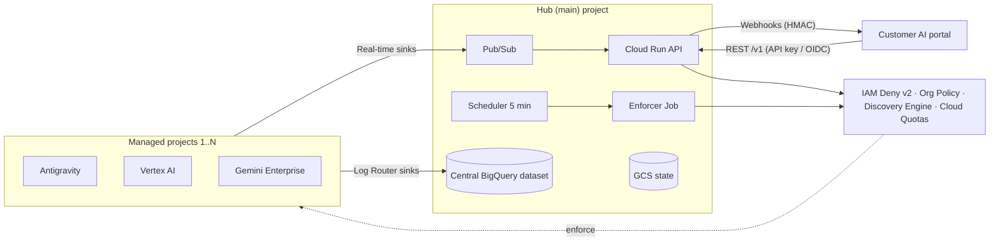

<p align="center">
  
</p>

<p align="center">
  <a href="openapi.yaml"></a>
  
  
  
  
  
</p>

<p align="center"><a href="README.md">한국어</a> · <b>English</b></p>

# GCP AI Usage & Spend Caps API

A **headless, machine-to-machine admin API** that lets an enterprise AI portal (already integrated with OpenAI and Anthropic Claude) govern Google Cloud **Antigravity, Gemini Enterprise and Vertex AI (Agent Platform)** the same way.
Install it **once in a hub (main) project** and it governs **every managed project**: per-user usage and cost, spend caps, block/unblock, model access, rate limits and quota increase requests — through REST endpoints modeled on the OpenAI / Anthropic Admin APIs.

> [!IMPORTANT]
> Before anything is created, an **exhaustive environment preflight** inspects the customer environment — enabled APIs, organization policies, **VPC Service Controls** (including hub↔spoke perimeter mismatches), networking (VPC egress, Private Google Access, Cloud NAT), **existing BigQuery datasets and log sinks to adopt**, Data Access audit logs, **whether Gemini Enterprise apps exist**, Antigravity configuration, IAM permissions, IAM Deny capacity and the Cloud Quotas API. Blocking findings stop the install with exact fix commands. → [Preflight checklist](docs/preflight-checklist.md)

## Highlights

| Area | Capabilities |
|---|---|
| 📊 Usage & cost | Per user / model / project: requests, input/output/cached tokens, estimated cost; monthly chargeback |
| 💰 Spend caps | Global + per-user caps (cost, tokens, requests), 80/100% alerts, auto/manual enforcement, period resets, project hard caps |
| 🚫 Block / unblock | Immediate per-service blocking (`antigravity`, `vertex_ai`, `gemini_enterprise`) with optional expiry |
| 🧠 Model governance | Model catalog; allow/deny per project/folder/org (Org Policy `vertexai.allowedModels`); Gemini Enterprise app model switches; **per-user model rules — block first, always notify** |
| ⏱️ Rate limits & quotas | RPM/TPM limits per model & region with usage and headroom, caps (decreases), **quota increase requests submitted directly to Google Cloud** with status tracking |
| 🩺 Preflight | Exhaustive readiness checks, automatic adaptation, remediation script; also `GET /v1/admin/readiness` |
| 🔔 Webhooks | 13 signed (HMAC-SHA256) events |
| 🧾 Audit | Every call, block and policy change is audited |

## Architecture



Details: [architecture](docs/architecture.md) · [multi-project deployment](docs/multi-project-deployment.md) · [block engine](docs/enforcement-logic.md) · [model governance](docs/model-governance.md)

## Compared with OpenAI / Anthropic Admin APIs

| Capability | OpenAI | Anthropic | This API (Google Cloud) |
|---|---|---|---|
| Usage | Usage API | Usage & Cost API | **Per user**, plus model / project / surface |
| Models | `/v1/models` | `/v1/models` | `/v1/models` + surfaces, pricing, lifecycle, **per-project access decision** |
| Model allow/deny | Project model permissions | Workspace (Console) | Org Policy per project/folder/org + GE apps + **per-user rules** |
| Rate limits | Project rate limits | Rate Limits API | Cloud Quotas + Monitoring headroom, per-user RPM/TPM |
| Quota increase | Usage tiers | Sales | **`POST /v1/quota-requests`**, tracked to approval |
| Spend limits | Project budgets | Spend limits | Per-user/global caps + project hard caps |
| Revocation latency | Immediate | Immediate | IAM Deny v2 propagates in **~1–2 min** |

## Install

```bash
# Readiness only (creates nothing)
bash <(curl -fsSL https://github.com/ldu1225/gcp-ai-usage-caps-api/raw/main/scripts/install.sh) \
  --preflight-only --project HUB_PROJECT --managed-projects TEAM_A,TEAM_B

# Hub governing several projects
bash <(curl -fsSL https://github.com/ldu1225/gcp-ai-usage-caps-api/raw/main/scripts/install.sh) \
  --project HUB_PROJECT --managed-projects TEAM_A,TEAM_B \
  --org-id 123456789012 --grant-org-roles --enable-data-access-logs \
  --quota-contact-email cloud-admin@company.com

# Every project under a folder / reuse existing logging
... --scope-type folder --scope-ids 987654321 --aggregated-sink
... --reuse-dataset LOGGING_PROJECT:existing_ai_logs --reuse-sinks
```

Order: **preflight → prepare (APIs, dataset, sinks, audit logs) → deploy (service accounts, Cloud Run service & job, Pub/Sub, Scheduler, secret)**. Terraform is available in [`terraform/`](terraform/).

> [!WARNING]
> `roles/orgpolicy.policyAdmin` (model policy writes) and `roles/iam.denyAdmin` / `roles/iam.denyReviewer` (blocking) can only be granted at the **organization** level.

## Quick start

```bash
curl -s "$BASE/v1/usage/users?start=2026-11-01&end=2026-11-30" -H "Authorization: Bearer $KEY"
curl -s -X PUT $BASE/v1/caps/policy -H "Authorization: Bearer $KEY" -H "Content-Type: application/json" \
  -d '{"cost_cap":100,"period":"monthly","enforcement_mode":"auto"}'
curl -s -X POST "$BASE/v1/users/alice%40company.com/block" -H "Authorization: Bearer $KEY" \
  -H "Content-Type: application/json" -d '{"services":["antigravity"]}'
curl -s -X POST $BASE/v1/model-access/bulk-apply -H "Authorization: Bearer $KEY" -H "Content-Type: application/json" \
  -d '{"scopes":["projects/*"],"mode":"deny_list","models":["anthropic/claude-opus-*"],"dryRun":true}'
curl -s -X PUT $BASE/v1/model-rules/default -H "Authorization: Bearer $KEY" -H "Content-Type: application/json" \
  -d '{"mode":"allow_list","models":["gemini-*"]}'
curl -s -X POST $BASE/v1/quota-requests -H "Authorization: Bearer $KEY" -H "Content-Type: application/json" \
  -d '{"project_id":"team-a-prod","quota_id":"GenerateContentRequestsPerMinutePerProjectPerBaseModel","model":"gemini-2.5-pro","location":"us-central1","requested_value":5000,"justification":"Company-wide coding assistant","contact_email":"cloud-admin@company.com"}'
```

Python: [`examples/python/caps_client.py`](examples/python/caps_client.py) (stdlib only). Full spec: [`openapi.yaml`](openapi.yaml) (also served at `GET /v1/openapi.yaml`). The complete endpoint table is in the [Korean README §8](README.md#8-api-엔드포인트-전체-목록).

## Known platform constraints

| Topic | Constraint | Mitigation |
|---|---|---|
| Blocking latency | IAM Deny v2 propagates in 1–2 min | operations + webhooks |
| Per-user model control | No native GCP mechanism | detect → block the surface (real-time + 5 min) |
| Org Policy | No wildcards, 500 values, minutes to propagate | pattern expansion + hourly reconcile |
| Antigravity models | Console-only writes | `409 console_required` + per-user rules |
| Quota increases | Google review (hours–days) | status tracking + webhooks |
| Vertex AI tokens | Data Access logs carry no tokens | request-based + billing-based cost |

## Development

```bash
pip install -r requirements-dev.txt   # optional: full OpenAPI schema validation
./scripts/test.sh                     # offline unit/integration tests, bash -n, OpenAPI 3.1 validation
```

Documentation: [architecture](docs/architecture.md) · [multi-project](docs/multi-project-deployment.md) · [preflight](docs/preflight-checklist.md) · [block engine](docs/enforcement-logic.md) · [model governance](docs/model-governance.md) · [webhooks](docs/webhooks.md) · [runbook](docs/operations-runbook.md) · [security](docs/security.md)
