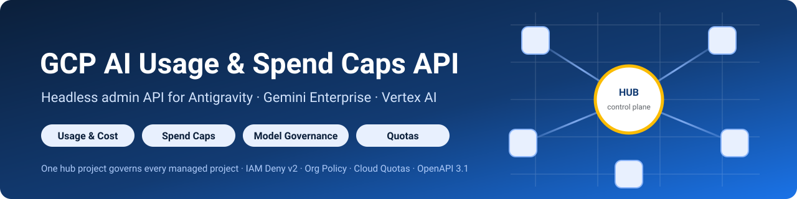
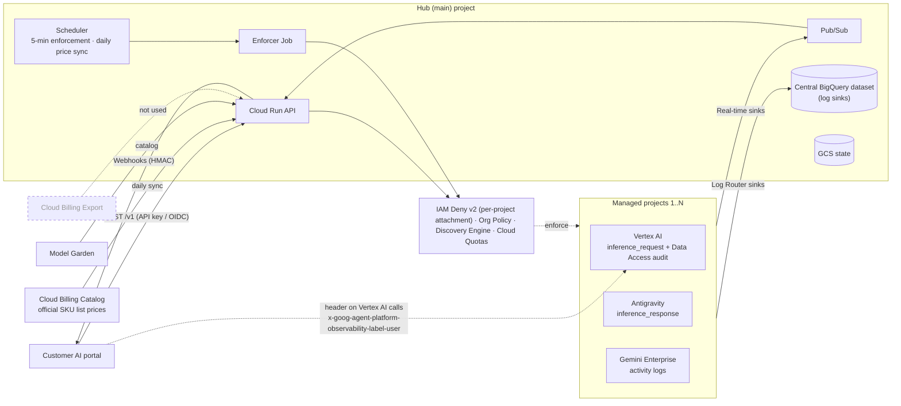

<p align="center">
  
</p>

<p align="center">
  <a href="openapi.yaml"></a>
  
  
  
  
  
  
</p>

<p align="center"><a href="README.md">한국어</a> · <b>English</b></p>

# GCP AI Usage & Spend Caps API

A **headless, machine-to-machine admin API** that lets an enterprise AI portal (already integrated with OpenAI and Anthropic Claude) govern Google Cloud **Antigravity, Gemini Enterprise and Vertex AI (Agent Platform)** the same way.
Install it **once in a hub (main) project** and it governs **every managed project**: per-user usage and cost, spend caps, block/unblock, model access, rate limits and quota increase requests — through REST endpoints modeled on the OpenAI / Anthropic Admin APIs.

> [!IMPORTANT]
> **Cost = token counts from Cloud Logging logs × official Cloud Billing Catalog SKU prices. The Cloud Billing export to BigQuery is NOT used and NOT required.** Amounts are list-price estimates (credits, committed-use discounts and taxes excluded). → [Cost methodology (Korean)](docs/cost-methodology.md)

> [!IMPORTANT]
> **There is no built-in model list.** The catalog is live Model Garden ∪ models actually observed in logs; a brand-new model is tracked the day it is first used (`model.first_seen` webhook). `<model-id>` / `<family>-*` in this document are placeholders — always use IDs returned by `GET /v1/models`.

> [!NOTE]
> Before anything is created, an **exhaustive environment preflight** inspects the customer environment — enabled APIs, organization policies, **VPC Service Controls** (including hub↔spoke perimeter mismatches), networking, **existing BigQuery datasets and log sinks to adopt**, Data Access audit logs, **whether Vertex AI inference request logging is enabled**, Gemini Enterprise apps, Antigravity configuration, IAM permissions, IAM Deny capacity and the Cloud Quotas API. → [Preflight checklist](docs/preflight-checklist.md)

## Highlights

| Area | Capabilities |
|---|---|
| 📊 Usage & cost | Per user / project / model / traffic tier: requests, input/output/cached/cache-write/thinking tokens, estimated cost; monthly chargeback; unattributed usage reported separately |
| 💲 Official prices | Daily Cloud Billing Catalog SKU sync (input, output, cache read/write, long context, Flex/Priority/Batch), contract overrides, `GET /v1/pricing` |
| 💰 Spend caps | Global + per-user caps (cost, tokens, requests), **total or per-project**, 80/100% alerts, auto/manual enforcement, period resets, project hard caps |
| 🚫 Block / unblock | Immediate per-service **and per-project** blocking (`antigravity`, `gemini_platform`, `gemini_enterprise`) with optional expiry |
| 🧠 Model governance | Dynamic catalog; allow/deny per project/folder/org (Org Policy `vertexai.allowedModels`); Gemini Enterprise app model switches; **per-user model rules — block first, always notify** |
| 🔎 Model tracking | First-seen models auto-registered from logs; Model Garden additions/delistings detected |
| ⏱️ Rate limits & quotas | RPM/TPM per model & region with usage and headroom, decreases, **quota increase requests submitted directly to Google Cloud** |
| 🩺 Preflight | Exhaustive readiness checks, automatic adaptation, remediation script; also `GET /v1/admin/readiness` |
| 🔔 Webhooks | 15 signed (HMAC-SHA256) events |
| 🧾 Audit | Every call, block and policy change is audited |

## Architecture



Details: [architecture](docs/architecture.md) · [multi-project deployment](docs/multi-project-deployment.md) · [block engine](docs/enforcement-logic.md) · [model governance](docs/model-governance.md)

## Cost methodology

| SKU dimension | Tokens priced | Notes |
|---|---|---|
| Input | input − cache read − cache write | includes tool-use prompt tokens |
| Output | output **+ thinking tokens** | thinking is billed at the output rate |
| Cached (context-cache read) | cache hits | falls back to input price if no SKU |
| Cache write (Claude prompt cache) | cache creation tokens | falls back to input price |
| Long context | all tokens of requests whose prompt exceeds the threshold (default 200,000) | `LONG_CONTEXT_THRESHOLD_TOKENS` |
| Flex / Priority / Batch | requests whose log `trafficType` is that tier | standard price if the tier has no SKU |
| Provisioned Throughput | PT-served requests | `on_demand` (priced at on-demand SKU, default) or `zero` (prepaid) — `PROVISIONED_THROUGHPUT_COST` |

$$
\text{cost} = \frac{(I - C - W)\,P_{in} + C\,P_{cached} + W\,P_{cw} + O\,P_{out}}{10^6}\quad\text{(per traffic tier, summed)}
$$

* **Nature of the number**: list-price (or contract-override) **estimate**; credits, CUDs, negotiated discounts (unless entered as overrides) and taxes are excluded. Gemini Enterprise is per-seat licensed → requests only (`cost_basis=license`).
* **Evidence**: `GET /v1/pricing` returns per-model prices, tiers and the **Cloud Billing Catalog SKU names**; every usage response carries `pricing_source` (`method=log_token_counts_x_official_sku_prices`, `billing_export=not_used`, last sync time).
* **Sync**: Cloud Scheduler calls `POST /v1/internal/pricing/sync` daily (default 03:00). Non-USD cap currencies use the Catalog FX rate, disclosed in `fx`.

## Vertex AI per-user attribution

Vertex AI token counts exist only in the **inference request metadata log** (`aiplatform.googleapis.com/inference_request`), which must be **enabled per project** (off by default, no org-level switch). Its principal is usually the portal's service account, so the human caller is attributed in this order:

| # | Method | Accuracy | `telemetry.attribution` key |
|---|---|---|---|
| 1 | Custom header label sent by the portal: `x-goog-agent-platform-observability-label-user: <email or uid>` | exact | `header_label` |
| 2 | Data Access audit correlation: same project + model, same minute (±1), tokens split by each caller's request share | approximate | `audit_correlated` |
| 3 | Otherwise kept as project-level **`unattributed`** usage (never dropped) | project totals exact | `unattributed` |
| – | Inference logs disabled → per-user **request counts only** from audit logs (`token_sources.gemini_platform = requests_only`) | no tokens/cost | – |

```bash
# Enable the inference request log (admin key)
curl -s -X POST "$BASE/v1/projects/team-a-prod/vertex-logging/enable" -H "Authorization: Bearer $ADMIN" \
  -H "Content-Type: application/json" -d '{"dryRun":false}'
curl -s -X POST "$BASE/v1/vertex-logging/enable" -H "Authorization: Bearer $ADMIN" \
  -H "Content-Type: application/json" -d '{"projects":["*"],"dryRun":false}'      # bulk (dryRun defaults to true)
curl -s "$BASE/v1/projects/team-a-prod/vertex-logging" -H "Authorization: Bearer $ADMIN"

# Portal: add the header to every Vertex AI call
curl -s -X POST \
  "https://aiplatform.googleapis.com/v1/projects/team-a-prod/locations/global/publishers/google/models/<model-id>:generateContent" \
  -H "Authorization: Bearer $(gcloud auth print-access-token)" -H "Content-Type: application/json" \
  -H "x-goog-agent-platform-observability-label-user: alice@company.com" \
  -d '{"contents":[{"role":"user","parts":[{"text":"Hello"}]}]}'
```

```python
import google.auth, google.auth.transport.requests, requests

PROJECT, LOCATION, MODEL_ID = "team-a-prod", "global", "<model-id>"   # pick MODEL_ID from GET /v1/models
creds, _ = google.auth.default(scopes=["https://www.googleapis.com/auth/cloud-platform"])
creds.refresh(google.auth.transport.requests.Request())

def generate(user_email: str, prompt: str) -> dict:
    url = (f"https://aiplatform.googleapis.com/v1/projects/{PROJECT}/locations/{LOCATION}"
           f"/publishers/google/models/{MODEL_ID}:generateContent")
    headers = {"Authorization": f"Bearer {creds.token}",
               "x-goog-agent-platform-observability-label-user": user_email}   # exact per-user attribution
    return requests.post(url, headers=headers, json={"contents": [{"role": "user", "parts": [{"text": prompt}]}]},
                         timeout=60).json()
# google-genai SDK: genai.Client(vertexai=True, ..., http_options=types.HttpOptions(headers={...}))
# Claude (rawPredict / streamRawPredict on publishers/anthropic) takes the same header.
```

The header suffix (`user`) is configurable with `VERTEX_USER_HEADER_LABEL`. The value may be the email or the API `uid` (16-char pseudonymous ID; resolvable for people the API already knows). `prepare.sh` and Terraform enable the inference request log by default (`--no-vertex-inference-logging` to skip). The runtime SA gets the one-permission custom role `gcpAiCapsVertexLoggingReader` (`aiplatform.endpoints.fetchPublisherModelConfig`) for status reads; enabling through the API additionally needs `aiplatform.endpoints.setPublisherModelConfig`. Cloud Logging ingestion charges apply.

## Multi-project users

Usage is always measured per **(user, project)**; a user may be assigned to several managed projects (N:M).

* `cap_scope`: `total` (default, one cap across all projects) | `per_project` (same cap applied in each project) — on the policy or per-user rule (`scope`).
* `project_caps` (per-user rule) and `project_defaults` (policy): `{project_id: {cost_cap, token_cap, request_cap}}`, evaluated in addition to the total cap. `metered_surfaces` selects which surfaces count.
* Over-cap in one project suspends **only that project** (`plan.suspend_projects`); IAM Deny v2 entries are managed per attachment point (`projects/{id}`). Model-rule violations also block only in the violating project by default (`MODEL_VIOLATION_BLOCK_SCOPE=project|all`; default action is still block + always notify).
* User cap rows expose `projects[]` (per-project `status`, `limit`, `usage`, `remaining`), `status_scope` (`all`|`projects`), `blocked_projects`, `over_scope`, `multi_project`. Per-project threshold webhooks carry `"scope":"project","project":...`.

```bash
curl -s -X PUT $BASE/v1/caps/policy -H "Authorization: Bearer $KEY" -H "Content-Type: application/json" \
  -d '{"cost_cap":100,"period":"monthly","enforcement_mode":"auto","cap_scope":"per_project","project_defaults":{"team-b-prod":{"cost_cap":30}}}'
curl -s -X PUT "$BASE/v1/caps/users/alice%40company.com" -H "Authorization: Bearer $KEY" -H "Content-Type: application/json" \
  -d '{"type":"limit","cost_cap":200,"scope":"total","project_caps":{"team-a-prod":{"cost_cap":150},"team-b-prod":{"cost_cap":50}}}'
curl -s -X POST "$BASE/v1/users/alice%40company.com/block" -H "Authorization: Bearer $KEY" -H "Content-Type: application/json" \
  -d '{"services":["gemini_platform"],"projects":["team-b-prod"],"reason":"project budget exhausted"}'
curl -s -X POST "$BASE/v1/users/alice%40company.com/unblock" -H "Authorization: Bearer $KEY" -H "Content-Type: application/json" \
  -d '{"projects":["team-b-prod"]}'
curl -s "$BASE/v1/users/alice%40company.com/projects?include=iam" -H "Authorization: Bearer $KEY"
```

## Dynamic model catalog & tracking

`GET /v1/models` = **live Model Garden** (configured publishers + every publisher observed in logs; delisted models kept with `lifecycle.delisted_at`) ∪ **models observed in logs on any surface** (with `first_seen`/`last_seen`, surfaces, projects, user count).

* Webhooks: `model.first_seen` (model used for the first time), `model.catalog_changed` (Model Garden `added` / `delisted`).
* Filters: `GET /v1/models?source=observed|model_garden`, `?used=true`. `Model.source` is `model_garden` | `observed`.
* `GET /v1/usage/models`: per-model usage and cost, `catalog_status` (`model_garden` | `observed_only`), `group_by=user|project|surface|traffic`, per-model `unattributed_requests/tokens`.
* The SKU parser learns model names/families from the catalog and logs, so new models are priced as soon as Google publishes their SKUs.
* Publishers are never guessed from model-name patterns — they come from Model Garden or the log resource. `models.publishers` / `MODEL_PUBLISHERS` is a vendor list, not a model list.

## Compared with OpenAI / Anthropic Admin APIs

| Capability | OpenAI | Anthropic | This API (Google Cloud) |
|---|---|---|---|
| Usage | Usage API | Usage & Cost API | **Per user**, plus project / model / surface / traffic tier |
| Cost | Costs API (billed) | Cost API (billed) | **Log token counts × official SKU list prices** (no Billing Export; list-price estimate) |
| Price evidence | Pricing page | Pricing page | `GET /v1/pricing` with SKU names, synced daily |
| Models | `/v1/models` | `/v1/models` | live Model Garden ∪ **observed models** + lifecycle, pricing, **per-project access decision** |
| New-model detection | – | – | `model.first_seen`, `model.catalog_changed` |
| Model allow/deny | Project model permissions | Workspace (Console) | Org Policy per project/folder/org + GE apps + **per-user rules** |
| Rate limits | Project rate limits | Rate Limits API | Cloud Quotas + Monitoring headroom, per-user RPM/TPM |
| Quota increase | Usage tiers | Sales | **`POST /v1/quota-requests`**, tracked to approval |
| Spend limits | Project budgets | Spend limits | Per-user/global caps (**total or per project**) + project hard caps |
| Revocation | Immediate | Immediate | IAM Deny v2, **per project possible**, propagates in **~1–2 min** |

## Endpoints (new in 1.2.0)

| Endpoint | Scope |
|---|---|
| `GET /v1/pricing` | `usage:read` or `models:read` |
| `GET /v1/users/{email}/projects` (`include=iam`) | `usage:read` |
| `GET /v1/projects/{project_id}/vertex-logging` | `usage:read` or `admin` |
| `POST /v1/projects/{project_id}/vertex-logging/enable` | `admin` |
| `POST /v1/vertex-logging/enable` | `admin` |
| `POST /v1/users/{email}/block` · `/unblock` now accept `projects: [...]` | `users:write` |
| `GET /v1/models` now accepts `source=observed\|model_garden`, `used=true` | `models:read` |

The complete endpoint table is in the [Korean README §12](README.md#12-api-엔드포인트-전체-목록); the full spec is [`openapi.yaml`](openapi.yaml) (version 1.2.0, also served at `GET /v1/openapi.yaml`).

## Install

```bash
# Readiness only (creates nothing)
bash <(curl -fsSL https://github.com/ldu1225/gcp-ai-usage-caps-api/raw/main/scripts/install.sh) \
  --preflight-only --project HUB_PROJECT --managed-projects TEAM_A,TEAM_B

# Hub governing several projects
bash <(curl -fsSL https://github.com/ldu1225/gcp-ai-usage-caps-api/raw/main/scripts/install.sh) \
  --project HUB_PROJECT --managed-projects TEAM_A,TEAM_B \
  --org-id 123456789012 --grant-org-roles --enable-data-access-logs \
  --quota-contact-email cloud-admin@company.com

# Every project under a folder / reuse existing logging
... --scope-type folder --scope-ids 987654321 --aggregated-sink
... --reuse-dataset LOGGING_PROJECT:existing_ai_logs --reuse-sinks
```

Order: **preflight → prepare (APIs, dataset, sinks, audit logs, Vertex AI inference request logging) → deploy (service accounts, Cloud Run service & job, Pub/Sub, Scheduler (5-min enforcement + daily price sync), secret)**. There is no Billing Export setting. Terraform: [`terraform/`](terraform/) (`pricing_sync_schedule`, default `0 3 * * *`; `enable_vertex_inference_logging`, default `true`).

New environment variables: `CAP_SCOPE`, `VERTEX_USER_HEADER_LABEL`, `METERED_SURFACES`, `MODEL_VIOLATION_BLOCK_SCOPE`, `MODEL_PUBLISHERS`, `LONG_CONTEXT_THRESHOLD_TOKENS`, `PROVISIONED_THROUGHPUT_COST`. **Removed**: `BILLING_PROJECT_ID`, `BILLING_DATASET_ID`, `BILLING_TABLE_ID`.

> [!WARNING]
> `roles/orgpolicy.policyAdmin` (model policy writes) and `roles/iam.denyAdmin` / `roles/iam.denyReviewer` (blocking) can only be granted at the **organization** level.

## Quick start

```bash
curl -s "$BASE/v1/usage/users?start=2026-11-01&end=2026-11-30" -H "Authorization: Bearer $KEY"
curl -s "$BASE/v1/pricing" -H "Authorization: Bearer $KEY"
curl -s "$BASE/v1/models?used=true" -H "Authorization: Bearer $KEY"
curl -s -X PUT $BASE/v1/caps/policy -H "Authorization: Bearer $KEY" -H "Content-Type: application/json" \
  -d '{"cost_cap":100,"period":"monthly","enforcement_mode":"auto"}'
curl -s -X POST "$BASE/v1/users/alice%40company.com/block" -H "Authorization: Bearer $KEY" \
  -H "Content-Type: application/json" -d '{"services":["antigravity"]}'
curl -s -X POST $BASE/v1/model-access/bulk-apply -H "Authorization: Bearer $KEY" -H "Content-Type: application/json" \
  -d '{"scopes":["projects/*"],"mode":"deny_list","models":["anthropic/<family>-*"],"dryRun":true}'
curl -s -X PUT $BASE/v1/model-rules/default -H "Authorization: Bearer $KEY" -H "Content-Type: application/json" \
  -d '{"mode":"allow_list","models":["google/*"]}'
curl -s -X POST $BASE/v1/quota-requests -H "Authorization: Bearer $KEY" -H "Content-Type: application/json" \
  -d '{"project_id":"team-a-prod","quota_id":"GenerateContentRequestsPerMinutePerProjectPerBaseModel","model":"<model-id>","location":"us-central1","requested_value":5000,"justification":"Company-wide coding assistant","contact_email":"cloud-admin@company.com"}'
```

Python: [`examples/python/caps_client.py`](examples/python/caps_client.py) (stdlib only; includes `pricing()`, `user_projects()`, `enable_vertex_logging()` and project-scoped `block_user(..., projects=[...])`).

## Limitations (honest list)

| Topic | Constraint | Mitigation |
|---|---|---|
| Cost is an estimate | list (or override) price × tokens; credits, CUDs, negotiated discounts, taxes, grounding/media fees excluded | contract overrides; reconcile with the invoice monthly |
| Vertex AI attribution | inference logs carry a service-account principal — needs the **portal header** or **Data Access audit logs** | header (exact) → audit correlation (proportional) → project `unattributed` |
| Vertex AI inference log coverage | only Gemini `generateContent`/`streamGenerateContent` and Claude `rawPredict`/`streamRawPredict`; must be enabled per project | otherwise audit request counts only (`requests_only`) |
| Cloud Logging cost | ingestion/retention of inference and audit logs is billed to the customer projects | `_Default` exclusion + hub sinks |
| Blocking latency | IAM Deny v2 propagates in **1–2 min**; in-flight requests complete | operations + webhooks |
| Per-user model control | no native GCP mechanism | detect → block the surface in that project (real-time + 5 min) |
| Antigravity model allow-list | **Console-only** writes | `409 console_required` + per-user rules |
| Org Policy | no wildcards, 500 values, minutes to propagate | expansion against the live catalog + hourly reconcile |
| Quota increases | Google review (hours–days) | status tracking + webhooks |
| Gemini Enterprise | per-seat license | requests only (`cost_basis=license`) |

## Development

```bash
pip install -r requirements-dev.txt   # optional: full OpenAPI schema validation
./scripts/test.sh                     # offline unit/integration tests, bash -n, OpenAPI 3.1 validation
```

Documentation: [cost methodology](docs/cost-methodology.md) · [architecture](docs/architecture.md) · [multi-project](docs/multi-project-deployment.md) · [preflight](docs/preflight-checklist.md) · [block engine](docs/enforcement-logic.md) · [model governance](docs/model-governance.md) · [webhooks](docs/webhooks.md) · [runbook](docs/operations-runbook.md) · [security](docs/security.md) · [changelog](CHANGELOG.md)
