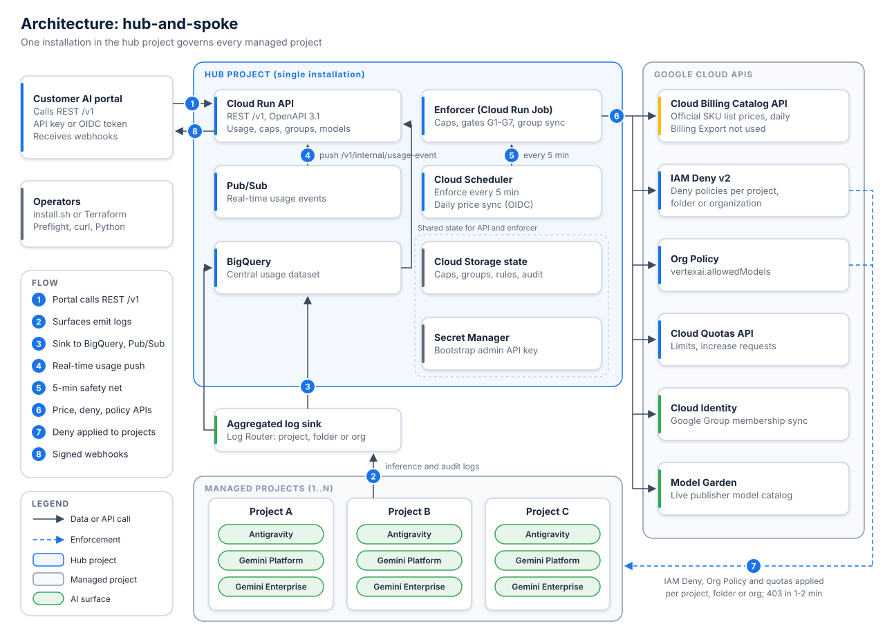
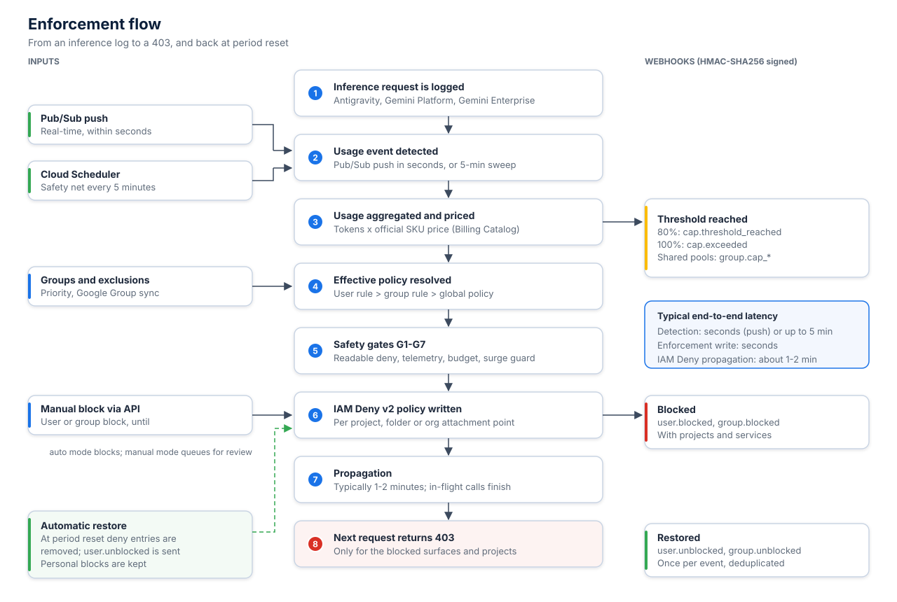
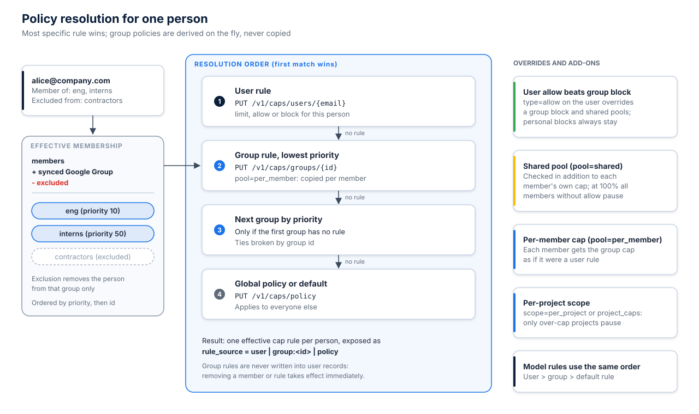

<p align="center">
  
</p>

<p align="center">
  <a href="openapi.yaml"></a>
  
  
  
  
  
  
</p>

<p align="center"><b>한국어</b> | <a href="README.en.md">English</a></p>

# GCP AI Usage & Spend Caps API

**GCP AI Usage & Spend Caps API**는 Google Cloud의 **Antigravity**, **Gemini Platform**, **Gemini Enterprise** 사용을 **사용자 · 그룹 · 프로젝트 단위로 측정하고, 지출 한도를 걸고, 실제로 차단까지 집행하는** UI 없는(Headless) M2M 관리 API입니다. **허브(메인) 프로젝트 한 곳**에 설치하면 여러 관리 대상 프로젝트 전체를 관할하며, 이미 운영 중인 사내 AI 통합 포털은 REST 호출과 Webhook 수신만으로 Google Cloud AI를 다른 AI 서비스와 같은 방식으로 통제할 수 있습니다. 비용은 로그의 토큰 수에 공식 SKU 단가를 곱해 계산하므로 결제 데이터 접근이 필요 없고, 차단은 IAM Deny v2로 집행되어 우회할 수 없습니다.

> [!IMPORTANT]
> **비용 = 로그의 토큰 수 x 공식 Cloud Billing Catalog SKU 단가.** Cloud Billing Export(BigQuery 결제 내보내기)는 사용하지 않으며 필요하지도 않습니다. 금액은 목록가(또는 계약 단가) 기준 추정치이며 크레딧·약정 할인·세금은 제외됩니다. 자세한 내용은 [비용 산정 방식](docs/cost-methodology.md)을 참고하세요.

> [!NOTE]
> **내장 모델 목록이 없습니다.** 모델 카탈로그는 실시간 Model Garden 조회와 로그에서 실제로 관측된 모델의 합집합입니다. 이 문서의 `<model-id>`, `<publisher>/*` 같은 표기는 자리표시자이며, 실제 ID는 항상 `GET /v1/models` 응답 값을 사용하세요.

---

## 목차

1. [핵심 기능](#1-핵심-기능)
2. [아키텍처](#2-아키텍처)
3. [차단은 실제로 어떻게 동작하나](#3-차단은-실제로-어떻게-동작하나)
4. [그룹 (Groups)](#4-그룹-groups)
5. [멀티 프로젝트 사용자](#5-멀티-프로젝트-사용자)
6. [비용 산정 방식](#6-비용-산정-방식)
7. [Gemini Platform 사용자별 귀속](#7-gemini-platform-사용자별-귀속)
8. [모델 거버넌스](#8-모델-거버넌스)
9. [Rate Limit · 쿼터](#9-rate-limit--쿼터)
10. [Webhook](#10-webhook)
11. [환경 사전점검 (Preflight)](#11-환경-사전점검-preflight)
12. [설치 (원클릭 · Terraform)](#12-설치-원클릭--terraform)
13. [API 빠른 시작 (curl · Python)](#13-api-빠른-시작-curl--python)
14. [API 엔드포인트 전체 목록](#14-api-엔드포인트-전체-목록)
15. [인증 · Scope](#15-인증--scope)
16. [기존 AI 벤더 Admin API와의 차이](#16-기존-ai-벤더-admin-api와의-차이)
17. [제약 사항](#17-제약-사항)
18. [개발 · 테스트](#18-개발--테스트)
19. [문서](#19-문서)

---

## 1. 핵심 기능

| 영역 | 제공 기능 | 고객 포털에서 얻는 것 |
|---|---|---|
| **사용량 · 비용** | 사용자 / 그룹 / 프로젝트 / 모델 / 트래픽 티어별 요청 수, 입력·출력·캐시·사고 토큰, 추정 비용, 월별 차지백, 귀속 불가분(`unattributed`) 별도 표시 | 사용자 단위 사용 리포트와 부서별 비용 배분 |
| **지출 캡** | 사용자 캡, **그룹 캡(공유 풀 / 멤버별)**, 전역 정책, 프로젝트 하드캡. 금액·토큰·요청 수, 합산 또는 프로젝트별, 기간 자동 리셋 | 예산 초과 시 자동 정지(초과한 프로젝트에서만) |
| **차단 / 해제** | IAM Deny v2 기반 사용자·그룹 차단, 서비스(`antigravity`, `gemini_platform`, `gemini_enterprise`) x 프로젝트 단위, 만료 시각 | 보안 사고 시 즉시 차단, 우회 불가 |
| **모델 거버넌스** | 동적 모델 카탈로그(Model Garden + 로그 관측), 프로젝트·폴더·조직 허용/차단(Org Policy `vertexai.allowedModels`), Gemini Enterprise 앱 모델 설정 | "이 팀은 Google 모델만" 같은 정책 |
| **사용자 · 그룹 모델 규칙** | 허용/차단 목록, 모델별 RPM·TPM·토큰·비용 한도. **차단 우선, 항상 알림** | 위반 즉시 해당 프로젝트에서 차단 + Webhook |
| **Rate Limit · 쿼터** | 모델·리전별 RPM/TPM 한도·사용량·헤드룸, 하향 조정, **쿼터 상향 요청을 API로 직접 제출**하고 상태 추적 | 쿼터 부족을 포털에서 바로 처리 |
| **환경 사전점검** | VPC-SC, Org Policy, API 활성화, 기존 BigQuery·로그 싱크 재사용, Gemini Enterprise 앱 유무, IAM, Deny 용량 등 전수 검사 | 어떤 고객 환경에도 안전하게 설치 |
| **멀티 프로젝트 허브** | 허브 한 곳이 프로젝트 목록 / 폴더 / 조직 단위로 관할, 사용자-프로젝트 N:M | 중앙 운영, 프로젝트별 한도 |
| **그룹** | 사용자와 동일한 기능을 가진 정책 주체, Google Group 동기화, 예외(제외) 목록, 우선순위 | 조직도 단위 정책 |
| **Webhook** | 20종 이벤트, HMAC-SHA256 서명 | 포털 알림·워크플로 연동 |
| **감사** | 모든 API 호출·차단·정책 변경 감사 로그 | 컴플라이언스 증적 |

**설계 원칙**

* **허브-앤-스포크**: 메인 프로젝트 한 곳이 모든 관리 프로젝트를 관할합니다.
* **로그 기반, 결제 내보내기 불필요**: 사용량은 Cloud Logging, 단가는 공개 Cloud Billing Catalog API에서 가져옵니다.
* **하드코딩 없음**: 모델 목록·모델 계열·가격을 코드에 넣지 않고 Model Garden, 로그, SKU 카탈로그에서 학습합니다.
* **기존 인프라 존중**: 이미 있는 BigQuery 데이터셋·로그 싱크는 재사용(adopt)하고, 없는 것만 생성합니다.
* **안전 우선**: dry-run, 영향 미리보기, 잠금 방지, etag 동시성 제어, 안전 게이트 G1-G7, 변경 예산.
* **경량**: 표준 라이브러리 중심 Python, UI 없음.

## 2. 아키텍처

<p align="center"></p>

| 구성 요소 | 위치 | 역할 |
|---|---|---|
| Cloud Run API | 허브 | REST `/v1`, 인증·Scope 검사, 사용량 조회, 정책 관리, 실시간 이벤트 수신(`/v1/internal/usage-event`) |
| Enforcer (Cloud Run Job) | 허브 | 캡 평가, 안전 게이트, IAM Deny 반영, 기간 리셋 복구, Google Group 동기화(매시) |
| Cloud Scheduler | 허브 | 5분 주기 집행 안전망, 매일 단가 동기화(OIDC) |
| Pub/Sub | 허브 | 집계 싱크에서 들어온 추론 로그를 수 초 안에 API로 push |
| BigQuery | 허브 | 관리 프로젝트 로그의 중앙 데이터셋(이력 조회) |
| Cloud Storage | 허브 | 상태 저장소(캡·그룹·규칙·감사·API 키 해시) |
| Secret Manager | 허브 | 부트스트랩 관리자 API 키 |
| 집계 로그 싱크 | 프로젝트 / 폴더 / 조직 | Antigravity, Gemini Platform(`aiplatform.googleapis.com/inference_request`, Data Access 감사 로그), Gemini Enterprise 로그를 허브로 라우팅 |
| Cloud Billing Catalog API | Google | 공식 SKU 목록가(매일). **Billing Export는 사용하지 않음** |
| IAM Deny v2 | 프로젝트 / 폴더 / 조직 | 부착점별 관리형 Deny 정책으로 차단 집행 |
| Org Policy | 프로젝트 / 폴더 / 조직 | `vertexai.allowedModels`로 모델 허용/차단 |
| Cloud Quotas API | 관리 프로젝트 | 한도 조회·하향·상향 요청 |
| Cloud Identity | Google Workspace / Cloud Identity | Google Group 멤버 동기화 |
| Webhook | 고객 포털 | HMAC-SHA256 서명된 이벤트 전달 |

세부 구성과 데이터 흐름은 [docs/architecture.md](docs/architecture.md), 멀티 프로젝트 설치는 [docs/multi-project-deployment.md](docs/multi-project-deployment.md)를 참고하세요.

## 3. 차단은 실제로 어떻게 동작하나

<p align="center"></p>

1. **로그 기반 감지**: 모든 추론 요청은 관리 프로젝트의 Cloud Logging에 기록되고, 집계 싱크가 허브의 Pub/Sub(수 초)과 BigQuery로 보냅니다. Pub/Sub이 끊겨도 Cloud Scheduler가 **5분마다** 전체를 다시 평가합니다(안전망).
2. **가격 계산**: 토큰 수 x 공식 Cloud Billing Catalog SKU 단가(입력·출력·캐시·장문·트래픽 티어별). **Cloud Billing Export는 사용하지 않습니다.**
3. **정책 해석**: 사람마다 유효 규칙을 결정합니다. 사용자 규칙 > 그룹 규칙(우선순위 순) > 전역 정책. 그룹 공유 풀은 개인 캡에 **추가로** 평가됩니다([4장](#4-그룹-groups)).
4. **안전 게이트 G1-G7**: 정책 판독 가능 여부, 판정 가능한 데이터, 텔레메트리 건전성, 변경 예산, Deny 용량, 급증 방지(Surge Guard). 하나라도 위험하면 자동 차단을 멈추거나 보류합니다.
5. **IAM Deny v2 반영**: 부착점(관리 프로젝트, 또는 폴더/조직)마다 하나의 관리형 Deny 정책에 사용자 주체를 추가합니다. 특정 프로젝트에서만 초과했으면 그 프로젝트에만 반영합니다.
6. **전파와 403**: IAM Deny는 보통 **1-2분** 안에 전파되며, 이후 요청은 해당 서비스·프로젝트에서 403을 받습니다. 이미 진행 중인 요청은 완료됩니다.
7. **알림**: 80% / 100% 도달 시 `cap.threshold_reached` / `cap.exceeded`(그룹 풀은 `group.cap_*`), 차단 시 `user.blocked` / `group.blocked` Webhook.
8. **자동 복구**: 다음 기간 리셋(일/주/월) 시 자동으로 Deny 항목을 제거하고 `user.unblocked`를 보냅니다. 수동 차단과 다른 사유의 정지는 유지됩니다.

`enforcement_mode`가 `auto`이면 즉시 정지, `manual`이면 검토 대기 목록(`plan`)과 알림만 생성합니다. 상세 규칙은 [docs/enforcement-logic.md](docs/enforcement-logic.md)를 참고하세요.

## 4. 그룹 (Groups)

그룹은 **사용자와 동일한 기능**(지출 캡, 차단, 모델 규칙, 예외, 사용량 집계)을 가진 일급 정책 주체입니다. 그룹의 **유효 멤버** = 명시적 `members` + (선택) Google Group에서 동기화된 멤버 - `excluded`(예외)입니다.

<p align="center"></p>

### 4.1 동작 원칙

| 항목 | 동작 |
|---|---|
| **해석 순서** | 사용자 규칙 > 그룹 규칙(`priority`가 가장 낮은 그룹부터, 같으면 그룹 id 순) > 전역 정책 / 기본 규칙 |
| **우선순위** | `priority` 0-100000, 기본 100, **낮을수록 우선**. 여러 그룹에 속한 사람은 규칙이 있는 첫 그룹을 따릅니다 |
| **예외(제외)** | `excluded`에 있는 사람은 그 그룹의 유효 멤버에서 빠지며 그룹 정책이 적용되지 않습니다 |
| **사용자 allow** | 사용자 수준 `type=allow` 규칙은 그룹 차단과 공유 풀 정지보다 우선합니다 |
| **멤버별 캡** (`pool=per_member`, 기본) | 각 멤버가 그룹 캡을 개인 규칙처럼 상속합니다(개인 규칙이 없는 경우) |
| **공유 풀** (`pool=shared`) | 유효 멤버 전체 사용량 합계에 하나의 캡. 각자의 개인 캡에 **추가로** 평가되며, 100% 도달 시 사용자 allow가 없는 모든 멤버가 정지됩니다(`scope=per_project` 또는 `project_caps`이면 초과한 프로젝트에서만) |
| **그룹 차단** | `POST /v1/groups/{group_id}/block` - 모든 또는 선택한 관리 프로젝트, 서비스, 만료 시각 지정. 이미 개인 차단이 있는 멤버는 개인 차단이 유지됩니다 |
| **그룹 모델 규칙** | 사용자 모델 규칙과 같은 형식. 해석 순서: 사용자 > 그룹 > 기본 규칙 |
| **멤버 제거 효과** | 그룹 정책은 개인 레코드에 복사되지 않고 매번 계산됩니다. 멤버 제거·예외 추가·그룹 규칙 삭제는 **즉시 반영**되고, 그룹 때문에만 생긴 정지는 바로 풀립니다. 개인 차단·개인 캡 정지는 유지됩니다 |
| **Google Group 동기화** | Cloud Identity API로 하위 그룹까지 포함한 멤버를 매시 자동 동기화(수동: `POST /v1/groups/{group_id}/sync`). 서비스 계정은 제외됩니다 |

> [!IMPORTANT]
> Google Group 동기화를 쓰려면 허브 프로젝트에서 **Cloud Identity API**(`cloudidentity.googleapis.com`)를 활성화하고, 런타임 서비스 계정에 Google 관리 콘솔(계정 > 관리자 역할)에서 **Groups Reader** 역할을 부여해야 합니다. 실패 시 그룹의 `sync_error`에 원인이 기록됩니다.

사용자 캡 응답(`GET /v1/caps/users/{email}`)에는 `rule_source`(`user` | `group:<id>` | `policy`), `groups`, `group_pools`, `block_source`(`manual` | `group:<id>` | `rule` | `auto_cap`)가 포함되어 누가 왜 차단되었는지 바로 알 수 있습니다.

### 4.2 그룹 API 예제

```bash
# 1) 그룹 생성 (명시적 멤버 + Google Group 동기화, 우선순위 10)
curl -s -X POST "$BASE/v1/groups" -H "Authorization: Bearer $KEY" -H "Content-Type: application/json" \
  -d '{"id":"eng","name":"Engineering","priority":10,
       "members":["alice@company.com","bob@company.com"],
       "google_group":"eng-all@company.com"}'

# 2) 멤버 추가 / 제거
curl -s -X POST "$BASE/v1/groups/eng/members" -H "Authorization: Bearer $KEY" -H "Content-Type: application/json" \
  -d '{"add":["carol@company.com"],"remove":["bob@company.com"]}'

# 3) 예외(제외) 추가 - 이 사람에게는 eng 그룹 정책이 적용되지 않음
curl -s -X POST "$BASE/v1/groups/eng/exclusions" -H "Authorization: Bearer $KEY" -H "Content-Type: application/json" \
  -d '{"add":["cto@company.com"]}'

# 4-a) 그룹 공유 풀 캡: eng 전체 합산 월 $5,000
curl -s -X PUT "$BASE/v1/caps/groups/eng" -H "Authorization: Bearer $KEY" -H "Content-Type: application/json" \
  -d '{"type":"limit","pool":"shared","cost_cap":5000,"scope":"total","note":"Q4 eng budget"}'

# 4-b) 멤버별 캡: interns 그룹 멤버 1인당 월 $50, 프로젝트별 적용
curl -s -X PUT "$BASE/v1/caps/groups/interns" -H "Authorization: Bearer $KEY" -H "Content-Type: application/json" \
  -d '{"type":"limit","pool":"per_member","cost_cap":50,"scope":"per_project"}'

# 5) 그룹 캡 현황 (풀 사용량, 남은 금액, 멤버 상태)
curl -s "$BASE/v1/caps/groups" -H "Authorization: Bearer $KEY"

# 6) 그룹 차단 (team-b-prod의 Gemini Platform만, 만료 시각 지정) / 해제
curl -s -X POST "$BASE/v1/groups/interns/block" -H "Authorization: Bearer $KEY" -H "Content-Type: application/json" \
  -d '{"services":["gemini_platform"],"projects":["team-b-prod"],"reason":"보안 점검","until":"2026-12-01T00:00:00Z"}'
curl -s -X POST "$BASE/v1/groups/interns/unblock" -H "Authorization: Bearer $KEY" -H "Content-Type: application/json" \
  -d '{"reason":"점검 완료"}'

# 7) 그룹 모델 규칙: interns는 Google 모델만 허용 (위반 시 차단 + 알림)
curl -s -X PUT "$BASE/v1/groups/interns/model-rules" -H "Authorization: Bearer $KEY" -H "Content-Type: application/json" \
  -d '{"mode":"allow_list","models":["google/*"]}'

# 8) 그룹별 사용량 (기간 지정)
curl -s "$BASE/v1/usage/groups?start=2026-11-01&end=2026-11-30" -H "Authorization: Bearer $KEY"

# 9) 한 사람이 속한 그룹과 유효 정책 출처
curl -s "$BASE/v1/users/alice%40company.com/groups" -H "Authorization: Bearer $KEY"

# 10) Google Group 즉시 동기화
curl -s -X POST "$BASE/v1/groups/eng/sync" -H "Authorization: Bearer $KEY"
```

`POST /v1/groups/{group_id}/unblock` 응답의 `members_still_blocked`에는 개인 차단 등 다른 사유로 여전히 차단된 멤버가 표시됩니다. 운영 절차는 [운영 런북](docs/operations-runbook.md), 집행 규칙은 [차단 엔진](docs/enforcement-logic.md)을 참고하세요.

## 5. 멀티 프로젝트 사용자

<p align="center"></p>

사용량은 항상 **(사용자, 프로젝트)** 단위로 집계되며, 한 사용자가 여러 관리 프로젝트에 배정될 수 있습니다(N:M).

| 설정 | 위치 | 의미 |
|---|---|---|
| `cap_scope: total` (기본) | 정책 / 사용자·그룹 규칙 `scope` | 모든 프로젝트 합산에 캡 1개 |
| `cap_scope: per_project` | 정책 / 사용자·그룹 규칙 `scope` | 같은 캡을 프로젝트마다 따로 적용 |
| `project_caps` | 사용자·그룹 규칙 | `{project_id: {cost_cap, token_cap, request_cap}}` - 합산 캡에 추가로 평가 |
| `project_defaults` | 정책 | 모든 사용자에게 적용되는 프로젝트별 기본 캡 |
| `metered_surfaces` | 정책 | 캡 계산에 포함할 서비스(기본 3개 모두) |

특정 프로젝트에서만 캡을 넘으면 **그 프로젝트에서만** 정지됩니다(`plan.suspend_projects`). 합산 캡 초과, 전역 차단, 합산 공유 풀 초과는 모든 관리 프로젝트에 적용됩니다.

```bash
# 정책: 모든 사용자에게 월 $100 캡을 프로젝트마다 적용, team-b-prod 기본 캡은 $30
curl -s -X PUT "$BASE/v1/caps/policy" -H "Authorization: Bearer $KEY" -H "Content-Type: application/json" \
  -d '{"cost_cap":100,"period":"monthly","enforcement_mode":"auto","cap_scope":"per_project",
       "project_defaults":{"team-b-prod":{"cost_cap":30}}}'

# 사용자 규칙: 합산 $200 + 프로젝트별 상한
curl -s -X PUT "$BASE/v1/caps/users/alice%40company.com" -H "Authorization: Bearer $KEY" -H "Content-Type: application/json" \
  -d '{"type":"limit","cost_cap":200,"scope":"total",
       "project_caps":{"team-a-prod":{"cost_cap":150},"team-b-prod":{"cost_cap":50}}}'

# 사용자가 일하는 모든 프로젝트 (사용량, 비용, 모델, 프로젝트별 캡 상태, 직접 IAM 바인딩)
curl -s "$BASE/v1/users/alice%40company.com/projects?start=2026-11-01&end=2026-11-30&include=iam" -H "Authorization: Bearer $KEY"
```

자세한 내용은 [docs/multi-project-deployment.md](docs/multi-project-deployment.md)를 참고하세요.

## 6. 비용 산정 방식

**비용 = 로그의 토큰 수 x 공식 Cloud Billing Catalog SKU 단가**(또는 계약 단가 override).

| SKU 차원 | 적용 토큰 | 비고 |
|---|---|---|
| 입력 | 입력 - 캐시 읽기 - 캐시 쓰기 | 도구 사용 프롬프트 포함 |
| 출력 | 출력 + 사고(thinking) 토큰 | 사고 토큰은 출력 단가 |
| 캐시 읽기 | 컨텍스트 캐시 적중 토큰 | SKU가 없으면 입력 단가(보수적) |
| 캐시 쓰기 | 파트너 모델 프롬프트 캐시 생성 토큰 | SKU가 없으면 입력 단가 |
| 장문 컨텍스트 | 프롬프트가 임계값(기본 200,000) 초과인 요청 | `LONG_CONTEXT_THRESHOLD_TOKENS` |
| Flex / Priority / Batch | 로그 `trafficType`이 해당 티어인 요청 | 티어 SKU가 없으면 표준 단가 |
| 오디오 · 이미지 · 영상 | Gemini Platform `usageMetadata`의 모달리티별 토큰 | `Audio Input`, `Image Output` 등 해당 SKU. Gemini-TTS는 Cloud Text-to-Speech SKU |
| Provisioned Throughput | PT로 처리된 요청 | `on_demand`(기본) 또는 `zero` |

* 모든 사용량 응답에 `pricing_source`(`method=log_token_counts_x_official_sku_prices`, `billing_export=not_used`, 동기화 시각)가 포함됩니다. `GET /v1/pricing`은 모델별 단가와 **SKU 리소스 이름**을 보여 줍니다.
* Gemini Enterprise는 좌석 과금 제품이므로 요청 수만 집계합니다(`cost_basis=license`).
* SKU가 없는 모델은 추측 단가를 쓰지 않고 `cost_basis=unpriced`, `cost_partial=true`로 표시합니다.

수식, 환율, 계산 예시는 [docs/cost-methodology.md](docs/cost-methodology.md)를 참고하세요.

### 6.1 원장형 수집: `/v1/usage/facts` · `/v1/usage/exports` (v1.4.0)

사용자별 비용·사용량을 주기적으로 적재하는 수집기(Airflow 등)를 위한 엔드포인트입니다. 출처·귀속·단가 계산은 `/v1/usage/users`와 같고, 같은 기간의 합계가 정확히 일치합니다.

| 항목 | 내용 |
|---|---|
| 버킷 | `granularity=hour` (최대 31일) 또는 `day` (최대 400일), UTC. `start_time`/`end_time`(RFC 3339) 또는 `start`/`end`(날짜) |
| 차원 (`group_by`, 복수 지정) | `user`, `surface`, `project`, `model`, `location`, `client`, `app`, `agent`, `traffic`, `reasoning_level` (기본 `user,surface,project,model`) |
| 멱등 키 | `fact_id` = (granularity, 버킷, 차원 값)의 결정적 해시. 수집기는 `fact_id`로 upsert만 하면 재집계(정정)된 값이 덮어써집니다. 값이 바뀌면 `revision`도 바뀝니다 |
| 토큰 | `requests`, `input_tokens`, `uncached_input_tokens`, `cached_tokens`, `cache_write_tokens`(+`_5m`/`_1h`), `output_tokens`, `thoughts_tokens`, `total_tokens`, `long_context_*`, `by_modality{text,image,audio,video,document}`, `by_traffic` |
| 비용 | `list_cost`(정가 또는 계약가 x 토큰, 오디오·이미지·영상 토큰은 해당 모달리티 SKU), `currency`, `cost_basis`, `billing[]` = SKU 라인 `{sku_id, tier, component, quantity{value, unit:"tokens"}, unit_price_per_1m, cost}` (`include=none`으로 생략) |
| 기타 | `principal_type`, `attribution`, `sessions`(Antigravity 대화 수), `latency_ms_avg`(Gemini Platform), `client_versions`, `agent_names` |
| 신선도 | 응답에 `data_refreshed_at`(로그를 읽은 시각), `data_complete_through`(로그 전달 지연 약 15분을 감안한 확정 시각). 기존 사용량 응답의 `telemetry`에도 추가 |

파일 방식이 편하면 `GET /v1/usage/exports?after=2026-11-21&before=2026-11-28`로 UTC 일자별 파일 목록을 받고, `GET /v1/usage/exports/usage-facts-hourly-2026-11-27/download`로 JSONL(한 줄 = 시간 단위 fact, 모든 차원)을 내려받습니다. 당일 파일은 `status=partial`이며, 다시 받아 `fact_id`로 덮어쓰면 됩니다.

```bash
curl -s -H "Authorization: Bearer $KEY" \
  "$API/v1/usage/facts?granularity=hour&start_time=2026-11-27T00:00:00Z&end_time=2026-11-28T00:00:00Z&group_by=user,model,location&limit=1000"
```

차원별 출처: `location` = `resource.labels.location`, `client` = Antigravity `labels.client_name`, `app` = Gemini Platform 요청 라벨 `labels.app` 또는 Gemini Enterprise 앱(engine) id, `agent` = Gemini Enterprise `agentInfo.agent`, `reasoning_level` = Antigravity `experience` 접미사, 모달리티 = Gemini Platform `usageMetadata.*TokensDetails`. 로그에 없는 값(웹 검색 횟수, Gemini Enterprise 토큰, 표시 이름)은 제공하지 않습니다.

## 7. Gemini Platform 사용자별 귀속

Gemini Platform 토큰 수는 **추론 요청 메타데이터 로그**(`aiplatform.googleapis.com/inference_request`)에만 기록됩니다. 이 로그는 프로젝트마다 활성화해야 하고, 호출 주체가 대개 포털의 서비스 계정이므로 다음 순서로 실제 사람에게 귀속합니다.

| 순서 | 방법 | 정확도 | `telemetry.attribution` 키 |
|---|---|---|---|
| 1 | 포털이 보낸 헤더 `x-goog-agent-platform-observability-label-user: <이메일 또는 uid>` | 정확 | `header_label` |
| 2 | Data Access 감사 로그 상관(같은 프로젝트·모델·분 단위, 요청 수 비례 배분) | 근사 | `audit_correlated` |
| 3 | 둘 다 불가하면 프로젝트 단위 `unattributed`로 보존(버리지 않음) | 프로젝트 합계 정확 | `unattributed` |

Antigravity 로그는 사용자 ID를 직접 담고 있으므로 `log_identity`로 집계됩니다.

```bash
# 추론 요청 로그 상태 / 단일 프로젝트 활성화 / 전체 일괄 활성화(기본 dryRun=true)
curl -s "$BASE/v1/projects/team-a-prod/vertex-logging" -H "Authorization: Bearer $ADMIN"
curl -s -X POST "$BASE/v1/projects/team-a-prod/vertex-logging/enable" -H "Authorization: Bearer $ADMIN" \
  -H "Content-Type: application/json" -d '{"dryRun":false}'
curl -s -X POST "$BASE/v1/vertex-logging/enable" -H "Authorization: Bearer $ADMIN" \
  -H "Content-Type: application/json" -d '{"projects":["*"],"dryRun":false}'
```

포털에서 Gemini Platform을 호출할 때 헤더를 추가합니다.

```python
import google.auth, google.auth.transport.requests, requests

PROJECT, LOCATION = "team-a-prod", "global"
MODEL_ID = "<model-id>"                      # GET /v1/models 응답에서 선택
creds, _ = google.auth.default(scopes=["https://www.googleapis.com/auth/cloud-platform"])
creds.refresh(google.auth.transport.requests.Request())

def generate(user_email: str, prompt: str) -> dict:
    url = (f"https://aiplatform.googleapis.com/v1/projects/{PROJECT}/locations/{LOCATION}"
           f"/publishers/google/models/{MODEL_ID}:generateContent")
    headers = {
        "Authorization": f"Bearer {creds.token}",
        # 포털 로그인 사용자: Caps API가 이 값으로 토큰과 비용을 정확히 귀속합니다.
        "x-goog-agent-platform-observability-label-user": user_email,
    }
    body = {"contents": [{"role": "user", "parts": [{"text": prompt}]}]}
    return requests.post(url, headers=headers, json=body, timeout=60).json()

# 파트너 모델(rawPredict / streamRawPredict) 호출에도 같은 헤더를 붙이면 됩니다.
```

헤더 접미사는 `VERTEX_USER_HEADER_LABEL`(기본 `user`)로 바꿀 수 있고, 로그 설정 API 엔드포인트는 `VERTEX_LOGGING_ENDPOINT`로 재정의할 수 있습니다. 서비스 id는 `gemini_platform`이며, 이전 id `vertex_ai`도 별칭으로 계속 허용됩니다.

## 8. 모델 거버넌스

| 계층 | 수단 | API |
|---|---|---|
| 카탈로그 | 실시간 Model Garden + 로그에서 관측된 모델, `model.first_seen` / `model.catalog_changed` Webhook | `/v1/models` |
| 프로젝트 · 폴더 · 조직 (Gemini Platform) | Org Policy `vertexai.allowedModels`(패턴을 실시간 카탈로그로 확장, 500값 검사, 매시 재확장) | `/v1/model-access/...` |
| Gemini Enterprise 앱 | 앱별 모델 설정 병합 PATCH(앱이 없으면 `not_applicable`) | `/v1/gemini-enterprise/apps/...` |
| Antigravity | 허용 모델 조회(쓰기는 Console 전용, `409 console_required`) | `/v1/antigravity/models` |
| **사용자 · 그룹** | 허용/차단 목록 + 모델별 RPM·TPM·일/월 토큰·비용 한도. 위반 시 **해당 프로젝트에서 즉시 서비스 차단 + Webhook** | `/v1/model-rules/...`, `/v1/users/{email}/model-rules`, `/v1/groups/{group_id}/model-rules` |

모델 규칙 해석 순서는 **사용자 > 그룹(우선순위 순) > 기본 규칙**입니다. publisher는 이름으로 추측하지 않으며, 정책에는 `<publisher>/<model-id>` 또는 `<publisher>/*` 형식을 사용합니다. 자세한 내용은 [docs/model-governance.md](docs/model-governance.md)를 참고하세요.

> **파트너 모델(Anthropic Claude 등) 최초 활성화 안내**: Cloud Billing Catalog 공식 SKU 동기화(`/v1/pricing`)와 로그 기반 집계·차단은 별도 승인 없이 자동 동작합니다. 다만 신규 GCP 프로젝트에서 `claude-opus-5-5` 같은 서드파티 파트너 모델을 **처음 추론 호출**하려면 프로젝트 관리자가 Google Cloud 콘솔 **Gemini Platform → Model Garden**에서 해당 모델의 **Enable / Request Access**(약관 동의)를 프로젝트별 최초 1회 완료해야 합니다(미동의 시 추론 API가 `HTTP 404` 반환).

## 9. Rate Limit · 쿼터

* 모든 관리 프로젝트의 생성형 AI 쿼터(모델·리전 차원)와 24시간 피크 사용량·헤드룸을 조회합니다.
* 하향(캡)은 즉시 적용합니다(피크 미만이면 `force` 필요).
* 상향은 **API로 바로 Google Cloud에 제출**합니다. 단일/다수 프로젝트, `Idempotency-Key`, 상태(`pending`, `approved`, `partially_approved`, `denied`) 추적, 취소, Webhook을 지원합니다.
* 사용자별 RPM/TPM 한도(`/v1/rate-limits/users/{email}`)는 로그 기반으로 감지해 차단합니다.

## 10. Webhook

HMAC-SHA256 서명(`X-Signature-256`), 이벤트별 중복 방지, 20종 이벤트:

| 분류 | 이벤트 |
|---|---|
| 캡 | `cap.threshold_reached`, `cap.exceeded`, `project_cap.enforced`, `project_cap.lifted` |
| 사용자 | `user.blocked`, `user.unblocked`, `user.model_violation` |
| 그룹 | `group.cap_threshold_reached`, `group.cap_exceeded`, `group.blocked`, `group.unblocked`, `group.membership_changed` |
| 모델 | `model.access_changed`, `model.lifecycle_notice`, `model.first_seen`, `model.catalog_changed` |
| 쿼터 | `rate_limit.threshold_reached`, `quota_request.created`, `quota_request.updated` |
| 환경 | `readiness.degraded` |

페이로드와 서명 검증 방법은 [docs/webhooks.md](docs/webhooks.md)를 참고하세요.

## 11. 환경 사전점검 (Preflight)

고객 환경은 제각각입니다. BigQuery가 이미 있을 수도, Gemini Enterprise 앱이 없을 수도, VPC-SC 경계 안일 수도 있습니다. 설치 스크립트는 **아무것도 만들기 전에** 전수 검사를 하고, 가능한 것은 자동으로 적응하며, 불가능한 것은 수정 명령어를 출력하고 멈춥니다.

| 카테고리 | 주요 점검 |
|---|---|
| project | 프로젝트 존재/상태, 조직·폴더 계층, 결제 연결 |
| apis | 허브/스포크별 필수·선택 API 활성화(Cloud Identity API 포함), 비활성 시 영향 기능 |
| orgpolicy | 리소스 위치, 도메인 제한 공유, Cloud Run ingress / VPC egress, CMEK 강제, 커스텀 제약, `vertexai.allowedModels` 현황 |
| vpcsc | 프로젝트 경계, dry-run 경계, 허브-스포크 경계 불일치(ingress/egress 규칙 제시), 관측된 VPC-SC 거부 |
| network | Private Google Access, Cloud NAT(Webhook 송신), restricted.googleapis.com DNS |
| bigquery | 데이터셋 존재·위치, **기존 AI 로그 테이블 재사용 권고**, 최신성 |
| logging | 프로젝트/폴더/조직 싱크(**기존 싱크 재사용**), writer 권한, Data Access 감사 로그, Gemini Platform 추론 요청 로그 활성 여부 |
| surfaces | Gemini Platform 모델 접근, **Gemini Enterprise 앱 유무**, Antigravity 설정·로그 |
| iam | 런타임 / Enforcer / 배포자 권한(누락 시 최소 역할과 명령어) |
| enforcement | 기존 IAM Deny 정책 수·용량·충돌, Pub/Sub·Scheduler·Cloud Run 상태 |
| quotas | Cloud Quotas API, 쿼터 요청 연락처 |

```bash
# 설치 없이 점검만 (아무것도 생성하지 않음)
bash <(curl -fsSL https://github.com/ldu1225/gcp-ai-usage-caps-api/raw/main/scripts/install.sh) \
  --preflight-only --project HUB_PROJECT --managed-projects TEAM_A,TEAM_B

# 운영 중 점검
curl -s "$BASE/v1/admin/readiness?refresh=true" -H "Authorization: Bearer $ADMIN"
```

전체 항목은 [docs/preflight-checklist.md](docs/preflight-checklist.md)를 참고하세요.

## 12. 설치 (원클릭 · Terraform)

### 12.1 원클릭 (Cloud Shell 권장)

```bash
# 허브가 여러 프로젝트를 관할 (중앙 BigQuery, 실시간 Pub/Sub, 조직 역할, Data Access 로그)
bash <(curl -fsSL https://github.com/ldu1225/gcp-ai-usage-caps-api/raw/main/scripts/install.sh) \
  --project HUB_PROJECT \
  --managed-projects TEAM_A_PROJECT,TEAM_B_PROJECT \
  --org-id 123456789012 --grant-org-roles \
  --enable-data-access-logs \
  --quota-contact-email cloud-admin@company.com

# 폴더 아래 모든 프로젝트 관할 (집계 싱크)
bash <(curl -fsSL https://github.com/ldu1225/gcp-ai-usage-caps-api/raw/main/scripts/install.sh) \
  --project HUB_PROJECT --scope-type folder --scope-ids 987654321 --aggregated-sink --grant-org-roles

# 기존 BigQuery 데이터셋 / 싱크 재사용
... --reuse-dataset LOGGING_PROJECT:existing_ai_logs --reuse-sinks
```

설치 순서: **1. Preflight**, **2. prepare**(API, 데이터셋, 싱크, 감사 로그, Gemini Platform 추론 요청 로그 활성화), **3. deploy**(서비스 계정, Cloud Run, Job, Pub/Sub, Scheduler, Secret). 완료 시 API URL과 부트스트랩 관리자 키(Secret Manager 저장)를 출력합니다. 추론 요청 로그 활성화는 `--no-vertex-inference-logging`으로 생략할 수 있습니다.

```bash
# 가장 단순한 설치: 프로젝트 하나 (새로 만든 빈 프로젝트도 그대로 됩니다. 결제 계정만 연결되어 있으면 됩니다)
bash <(curl -fsSL https://github.com/ldu1225/gcp-ai-usage-caps-api/raw/main/scripts/install.sh) --project HUB_PROJECT

# 관리자 키는 언제든 다시 꺼낼 수 있습니다 (재설치·중단 후에도 Secret Manager에 남아 있음)
ADMIN=$(gcloud secrets versions access latest --secret=gcp-ai-usage-caps-api-bootstrap-key --project=HUB_PROJECT)
curl -s "$BASE/v1/admin/readiness" -H "Authorization: Bearer $ADMIN"
```

- **빈 프로젝트**: API가 하나도 켜져 있지 않아도 됩니다. 설치 스크립트가 필요한 API를 켜고, 이미지 빌드는 전용 최소 권한 서비스 계정(`ai-usage-caps-build`)과 허브 리전 버킷으로 실행합니다. Compute Engine 기본 서비스 계정이나 `iam.automaticIamGrantsForDefaultServiceAccounts` 정책과 무관하게 동작합니다.
- **기존 프로젝트**: 같은 명령을 다시 실행해도 안전합니다(멱등). 기존 데이터셋·싱크·서비스 계정은 재사용하고, 관리자 키는 바꾸지 않습니다.
- **리소스 위치 제한**(`gcp.resourceLocations`): 시크릿·버킷·빌드를 모두 `--region`(기본 `asia-northeast3`) 안에 만듭니다.
- **필요 권한**: 허브 프로젝트 Owner(또는 서비스 사용·IAM·Cloud Run·Secret Manager·Storage·Logging 관리자). 조직 역할은 `--grant-org-roles` 또는 출력된 명령을 조직 관리자에게 전달하세요.
- **서비스 계정도 캡 대상으로**: 기본값은 사람(사용자) 계정만 캡 대상입니다. 서비스 계정 호출에도 한도·차단을 걸려면 `SERVICE_ACCOUNT_SUBJECTS=true`로 설치하세요.
- 설치가 중간에 멈추면 원인을 고친 뒤 **같은 명령을 다시 실행**하면 이어서 완료됩니다.

> [!WARNING]
> `roles/orgpolicy.policyAdmin`(모델 정책 쓰기)과 `roles/iam.denyAdmin`(차단)은 **조직 수준에서만 부여할 수 있습니다.** `--grant-org-roles`를 쓰거나 출력되는 명령을 조직 관리자에게 전달하세요. Google Group 동기화에는 Google 관리 콘솔의 Groups Reader 역할이 별도로 필요합니다([4장](#4-그룹-groups)).

### 12.2 Terraform

```bash
cd terraform && cp terraform.tfvars.example terraform.tfvars   # project_id, managed_projects, org_id ...
terraform init && terraform apply
```

주요 변수: `managed_projects`, `central_dataset`, `reuse_dataset`, `enable_data_access_logs`, `enable_vertex_inference_logging`, `vpc_network` / `vpc_subnet` / `vpc_egress`, `quota_contact_email`, `model_violation_action`, `pricing_sync_schedule`(기본 `0 3 * * *`).

### 12.3 주요 환경변수

| 변수 | 기본값 | 의미 |
|---|---|---|
| `CAP_SCOPE` | `total` | `total` 또는 `per_project` |
| `METERED_SURFACES` | 3개 모두 | 캡 계산 대상 서비스(`antigravity`, `gemini_platform`, `gemini_enterprise`) |
| `VERTEX_USER_HEADER_LABEL` | `user` | Gemini Platform 사용자 헤더 라벨 접미사 |
| `VERTEX_LOGGING_ENDPOINT` | `https://aiplatform.googleapis.com/v1beta1` | 추론 로그 설정 API 엔드포인트 재정의(`https://host[:port]/v1beta1` 형식) |
| `MODEL_VIOLATION_BLOCK_SCOPE` | `project` | 모델 규칙 위반 차단 범위 `project` 또는 `all` |
| `MODEL_PUBLISHERS` | `google` 및 파트너 publisher | Model Garden 조회 대상 **publisher 목록**(모델 목록 아님) |
| `LONG_CONTEXT_THRESHOLD_TOKENS` | `200000` | 장문 컨텍스트 티어 판정 임계값 |
| `PROVISIONED_THROUGHPUT_COST` | `on_demand` | `on_demand` 또는 `zero` |
| `CAP_CURRENCY` | `USD` | 캡·비용 통화(Catalog 환율로 환산) |
| `SERVICE_ACCOUNT_SUBJECTS` | `false` | 서비스 계정도 정책 대상으로 취급(사용량 귀속·캡·규칙·IAM Deny `principal://iam.googleapis.com/projects/-/serviceAccounts/EMAIL`). 허브 런타임/집행 SA는 항상 보호 |

### 12.4 삭제

`scripts/teardown.sh --project HUB_PROJECT --managed-projects ...` (모든 프로젝트의 싱크까지 정리, `--keep-log-sinks` 옵션)

## 13. API 빠른 시작 (curl · Python)

```bash
BASE=https://gcp-ai-usage-caps-api-XXXX.asia-northeast3.run.app
ADMIN=gcpai_...   # 부트스트랩 관리자 키 (Secret Manager)

# 포털용 최소 권한 키 발급 (평문은 1회만 반환, 서버에는 해시만 저장)
curl -s -X POST "$BASE/v1/admin/api-keys" -H "Authorization: Bearer $ADMIN" -H "Content-Type: application/json" \
  -d '{"name":"ai-portal","scopes":["usage:read","caps:read","caps:write","users:write","models:read","models:write","quotas:read","quotas:write"]}'
KEY=gcpai_...     # 위 응답의 key

# 사용자별 사용량 (이번 달)
curl -s "$BASE/v1/usage/users?start=2026-11-01&end=2026-11-30&limit=50" -H "Authorization: Bearer $KEY"

# 비용 근거: 공식 SKU 단가표
curl -s "$BASE/v1/pricing" -H "Authorization: Bearer $KEY"

# 전역 캡 월 $100, 자동 차단
curl -s -X PUT "$BASE/v1/caps/policy" -H "Authorization: Bearer $KEY" -H "Content-Type: application/json" \
  -d '{"cost_cap":100,"period":"monthly","enforcement_mode":"auto"}'

# 즉시 차단 (Antigravity만, 모든 프로젝트)
curl -s -X POST "$BASE/v1/users/alice%40company.com/block" -H "Authorization: Bearer $KEY" \
  -H "Content-Type: application/json" -d '{"services":["antigravity"],"reason":"보안 점검"}'

# 모든 관리 프로젝트: 특정 파트너 publisher 모델 차단 (미리보기 후 적용)
curl -s -X POST "$BASE/v1/model-access/bulk-apply" -H "Authorization: Bearer $KEY" -H "Content-Type: application/json" \
  -d '{"scopes":["projects/*"],"mode":"deny_list","models":["partner-publisher/*"],"dryRun":true}'

# 쿼터 상향 요청 (Google Cloud에 즉시 제출)
curl -s -X POST "$BASE/v1/quota-requests" -H "Authorization: Bearer $KEY" -H "Content-Type: application/json" \
  -d '{"project_id":"team-a-prod","quota_id":"GenerateContentRequestsPerMinutePerProjectPerBaseModel","model":"<model-id>","location":"us-central1","requested_value":5000,"justification":"코딩 어시스턴트 확대","contact_email":"cloud-admin@company.com"}'
```

```python
from caps_client import CapsClient            # examples/python/caps_client.py (표준 라이브러리만 사용)

c = CapsClient(BASE, api_key=KEY)
top = c.list_user_usage(start="2026-11-01", end="2026-11-30")[:10]
c.set_user_model_rule("intern@company.com", mode="deny_list", models=["partner-publisher/*"])
print(c.pricing()["pricing_source"])          # {"method": "log_token_counts_x_official_sku_prices", "billing_export": "not_used", ...}

# 그룹: 범용 request() 메서드로 호출
c.request("POST", "/v1/groups", body={"id": "eng", "priority": 10, "members": ["alice@company.com"]})
c.request("PUT", "/v1/caps/groups/eng", body={"type": "limit", "pool": "shared", "cost_cap": 5000})
print(c.request("GET", "/v1/users/alice%40company.com/groups")["effective_cap_rule_source"])
```

오류 형식: `{"error": {"type": "invalid_request_error", "code": "lockout_prevented", "message": "..."}}` (업계에서 널리 쓰이는 Admin API 오류 형식과 같은 구조)

## 14. API 엔드포인트 전체 목록

전체 스펙: [`openapi.yaml`](openapi.yaml) (OpenAPI 3.1, API 버전 1.4.1, `GET /v1/openapi.yaml`로도 제공)

| 영역 | 메서드 | 경로 | Scope |
|---|---|---|---|
| 시스템 | GET | `/v1/health` | 공개(인증 시 상세) |
| 시스템 | GET | `/v1/openapi.yaml` | 공개 |
| 사용량 | GET | `/v1/usage/users` | `usage:read` |
| 사용량 | GET | `/v1/usage/users/{email}` | `usage:read` |
| 사용량 | GET | `/v1/users/{email}/projects` | `usage:read` |
| 사용량 | GET | `/v1/billing/users` | `usage:read` |
| 사용량 | GET | `/v1/usage/facts` | `usage:read` |
| 사용량 | GET | `/v1/usage/exports` | `usage:read` |
| 사용량 | GET | `/v1/usage/exports/{export_id}/download` | `usage:read` |
| 사용량 | GET | `/v1/usage/models` | `usage:read` 또는 `models:read` |
| 사용량 | GET | `/v1/pricing` | `usage:read` 또는 `models:read` |
| 캡 정책 | GET, PUT | `/v1/caps/policy` | `caps:read` / `caps:write` |
| 사용자 캡 | GET | `/v1/caps/users` | `caps:read` |
| 사용자 캡 | GET, PUT, DELETE | `/v1/caps/users/{email}` | `caps:read` / `caps:write` |
| 사용자 캡 | POST | `/v1/caps/enforce` | `caps:write` |
| 사용자 차단 | POST | `/v1/users/{email}/block` | `users:write` |
| 사용자 차단 | POST | `/v1/users/{email}/unblock` | `users:write` |
| 그룹 | GET, POST | `/v1/groups` | GET: `caps:read` 또는 `users:write` / POST: `users:write` |
| 그룹 | GET, PATCH, DELETE | `/v1/groups/{group_id}` | GET: `caps:read` 또는 `users:write` / 변경: `users:write` |
| 그룹 | POST | `/v1/groups/{group_id}/members` | `users:write` |
| 그룹 | POST | `/v1/groups/{group_id}/exclusions` | `users:write` |
| 그룹 | POST | `/v1/groups/{group_id}/sync` | `users:write` |
| 그룹 | POST | `/v1/groups/{group_id}/block` | `users:write` |
| 그룹 | POST | `/v1/groups/{group_id}/unblock` | `users:write` |
| 그룹 | GET, PUT, DELETE | `/v1/groups/{group_id}/model-rules` | `models:read` / `models:write` |
| 그룹 캡 | GET | `/v1/caps/groups` | `caps:read` |
| 그룹 캡 | GET, PUT, DELETE | `/v1/caps/groups/{group_id}` | `caps:read` / `caps:write` |
| 그룹 사용량 | GET | `/v1/usage/groups` | `usage:read` |
| 그룹 사용량 | GET | `/v1/usage/groups/{group_id}` | `usage:read` |
| 그룹 | GET | `/v1/users/{email}/groups` | `usage:read` 또는 `caps:read` |
| 프로젝트 캡 | GET | `/v1/caps/projects` | `caps:read` |
| 프로젝트 캡 | PUT | `/v1/caps/projects/{project_id}` | `caps:write` |
| 프로젝트 캡 | POST | `/v1/caps/projects/{project_id}/lift` | `caps:write` |
| 모델 | GET | `/v1/models` | `models:read` |
| 모델 | POST | `/v1/models/sync` | `models:write` |
| 모델 | GET | `/v1/models/{model_id}` | `models:read` |
| 모델 | GET | `/v1/models/{model_id}/access` | `models:read` |
| 모델 접근 | GET | `/v1/model-access` | `models:read` |
| 모델 접근 | POST | `/v1/model-access/bulk-apply` | `models:write` |
| 모델 접근 | POST | `/v1/model-access/reconcile` | `models:write` |
| 모델 접근 | GET, PUT, DELETE | `/v1/model-access/{scope_type}/{scope_id}` | `models:read` / `models:write` |
| 모델 접근 | POST | `/v1/model-access/{scope_type}/{scope_id}/preview` | `models:read` |
| 모델 접근 | POST | `/v1/model-access/{scope_type}/{scope_id}/models/{model_id}/allow` | `models:write` |
| 모델 접근 | POST | `/v1/model-access/{scope_type}/{scope_id}/models/{model_id}/restrict` | `models:write` |
| 서비스 모델 | GET | `/v1/gemini-enterprise/apps` | `models:read` |
| 서비스 모델 | POST | `/v1/gemini-enterprise/apps/bulk-models` | `models:write` |
| 서비스 모델 | GET, PATCH | `/v1/gemini-enterprise/apps/{app_id}/models` | `models:read` / `models:write` |
| 서비스 모델 | GET, PUT | `/v1/antigravity/models` | `models:read` / `models:write` |
| 모델 규칙 | GET | `/v1/model-rules` | `models:read` |
| 모델 규칙 | GET, PUT, DELETE | `/v1/model-rules/default` | `models:read` / `models:write` |
| 모델 규칙 | POST | `/v1/model-rules/evaluate` | `models:write` |
| 모델 규칙 | GET | `/v1/model-violations` | `models:read` |
| 모델 규칙 | GET, PUT, DELETE | `/v1/users/{email}/model-rules` | `models:read` / `models:write` |
| Rate Limit | GET | `/v1/rate-limits` | `quotas:read` |
| Rate Limit | GET, PUT, DELETE | `/v1/rate-limits/users/{email}` | `quotas:read` / `quotas:write` |
| Rate Limit | GET | `/v1/projects/{project_id}/rate-limits` | `quotas:read` |
| Rate Limit | GET, PATCH | `/v1/projects/{project_id}/rate-limits/{limit_id}` | `quotas:read` / `quotas:write` |
| 쿼터 요청 | GET, POST | `/v1/quota-requests` | `quotas:read` / `quotas:write` |
| 쿼터 요청 | GET | `/v1/quota-requests/{request_id}` | `quotas:read` |
| 쿼터 요청 | POST | `/v1/quota-requests/{request_id}/cancel` | `quotas:write` |
| Gemini Platform 로그 | GET | `/v1/projects/{project_id}/vertex-logging` | `usage:read` 또는 `admin` |
| Gemini Platform 로그 | POST | `/v1/projects/{project_id}/vertex-logging/enable` | `admin` |
| Gemini Platform 로그 | POST | `/v1/vertex-logging/enable` | `admin` |
| 사전점검 | GET | `/v1/admin/readiness` | `admin` |
| 사전점검 | POST | `/v1/admin/readiness/run` | `admin` |
| 사전점검 | GET | `/v1/projects/{project_id}/capabilities` | `models:read`, `quotas:read`, `caps:read` 중 하나 |
| 작업 | GET | `/v1/operations` | `models:read`, `quotas:read`, `caps:read` 중 하나 |
| 작업 | GET | `/v1/operations/{operation_id}` | `models:read`, `quotas:read`, `caps:read` 중 하나 |
| 감사 | GET | `/v1/audit-logs` | `caps:read` 또는 `admin` |
| 관리 | GET, POST | `/v1/admin/api-keys` | `admin` |
| 관리 | DELETE | `/v1/admin/api-keys/{key_id}` | `admin` |
| 관리 | GET, POST | `/v1/admin/webhooks` | `admin` |
| 관리 | DELETE | `/v1/admin/webhooks/{webhook_id}` | `admin` |
| 내부 | POST | `/v1/internal/usage-event` | OIDC(`internal:pubsub`) 또는 `admin` |
| 내부 | POST | `/v1/internal/pricing/sync` | OIDC(`internal:pubsub`) 또는 `admin` |

## 15. 인증 · Scope

* **API 키**: `gcpai_<id>_<secret>` 형식, 솔트 SHA-256 해시만 저장, Scope 분리, 만료·폐기, 발급 시 1회만 노출. `Authorization: Bearer <key>`.
* **OIDC**: Cloud Scheduler, Pub/Sub, GCP 내부 서버는 Google ID 토큰으로 호출합니다(허용 서비스 계정 목록과 audience 검증).
* **Rate limit**: 엔드포인트 등급(`general`, `write`, `enforce`, `usage_event`)별 호출 제한.

| Scope | 허용 범위 |
|---|---|
| `usage:read` | 사용량, 차지백, 그룹 사용량, 단가 |
| `caps:read` / `caps:write` | 정책, 사용자·그룹·프로젝트 캡 조회 / 변경, 집행 실행 |
| `users:write` | 사용자 차단·해제, 그룹 생성·수정·삭제, 멤버, 예외, 동기화, 그룹 차단·해제 |
| `models:read` / `models:write` | 모델 카탈로그, 모델 접근 정책, 서비스 모델, 사용자·그룹 모델 규칙 |
| `quotas:read` / `quotas:write` | Rate limit, 쿼터 조회 / 하향·상향 요청 |
| `admin` | API 키, Webhook, 사전점검, Gemini Platform 로그 활성화, 모든 권한 |

* **최소 권한 서비스 계정 2개**: API 런타임과 Enforcer를 분리합니다. 프롬프트·응답 본문은 저장하지 않고 메타데이터와 토큰 수만 사용합니다.
* **결제 데이터 접근 불필요**: Billing Export 테이블 읽기 권한이 필요 없습니다.
* SSRF 방지 Webhook 송신, 감사 로그. 자세한 내용은 [docs/security.md](docs/security.md)를 참고하세요.

## 16. 기존 AI 벤더 Admin API와의 차이

| 기능 | 일반적인 AI 벤더 Admin API | **이 API (Google Cloud)** |
|---|---|---|
| 사용량 조회 단위 | 조직 / 프로젝트 / API 키 | **사용자 · 그룹** + 프로젝트 / 모델 / 서비스 / 트래픽 티어 |
| 비용 | 청구 시스템 기준 | **로그 토큰 수 x 공식 SKU 목록가**(Billing Export 불필요, 추정치) |
| 단가 근거 | 가격 페이지 | `GET /v1/pricing`(SKU 리소스 이름 포함, 매일 동기화) |
| 모델 목록 | 정적 목록 | 실시간 Model Garden + **로그 관측 모델**, 프로젝트별 접근 판정 |
| 신규 모델 감지 | 미지원 | `model.first_seen`, `model.catalog_changed` Webhook |
| 모델 허용/차단 | 프로젝트 또는 워크스페이스 단위 | 프로젝트 · 폴더 · 조직 Org Policy + Gemini Enterprise 앱 + **사용자 · 그룹 규칙** |
| Rate limit 조정 | 한도 하향 | 한도 하향 + **사용자별 RPM/TPM** |
| 쿼터 상향 | 등급제 또는 영업 문의 | **`POST /v1/quota-requests`로 직접 제출, 심사 상태 추적** |
| 지출 한도 | 조직 / 프로젝트 예산 | 사용자 · 그룹(공유 풀 / 멤버별) · 전역 캡(합산 또는 프로젝트별) + 프로젝트 하드캡 |
| 차단 | API 키 폐기(즉시) | IAM Deny v2, 프로젝트 단위 가능(**1-2분 전파**), 우회 불가 |
| 그룹 정책 | 일부 지원 | Google Group 동기화, 예외, 우선순위, 공유 풀 |
| Webhook | 제한적 | 20종 이벤트, HMAC 서명 |

## 17. 제약 사항

| 항목 | 내용 | 대응 |
|---|---|---|
| 비용은 추정치 | 목록가(또는 계약가) x 토큰. 크레딧, 약정 할인, 협상 할인(override 미입력), 세금, 그라운딩·미디어 요금 미반영 | 계약 단가 override, 월말 청구서와 대사 |
| Gemini Platform 사용자 귀속 | 추론 로그 주체는 대개 서비스 계정. 포털 헤더 또는 Data Access 감사 로그가 있어야 사람에게 귀속 | 헤더 정확 귀속, 감사 로그 비례 배분, 프로젝트 `unattributed` |
| Gemini Platform 추론 로그 범위 | `generateContent` / `streamGenerateContent`와 파트너 모델 `rawPredict` / `streamRawPredict`만 기록. 프로젝트별 활성화 필요 | 미활성·기타 호출은 감사 로그 요청 수만(`requests_only`) |
| Cloud Logging 비용 | 추론 요청 로그·감사 로그 수집/보관 요금이 고객 프로젝트에 부과 | `_Default` 제외 필터, 허브 싱크만 유지 |
| 차단 반영 시간 | IAM Deny v2 전파 **1-2분**, 진행 중 요청은 완료 | 감지는 수 초(Pub/Sub) 또는 최대 5분 |
| IAM Deny 용량 | 부착점당 거부 주체 2,500명 | 2,000명부터 경고, 초과분 보류(G6) |
| 사용자별 모델 제한 | GCP 네이티브 수단 없음 | 로그로 감지해 해당 프로젝트·서비스 차단 |
| Antigravity 허용 모델 | API 쓰기 불가(Console 전용) | `409 console_required` + 사용자 규칙 |
| Org Policy | 와일드카드 없음, 500값 제한, 전파 수 분 | 실시간 카탈로그로 패턴 확장·매시 재확장 |
| 그룹 동기화 | Cloud Identity API와 Groups Reader 역할 필요, 그룹당 최대 5,000명, 최대 500개 그룹 | `sync_error` 확인, 수동 `sync` |
| 쿼터 상향 | Google 심사(수 시간에서 수 일) | 상태 추적, Webhook |
| Gemini Enterprise | 좌석 과금 제품, 요청 수만 추적 | `cost_basis=license` |
| 조직 역할 | Org Policy 관리자, Deny 관리자는 조직 수준 부여만 가능 | `--grant-org-roles` |

## 18. 개발 · 테스트

```bash
pip install -r requirements-dev.txt     # (선택) OpenAPI 스키마 전체 검증용
./scripts/test.sh                        # 오프라인 단위·통합 테스트 + 스크립트 문법 + OpenAPI 3.1 검증
PYTHONPATH=src ALLOW_LOCAL_INSECURE=true STORAGE_BACKEND=file PROJECT_ID=my-hub python3 src/server.py
```

모든 테스트는 GCP 없이 오프라인으로 실행됩니다(가짜 Org Policy, Cloud Quotas, Discovery Engine, IAM Deny, Logging, Model Garden, Cloud Billing Catalog, Cloud Identity).

### 18.1 실환경 E2E 검증

실제 프로젝트에서 "한도 초과 시 실제로 403 차단되는지"를 자동 검증합니다(사용자 캡, 그룹 공유 풀, 그룹 차단, 해제·복구, 전파 시간 리포트).
테스트 전용 서비스 계정을 사용자처럼 다루므로 사람 계정은 차단되지 않습니다.

```bash
export PROJECT_ID=duleetest
scripts/e2e_live.sh all        # setup + 로컬 API + 검증 + 리포트(e2e-report-*.md)
```

자세한 절차와 문제 해결: [docs/live-e2e-test.md](docs/live-e2e-test.md)

## 19. 문서

| 문서 | 내용 |
|---|---|
| [docs/architecture.md](docs/architecture.md) | 구성도, 데이터 흐름, 사용자 귀속, 그룹, 상태 저장소 |
| [docs/enforcement-logic.md](docs/enforcement-logic.md) | 차단 엔진(IAM Deny v2 부착점, G1-G7, 프로젝트 한정 차단, 그룹, 복구 규칙) |
| [docs/cost-methodology.md](docs/cost-methodology.md) | 비용 산정 방식(수식, SKU 차원, 티어, 환율, override, 계산 예시) |
| [docs/multi-project-deployment.md](docs/multi-project-deployment.md) | 허브-앤-스포크 설치, 사용자-프로젝트 N:M, 프로젝트별 캡, IAM, Terraform |
| [docs/model-governance.md](docs/model-governance.md) | 동적 카탈로그, 모델 정책, 사용자·그룹 모델 규칙, 쿼터 API |
| [docs/webhooks.md](docs/webhooks.md) | 이벤트, 페이로드, 서명 검증 |
| [docs/preflight-checklist.md](docs/preflight-checklist.md) | 사전점검 전체 항목과 수정 방법 |
| [docs/operations-runbook.md](docs/operations-runbook.md) | 운영·장애 대응(단가 동기화, 추론 로그, 그룹 차단 해제, 그룹 동기화) |
| [docs/security.md](docs/security.md) | 보안 모델, 권한, 위협 분석 |
| [docs/live-e2e-test.md](docs/live-e2e-test.md) | 실환경 E2E 검증 절차(실제 403 차단 확인) |
| [CHANGELOG.md](CHANGELOG.md) | 변경 이력(1.3.0 Breaking change 포함) |
| [openapi.yaml](openapi.yaml) | OpenAPI 3.1 전체 스펙 |
