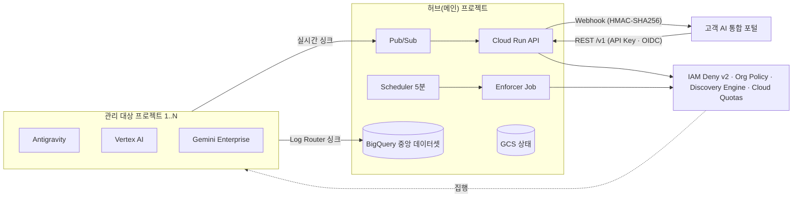

<p align="center">
  
</p>

<p align="center">
  <a href="openapi.yaml"></a>
  
  
  
  
  
</p>

<p align="center"><b>한국어</b> · <a href="README.en.md">English</a></p>

# GCP AI Usage & Spend Caps API

**이미 OpenAI·Claude를 연동한 자체 AI 통합 관리 포털**에 Google Cloud의 **Antigravity · Gemini Enterprise · Vertex AI(Agent Platform)** 를 “같은 방식으로” 붙이기 위한 **Headless(UI 없는) M2M 관리 API**입니다.
**메인(허브) 프로젝트 한 곳**에 설치하면 **여러 관리 대상 프로젝트 전체**의 사용량·비용을 조회하고, 지출 캡·모델 사용·Rate Limit·쿼터를 **OpenAI / Anthropic Admin API와 같은 감각의 REST API**로 통제합니다.

> [!IMPORTANT]
> 설치 전에 **환경 사전점검(Preflight)** 이 고객 환경을 전수 검사합니다 — API 활성화, 조직 정책, **VPC Service Controls**, 네트워크(VPC egress·PGA·NAT), 기존 **BigQuery 데이터셋/로그 싱크 재사용**, Data Access 감사 로그, **Gemini Enterprise 앱 존재 여부**, Antigravity 설정, IAM 권한, IAM Deny 용량, 쿼터 API까지. 막히는 항목은 아무것도 만들기 전에 **수정 명령어와 함께** 알려 줍니다. → [사전점검 체크리스트](docs/preflight-checklist.md)

---

## 목차

1. [한눈에 보기](#1-한눈에-보기)
2. [아키텍처](#2-아키텍처)
3. [OpenAI · Anthropic Admin API와 비교](#3-openai--anthropic-admin-api와-비교)
4. [기능 상세](#4-기능-상세)
5. [환경 사전점검 (Preflight)](#5-환경-사전점검-preflight)
6. [설치 (원클릭 · Terraform)](#6-설치)
7. [API 빠른 시작 (curl · Python)](#7-api-빠른-시작)
8. [API 엔드포인트 전체 목록](#8-api-엔드포인트-전체-목록)
9. [보안 · 권한](#9-보안--권한)
10. [제약 사항 (GCP 특성)](#10-제약-사항-gcp-특성)
11. [개발 · 테스트](#11-개발--테스트)
12. [문서](#12-문서)

---

## 1. 한눈에 보기

| 영역 | 제공 기능 | 고객 포털에서 얻는 것 |
|---|---|---|
| 📊 **사용량·비용** | 유저별/모델별/프로젝트별 요청·입력/출력/캐시 토큰·추정 비용, 월별 차지백 | OpenAI Usage API처럼 사용자 단위 리포트 |
| 💰 **지출 캡** | 유저/전역 캡(금액·토큰·요청), 80/100% 알림, 자동·수동 차단, 기간 자동 리셋, 프로젝트 하드캡 | 예산 초과 사용자 자동 차단 |
| 🚫 **차단/해제** | 서비스 선택(`antigravity`·`vertex_ai`·`gemini_enterprise`) 즉시 차단·해제, 만료 시각 | 보안 사고 시 원클릭 차단 |
| 🧠 **모델 거버넌스** | 모델 카탈로그, 프로젝트/폴더/조직 허용·차단, GE 앱 모델 ON/OFF, **유저별 모델 규칙(차단 우선·알림)** | “이 팀은 Gemini만”, “인턴은 Claude 금지” |
| ⏱️ **Rate Limit·쿼터** | 모델·리전별 RPM/TPM 한도·사용량·헤드룸, 하향(캡), **상향 요청 API 직접 제출**, 상태 추적 | 쿼터 부족을 포털에서 바로 해결 |
| 🩺 **사전점검** | 30여 개 카테고리 전수 검사 + 자동 적응 + 수정 스크립트 | 어떤 고객 환경에도 안전한 설치 |
| 🔔 **Webhook** | 임계치·차단·모델 위반·정책 변경·쿼터 상태 변경 (HMAC 서명) | 포털 알림/워크플로 연동 |
| 🧾 **감사** | 모든 API 호출·차단·정책 변경 감사 로그 | 컴플라이언스 증적 |

**핵심 설계 원칙**
* **허브-앤-스포크**: 메인 프로젝트 한 곳이 모든 관리 프로젝트를 관할 (프로젝트 목록 / 폴더 / 조직 단위).
* **기존 인프라 존중**: 이미 있는 BigQuery 데이터셋·로그 싱크는 **재사용(adopt)**, 없는 것만 생성.
* **안전 우선**: dry-run, 영향 미리보기, 잠금 방지, etag 동시성, 안전 게이트 G1–G7, 변경 예산.
* **검증된 엔진**: 차단 로직은 레퍼런스 `ai-control-plane`의 검증된 IAM Deny v2 엔진을 이식 → [차단 엔진 상세](docs/enforcement-logic.md).
* **경량**: 표준 라이브러리 중심 Python, UI·AI 분석기 등 불필요한 구성 요소 없음.

## 2. 아키텍처



자세한 구성·데이터 흐름·상태 저장소 → [docs/architecture.md](docs/architecture.md) · 멀티 프로젝트 배포 → [docs/multi-project-deployment.md](docs/multi-project-deployment.md)

## 3. OpenAI · Anthropic Admin API와 비교

| 기능 | OpenAI | Anthropic | **이 API (Google Cloud)** |
|---|---|---|---|
| 사용량 조회 | Usage API (org/project/key) | Usage & Cost API (workspace) | **유저 단위** + 모델/프로젝트/서비스 |
| 비용 | Costs API | Cost API | 토큰×실제 청구 단가(Billing Export→Catalog→수동) |
| 모델 목록 | `/v1/models` | `/v1/models` | `/v1/models` + 서비스·리전·가격·수명주기·**프로젝트별 접근 판정** |
| 모델 허용/차단 | 프로젝트 model permissions | Workspace (Console) | 프로젝트·폴더·조직 Org Policy + GE 앱 + **유저별 규칙** |
| Rate limit 조회 | 프로젝트 rate_limits | Rate Limits API | Cloud Quotas + Monitoring 헤드룸 |
| Rate limit 조정 | 프로젝트 한도 하향 | Console | QuotaPreference 하향 + **유저별 RPM/TPM** |
| 쿼터 상향 | Usage tier | 영업 문의 | **`POST /v1/quota-requests` → Google 심사 상태 추적** |
| 지출 한도 | Project budget | Spend limits | 유저/전역 캡 + 프로젝트 하드캡 |
| 키/사용자 차단 | 키 폐기 (즉시) | 키 비활성 (즉시) | IAM Deny v2 (**1–2분 전파**) |
| 감사 로그 | Audit logs | – | 감사 로그 API |
| Webhook | – | – | ✅ 13종 이벤트 |

## 4. 기능 상세

### 4.1 사용량 · 비용 · 차지백
* 데이터 소스: Antigravity 추론 로그(토큰 포함), Vertex AI Data Access 감사 로그, Gemini Enterprise 사용자 활동 로그 → BigQuery 중앙 데이터셋(이력) + Cloud Logging(최근 구간).
* 비용: 비캐시 입력 / 캐시 입력 / 출력(사고 토큰 포함) 토큰별 단가 적용. 단가는 Billing Export 실효 단가 → Cloud Billing Catalog → 수동 설정 순.
* `GET /v1/usage/users`, `GET /v1/usage/users/{email}`(시계열 + 캡 소진율), `GET /v1/usage/models`, `GET /v1/billing/users?month=YYYY-MM`.

### 4.2 지출 캡 · 차단 (레퍼런스 검증 엔진)
* 전역 정책 + 유저별 개별 캡(금액·토큰·요청), 기간(일/주/월/사용자 정의, calendar/rolling, 리셋 시각·TZ).
* `auto` 모드: 초과 즉시 자동 정지 → 다음 리셋 시 자동 복구. `manual` 모드: 검토 대기 + 알림.
* 감지: **Pub/Sub 실시간(수 초)** + **Scheduler 안전망(5분)**. 안전 게이트 G1–G7로 오작동·대량 오차단 방지.
* 프로젝트 하드캡: Billing Budget `spendCap`. → [docs/enforcement-logic.md](docs/enforcement-logic.md)

### 4.3 모델 거버넌스
| 계층 | 수단 | API |
|---|---|---|
| 프로젝트·폴더·조직 (Vertex AI) | Org Policy `vertexai.allowedModels` (패턴 확장·500값 검사·매시 재확장) | `/v1/model-access/...` |
| Gemini Enterprise 앱 | `Engine.modelConfigs` merge PATCH (앱 없으면 `not_applicable`) | `/v1/gemini-enterprise/apps/...` |
| Antigravity | DevToolsConfig 조회 (쓰기는 Console 전용 → `409 console_required`) | `/v1/antigravity/models` |
| **유저** | 허용/차단 모델 + 모델별 RPM·TPM·일/월 토큰·비용 → **위반 시 즉시 서비스 차단 + Webhook** | `/v1/model-rules/...`, `/v1/users/{email}/model-rules` |

→ [docs/model-governance.md](docs/model-governance.md)

### 4.4 Rate Limit · 쿼터
* 모든 관리 프로젝트의 생성형 AI 쿼터(모델·리전 차원)와 24시간 피크 사용량·헤드룸.
* 하향(캡)은 즉시 적용(피크 미만이면 `force` 필요), 상향은 **API로 바로 Google Cloud에 제출** — 단일/다수 프로젝트, `Idempotency-Key`, 상태(`pending → approved/partially_approved/denied`) 추적, 취소, 웹훅.

### 4.5 Webhook (HMAC-SHA256 서명)
`cap.threshold_reached` · `cap.exceeded` · `user.blocked` · `user.unblocked` · `project_cap.enforced` · `project_cap.lifted` · `model.access_changed` · `model.lifecycle_notice` · `user.model_violation` · `rate_limit.threshold_reached` · `quota_request.created` · `quota_request.updated` · `readiness.degraded` → [docs/webhooks.md](docs/webhooks.md)

## 5. 환경 사전점검 (Preflight)

고객 환경은 제각각입니다 — BigQuery가 이미 있을 수도, Gemini Enterprise 앱이 없을 수도, VPC-SC 경계 안일 수도 있습니다. 설치 스크립트는 **아무것도 만들기 전에** 다음을 전수 검사하고, 가능한 것은 **자동 적응**, 불가능한 것은 **수정 명령어**를 출력하고 멈춥니다.

| 카테고리 | 주요 점검 |
|---|---|
| project | 프로젝트 존재/상태, 조직·폴더 계층, 결제 연결 |
| apis | 허브/스포크별 필수·선택 API 활성화, 비활성 시 영향 기능 |
| orgpolicy | 리소스 위치, 도메인 제한 공유(DRS), Cloud Run ingress/VPC egress/Binary Authorization/invoker IAM, CMEK 강제, 서비스 사용 제한, Cloud Build 풀, 커스텀 제약, `vertexai.allowedModels` 현황 |
| vpcsc | 프로젝트 경계, dry-run 경계, 접근 가능 서비스, **허브↔스포크 경계 불일치(ingress/egress 규칙 YAML 제시)**, 관측된 VPC-SC 거부 |
| network | 서브넷 Private Google Access, Cloud NAT(웹훅 송신), restricted.googleapis.com DNS |
| bigquery | 데이터셋 존재·위치, **기존 AI 로그 테이블 발견 시 재사용 권고**, 최신성, Billing Export 자동 탐지 |
| logging | 프로젝트/폴더/조직 싱크(**기존 싱크 재사용**), 비활성 싱크, writer 권한, `_Default` 제외 필터, Data Access 감사 로그 |
| surfaces | Vertex AI 모델 접근, **Gemini Enterprise 앱 유무**, Antigravity DevToolsConfig·로그 |
| iam | 런타임/Enforcer/배포자 권한(누락 → 최소 역할 매핑 + 명령어) |
| enforcement | 기존 IAM Deny 정책 수·용량·충돌, Pub/Sub·Scheduler·Cloud Run 상태 |
| quotas | Cloud Quotas API, 쿼터 요청 연락처 |

```bash
# 설치 없이 점검만 (아무것도 생성하지 않음)
bash <(curl -fsSL https://github.com/ldu1225/gcp-ai-usage-caps-api/raw/main/scripts/install.sh) \
  --preflight-only --project HUB_PROJECT --managed-projects TEAM_A,TEAM_B

# 운영 중 점검
curl -s "$BASE/v1/admin/readiness?refresh=true" -H "Authorization: Bearer $ADMIN_KEY"
```

## 6. 설치

### 6.1 원클릭 (Cloud Shell 권장)

```bash
# 허브가 여러 프로젝트를 관할 (중앙 BigQuery, 실시간 Pub/Sub, 조직 역할, Data Access 로그)
bash <(curl -fsSL https://github.com/ldu1225/gcp-ai-usage-caps-api/raw/main/scripts/install.sh) \
  --project HUB_PROJECT \
  --managed-projects TEAM_A_PROJECT,TEAM_B_PROJECT \
  --org-id 123456789012 --grant-org-roles \
  --enable-data-access-logs \
  --quota-contact-email cloud-admin@company.com

# 폴더 아래 모든 프로젝트 관할 (집계 싱크)
bash <(curl -fsSL https://github.com/ldu1225/gcp-ai-usage-caps-api/raw/main/scripts/install.sh) \
  --project HUB_PROJECT --scope-type folder --scope-ids 987654321 --aggregated-sink --grant-org-roles

# 기존 BigQuery 데이터셋/싱크 재사용
... --reuse-dataset LOGGING_PROJECT:existing_ai_logs --reuse-sinks
```

설치 순서: **① Preflight → ② prepare(API·데이터셋·싱크·감사 로그) → ③ deploy(서비스 계정·Cloud Run·Job·Pub/Sub·Scheduler·Secret)**. 완료 시 API URL과 **부트스트랩 관리자 키**(Secret Manager 저장)를 출력합니다.

> [!WARNING]
> `roles/orgpolicy.policyAdmin`(모델 정책 쓰기)과 `roles/iam.denyAdmin`/`denyReviewer`(차단)는 **조직 수준에서만 부여 가능**합니다. `--grant-org-roles`를 쓰거나 출력되는 명령을 조직 관리자에게 전달하세요.

### 6.2 Terraform

```bash
cd terraform && cp terraform.tfvars.example terraform.tfvars   # project_id, managed_projects, org_id ...
terraform init && terraform apply
```

주요 변수: `managed_projects`, `central_dataset`, `reuse_dataset`, `enable_data_access_logs`, `vpc_network`/`vpc_subnet`/`vpc_egress`, `no_invoker_iam_check`, `quota_contact_email`, `model_violation_action`. → [docs/multi-project-deployment.md](docs/multi-project-deployment.md)

### 6.3 삭제
`scripts/teardown.sh --project HUB_PROJECT --managed-projects ...` (모든 프로젝트의 싱크 포함 정리, `--keep-log-sinks` 옵션)

## 7. API 빠른 시작

```bash
BASE=https://gcp-ai-usage-caps-api-XXXX.asia-northeast3.run.app
ADMIN=gcpai_...   # 부트스트랩 키

# 포털용 최소 권한 키 발급 (평문은 1회만 반환, 서버에는 해시만 저장)
curl -s -X POST $BASE/v1/admin/api-keys -H "Authorization: Bearer $ADMIN" -H "Content-Type: application/json" \
  -d '{"name":"ai-portal","scopes":["usage:read","caps:read","caps:write","users:write","models:read","models:write","quotas:read","quotas:write"]}'

# 유저별 사용량 (이번 달)
curl -s "$BASE/v1/usage/users?start=2026-11-01&end=2026-11-30&limit=50" -H "Authorization: Bearer $KEY"

# 전역 캡 $100/월 자동 차단
curl -s -X PUT $BASE/v1/caps/policy -H "Authorization: Bearer $KEY" -H "Content-Type: application/json" \
  -d '{"cost_cap":100,"period":"monthly","enforcement_mode":"auto"}'

# 즉시 차단 (Antigravity만)
curl -s -X POST "$BASE/v1/users/alice%40company.com/block" -H "Authorization: Bearer $KEY" \
  -H "Content-Type: application/json" -d '{"services":["antigravity"],"reason":"보안 점검"}'

# 모든 관리 프로젝트: Claude Opus 차단 (미리보기 후 적용)
curl -s -X POST $BASE/v1/model-access/bulk-apply -H "Authorization: Bearer $KEY" -H "Content-Type: application/json" \
  -d '{"scopes":["projects/*"],"mode":"deny_list","models":["anthropic/claude-opus-*"],"dryRun":true}'

# 전 직원 기본 규칙: Gemini만 허용 (위반 시 차단 + 알림)
curl -s -X PUT $BASE/v1/model-rules/default -H "Authorization: Bearer $KEY" -H "Content-Type: application/json" \
  -d '{"mode":"allow_list","models":["gemini-*"]}'

# 쿼터 상향 요청 (Google Cloud에 즉시 제출)
curl -s -X POST $BASE/v1/quota-requests -H "Authorization: Bearer $KEY" -H "Content-Type: application/json" \
  -d '{"project_id":"team-a-prod","quota_id":"GenerateContentRequestsPerMinutePerProjectPerBaseModel","model":"gemini-2.5-pro","location":"us-central1","requested_value":5000,"justification":"전사 코딩 어시스턴트 확대","contact_email":"cloud-admin@company.com"}'
```

```python
from caps_client import CapsClient            # examples/python/caps_client.py (표준 라이브러리만 사용)
c = CapsClient(BASE, api_key=KEY)
top = c.list_user_usage(start="2026-11-01", end="2026-11-30")[:10]
c.set_user_model_rule("intern@company.com", mode="deny_list", models=["claude-*"])
for rl in c.rate_limits(near_limit=True):
    print(rl["project_id"], rl["model"], rl["utilization_pct"])
```

오류 형식(OpenAI/Anthropic 호환): `{"error": {"type": "invalid_request_error", "code": "lockout_prevented", "message": "..."}}`

## 8. API 엔드포인트 전체 목록

전체 스펙: [`openapi.yaml`](openapi.yaml) (OpenAPI 3.1, `GET /v1/openapi.yaml`로도 제공)

| 그룹 | 엔드포인트 | Scope |
|---|---|---|
| 시스템 | `GET /v1/health`, `GET /v1/openapi.yaml` | 공개 |
| 사용량 | `GET /v1/usage/users`, `GET /v1/usage/users/{email}`, `GET /v1/usage/models`, `GET /v1/billing/users` | `usage:read` |
| 캡 정책 | `GET·PUT /v1/caps/policy`, `GET /v1/caps/users`, `GET·PUT·DELETE /v1/caps/users/{email}`, `POST /v1/caps/enforce` | `caps:*` |
| 차단 | `POST /v1/users/{email}/block`, `POST /v1/users/{email}/unblock` | `users:write` |
| 프로젝트 캡 | `GET /v1/caps/projects`, `PUT /v1/caps/projects/{id}`, `POST /v1/caps/projects/{id}/lift` | `caps:*` |
| 모델 | `GET /v1/models`, `GET /v1/models/{id}`, `GET /v1/models/{id}/access`, `POST /v1/models/sync` | `models:*` |
| 모델 접근 | `GET /v1/model-access`, `GET·PUT·DELETE /v1/model-access/{scope_type}/{scope_id}`, `POST .../preview`, `POST .../models/{id}/allow·restrict`, `POST /v1/model-access/bulk-apply`, `POST /v1/model-access/reconcile` | `models:*` |
| 서비스 모델 | `GET /v1/gemini-enterprise/apps`, `GET·PATCH /v1/gemini-enterprise/apps/{app_id}/models`, `POST /v1/gemini-enterprise/apps/bulk-models`, `GET·PUT /v1/antigravity/models` | `models:*` |
| 유저 모델 규칙 | `GET /v1/model-rules`, `GET·PUT·DELETE /v1/model-rules/default`, `GET·PUT·DELETE /v1/users/{email}/model-rules`, `POST /v1/model-rules/evaluate`, `GET /v1/model-violations` | `models:*` |
| Rate limit·쿼터 | `GET /v1/rate-limits`, `GET /v1/projects/{id}/rate-limits`, `GET·PATCH /v1/projects/{id}/rate-limits/{rl}`, `GET·PUT·DELETE /v1/rate-limits/users/{email}`, `GET·POST /v1/quota-requests`, `GET /v1/quota-requests/{id}`, `POST /v1/quota-requests/{id}/cancel` | `quotas:*` |
| 작업 | `GET /v1/operations`, `GET /v1/operations/{id}` | read scopes |
| 감사 | `GET /v1/audit-logs` | `caps:read` |
| 관리 | `GET·POST /v1/admin/api-keys`, `DELETE /v1/admin/api-keys/{id}`, `GET·POST /v1/admin/webhooks`, `DELETE /v1/admin/webhooks/{id}`, `GET /v1/admin/readiness`, `POST /v1/admin/readiness/run` | `admin` |
| 내부 | `POST /v1/internal/usage-event`, `POST /v1/internal/pricing/sync` | OIDC |

## 9. 보안 · 권한

* **API 키**: `gcpai_<id>_<secret>`, 솔트 SHA-256 해시만 저장, scope 분리, 만료·폐기, 발급 1회 노출.
* **OIDC**: Cloud Scheduler·Pub/Sub·GCP 내부 서버는 Google ID 토큰으로 호출(허용 SA 목록·audience 검증).
* **최소 권한 SA 2개**: API 런타임 / Enforcer 분리. 프롬프트·응답 본문은 저장하지 않고 메타데이터·토큰 수만 사용.
* **SSRF 방지 웹훅**, 엔드포인트별 Rate limit, 감사 로그. → [docs/security.md](docs/security.md)

## 10. 제약 사항 (GCP 특성)

| 항목 | 내용 | 대응 |
|---|---|---|
| 차단 반영 | IAM Deny v2는 1–2분 전파 | `operation`/웹훅, 진행 중 요청은 완료됨 |
| 유저별 모델 제한 | GCP 네이티브 수단 없음 | 감지 → 서비스 차단(실시간·5분) |
| Org Policy | 와일드카드 없음, 500값, 전파 수 분 | 패턴 확장·재확장, 값 수 검사 |
| Antigravity 모델 설정 | API 쓰기 불가(Console 전용) | `409 console_required` + 유저 규칙 |
| 쿼터 상향 | Google 심사(수 시간~수 일) | 상태 추적·웹훅 |
| Vertex AI 토큰 | Data Access 로그에는 토큰 없음 | 요청 수 기준 + Billing 기반 비용 |
| 조직 역할 | Org Policy 관리자·Deny 관리자는 조직 수준 부여만 가능 | `--grant-org-roles` |

## 11. 개발 · 테스트

```bash
pip install -r requirements-dev.txt     # (선택) OpenAPI 스키마 전체 검증용
./scripts/test.sh                        # 오프라인 단위·통합 테스트 + 스크립트 문법 + OpenAPI 3.1 검증
PYTHONPATH=src ALLOW_LOCAL_INSECURE=true STORAGE_BACKEND=file PROJECT_ID=my-hub python3 src/server.py
```

모든 테스트는 GCP 없이 오프라인으로 실행됩니다(가짜 Org Policy·Cloud Quotas·Discovery Engine·IAM Deny·Logging).

## 12. 문서

| 문서 | 내용 |
|---|---|
| [docs/architecture.md](docs/architecture.md) | 구성도, 데이터 흐름, 상태 저장소 |
| [docs/multi-project-deployment.md](docs/multi-project-deployment.md) | 허브-앤-스포크 설치, IAM 표, Terraform |
| [docs/preflight-checklist.md](docs/preflight-checklist.md) | 사전점검 전체 항목·수정 방법 |
| [docs/enforcement-logic.md](docs/enforcement-logic.md) | 차단 엔진(IAM Deny v2·G1–G7·실시간/안전망) |
| [docs/model-governance.md](docs/model-governance.md) | 모델·쿼터 API 가이드 |
| [docs/webhooks.md](docs/webhooks.md) | 이벤트·페이로드·서명 검증 |
| [docs/operations-runbook.md](docs/operations-runbook.md) | 운영·장애 대응 |
| [docs/security.md](docs/security.md) | 보안 모델·위협 분석 |
| [openapi.yaml](openapi.yaml) | OpenAPI 3.1 전체 스펙 |
