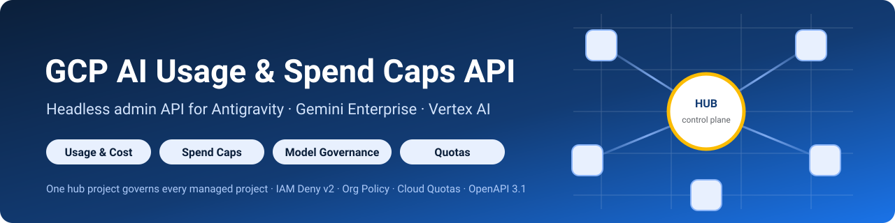
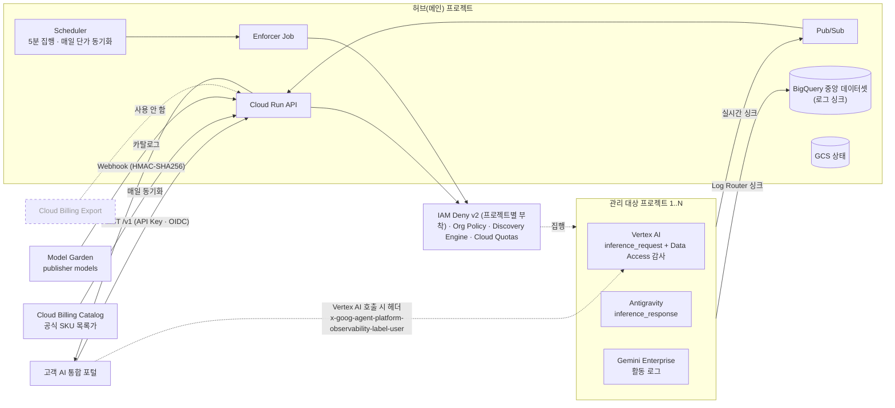

<p align="center">
  
</p>

<p align="center">
  <a href="openapi.yaml"></a>
  
  
  
  
  
  
</p>

<p align="center"><b>한국어</b> · <a href="README.en.md">English</a></p>

# GCP AI Usage & Spend Caps API

**이미 OpenAI·Claude를 연동한 자체 AI 통합 관리 포털**에 Google Cloud의 **Antigravity · Gemini Enterprise · Vertex AI(Agent Platform)** 를 “같은 방식으로” 붙이기 위한 **Headless(UI 없는) M2M 관리 API**입니다.
**메인(허브) 프로젝트 한 곳**에 설치하면 **여러 관리 대상 프로젝트 전체**의 사용자별 사용량·비용을 조회하고, 지출 캡·모델 사용·Rate Limit·쿼터를 **OpenAI / Anthropic Admin API와 같은 감각의 REST API**로 통제합니다.

> [!IMPORTANT]
> **비용은 “로그의 토큰 수 × 공식 Cloud Billing Catalog SKU 단가”로 계산합니다. Cloud Billing Export(BigQuery 결제 내보내기)는 사용하지 않으며 필요하지도 않습니다.** 금액은 목록가 기준 추정치이며 크레딧·약정 할인·세금은 제외됩니다. → [비용 산정 방식](docs/cost-methodology.md)

> [!IMPORTANT]
> **내장 모델 목록이 없습니다.** 모델 카탈로그는 실시간 Model Garden 조회와 **로그에서 실제로 관측된 모델**의 합집합이며, 새 모델은 처음 사용되는 날 자동으로 추적됩니다(`model.first_seen` 웹훅). 이 문서의 `<model-id>`, `<family>-*` 같은 표기는 자리표시자이며, 실제 ID는 항상 `GET /v1/models`가 돌려주는 값을 사용하세요.

> [!NOTE]
> 설치 전에 **환경 사전점검(Preflight)** 이 고객 환경을 전수 검사합니다 — API 활성화, 조직 정책, **VPC Service Controls**, 네트워크(VPC egress·PGA·NAT), 기존 **BigQuery 데이터셋/로그 싱크 재사용**, Data Access 감사 로그, **Vertex AI 추론 요청 로그 활성 여부**, Gemini Enterprise 앱 존재 여부, Antigravity 설정, IAM 권한, IAM Deny 용량, 쿼터 API까지. 막히는 항목은 아무것도 만들기 전에 **수정 명령어와 함께** 알려 줍니다. → [사전점검 체크리스트](docs/preflight-checklist.md)

---

## 목차

1. [한눈에 보기](#1-한눈에-보기)
2. [아키텍처](#2-아키텍처)
3. [비용 산정 방식](#3-비용-산정-방식)
4. [Vertex AI 사용자별 귀속](#4-vertex-ai-사용자별-귀속)
5. [멀티 프로젝트 사용자](#5-멀티-프로젝트-사용자)
6. [동적 모델 카탈로그 · 신규 모델 추적](#6-동적-모델-카탈로그--신규-모델-추적)
7. [OpenAI · Anthropic Admin API와 비교](#7-openai--anthropic-admin-api와-비교)
8. [기능 상세](#8-기능-상세)
9. [환경 사전점검 (Preflight)](#9-환경-사전점검-preflight)
10. [설치 (원클릭 · Terraform)](#10-설치)
11. [API 빠른 시작 (curl · Python)](#11-api-빠른-시작)
12. [API 엔드포인트 전체 목록](#12-api-엔드포인트-전체-목록)
13. [보안 · 권한](#13-보안--권한)
14. [제약 사항 (정직한 한계)](#14-제약-사항-정직한-한계)
15. [개발 · 테스트](#15-개발--테스트)
16. [문서](#16-문서)

---

## 1. 한눈에 보기

| 영역 | 제공 기능 | 고객 포털에서 얻는 것 |
|---|---|---|
| 📊 **사용량·비용** | 사용자/프로젝트/모델/트래픽 티어별 요청·입력/출력/캐시/사고 토큰·추정 비용, 월별 차지백, 귀속 불가분(`unattributed`) 별도 표시 | OpenAI Usage API처럼 사용자 단위 리포트 |
| 💲 **공식 단가** | Cloud Billing Catalog SKU 매일 동기화(입력·출력·캐시 읽기/쓰기·장문·Flex/Priority/Batch), 계약 단가 override, `GET /v1/pricing` | 재무팀이 검증 가능한 근거(SKU 이름) |
| 💰 **지출 캡** | 사용자/전역 캡(금액·토큰·요청), **전체 합산 또는 프로젝트별 캡**, 80/100% 알림, 자동·수동 차단, 기간 자동 리셋, 프로젝트 하드캡 | 예산 초과 사용자 자동 차단 (초과한 프로젝트에서만) |
| 🚫 **차단/해제** | 서비스(`antigravity`·`vertex_ai`·`gemini_enterprise`) × **프로젝트 단위** 즉시 차단·해제, 만료 시각 | 보안 사고 시 원클릭 차단 |
| 🧠 **모델 거버넌스** | 동적 카탈로그, 프로젝트/폴더/조직 허용·차단, GE 앱 모델 ON/OFF, **사용자별 모델 규칙(차단 우선·알림 필수)** | “이 팀은 Google 모델만”, “인턴은 특정 계열 금지” |
| 🔎 **모델 추적** | 로그에서 처음 관측된 모델 자동 등록, Model Garden 신규/제외 감지 | 신규 모델 사용을 당일 인지 |
| ⏱️ **Rate Limit·쿼터** | 모델·리전별 RPM/TPM 한도·사용량·헤드룸, 하향(캡), **상향 요청 API 직접 제출**, 상태 추적 | 쿼터 부족을 포털에서 바로 해결 |
| 🩺 **사전점검** | 30여 개 카테고리 전수 검사 + 자동 적응 + 수정 스크립트 | 어떤 고객 환경에도 안전한 설치 |
| 🔔 **Webhook** | 15종 이벤트 (HMAC-SHA256 서명) | 포털 알림/워크플로 연동 |
| 🧾 **감사** | 모든 API 호출·차단·정책 변경 감사 로그 | 컴플라이언스 증적 |

**핵심 설계 원칙**
* **허브-앤-스포크**: 메인 프로젝트 한 곳이 모든 관리 프로젝트를 관할 (프로젝트 목록 / 폴더 / 조직 단위).
* **로그 기반 · 결제 내보내기 불필요**: 사용량은 Cloud Logging 로그, 단가는 공개 Cloud Billing Catalog API — 결제 계정 데이터 접근 권한 없이 동작합니다.
* **하드코딩 없음**: 모델 목록·모델 계열·가격을 코드에 넣지 않고 Model Garden, 로그, SKU 카탈로그에서 매번 학습합니다.
* **기존 인프라 존중**: 이미 있는 BigQuery 데이터셋·로그 싱크는 **재사용(adopt)**, 없는 것만 생성.
* **안전 우선**: dry-run, 영향 미리보기, 잠금 방지, etag 동시성, 안전 게이트 G1–G7, 변경 예산.
* **검증된 엔진**: 차단 로직은 레퍼런스 `ai-control-plane`의 검증된 IAM Deny v2 엔진을 이식하고 프로젝트별 부착점으로 확장 → [차단 엔진 상세](docs/enforcement-logic.md).
* **경량**: 표준 라이브러리 중심 Python, UI·AI 분석기 등 불필요한 구성 요소 없음.

## 2. 아키텍처



* **사용량**: Antigravity 추론 로그 · Vertex AI 추론 요청 로그(`aiplatform.googleapis.com/inference_request`) · Data Access 감사 로그(사용자 귀속/요청 수) · Gemini Enterprise 활동 로그 → BigQuery 중앙 데이터셋(이력) + Cloud Logging(최근 구간).
* **사용자 귀속(Vertex AI)**: 포털 헤더 라벨 → 감사 로그 상관 → 프로젝트 `unattributed` 순서([4장](#4-vertex-ai-사용자별-귀속)).
* **단가**: 공식 Cloud Billing Catalog SKU를 매일 동기화([3장](#3-비용-산정-방식)).

자세한 구성·데이터 흐름·상태 저장소 → [docs/architecture.md](docs/architecture.md) · 멀티 프로젝트 배포 → [docs/multi-project-deployment.md](docs/multi-project-deployment.md)

## 3. 비용 산정 방식

**비용 = 로그의 토큰 수 × 공식 Cloud Billing Catalog SKU 단가** (또는 계약 단가 override). Cloud Billing Export는 **사용하지 않고 필요하지도 않습니다**.

| SKU 차원 | 적용 토큰 | 비고 |
|---|---|---|
| 입력(input) | 입력 − 캐시 읽기 − 캐시 쓰기 | 도구 사용 프롬프트 포함 |
| 출력(output) | 출력 + **사고(thinking) 토큰** | 사고 토큰은 출력 단가로 과금 |
| 캐시 읽기(cached) | 컨텍스트 캐시 적중 토큰 | SKU 없으면 입력 단가(보수적) |
| 캐시 쓰기(cache_write) | Claude 프롬프트 캐시 생성 토큰 | SKU 없으면 입력 단가 |
| 장문 컨텍스트(long_context) | 프롬프트가 임계값(기본 200,000) 초과인 요청의 토큰 | `LONG_CONTEXT_THRESHOLD_TOKENS` |
| Flex / Priority / Batch | 로그 `trafficType`이 해당 티어인 요청 | 티어 SKU 없으면 표준 단가 |
| Provisioned Throughput | PT로 처리된 요청 | `on_demand`(표준 단가 환산, 기본) 또는 `zero`(선결제) — `PROVISIONED_THROUGHPUT_COST` |

$$
\text{cost} = \frac{(I - C - W)\,P_{in} + C\,P_{cached} + W\,P_{cw} + O\,P_{out}}{10^6}\quad\text{(트래픽 티어별로 계산 후 합산)}
$$

* **금액의 성격**: 목록가(또는 계약가) 기준 **추정액** — 크레딧·CUD·협상 할인(override 미입력 시)·세금 제외. Gemini Enterprise는 좌석 과금이므로 요청 수만 집계(`cost_basis=license`).
* **근거 공개**: `GET /v1/pricing`이 모델별 단가·티어·**SKU 리소스 이름**을 보여 주며, 모든 사용량 응답에 `pricing_source`(`method=log_token_counts_x_official_sku_prices`, `billing_export=not_used`, 동기화 시각)가 포함됩니다.
* **동기화**: Cloud Scheduler가 매일(기본 03:00) `POST /v1/internal/pricing/sync` 호출. 비 USD 캡 통화는 Catalog 환율로 환산하고 `fx`에 근거를 표시합니다.

수식·우선순위·환율·계산 예시 → **[docs/cost-methodology.md](docs/cost-methodology.md)**

## 4. Vertex AI 사용자별 귀속

Vertex AI 토큰 수는 **추론 요청 메타데이터 로그**(`aiplatform.googleapis.com/inference_request`)에만 기록됩니다. 이 로그는 **프로젝트마다 활성화**해야 하며(기본 꺼짐, 조직 단위 스위치 없음), 호출 주체가 대개 포털의 **서비스 계정**이므로 실제 사람에게 다음 순서로 귀속합니다.

| 순서 | 방법 | 정확도 | `telemetry.attribution` 키 |
|---|---|---|---|
| 1 | **포털이 보낸 커스텀 헤더 라벨** `x-goog-agent-platform-observability-label-user: <이메일 또는 uid>` | 정확 | `header_label` |
| 2 | **Data Access 감사 로그 상관**: 같은 프로젝트·같은 모델·같은 분(±1분)의 사람 호출자에게 요청 수 비율로 토큰을 비례 배분 | 근사 | `audit_correlated` |
| 3 | 위 둘 다 불가 → 프로젝트 단위 **`unattributed`** 로 보존 (절대 버리지 않음) | 프로젝트 합계 정확 | `unattributed` |
| – | 추론 로그 미활성 시 → 감사 로그의 사용자별 **요청 수만** 집계 (`token_sources.vertex_ai = requests_only`) | 토큰·비용 없음 | – |

Antigravity 로그는 사용자 ID를 직접 담고 있으므로 `log_identity`로 집계됩니다.

**① 추론 요청 로그 활성화** — 설치 시 `prepare.sh`(5단계)와 Terraform(`enable_vertex_inference_logging=true`)이 **기본으로 켭니다**(생략: `--no-vertex-inference-logging`). 나중에 추가된 프로젝트나 상태 확인은 API로:

```bash
curl -s "$BASE/v1/projects/team-a-prod/vertex-logging" -H "Authorization: Bearer $ADMIN"          # 상태
curl -s -X POST "$BASE/v1/projects/team-a-prod/vertex-logging/enable" -H "Authorization: Bearer $ADMIN" \
  -H "Content-Type: application/json" -d '{"dryRun":false}'                                       # 단일 프로젝트
curl -s -X POST "$BASE/v1/vertex-logging/enable" -H "Authorization: Bearer $ADMIN" \
  -H "Content-Type: application/json" -d '{"projects":["*"],"dryRun":false}'                    # 전체 (기본 dryRun=true)
```

> [!NOTE]
> 상태 조회에는 런타임 SA의 `aiplatform.endpoints.fetchPublisherModelConfig`(설치 시 1권한 커스텀 역할 `gcpAiCapsVertexLoggingReader`로 부여), API로 활성화하려면 해당 프로젝트에서 `aiplatform.endpoints.setPublisherModelConfig`가 추가로 필요합니다. 로그는 Cloud Logging 수집 요금이 부과됩니다. 적용까지 몇 분, 이후 요청 후 수 초~최대 5분 내 로그가 나타납니다. 로그는 Gemini `generateContent`/`streamGenerateContent`와 Claude `rawPredict`/`streamRawPredict` 호출만 기록합니다.

**② 포털에서 헤더 추가 (Vertex AI 호출마다)** — 헤더 이름의 접미사 `user`는 `VERTEX_USER_HEADER_LABEL`(기본 `user`)로 바꿀 수 있습니다. 값은 사용자 이메일 또는 이 API가 반환하는 `uid`(이메일 대신 쓰는 16자리 가명 ID, 이 API가 이미 알고 있는 사용자만 해석)입니다.

```bash
MODEL_ID="<model-id>"   # GET /v1/models 응답의 id
curl -s -X POST \
  "https://aiplatform.googleapis.com/v1/projects/team-a-prod/locations/global/publishers/google/models/${MODEL_ID}:generateContent" \
  -H "Authorization: Bearer $(gcloud auth print-access-token)" \
  -H "Content-Type: application/json" \
  -H "x-goog-agent-platform-observability-label-user: alice@company.com" \
  -d '{"contents":[{"role":"user","parts":[{"text":"안녕하세요"}]}]}'
```

```python
import google.auth, google.auth.transport.requests, requests

PROJECT, LOCATION = "team-a-prod", "global"
MODEL_ID = "<model-id>"                      # 하드코딩 금지: GET /v1/models 에서 선택
creds, _ = google.auth.default(scopes=["https://www.googleapis.com/auth/cloud-platform"])
creds.refresh(google.auth.transport.requests.Request())

def generate(user_email: str, prompt: str) -> dict:
    url = (f"https://aiplatform.googleapis.com/v1/projects/{PROJECT}/locations/{LOCATION}"
           f"/publishers/google/models/{MODEL_ID}:generateContent")
    headers = {
        "Authorization": f"Bearer {creds.token}",
        # 포털 로그인 사용자 → Caps API가 이 값으로 토큰/비용을 정확히 귀속합니다.
        "x-goog-agent-platform-observability-label-user": user_email,
    }
    body = {"contents": [{"role": "user", "parts": [{"text": prompt}]}]}
    return requests.post(url, headers=headers, json=body, timeout=60).json()

# google-genai SDK를 쓰는 경우:
#   client = genai.Client(vertexai=True, project=PROJECT, location=LOCATION,
#       http_options=types.HttpOptions(headers={"x-goog-agent-platform-observability-label-user": user_email}))
# Claude(rawPredict / streamRawPredict, publishers/anthropic)도 같은 헤더를 붙이면 됩니다.
```

**③ 귀속 품질 확인** — 모든 사용량 응답의 `telemetry`:

```json
"telemetry": {
  "attribution": {"log_identity": 18234, "header_label": 9120, "audit_correlated": 412, "unattributed": 37},
  "token_sources": {"antigravity": "logs", "vertex_ai": "logs", "gemini_enterprise": "requests_only"},
  "unattributed_projects": ["team-c-batch"], "telemetry_ok": true, "truncated": false
}
```

`unattributed`가 크면 해당 프로젝트 호출에 헤더가 빠졌거나 Data Access 감사 로그가 꺼져 있는 것입니다 → [운영 런북](docs/operations-runbook.md).

## 5. 멀티 프로젝트 사용자

사용량은 항상 **(사용자, 프로젝트)** 단위로 집계되며, 한 사용자가 여러 관리 프로젝트에 배정될 수 있습니다(N:M).

| 설정 | 위치 | 의미 |
|---|---|---|
| `cap_scope: total` (기본) | 정책 / 사용자 규칙 `scope` | 모든 프로젝트 합산에 캡 1개 |
| `cap_scope: per_project` | 정책 / 사용자 규칙 `scope` | 같은 캡을 **프로젝트마다 따로** 적용 |
| `project_caps` | 사용자 규칙 | `{project_id: {cost_cap, token_cap, request_cap}}` — 합산 캡에 **추가로** 평가 |
| `project_defaults` | 정책 | 모든 사용자에게 적용되는 프로젝트별 기본 캡 |
| `metered_surfaces` | 정책 | 캡 계산에 포함할 서비스 (기본 3개 모두) |

**집행 규칙**: 특정 프로젝트에서만 캡을 넘으면 **그 프로젝트에서만** 정지됩니다(`plan.suspend_projects`). IAM Deny v2 항목은 부착점(`projects/{id}`)별로 관리되며, 합산 캡 초과나 전역 차단만 모든 프로젝트에 적용됩니다. 모델 규칙 위반도 기본적으로 **위반이 발생한 프로젝트에서만** 차단합니다(`MODEL_VIOLATION_BLOCK_SCOPE=project|all`, 기본 동작은 여전히 차단 + 항상 알림).

```bash
# 정책: 모든 사용자에게 월 $100 캡을 프로젝트마다 적용, team-b-prod는 프로젝트 기본 캡 $30
curl -s -X PUT $BASE/v1/caps/policy -H "Authorization: Bearer $KEY" -H "Content-Type: application/json" \
  -d '{"cost_cap":100,"period":"monthly","enforcement_mode":"auto","cap_scope":"per_project",
       "project_defaults":{"team-b-prod":{"cost_cap":30}}}'

# 사용자 규칙: 합산 $200 + 프로젝트별 상한
curl -s -X PUT "$BASE/v1/caps/users/alice%40company.com" -H "Authorization: Bearer $KEY" -H "Content-Type: application/json" \
  -d '{"type":"limit","cost_cap":200,"scope":"total",
       "project_caps":{"team-a-prod":{"cost_cap":150},"team-b-prod":{"cost_cap":50,"token_cap":20000000}}}'

# 프로젝트 한정 차단 / 해제 (다른 프로젝트는 계속 사용 가능)
curl -s -X POST "$BASE/v1/users/alice%40company.com/block" -H "Authorization: Bearer $KEY" -H "Content-Type: application/json" \
  -d '{"services":["vertex_ai"],"projects":["team-b-prod"],"reason":"프로젝트 예산 소진"}'
curl -s -X POST "$BASE/v1/users/alice%40company.com/unblock" -H "Authorization: Bearer $KEY" -H "Content-Type: application/json" \
  -d '{"projects":["team-b-prod"]}'

# 사용자가 일하는 모든 프로젝트 (사용량·비용·모델·프로젝트별 캡 상태, 직접 IAM 바인딩)
curl -s "$BASE/v1/users/alice%40company.com/projects?start=2026-11-01&end=2026-11-30&include=iam" -H "Authorization: Bearer $KEY"
```

`GET /v1/caps/users/{email}` 응답 일부:

```json
{
  "email": "alice@company.com", "status": "suspended", "status_scope": "projects", "cap_scope": "total",
  "multi_project": true, "over_scope": ["team-b-prod"], "blocked_projects": {"team-b-prod": ["vertex_ai"]},
  "projects": [
    {"project": "team-a-prod", "status": "active",    "limit": {"cost_cap": 150, "source": "user_project_cap"},
     "usage": {"estimated_cost": 61.2}, "remaining": {"cost": 88.8}, "blocked_services": []},
    {"project": "team-b-prod", "status": "suspended", "limit": {"cost_cap": 50, "source": "user_project_cap"},
     "usage": {"estimated_cost": 50.4}, "remaining": {"cost": 0}, "blocked_services": ["vertex_ai"]}
  ]
}
```

프로젝트별 임계치 웹훅(`cap.threshold_reached`, `cap.exceeded`)은 `"scope":"project","project":"team-b-prod"`를, `user.blocked`는 `"projects"`를 포함합니다. → [멀티 프로젝트 배포](docs/multi-project-deployment.md) · [차단 엔진](docs/enforcement-logic.md)

## 6. 동적 모델 카탈로그 · 신규 모델 추적

**내장 모델 목록이 없습니다.** `GET /v1/models`는 다음의 합집합입니다.

1. **실시간 Model Garden** (`publishers/{publisher}/models`) — 설정된 publisher(벤더) + 로그에서 관측된 모든 publisher. Model Garden에서 사라진 모델은 `lifecycle.delisted_at`과 함께 유지.
2. **로그에서 관측된 모델** — 모든 서비스(Antigravity `labels.model_id`, Vertex AI 추론 로그 `model_user_id`, 감사 로그 `resourceName`, Gemini Enterprise 활동)에서 처음 본 순간 `first_seen`/`last_seen`, 사용 서비스·프로젝트·사용자 수와 함께 기록.

| 이벤트 / 기능 | 설명 |
|---|---|
| `model.first_seen` 웹훅 | 로그에서 처음 사용된 모델 (`in_model_garden`, `surfaces`, `projects`, `users`) |
| `model.catalog_changed` 웹훅 | Model Garden 동기화 시 신규 `added` / 제외 `delisted` |
| `GET /v1/models?source=observed` | Model Garden에 없지만 로그에서 사용된 모델 (`source` = `model_garden` \| `observed`) |
| `GET /v1/models?used=true` | 실제로 사용된 모델만 |
| `GET /v1/usage/models` | 모델별 사용량·비용, `catalog_status`(`model_garden` \| `observed_only`), `group_by=user\|project\|surface\|traffic`, 모델별 `unattributed_*` |
| SKU 학습 | 단가 동기화 시 카탈로그·로그의 모델 ID로 모델 계열을 학습 → 신규 모델 SKU가 게시되면 바로 가격 적용 |

publisher는 **이름 패턴으로 추측하지 않고** Model Garden 또는 로그 리소스에서만 가져옵니다. 처음 보는 모델에 정책을 걸 때는 `publisher/model-id` 형식을 쓰세요. 설정의 `models.publishers`(`MODEL_PUBLISHERS`)는 **벤더 목록이지 모델 목록이 아닙니다**. → [모델 거버넌스](docs/model-governance.md)

## 7. OpenAI · Anthropic Admin API와 비교

| 기능 | OpenAI | Anthropic | **이 API (Google Cloud)** |
|---|---|---|---|
| 사용량 조회 | Usage API (org/project/key) | Usage & Cost API (workspace) | **사용자 단위** + 프로젝트/모델/서비스/트래픽 티어 |
| 비용 | Costs API (청구 기준) | Cost API (청구 기준) | **로그 토큰 수 × 공식 SKU 목록가** (Billing Export 불필요, 목록가 추정) |
| 단가 근거 | 가격 페이지 | 가격 페이지 | `GET /v1/pricing` (SKU 리소스 이름 포함, 매일 동기화) |
| 모델 목록 | `/v1/models` | `/v1/models` | `/v1/models` = 실시간 Model Garden ∪ **로그 관측 모델** + 수명주기·가격·**프로젝트별 접근 판정** |
| 신규 모델 감지 | – | – | ✅ `model.first_seen`, `model.catalog_changed` 웹훅 |
| 모델 허용/차단 | 프로젝트 model permissions | Workspace (Console) | 프로젝트·폴더·조직 Org Policy + GE 앱 + **사용자별 규칙** |
| Rate limit 조회 | 프로젝트 rate_limits | Rate Limits API | Cloud Quotas + Monitoring 헤드룸 |
| Rate limit 조정 | 프로젝트 한도 하향 | Console | QuotaPreference 하향 + **사용자별 RPM/TPM** |
| 쿼터 상향 | Usage tier | 영업 문의 | **`POST /v1/quota-requests` → Google 심사 상태 추적** |
| 지출 한도 | Project budget | Spend limits | 사용자/전역 캡 (**합산 또는 프로젝트별**) + 프로젝트 하드캡 |
| 키/사용자 차단 | 키 폐기 (즉시) | 키 비활성 (즉시) | IAM Deny v2, **프로젝트 단위 가능** (**1–2분 전파**) |
| 감사 로그 | Audit logs | – | 감사 로그 API |
| Webhook | – | – | ✅ 15종 이벤트 |

## 8. 기능 상세

### 8.1 사용량 · 비용 · 차지백
* 데이터 소스(로그만): Antigravity 추론 로그(토큰 포함), **Vertex AI 추론 요청 로그(토큰 포함)** + Data Access 감사 로그(사용자 귀속·요청 수), Gemini Enterprise 사용자 활동 로그 → BigQuery 중앙 데이터셋(이력) + Cloud Logging(최근 구간).
* 응답 행: `requests`, `input_tokens`, `output_tokens`, `cached_tokens`, `cache_write_tokens`, `thoughts_tokens`, `total_tokens`, `by_traffic`, `estimated_cost`, `cost_partial`, `cost_basis`, `by_project`, `multi_project`.
* `GET /v1/usage/users`, `GET /v1/usage/users/{email}`(시계열 + 캡 소진율), `GET /v1/usage/models`, `GET /v1/users/{email}/projects`, `GET /v1/billing/users?month=YYYY-MM`(사용자×프로젝트 정수 센트 차지백 + 프로젝트별 `unattributed`).

### 8.2 지출 캡 · 차단 (레퍼런스 검증 엔진)
* 전역 정책 + 사용자별 개별 캡(금액·토큰·요청), 기간(일/주/월/사용자 정의, calendar/rolling, 리셋 시각·TZ), **합산/프로젝트별 캡**.
* `auto` 모드: 초과 즉시 자동 정지(초과한 프로젝트만) → 다음 리셋 시 자동 복구. `manual` 모드: 검토 대기 + 알림.
* 감지: **Pub/Sub 실시간(수 초)** + **Scheduler 안전망(5분)**. 안전 게이트 G1–G7로 오작동·대량 오차단 방지.
* 프로젝트 하드캡: Billing Budget `spendCap`. → [docs/enforcement-logic.md](docs/enforcement-logic.md)

### 8.3 모델 거버넌스
| 계층 | 수단 | API |
|---|---|---|
| 프로젝트·폴더·조직 (Vertex AI) | Org Policy `vertexai.allowedModels` (패턴을 실시간 카탈로그로 확장·500값 검사·매시 재확장) | `/v1/model-access/...` |
| Gemini Enterprise 앱 | `Engine.modelConfigs` merge PATCH (앱 없으면 `not_applicable`) | `/v1/gemini-enterprise/apps/...` |
| Antigravity | DevToolsConfig 조회 (쓰기는 Console 전용 → `409 console_required`) | `/v1/antigravity/models` |
| **사용자** | 허용/차단 모델 + 모델별 RPM·TPM·일/월 토큰·비용 → **위반 시 해당 프로젝트에서 즉시 서비스 차단 + Webhook** | `/v1/model-rules/...`, `/v1/users/{email}/model-rules` |

→ [docs/model-governance.md](docs/model-governance.md)

### 8.4 Rate Limit · 쿼터
* 모든 관리 프로젝트의 생성형 AI 쿼터(모델·리전 차원)와 24시간 피크 사용량·헤드룸.
* 하향(캡)은 즉시 적용(피크 미만이면 `force` 필요), 상향은 **API로 바로 Google Cloud에 제출** — 단일/다수 프로젝트, `Idempotency-Key`, 상태(`pending → approved/partially_approved/denied`) 추적, 취소, 웹훅.

### 8.5 Webhook (HMAC-SHA256 서명, 15종)
`cap.threshold_reached` · `cap.exceeded` · `user.blocked` · `user.unblocked` · `project_cap.enforced` · `project_cap.lifted` · `model.access_changed` · `model.lifecycle_notice` · **`model.first_seen`** · **`model.catalog_changed`** · `user.model_violation` · `rate_limit.threshold_reached` · `quota_request.created` · `quota_request.updated` · `readiness.degraded` → [docs/webhooks.md](docs/webhooks.md)

## 9. 환경 사전점검 (Preflight)

고객 환경은 제각각입니다 — BigQuery가 이미 있을 수도, Gemini Enterprise 앱이 없을 수도, VPC-SC 경계 안일 수도 있습니다. 설치 스크립트는 **아무것도 만들기 전에** 다음을 전수 검사하고, 가능한 것은 **자동 적응**, 불가능한 것은 **수정 명령어**를 출력하고 멈춥니다.

| 카테고리 | 주요 점검 |
|---|---|
| project | 프로젝트 존재/상태, 조직·폴더 계층, 결제 연결 |
| apis | 허브/스포크별 필수·선택 API 활성화(`cloudbilling.googleapis.com`은 공개 SKU 카탈로그 조회용), 비활성 시 영향 기능 |
| orgpolicy | 리소스 위치, 도메인 제한 공유(DRS), Cloud Run ingress/VPC egress/Binary Authorization/invoker IAM, CMEK 강제, 서비스 사용 제한, Cloud Build 풀, 커스텀 제약, `vertexai.allowedModels` 현황 |
| vpcsc | 프로젝트 경계, dry-run 경계, 접근 가능 서비스, **허브↔스포크 경계 불일치(ingress/egress 규칙 YAML 제시)**, 관측된 VPC-SC 거부 |
| network | 서브넷 Private Google Access, Cloud NAT(웹훅 송신), restricted.googleapis.com DNS |
| bigquery | 데이터셋 존재·위치, **기존 AI 로그 테이블 발견 시 재사용 권고**, 최신성 |
| logging | 프로젝트/폴더/조직 싱크(**기존 싱크 재사용**, 필터에 `inference_request` 포함 여부), 비활성 싱크, writer 권한, `_Default` 제외 필터, Data Access 감사 로그, **Vertex AI 추론 요청 로그 활성 여부** |
| surfaces | Vertex AI 모델 접근, **Gemini Enterprise 앱 유무**, Antigravity DevToolsConfig·로그 |
| iam | 런타임/Enforcer/배포자 권한(누락 → 최소 역할 매핑 + 명령어) |
| enforcement | 기존 IAM Deny 정책 수·용량·충돌, Pub/Sub·Scheduler·Cloud Run 상태 |
| quotas | Cloud Quotas API, 쿼터 요청 연락처 |

```bash
# 설치 없이 점검만 (아무것도 생성하지 않음)
bash <(curl -fsSL https://github.com/ldu1225/gcp-ai-usage-caps-api/raw/main/scripts/install.sh) \
  --preflight-only --project HUB_PROJECT --managed-projects TEAM_A,TEAM_B

# 운영 중 점검
curl -s "$BASE/v1/admin/readiness?refresh=true" -H "Authorization: Bearer $ADMIN_KEY"
```

## 10. 설치

### 10.1 원클릭 (Cloud Shell 권장)

```bash
# 허브가 여러 프로젝트를 관할 (중앙 BigQuery, 실시간 Pub/Sub, 조직 역할, Data Access 로그)
bash <(curl -fsSL https://github.com/ldu1225/gcp-ai-usage-caps-api/raw/main/scripts/install.sh) \
  --project HUB_PROJECT \
  --managed-projects TEAM_A_PROJECT,TEAM_B_PROJECT \
  --org-id 123456789012 --grant-org-roles \
  --enable-data-access-logs \
  --quota-contact-email cloud-admin@company.com

# 폴더 아래 모든 프로젝트 관할 (집계 싱크)
bash <(curl -fsSL https://github.com/ldu1225/gcp-ai-usage-caps-api/raw/main/scripts/install.sh) \
  --project HUB_PROJECT --scope-type folder --scope-ids 987654321 --aggregated-sink --grant-org-roles

# 기존 BigQuery 데이터셋/싱크 재사용
... --reuse-dataset LOGGING_PROJECT:existing_ai_logs --reuse-sinks
```

설치 순서: **① Preflight → ② prepare(API·데이터셋·싱크·감사 로그·Vertex AI 추론 요청 로그 활성화) → ③ deploy(서비스 계정·Cloud Run·Job·Pub/Sub·Scheduler(5분 집행·매일 단가 동기화)·Secret)**. 완료 시 API URL과 **부트스트랩 관리자 키**(Secret Manager 저장)를 출력합니다. Vertex AI 추론 요청 로그는 기본으로 켜지며 `--no-vertex-inference-logging`으로 생략할 수 있습니다([4장 ①](#4-vertex-ai-사용자별-귀속)). 결제 내보내기(Billing Export) 관련 설정은 없습니다.

> [!WARNING]
> `roles/orgpolicy.policyAdmin`(모델 정책 쓰기)과 `roles/iam.denyAdmin`/`denyReviewer`(차단)는 **조직 수준에서만 부여 가능**합니다. `--grant-org-roles`를 쓰거나 출력되는 명령을 조직 관리자에게 전달하세요.

### 10.2 Terraform

```bash
cd terraform && cp terraform.tfvars.example terraform.tfvars   # project_id, managed_projects, org_id ...
terraform init && terraform apply
```

주요 변수: `managed_projects`, `central_dataset`, `reuse_dataset`, `enable_data_access_logs`, `vpc_network`/`vpc_subnet`/`vpc_egress`, `no_invoker_iam_check`, `quota_contact_email`, `model_violation_action`, `pricing_sync_schedule`(기본 `0 3 * * *`). → [docs/multi-project-deployment.md](docs/multi-project-deployment.md)

### 10.3 주요 환경변수 (1.2.0)

| 변수 | 기본값 | 의미 |
|---|---|---|
| `CAP_SCOPE` | `total` | `total` \| `per_project` |
| `METERED_SURFACES` | 3개 모두 | 캡 계산 대상 서비스 (쉼표 구분) |
| `VERTEX_USER_HEADER_LABEL` | `user` | Vertex AI 헤더 라벨 접미사 |
| `MODEL_VIOLATION_BLOCK_SCOPE` | `project` | 모델 규칙 위반 차단 범위 `project` \| `all` |
| `MODEL_PUBLISHERS` | `google,anthropic,meta,mistralai,ai21,deepseek-ai,qwen,openai` | Model Garden 조회 **벤더** 목록 (모델 목록 아님) |
| `LONG_CONTEXT_THRESHOLD_TOKENS` | `200000` | 장문 컨텍스트 티어 판정 임계값 |
| `PROVISIONED_THROUGHPUT_COST` | `on_demand` | `on_demand` \| `zero` |
| `CAP_CURRENCY` | `USD` | 캡·비용 통화 (Catalog 환율로 환산) |

> [!WARNING]
> **제거됨**: `BILLING_PROJECT_ID`, `BILLING_DATASET_ID`, `BILLING_TABLE_ID` (Billing Export 미사용). `BILLING_ACCOUNT_ID`는 프로젝트 하드캡(Budget API)용으로만 남아 있습니다.

### 10.4 삭제
`scripts/teardown.sh --project HUB_PROJECT --managed-projects ...` (모든 프로젝트의 싱크 포함 정리, `--keep-log-sinks` 옵션)

## 11. API 빠른 시작

```bash
BASE=https://gcp-ai-usage-caps-api-XXXX.asia-northeast3.run.app
ADMIN=gcpai_...   # 부트스트랩 키

# 포털용 최소 권한 키 발급 (평문은 1회만 반환, 서버에는 해시만 저장)
curl -s -X POST $BASE/v1/admin/api-keys -H "Authorization: Bearer $ADMIN" -H "Content-Type: application/json" \
  -d '{"name":"ai-portal","scopes":["usage:read","caps:read","caps:write","users:write","models:read","models:write","quotas:read","quotas:write"]}'

# 사용자별 사용량 (이번 달) — summary.unattributed_* 와 telemetry 포함
curl -s "$BASE/v1/usage/users?start=2026-11-01&end=2026-11-30&limit=50" -H "Authorization: Bearer $KEY"

# 비용 근거: 공식 SKU 단가표
curl -s "$BASE/v1/pricing" -H "Authorization: Bearer $KEY"

# 실제로 사용된 모델 (ID는 항상 여기서 가져오기)
curl -s "$BASE/v1/models?used=true" -H "Authorization: Bearer $KEY"

# 전역 캡 $100/월 자동 차단
curl -s -X PUT $BASE/v1/caps/policy -H "Authorization: Bearer $KEY" -H "Content-Type: application/json" \
  -d '{"cost_cap":100,"period":"monthly","enforcement_mode":"auto"}'

# 즉시 차단 (Antigravity만, 모든 프로젝트)
curl -s -X POST "$BASE/v1/users/alice%40company.com/block" -H "Authorization: Bearer $KEY" \
  -H "Content-Type: application/json" -d '{"services":["antigravity"],"reason":"보안 점검"}'

# 모든 관리 프로젝트: 특정 Anthropic 모델 계열 차단 (미리보기 후 적용)
curl -s -X POST $BASE/v1/model-access/bulk-apply -H "Authorization: Bearer $KEY" -H "Content-Type: application/json" \
  -d '{"scopes":["projects/*"],"mode":"deny_list","models":["anthropic/<family>-*"],"dryRun":true}'

# 전 직원 기본 규칙: Google 모델만 허용 (위반 시 해당 프로젝트에서 차단 + 알림)
curl -s -X PUT $BASE/v1/model-rules/default -H "Authorization: Bearer $KEY" -H "Content-Type: application/json" \
  -d '{"mode":"allow_list","models":["google/*"]}'

# 쿼터 상향 요청 (Google Cloud에 즉시 제출) — model 은 GET /v1/models 의 id
curl -s -X POST $BASE/v1/quota-requests -H "Authorization: Bearer $KEY" -H "Content-Type: application/json" \
  -d '{"project_id":"team-a-prod","quota_id":"GenerateContentRequestsPerMinutePerProjectPerBaseModel","model":"<model-id>","location":"us-central1","requested_value":5000,"justification":"전사 코딩 어시스턴트 확대","contact_email":"cloud-admin@company.com"}'
```

```python
from caps_client import CapsClient            # examples/python/caps_client.py (표준 라이브러리만 사용)
c = CapsClient(BASE, api_key=KEY)
top = c.list_user_usage(start="2026-11-01", end="2026-11-30")[:10]
c.set_user_model_rule("intern@company.com", mode="deny_list", models=["anthropic/*"])
print(c.user_projects("alice@company.com", include="iam")["data"])
print(c.pricing()["pricing_source"])          # {"method": "log_token_counts_x_official_sku_prices", "billing_export": "not_used", ...}
for rl in c.rate_limits(near_limit=True):
    print(rl["project_id"], rl["model"], rl["utilization_pct"])
```

오류 형식(OpenAI/Anthropic 호환): `{"error": {"type": "invalid_request_error", "code": "lockout_prevented", "message": "..."}}`

## 12. API 엔드포인트 전체 목록

전체 스펙: [`openapi.yaml`](openapi.yaml) (OpenAPI 3.1, API 버전 1.2.0, `GET /v1/openapi.yaml`로도 제공)

| 그룹 | 엔드포인트 | Scope |
|---|---|---|
| 시스템 | `GET /v1/health`, `GET /v1/openapi.yaml` | 공개 |
| 사용량 | `GET /v1/usage/users`, `GET /v1/usage/users/{email}`, `GET /v1/billing/users` | `usage:read` |
| 모델별 사용량 | `GET /v1/usage/models` | `usage:read` 또는 `models:read` |
| **사용자 프로젝트** (신규) | `GET /v1/users/{email}/projects` (`include=iam`) | `usage:read` |
| **단가** (신규) | `GET /v1/pricing` | `usage:read` 또는 `models:read` |
| 캡 정책 | `GET·PUT /v1/caps/policy`, `GET /v1/caps/users`, `GET·PUT·DELETE /v1/caps/users/{email}`, `POST /v1/caps/enforce` | `caps:*` |
| 차단 | `POST /v1/users/{email}/block`, `POST /v1/users/{email}/unblock` (둘 다 `projects: [...]` 지원) | `users:write` |
| 프로젝트 캡 | `GET /v1/caps/projects`, `PUT /v1/caps/projects/{id}`, `POST /v1/caps/projects/{id}/lift` | `caps:*` |
| 모델 | `GET /v1/models` (`source`, `used`, `publisher`, `surface`, `stage`, `q`, `include=usage,access`), `GET /v1/models/{id}`, `GET /v1/models/{id}/access`, `POST /v1/models/sync` | `models:*` |
| 모델 접근 | `GET /v1/model-access`, `GET·PUT·DELETE /v1/model-access/{scope_type}/{scope_id}`, `POST .../preview`, `POST .../models/{id}/allow·restrict`, `POST /v1/model-access/bulk-apply`, `POST /v1/model-access/reconcile` | `models:*` |
| 서비스 모델 | `GET /v1/gemini-enterprise/apps`, `GET·PATCH /v1/gemini-enterprise/apps/{app_id}/models`, `POST /v1/gemini-enterprise/apps/bulk-models`, `GET·PUT /v1/antigravity/models` | `models:*` |
| 사용자 모델 규칙 | `GET /v1/model-rules`, `GET·PUT·DELETE /v1/model-rules/default`, `GET·PUT·DELETE /v1/users/{email}/model-rules`, `POST /v1/model-rules/evaluate`, `GET /v1/model-violations` | `models:*` |
| Rate limit·쿼터 | `GET /v1/rate-limits`, `GET /v1/projects/{id}/rate-limits`, `GET·PATCH /v1/projects/{id}/rate-limits/{rl}`, `GET·PUT·DELETE /v1/rate-limits/users/{email}`, `GET·POST /v1/quota-requests`, `GET /v1/quota-requests/{id}`, `POST /v1/quota-requests/{id}/cancel` | `quotas:*` |
| **Vertex AI 로그** (신규) | `GET /v1/projects/{id}/vertex-logging` | `usage:read` 또는 `admin` |
| **Vertex AI 로그 활성화** (신규) | `POST /v1/projects/{id}/vertex-logging/enable`, `POST /v1/vertex-logging/enable` | `admin` |
| 사전점검 | `GET /v1/admin/readiness`, `POST /v1/admin/readiness/run` | `admin` |
| 프로젝트 기능 | `GET /v1/projects/{id}/capabilities` | `models:read`·`quotas:read`·`caps:read` 중 하나 |
| 작업 | `GET /v1/operations`, `GET /v1/operations/{id}` | read scopes |
| 감사 | `GET /v1/audit-logs` | `caps:read` |
| 관리 | `GET·POST /v1/admin/api-keys`, `DELETE /v1/admin/api-keys/{id}`, `GET·POST /v1/admin/webhooks`, `DELETE /v1/admin/webhooks/{id}` | `admin` |
| 내부 | `POST /v1/internal/usage-event`, `POST /v1/internal/pricing/sync` (매일) | OIDC 또는 `admin` |

## 13. 보안 · 권한

* **API 키**: `gcpai_<id>_<secret>`, 솔트 SHA-256 해시만 저장, scope 분리, 만료·폐기, 발급 1회 노출.
* **OIDC**: Cloud Scheduler·Pub/Sub·GCP 내부 서버는 Google ID 토큰으로 호출(허용 SA 목록·audience 검증).
* **최소 권한 SA 2개**: API 런타임 / Enforcer 분리. 프롬프트·응답 본문은 저장하지 않고 메타데이터·토큰 수만 사용(Vertex AI 추론 요청 로그도 메타데이터만 기록).
* **결제 데이터 접근 불필요**: Billing Export 테이블 읽기 권한이 필요 없습니다. 단가는 공개 Cloud Billing Catalog API에서 읽습니다.
* **SSRF 방지 웹훅**, 엔드포인트별 Rate limit, 감사 로그. → [docs/security.md](docs/security.md)

## 14. 제약 사항 (정직한 한계)

| 항목 | 내용 | 대응 |
|---|---|---|
| 비용은 추정치 | 목록가(또는 계약가) × 토큰 — 크레딧·CUD·협상 할인(override 미입력)·세금·그라운딩/미디어 요금 미반영 | 계약 단가 override, 월말 결제 보고서와 대사 → [비용 산정 방식](docs/cost-methodology.md) |
| Vertex AI 사용자 귀속 | 추론 로그 주체는 대개 서비스 계정 — **포털 헤더** 또는 **Data Access 감사 로그**가 있어야 사람에게 귀속 | 헤더 정확 귀속 → 감사 로그 비례 배분 → 프로젝트 `unattributed` |
| Vertex AI 추론 로그 범위 | Gemini `generateContent`/`streamGenerateContent`, Claude `rawPredict`/`streamRawPredict`만 기록. 프로젝트별 활성화 필요 | 미활성·기타 호출은 감사 로그 요청 수만(`requests_only`) |
| Cloud Logging 비용 | 추론 요청 로그·감사 로그 수집/보관 요금이 고객 프로젝트에 부과 | `_Default` 제외 필터 + 허브 싱크만 유지 |
| 차단 반영 | IAM Deny v2는 **1–2분** 전파, 진행 중 요청은 완료됨 | `operation`/웹훅 |
| 사용자별 모델 제한 | GCP 네이티브 수단 없음 | 감지 → 해당 프로젝트·서비스 차단(실시간·5분) |
| Antigravity 모델 허용 목록 | API 쓰기 불가(**Console 전용**) | `409 console_required` + 사용자 규칙 |
| Org Policy | 와일드카드 없음, 500값, 전파 수 분 | 실시간 카탈로그로 패턴 확장·매시 재확장, 값 수 검사 |
| 쿼터 상향 | Google 심사(수 시간~수 일) | 상태 추적·웹훅 |
| Gemini Enterprise | 좌석 과금 제품 — 요청 수만 추적 | `cost_basis=license` |
| 조직 역할 | Org Policy 관리자·Deny 관리자는 조직 수준 부여만 가능 | `--grant-org-roles` |

## 15. 개발 · 테스트

```bash
pip install -r requirements-dev.txt     # (선택) OpenAPI 스키마 전체 검증용
./scripts/test.sh                        # 오프라인 단위·통합 테스트 + 스크립트 문법 + OpenAPI 3.1 검증
PYTHONPATH=src ALLOW_LOCAL_INSECURE=true STORAGE_BACKEND=file PROJECT_ID=my-hub python3 src/server.py
```

모든 테스트는 GCP 없이 오프라인으로 실행됩니다(가짜 Org Policy·Cloud Quotas·Discovery Engine·IAM Deny·Logging·Model Garden·Cloud Billing Catalog).

## 16. 문서

| 문서 | 내용 |
|---|---|
| [docs/cost-methodology.md](docs/cost-methodology.md) | **비용 산정 방식** — 수식, SKU 차원, 장문/티어/PT, 환율, override, 계산 예시 |
| [docs/architecture.md](docs/architecture.md) | 구성도, 데이터 흐름, 사용자 귀속, 상태 저장소 |
| [docs/multi-project-deployment.md](docs/multi-project-deployment.md) | 허브-앤-스포크 설치, 사용자↔프로젝트 N:M, 프로젝트별 캡, IAM 표, Terraform |
| [docs/preflight-checklist.md](docs/preflight-checklist.md) | 사전점검 전체 항목·수정 방법 |
| [docs/enforcement-logic.md](docs/enforcement-logic.md) | 차단 엔진(IAM Deny v2 부착점별·G1–G7·프로젝트 한정 차단·복구 규칙) |
| [docs/model-governance.md](docs/model-governance.md) | 동적 카탈로그·모델 정책·사용자 규칙·쿼터 API 가이드 |
| [docs/webhooks.md](docs/webhooks.md) | 이벤트·페이로드·서명 검증 |
| [docs/operations-runbook.md](docs/operations-runbook.md) | 운영·장애 대응 (단가 동기화, Vertex 로그, 귀속 불가분 처리) |
| [docs/security.md](docs/security.md) | 보안 모델·위협 분석 |
| [CHANGELOG.md](CHANGELOG.md) | 변경 이력 (1.2.0 Breaking changes 포함) |
| [openapi.yaml](openapi.yaml) | OpenAPI 3.1 전체 스펙 |
