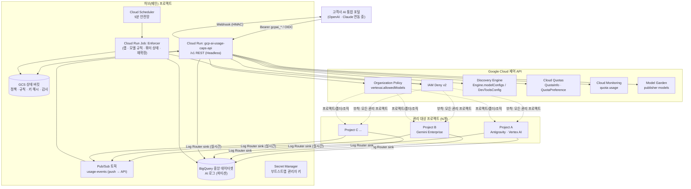
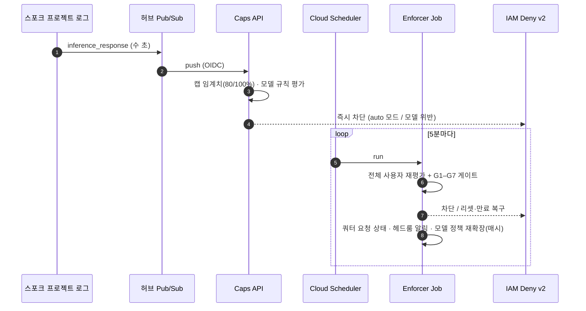

# 아키텍처 (Architecture)

> **English summary** — One *hub* project hosts a headless Cloud Run API, a Cloud Run Enforcer Job, a GCS state bucket, a central BigQuery dataset, a Pub/Sub topic and Cloud Scheduler. Every *managed (spoke)* project routes AI usage logs to the hub (BigQuery for history, Pub/Sub for real-time). The hub reads usage, computes cost, and enforces controls back on every spoke through IAM Deny v2, Organization Policy (`vertexai.allowedModels`), Discovery Engine (Gemini Enterprise app models) and the Cloud Quotas API. The customer's existing AI portal calls only the hub's `/v1` REST API (API keys or Google OIDC).

## 1. 전체 구성 (Hub-and-Spoke)

## 2. 기능별 데이터 흐름

| 기능 | 읽기 | 쓰기(집행) | 지연 |
|---|---|---|---|
| 유저별 사용량·비용 | BigQuery 싱크(이력) + Cloud Logging(꼬리 구간) + Billing Export/Catalog 가격 | – | 수 초 |
| 유저 지출 캡 | 위 사용량 + 정책 | IAM Deny v2 (서비스별 룰) | 감지 수 초~5분 + 1–2분 |
| 프로젝트 하드캡 | Billing Budget | Budget `spendCap` | 해제 시 ~1시간 |
| 모델 카탈로그 | Model Garden publisher models + 가격 | – | 즉시 |
| 프로젝트 모델 정책 | Org Policy (effective) | Org Policy `vertexai.allowedModels` | 수 분(≤~15) |
| GE 앱 모델 | Discovery Engine engines | `modelConfigs` (merge PATCH) | 수 초~1분 |
| Antigravity 허용 모델 | DevToolsConfig | (Console 전용) | – |
| 유저별 모델 규칙 | 추론 로그(실시간) + 사용량(5분) | IAM Deny v2 | 수 초 + 1–2분 |
| Rate limit/쿼터 | Cloud Quotas + Monitoring | QuotaPreference | 하향 빠름 / 상향 심사 |
| 환경 사전점검 | 30여 개 GCP API (읽기 전용) | – | 수십 초 |

## 3. 실시간 경로 vs 안전망

## 4. 상태 저장소 (GCS 문서)

| 문서 | 내용 |
|---|---|
| `api_keys` | 키 ID, 이름, scope, **솔트 SHA-256 해시**(평문 미저장), 만료 |
| `policy` | 전역 캡 정책 오버라이드 |
| `user_caps` | 유저 캡 규칙, 수동/모델 차단(`blocks`, `source`), 자동 정지, 마지막 실행 |
| `user_model_rules` | 기본/유저 모델 규칙, 위반 이력, 중복 제거 원장 |
| `model_policies` | 스코프별 모델 정책 **의도(패턴)** |
| `model_catalog` | Model Garden 동기화 결과 |
| `quota_requests` | 쿼터 요청·상태 이력 |
| `operations` | 전파 중 작업 |
| `webhooks` | 웹훅 등록(서명 비밀키) · 알림 중복 제거 |
| `readiness` | 최근 사전점검 리포트 |

GCS 버킷은 버전 관리·균일 접근·공개 차단으로 생성되며, 문서 단위 낙관적 잠금(generation match)으로 동시 쓰기를 보호합니다.

## 5. 인증·권한 경계

* **포털 → API**: `Authorization: Bearer gcpai_<id>_<secret>` (scope: `usage:read`, `caps:read`, `caps:write`, `users:write`, `models:read`, `models:write`, `quotas:read`, `quotas:write`, `admin`) 또는 Google OIDC ID 토큰(허용된 서비스 계정).
* **Pub/Sub · Scheduler → API**: Google OIDC (audience = 서비스 URL).
* **API/Job → Google Cloud**: 최소 권한 서비스 계정 2개(API 런타임 / Enforcer). IAM Deny 쓰기는 Enforcer, 조회는 API. Org Policy 쓰기 권한(`roles/orgpolicy.policyAdmin`)과 Deny 권한(`roles/iam.denyAdmin`/`denyReviewer`)은 **조직 수준에서만 부여 가능**합니다 — 자세한 표는 [multi-project-deployment.md](multi-project-deployment.md).
