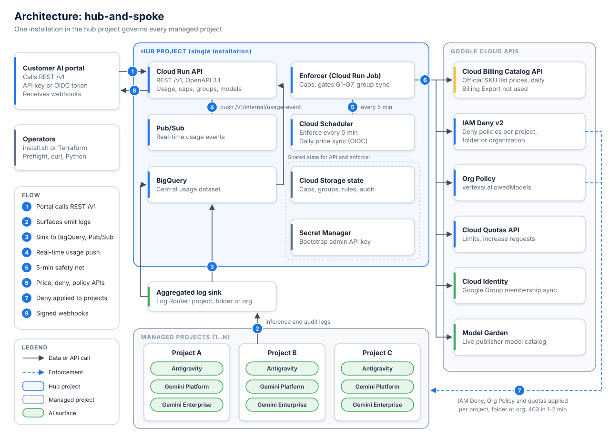
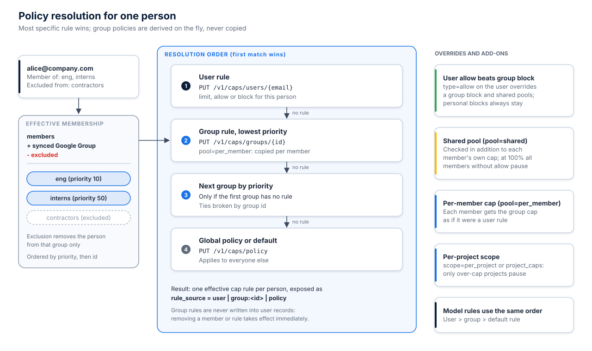
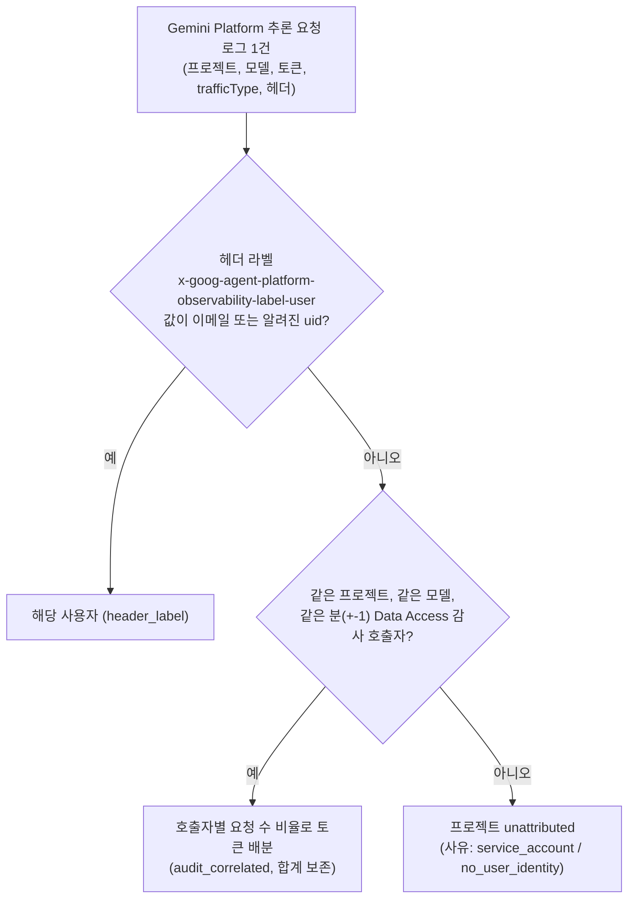
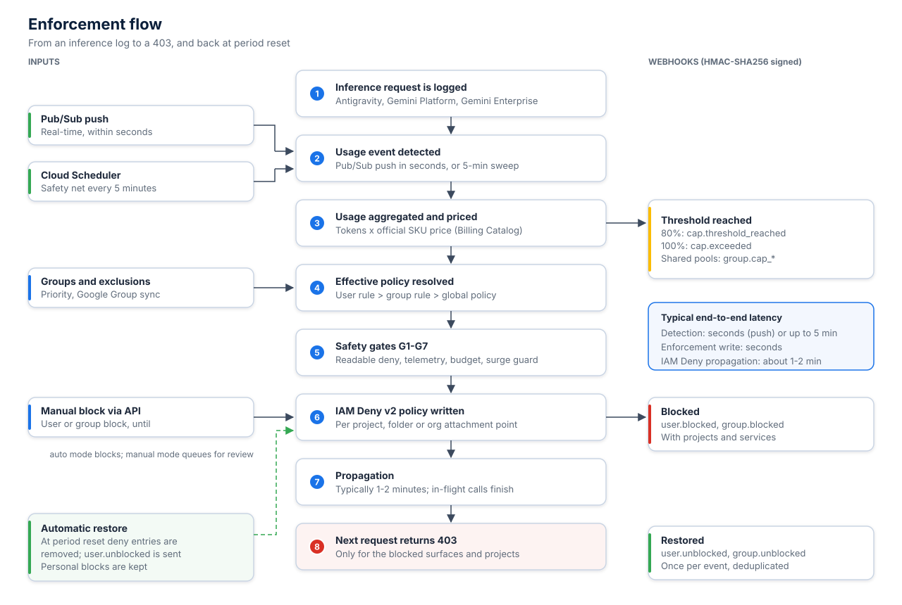
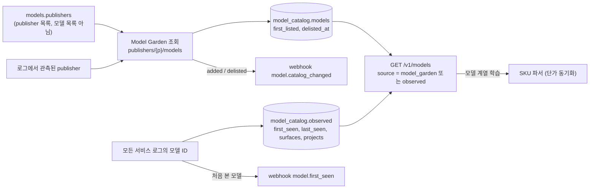

# 아키텍처 (Architecture)

> **English summary** - One *hub* project hosts a headless Cloud Run API, a Cloud Run Enforcer Job, a GCS state bucket, a central BigQuery dataset, a Pub/Sub topic, Secret Manager and Cloud Scheduler (5-minute enforcement, daily price sync, hourly group sync). Every *managed (spoke)* project routes AI usage **logs** to the hub - Antigravity `inference_response`, Gemini Platform `inference_request` (token counts, enabled per project) and Data Access audit logs (caller identity), Gemini Enterprise activity - BigQuery for history, Pub/Sub for real time. Cost = log token counts x **official Cloud Billing Catalog SKU prices**; the **Cloud Billing export is not used**. The model catalog is live Model Garden plus models observed in logs (no built-in list). Policies apply to users, groups (explicit members plus Cloud Identity group sync) and a global default. Controls are enforced back on every spoke through IAM Deny v2 (per project, or per folder/organization), Organization Policy (`vertexai.allowedModels`), Discovery Engine and the Cloud Quotas API, and every state change is pushed to the portal as a signed outbound webhook.

## 1. 전체 구성 (Hub-and-Spoke)

허브(메인) 프로젝트 하나가 모든 관리 대상(스포크) 프로젝트의 AI 사용량을 수집하고 정책을 집행합니다. 고객사 AI 통합 포털은 기존 AI 벤더 Admin API와 같은 방식으로 이 API만 호출하면 됩니다.

| 구성 요소 | 위치 | 역할 |
|---|---|---|
| Cloud Run `gcp-ai-usage-caps-api` | 허브 | `/v1` REST (Headless). 포털 · Pub/Sub push · Scheduler 호출 수신 |
| Cloud Run Job (Enforcer) | 허브 | 5분 주기 캡 · 모델 규칙 · 쿼터 상태 재평가, 모델 정책 재확장 |
| Cloud Scheduler | 허브 | 5분 안전망, 매일 단가 동기화, 매시 그룹 동기화 |
| Pub/Sub 토픽 `usage-events` | 허브 | 스포크 로그 실시간 push -> API |
| BigQuery 중앙 데이터셋 | 허브 | AI 로그 이력 (파티션) |
| GCS 상태 버킷 (상태 저장소) | 허브 | 정책 · 규칙 · 그룹 · 카탈로그 · 단가 · 키 해시 · 감사 문서 ([6장](#6-상태-저장소-gcs-문서)) |
| Secret Manager | 허브 | 부트스트랩 관리자 키 |
| Cloud Billing Catalog API | Google | 공식 SKU 목록가 · 환율 (Billing Export는 **사용하지 않음**) |
| IAM Deny v2 | Google | 차단 집행. 프로젝트별 부착점(기본) 또는 폴더/조직 부착(`deny_attachment=scope`) |
| Organization Policy | Google | 프로젝트/폴더/조직 모델 허용 목록 `vertexai.allowedModels` |
| Discovery Engine | Google | Gemini Enterprise 앱 `Engine.modelConfigs` / `DevToolsConfig` |
| Cloud Quotas API + Cloud Monitoring | Google | `QuotaInfo` · `QuotaPreference`, 쿼터 사용량 |
| Model Garden | Google | publisher models (동적 카탈로그) |
| Gemini Platform `setPublisherModelConfig` | Google | 프로젝트별 추론 요청 로그 활성화 |
| Cloud Identity API | Google | Google Group 멤버 동기화 |
| Outbound webhooks (HMAC 서명) | 포털 | 차단 · 해제 · 임계치 · 모델 위반 · 카탈로그 변경 알림 |

> [!IMPORTANT]
> **Cloud Billing Export(BigQuery 결제 내보내기)는 어떤 경로에서도 사용하지 않습니다.** 사용량은 로그, 단가는 공개 Cloud Billing Catalog API에서 옵니다. 결제 계정 데이터에 대한 읽기 권한이 필요 없습니다. `workspace.billing.account_id`는 프로젝트 하드캡(Billing Budget API)에만 쓰입니다.

### 1.1 계측 서비스(surface)

| surface id | 서비스 |
|---|---|
| `antigravity` | Antigravity |
| `gemini_platform` | Gemini Platform. 레거시 id `vertex_ai`도 별칭으로 계속 허용되며 `gemini_platform`으로 정규화됩니다 |
| `gemini_enterprise` | Gemini Enterprise |

### 1.2 그룹 / 정책 주체 (Groups / policy subjects)

 그룹 규칙(priority 낮은 순) > 전역 기본 정책" width="100%">

정책 주체는 **사용자**, **그룹**, **전역 기본값** 세 가지입니다. 그룹은 사용자와 동일한 기능(지출 캡, 차단, 모델 규칙, 예외, 사용량 조회)을 가집니다.

* **groups 저장 문서**: 그룹 정의(명시적 `members`, 동기화된 멤버, `excluded`, `priority`, 캡 · 모델 규칙 · 차단)는 상태 저장소의 `groups` 문서 하나에 저장됩니다.
* **Cloud Identity 그룹 동기화**: 그룹에 Google Group 이메일을 연결하면 Cloud Identity API로 멤버를 **매시간** 자동 동기화하고, `POST /v1/groups/{group_id}/sync`로 **즉시** 동기화할 수도 있습니다.
* **해석 순서 (가장 구체적인 규칙 우선)**: 사용자 규칙 > 그룹 규칙(`priority`가 낮은 순, 동률이면 그룹 id 순) > 전역 정책/기본 규칙. 사용자 수준 `allow` 규칙은 그룹 차단보다 우선합니다.
* **공유 풀 캡**: `pool=shared` 그룹 캡은 각 멤버 개인 캡과 **추가로** 평가됩니다. 유효 멤버 합산 사용량이 그룹 캡에 도달하면 사용자 수준 `allow`가 없는 모든 멤버가 정지됩니다.
* **`expand_state` 멤버별 파생**: 그룹 정책은 사용자 레코드에 기록되지 않고, `expand_state`가 평가 시점에 사람별 유효 정책을 파생합니다. 따라서 멤버 제거 · 예외 추가 · 그룹 규칙 삭제는 즉시 반영되고 완전히 되돌릴 수 있습니다.

## 2. 기능별 데이터 흐름

| 기능 | 읽기 | 쓰기(집행) | 지연 |
|---|---|---|---|
| 사용자별 사용량 | BigQuery 싱크(이력) + Cloud Logging(최근 구간): Antigravity `inference_response`, Gemini Platform `inference_request` + Data Access 감사 로그, GE 활동 로그 | - | 수 초 |
| 비용 | 위 토큰 수 x 공식 SKU 단가(`pricing` 문서, 매일 동기화) 또는 계약 override | - | 즉시 |
| 단가 동기화 | Cloud Billing Catalog `services` / `services.skus` (+ 환율) | GCS `pricing` | 매일 03:00 (기본) |
| 사용자/그룹 지출 캡 | 위 사용량 + 정책 (합산/프로젝트별, 그룹 per_member/shared) | IAM Deny v2 (서비스별 룰 x 부착점) | 감지 수 초~5분 + 1-2분 |
| 그룹 멤버 동기화 | Cloud Identity API (Google Group 멤버십) | GCS `groups` | 매시 + 요청 시 즉시 |
| 프로젝트 하드캡 | Billing Budget | Budget `spendCap` | 해제 시 ~1시간 |
| 모델 카탈로그 | Model Garden publisher models + 로그 관측 모델 + 단가 | GCS `model_catalog` (`observed`, `models`) | 즉시 (TTL 1시간) |
| 프로젝트 모델 정책 | Org Policy (effective) | Org Policy `vertexai.allowedModels` | 수 분(~15분 이내) |
| GE 앱 모델 | Discovery Engine engines | `modelConfigs` (merge PATCH) | 수 초~1분 |
| Antigravity 허용 모델 | DevToolsConfig | (Console 전용) | - |
| 사용자/그룹 모델 규칙 | 추론 로그(실시간) + 사용량(5분) | IAM Deny v2 (위반 프로젝트) | 수 초 + 1-2분 |
| Gemini Platform 추론 로그 | `fetchPublisherModelConfig` | `setPublisherModelConfig` | 수 분 |
| Rate limit/쿼터 | Cloud Quotas + Monitoring | QuotaPreference | 하향 빠름 / 상향 심사 |
| 상태 변경 알림 | - | Outbound webhook (HMAC) | 즉시 |
| 환경 사전점검 | 30여 개 GCP API (읽기 전용) | - | 수십 초 |

Gemini Platform 추론 로그 활성화 API(`/v1/projects/{project_id}/vertex-logging`, `/v1/vertex-logging/enable`)는 기본적으로 `https://aiplatform.googleapis.com/v1beta1`을 호출합니다. 환경 변수 `VERTEX_LOGGING_ENDPOINT`로 이 publisher-model-config 엔드포인트를 재정의할 수 있으며, 값은 `https://host[:port]/v1beta1` 형식이어야 합니다(형식이 다르면 무시).

## 3. 사용량 수집과 사용자 귀속

| 서비스 | 로그 | 사람 식별 | 토큰 | `attribution` |
|---|---|---|---|---|
| Antigravity | `businessaicode.googleapis.com/inference_response` | `labels.user_id` | Yes | `log_identity` |
| Gemini Platform | `aiplatform.googleapis.com/inference_request` (프로젝트별 활성화) | 헤더 라벨 -> 감사 로그 상관 | Yes | `header_label` / `audit_correlated` / `unattributed` |
| Gemini Platform (추론 로그 없음) | `cloudaudit.googleapis.com/data_access` | `principalEmail` | No (요청 수만) | `log_identity` (`token_sources=requests_only`) |
| Gemini Enterprise | `discoveryengine.googleapis.com/gemini_enterprise_user_activity` / `gen_ai_user_message` | 사용자 IAM 주체 | No (좌석 과금) | `log_identity` |

* 배분은 최대 나머지(largest-remainder) 방식의 정수 분할이라 **배분 후 합계가 원래 토큰 수와 정확히 같습니다**.
* 귀속 불가분은 사용자 합계에서 빠지지만 `summary.unattributed_*`, `GET /v1/usage/models`의 `unattributed_*`, 차지백의 `unattributed` 섹션으로 프로젝트별로 보고되어 **프로젝트 합계는 완전**합니다.
* 모든 사용량 응답의 `telemetry`(`attribution`, `token_sources`, `unattributed_projects`, `truncated`)로 데이터 품질을 확인합니다.

## 4. 실시간 경로 vs 안전망

1. 스포크 프로젝트 로그(`inference_response` / `inference_request`)가 수 초 안에 허브 Pub/Sub로 전달되고 OIDC push로 API에 도착합니다.
2. API가 캡 임계치(80/100%), 사용자/그룹 모델 규칙을 평가하고 신규 모델을 기록합니다. auto 모드이거나 모델 위반이면 해당 프로젝트에 IAM Deny v2로 즉시 차단하고 웹훅을 보냅니다.
3. Cloud Scheduler가 5분마다 Enforcer Job을 실행해 전체 사용자 x 프로젝트를 재평가(G1-G7 게이트)하고, 부착점별 차단과 리셋 · 만료 복구, 쿼터 요청 상태 · 헤드룸 알림, 모델 정책 재확장(매시)을 수행합니다.
4. 매일 `POST /v1/internal/pricing/sync`로 공식 SKU 단가와 환율을, 매시 Cloud Identity 그룹 멤버를 동기화합니다.

## 5. 동적 모델 카탈로그

`models.publishers`(`MODEL_PUBLISHERS`)의 기본값은 `google`과 설정된 파트너 publisher들입니다.

## 6. 상태 저장소 (GCS 문서)

| 문서 | 내용 |
|---|---|
| `api_keys` | 키 ID, 이름, scope, **솔트 SHA-256 해시**(평문 미저장), 만료 |
| `policy` | 전역 캡 정책 오버라이드 (`cap_scope`, `project_defaults`, `metered_surfaces` 포함) |
| `user_caps` | 사용자 캡 규칙(`scope`, `project_caps`), 수동/모델 차단(`blocks`, `projects`, `source`), 자동 정지(`suspensions.projects`), 마지막 실행 |
| `groups` | 그룹 정의(멤버 · 동기화 멤버 · 예외 · `priority`), 그룹 캡 · 차단 · 모델 규칙, 마지막 동기화 |
| `user_model_rules` | 기본/사용자 모델 규칙, 위반 이력, 중복 제거 원장 |
| `user_directory` | `uid` -> 사용자 매핑 (헤더 라벨의 uid 해석용) |
| `model_policies` | 스코프별 모델 정책 **의도(패턴)** |
| `model_catalog` | Model Garden 조회 결과(`models`) + 로그 관측 모델(`observed`) |
| `pricing` | 공식 SKU 단가표(`models`: 차원 · 티어 · SKU 이름), 환율(`fx`), `synced_at` |
| `quota_requests` | 쿼터 요청 · 상태 이력 |
| `operations` | 전파 중 작업 |
| `webhooks` | 웹훅 등록(서명 비밀키) · 알림 중복 제거 |
| `readiness` | 최근 사전점검 리포트 |

GCS 버킷은 버전 관리 · 균일 접근 · 공개 차단으로 생성되며, 문서 단위 낙관적 잠금(generation match)으로 동시 쓰기를 보호합니다. 부트스트랩 관리자 키는 GCS가 아닌 Secret Manager에 보관됩니다.

## 7. 인증 · 권한 경계

* **포털 -> API**: `Authorization: Bearer gcpai_<id>_<secret>` (scope: `usage:read`, `caps:read`, `caps:write`, `users:write`, `models:read`, `models:write`, `quotas:read`, `quotas:write`, `admin`) 또는 Google OIDC ID 토큰(허용된 서비스 계정).
* **API -> 포털**: 등록된 웹훅 URL로 HMAC 서명된 이벤트 전송 ([webhooks.md](webhooks.md)).
* **Pub/Sub · Scheduler -> API**: Google OIDC (audience = 서비스 URL). 단가 동기화(`/v1/internal/pricing/sync`)도 동일.
* **API/Job -> Google Cloud**: 최소 권한 서비스 계정 2개(API 런타임 / Enforcer). IAM Deny 쓰기는 Enforcer, 조회는 API. Gemini Platform 추론 로그 활성화는 각 프로젝트의 `aiplatform.endpoints.setPublisherModelConfig` 권한 필요. 그룹 동기화는 Cloud Identity 그룹 멤버십 읽기 권한 필요. Org Policy 쓰기 권한(`roles/orgpolicy.policyAdmin`)과 Deny 권한(`roles/iam.denyAdmin`/`denyReviewer`)은 **조직 수준에서만 부여 가능**합니다. 자세한 표는 [multi-project-deployment.md](multi-project-deployment.md).
* 비용 산정 상세 -> [cost-methodology.md](cost-methodology.md)
