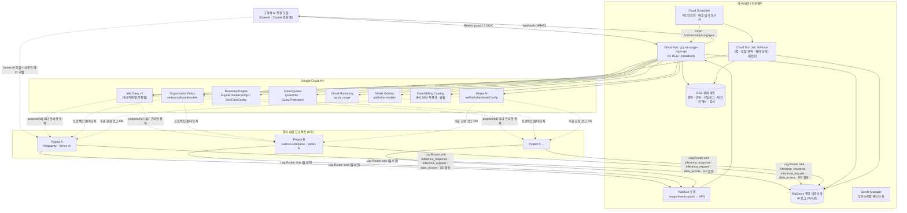
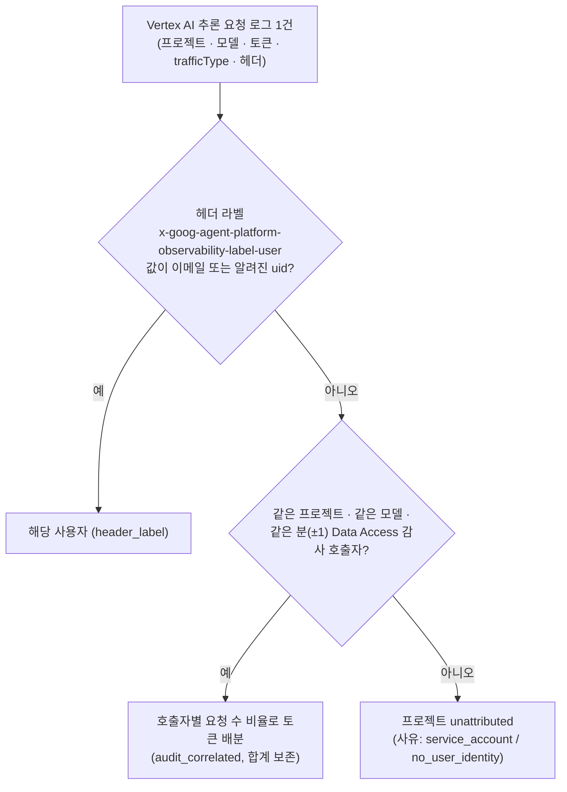
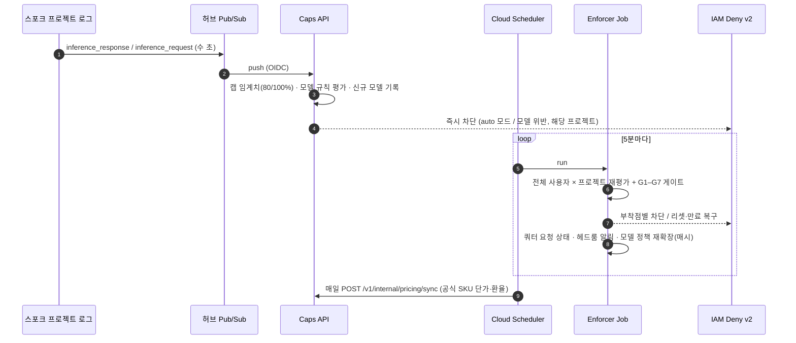
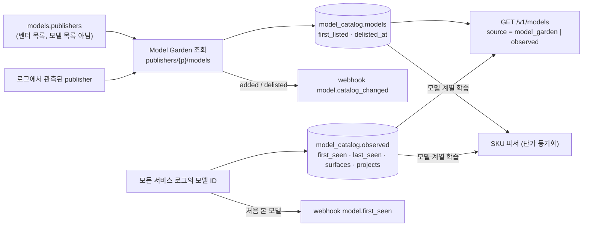

# 아키텍처 (Architecture)

> **English summary** — One *hub* project hosts a headless Cloud Run API, a Cloud Run Enforcer Job, a GCS state bucket, a central BigQuery dataset, a Pub/Sub topic and Cloud Scheduler (5-minute enforcement, daily price sync). Every *managed (spoke)* project routes AI usage **logs** to the hub — Antigravity `inference_response`, Vertex AI `inference_request` (token counts, enabled per project) and Data Access audit logs (caller identity), Gemini Enterprise activity — BigQuery for history, Pub/Sub for real time. Cost = log token counts × **official Cloud Billing Catalog SKU prices**; the **Cloud Billing export is not used**. The model catalog is live Model Garden ∪ models observed in logs (no built-in list). Controls are enforced back on every spoke through IAM Deny v2 (one attachment point per project, project-scoped entries), Organization Policy (`vertexai.allowedModels`), Discovery Engine and the Cloud Quotas API.

## 1. 전체 구성 (Hub-and-Spoke)

> [!IMPORTANT]
> **Cloud Billing Export(BigQuery 결제 내보내기)는 어떤 경로에서도 사용하지 않습니다.** 사용량은 로그, 단가는 공개 Cloud Billing Catalog API에서 옵니다. 결제 계정 데이터에 대한 읽기 권한이 필요 없습니다. `workspace.billing.account_id`는 프로젝트 하드캡(Billing Budget API)에만 쓰입니다.

## 2. 기능별 데이터 흐름

| 기능 | 읽기 | 쓰기(집행) | 지연 |
|---|---|---|---|
| 사용자별 사용량 | BigQuery 싱크(이력) + Cloud Logging(최근 구간): Antigravity `inference_response`, Vertex AI `inference_request` + Data Access 감사 로그, GE 활동 로그 | – | 수 초 |
| 비용 | 위 토큰 수 × 공식 SKU 단가(`pricing` 문서, 매일 동기화) 또는 계약 override | – | 즉시 |
| 단가 동기화 | Cloud Billing Catalog `services` / `services.skus` (+ 환율) | GCS `pricing` | 매일 03:00 (기본) |
| 사용자 지출 캡 | 위 사용량 + 정책 (합산/프로젝트별) | IAM Deny v2 (서비스별 룰 × 프로젝트 부착점) | 감지 수 초~5분 + 1–2분 |
| 프로젝트 하드캡 | Billing Budget | Budget `spendCap` | 해제 시 ~1시간 |
| 모델 카탈로그 | Model Garden publisher models + 로그 관측 모델 + 단가 | GCS `model_catalog` (`observed`, `models`) | 즉시 (TTL 1시간) |
| 프로젝트 모델 정책 | Org Policy (effective) | Org Policy `vertexai.allowedModels` | 수 분(≤~15) |
| GE 앱 모델 | Discovery Engine engines | `modelConfigs` (merge PATCH) | 수 초~1분 |
| Antigravity 허용 모델 | DevToolsConfig | (Console 전용) | – |
| 사용자별 모델 규칙 | 추론 로그(실시간) + 사용량(5분) | IAM Deny v2 (위반 프로젝트) | 수 초 + 1–2분 |
| Vertex AI 추론 로그 | `fetchPublisherModelConfig` | `setPublisherModelConfig` | 수 분 |
| Rate limit/쿼터 | Cloud Quotas + Monitoring | QuotaPreference | 하향 빠름 / 상향 심사 |
| 환경 사전점검 | 30여 개 GCP API (읽기 전용) | – | 수십 초 |

## 3. 사용량 수집과 사용자 귀속

| 서비스 | 로그 | 사람 식별 | 토큰 | `attribution` |
|---|---|---|---|---|
| Antigravity | `businessaicode.googleapis.com/inference_response` | `labels.user_id` | ✅ | `log_identity` |
| Vertex AI | `aiplatform.googleapis.com/inference_request` (프로젝트별 활성화) | 헤더 라벨 → 감사 로그 상관 | ✅ | `header_label` / `audit_correlated` / `unattributed` |
| Vertex AI (추론 로그 없음) | `cloudaudit.googleapis.com/data_access` | `principalEmail` | ✗ (요청 수만) | `log_identity` (`token_sources=requests_only`) |
| Gemini Enterprise | `discoveryengine.googleapis.com/gemini_enterprise_user_activity` / `gen_ai_user_message` | 사용자 IAM 주체 | ✗ (좌석 과금) | `log_identity` |

* 배분은 최대 나머지(largest-remainder) 방식의 정수 분할이라 **배분 후 합계가 원래 토큰 수와 정확히 같습니다**.
* 귀속 불가분은 사용자 합계에서 빠지지만 `summary.unattributed_*`, `GET /v1/usage/models`의 `unattributed_*`, 차지백의 `unattributed` 섹션으로 프로젝트별로 보고되어 **프로젝트 합계는 완전**합니다.
* 모든 사용량 응답의 `telemetry`(`attribution`, `token_sources`, `unattributed_projects`, `truncated`)로 데이터 품질을 확인합니다.

## 4. 실시간 경로 vs 안전망

## 5. 동적 모델 카탈로그

## 6. 상태 저장소 (GCS 문서)

| 문서 | 내용 |
|---|---|
| `api_keys` | 키 ID, 이름, scope, **솔트 SHA-256 해시**(평문 미저장), 만료 |
| `policy` | 전역 캡 정책 오버라이드 (`cap_scope`, `project_defaults`, `metered_surfaces` 포함) |
| `user_caps` | 사용자 캡 규칙(`scope`, `project_caps`), 수동/모델 차단(`blocks`, `projects`, `source`), 자동 정지(`suspensions.projects`), 마지막 실행 |
| `user_model_rules` | 기본/사용자 모델 규칙, 위반 이력, 중복 제거 원장 |
| `user_directory` | `uid` → 사용자 매핑 (헤더 라벨의 uid 해석용) |
| `model_policies` | 스코프별 모델 정책 **의도(패턴)** |
| `model_catalog` | Model Garden 조회 결과(`models`) + 로그 관측 모델(`observed`) |
| `pricing` | 공식 SKU 단가표(`models`: 차원·티어·SKU 이름), 환율(`fx`), `synced_at` |
| `quota_requests` | 쿼터 요청·상태 이력 |
| `operations` | 전파 중 작업 |
| `webhooks` | 웹훅 등록(서명 비밀키) · 알림 중복 제거 |
| `readiness` | 최근 사전점검 리포트 |

GCS 버킷은 버전 관리·균일 접근·공개 차단으로 생성되며, 문서 단위 낙관적 잠금(generation match)으로 동시 쓰기를 보호합니다.

## 7. 인증·권한 경계

* **포털 → API**: `Authorization: Bearer gcpai_<id>_<secret>` (scope: `usage:read`, `caps:read`, `caps:write`, `users:write`, `models:read`, `models:write`, `quotas:read`, `quotas:write`, `admin`) 또는 Google OIDC ID 토큰(허용된 서비스 계정).
* **Pub/Sub · Scheduler → API**: Google OIDC (audience = 서비스 URL). 단가 동기화(`/v1/internal/pricing/sync`)도 동일.
* **API/Job → Google Cloud**: 최소 권한 서비스 계정 2개(API 런타임 / Enforcer). IAM Deny 쓰기는 Enforcer, 조회는 API. Vertex AI 추론 로그 활성화는 각 프로젝트의 `aiplatform.endpoints.setPublisherModelConfig` 권한 필요. Org Policy 쓰기 권한(`roles/orgpolicy.policyAdmin`)과 Deny 권한(`roles/iam.denyAdmin`/`denyReviewer`)은 **조직 수준에서만 부여 가능**합니다 — 자세한 표는 [multi-project-deployment.md](multi-project-deployment.md).
* 비용 산정 상세 → [cost-methodology.md](cost-methodology.md)
