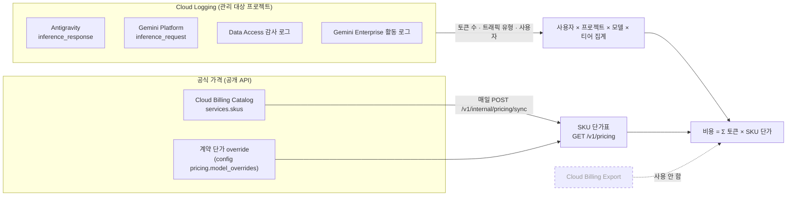

# 비용 산정 방식 (Cost Methodology)

> **English summary** — Costs are computed as **token counts read from Cloud Logging logs × official Cloud Billing Catalog SKU list prices** (or contract override prices). The **Cloud Billing export to BigQuery is NOT used and NOT required**. Each token is priced at its own SKU dimension — input, output (thinking tokens are billed as output), context-cache read, prompt-cache write, long-context tier, and the Flex / Priority / Batch traffic tiers; Provisioned Throughput traffic follows a configurable policy. Results are **list-price estimates** that exclude credits, committed-use discounts, negotiated discounts (unless entered as overrides) and taxes. `GET /v1/pricing` shows the exact SKU table (with SKU resource names) used for every number.

이 문서는 고객사 재무·감사 검토에 제출할 수 있도록 이 API가 **“누가, 어떤 모델로, 얼마를 썼는가”** 를 계산하는 방법을 처음부터 끝까지 설명합니다.

---

## 1. 핵심 원칙 (한 문단 요약)

| 항목 | 내용 |
|---|---|
| 사용량(토큰 수) 출처 | **Cloud Logging 로그만** 사용 — Antigravity 추론 로그, Gemini Platform 추론 요청 로그(`aiplatform.googleapis.com/inference_request`), Data Access 감사 로그(요청 수·사용자 귀속), Gemini Enterprise 활동 로그 |
| 단가 출처 | **공식 Cloud Billing Catalog API의 SKU 목록가**(`cloudbilling.googleapis.com/v1/services/{id}/skus`), 매일 동기화 · 또는 계약 단가 override |
| Cloud Billing Export | **사용하지 않음 · 필요 없음** (BigQuery 결제 내보내기 테이블을 읽지 않으며 설정 항목도 없음) |
| 결과의 성격 | **목록가 기준 추정액** — 크레딧·약정 사용 할인(CUD)·협상 할인(override 미입력 시)·세금 **미반영** |
| 투명성 | 모든 응답에 `pricing_source`(산정 방식·동기화 시각·SKU 수), 행마다 `cost_basis`, `cost_partial`; `GET /v1/pricing`으로 SKU 이름까지 공개 |
| 모델 목록 | **내장 모델 목록 없음** — SKU 파서는 Model Garden 카탈로그와 로그에서 관측된 모델 ID로 모델 계열을 **학습**하므로, 신규 모델은 Google이 SKU를 게시하는 즉시 가격이 매겨집니다 |



## 2. 사용량(토큰) 수집 — 서비스별 필드 매핑

| 서비스 | 로그 | 입력 토큰 `I` | 캐시 읽기 `C` | 캐시 쓰기 `W` | 출력 토큰 `O` | 트래픽 유형 |
|---|---|---|---|---|---|---|
| Antigravity | `businessaicode.googleapis.com/inference_response` | `promptTokenCount` (+`toolUsePromptTokenCount`) | `cachedContentTokenCount` | – | `max(total − I, candidates + thoughts)` | 표준(on-demand) |
| Gemini Platform — Gemini `generateContent` / `streamGenerateContent` | `aiplatform.googleapis.com/inference_request` → `generateContentDetails.usageMetadata` | `promptTokenCount + toolUsePromptTokenCount` | `cachedContentTokenCount` | – | `max(totalTokenCount − I, candidatesTokenCount + thoughtsTokenCount)` | `trafficType` |
| Gemini Platform — 파트너 모델 `rawPredict` / `streamRawPredict` | 같은 로그 → `rawPredictDetails.usageMetadata` | `input_tokens + cache_read_input_tokens + cache_creation_input_tokens` | `cache_read_input_tokens` | `cache_creation_input_tokens` | `output_tokens` | `trafficType` |
| Gemini Platform (추론 로그 미활성) | Data Access 감사 로그 | 없음 → **요청 수만** (`token_sources.gemini_platform = requests_only`) | – | – | – | – |
| Gemini Enterprise | 사용자 활동 로그 | 없음 — **좌석(라이선스) 과금 제품**, 요청 수만 집계 (`cost_basis = license`) | – | – | – | – |

* **사고(thinking) 토큰은 출력 단가로 과금**되므로 출력 토큰에 포함합니다(`thoughts_tokens`로 별도 표시).
* 실패한 요청(`severity=ERROR` 또는 `error` 필드)은 집계하지 않습니다.
* `trafficType` 매핑: `ON_DEMAND → on_demand`, `ON_DEMAND_FLEX → flex`, `ON_DEMAND_PRIORITY → priority`, `BATCH → batch`, `PROVISIONED_THROUGHPUT → provisioned`.
* 응답의 `by_traffic`에 티어별 토큰이 그대로 노출되어 재계산·검증이 가능합니다.

## 3. 단가(SKU) 수집 — 공식 Cloud Billing Catalog

1. `POST /v1/internal/pricing/sync`(Cloud Scheduler가 **매일** OIDC로 호출)가 공개 Cloud Billing Catalog의 서비스 목록에서 AI 모델 서비스(설정 `pricing.catalog_services` 패턴 + 이름으로 모델 서비스임이 식별되는 파트너 모델 서비스)를 찾고, 각 서비스의 SKU를 모두 읽습니다.
2. SKU 설명(description)을 **모델 키 + 가격 차원 + 티어**로 분류합니다. 모델 계열은 내장 목록이 아니라 Model Garden 카탈로그 및 로그에서 관측된 모델 ID로부터 학습합니다(`families_learned`).
3. 같은 (모델, 티어, 차원)에 SKU가 여러 개면 기본(제품 변형이 아닌) SKU와 global SKU를 우선하고, 남은 후보의 중앙값을 사용합니다. 1M 토큰당 \$500 초과 등 비정상 값은 버립니다.
4. 결과는 상태 저장소의 `pricing` 문서에 저장되고 6시간 캐시됩니다. 동기화가 한 번도 안 된 경우 첫 조회 때 1회 실시간 조회합니다.

### 3.1 SKU 가격 차원

| 차원 (`GET /v1/pricing` 필드) | 의미 | 적용 토큰 | 해당 SKU가 없을 때 |
|---|---|---|---|
| `input` | 표준 입력 | `I − C − W` | 미가격(`cost_partial=true`) |
| `output` | 표준 출력 (**사고 토큰 포함**) | `O` | 미가격 |
| `cached` | 컨텍스트 캐시 읽기 | `C` | `input` 단가(보수적) |
| `cache_write` | 프롬프트 캐시 쓰기(파트너 모델) | `W` | `input` 단가 |
| `tiers.long_context` | 장문 컨텍스트 티어(입력·출력·캐시) | 프롬프트가 임계값 초과인 요청의 토큰 | 표준 단가 |
| `tiers.flex` / `tiers.priority` / `tiers.batch` | 트래픽 티어 | `trafficType`가 해당 티어인 요청의 토큰 | 표준 단가 |
| `tiers.<variant>_long_context` | 티어 × 장문 조합(SKU가 있으면 표에 표시) | 참고용 | – |
| `skus` | 각 단가의 근거 SKU 리소스 이름(`services/…/skus/…`) | – | – |

> [!NOTE]
> 다음 SKU는 텍스트 토큰 단가가 아니므로 분류에서 제외합니다: 이미지·오디오·비디오·Live/양방향·임베딩·그라운딩/검색·튜닝·스토리지·시간 단위 SKU, 그리고 Provisioned Throughput 약정 SKU. 설정 `pricing.excluded_sku_patterns`(필수 포함: `code assist`, `duet ai`)에 해당하는 SKU도 제외됩니다. 이미지·영상 생성처럼 토큰으로 과금되지 않는 모델은 `cost_basis = not_token_priced`로 표시되고 비용 합계에서 빠집니다.

## 4. 계산식

모델 `m`, 트래픽 티어 `t`(on_demand · flex · priority · batch · provisioned)마다 (모든 단가는 **1M 토큰당**):

$$
\text{cost}_{m,t} = \frac{(I_t - C_t - W_t)\,P^{in}_{t} + C_t\,P^{cached}_{t} + W_t\,P^{cw}_{t} + O_t\,P^{out}_{t}}{1{,}000{,}000}
$$

* `C ≤ I`, `W ≤ I − C`로 보정하며 음수는 0으로 처리합니다.
* `P_t`는 해당 티어 SKU 단가, 티어 SKU가 없으면 표준 단가입니다.

**장문 컨텍스트(long-context) 규칙**

* 요청의 입력 토큰 `I`가 `pricing.long_context_threshold_tokens`(기본 **200,000**, 환경변수 `LONG_CONTEXT_THRESHOLD_TOKENS`)를 **초과**하면, 그 요청의 입력·출력·캐시 토큰 전체를 표준(on-demand) 버킷에서 빼서 `tiers.long_context` 단가로 계산합니다.

$$
\text{cost}^{long}_{m} = \frac{(I^{L} - C^{L})\,P^{in}_{long} + C^{L}\,P^{cached}_{long} + O^{L}\,P^{out}_{long}}{1{,}000{,}000}
$$

* SKU 설명에 표시된 임계값은 `GET /v1/pricing`의 `tiers.long_context.threshold_tokens`로 노출됩니다. 판정에는 설정값이 쓰이므로 SKU 기준과 다르면 설정을 맞춰 주세요.

**Provisioned Throughput (PT)** — `pricing.provisioned_throughput_cost` (환경변수 `PROVISIONED_THROUGHPUT_COST`)

| 값 | 의미 | 사용 시점 |
|---|---|---|
| `on_demand` (기본) | PT로 처리된 토큰도 **온디맨드 표준 단가**로 환산 | 사용자별 “실사용 가치” 차지백, PT 약정을 부서에 배분할 때 |
| `zero` | PT 토큰은 **0원**(약정 요금으로 이미 선결제) | 추가 지출만 보고 싶을 때 |

**모델·사용자 합계**

$$
\text{cost}_{user} = \sum_{project}\sum_{m}\Big(\text{cost}^{long}_{m} + \sum_{t}\text{cost}_{m,t}\Big)
$$

차지백 리포트(`GET /v1/billing/users`)는 (사용자, 프로젝트) 단위 사실값을 **정수 센트**로 확정한 뒤 합산하므로 사용자 합계·프로젝트 합계·총합 사이에 반올림 오차가 없습니다.

## 5. 단가 우선순위 · 계약 단가 override · 환율

1. **계약 단가 override** — `config.yaml`/`config.local.yaml`의 `pricing.model_overrides: [{model, input, output, cached}]` (1M 토큰당, **캡 통화 기준**, 모델 ID 접두사 일치). override가 있는 모델은 모든 티어에 같은 단가를 쓰며, 캐시 쓰기는 `input` 단가를 씁니다. `cost_basis = override`.
2. **공식 SKU 목록가** — 위 3절. `cost_basis = official_sku`.
3. 그 외 — `pricing.source: manual`일 때만 `input_price_per_million`/`output_price_per_million` 기본 단가(`default_rate`). 기본값 `auto`에서는 SKU가 없는 모델을 **추측 가격으로 채우지 않고** `unpriced` + `cost_partial=true`로 표시합니다.

모델 ID가 SKU 이름과 다를 때는 `pricing.model_aliases: ["<logged-model-id>=<sku-model-key>"]`로 연결할 수 있습니다.

**환율(FX)** — 캡 통화(`CAP_CURRENCY`, 예: `KRW`)가 USD가 아니면, 동기화 시 Cloud Billing Catalog가 제공하는 `currencyConversionRate`를 사용하고(없으면 `pricing.fx_sources`의 공개 환율 API), 적용 환율과 기준 시각을 응답의 `fx: {from, to, rate, as_of}`로 공개합니다.

## 6. 계산 예시 (가상 단가)

> [!IMPORTANT]
> 아래 모델 이름(`<model-A>`, `<model-B>`)과 단가는 **설명용 가상 값**이며 실제 Google Cloud 가격이 아닙니다. 실제 단가는 항상 `GET /v1/pricing?model=<model-id>`로 확인하세요.

**가정 단가 (USD / 1M 토큰)**

| 모델 | 티어 | 입력 | 캐시 읽기 | 캐시 쓰기 | 출력 |
|---|---|---|---|---|---|
| `<model-A>` (Gemini 계열) | 표준 | 1.00 | 0.10 | – | 8.00 |
| `<model-A>` | long_context | 2.00 | 0.20 | – | 12.00 |
| `<model-A>` | flex | 0.50 | 0.05 | – | 4.00 |
| `<model-B>` (파트너 모델 계열) | 표준 | 3.00 | 0.30 | 3.75 | 15.00 |

**사용자 alice@company.com, 한 달 사용량 (로그 집계 결과)**

| # | 모델 · 티어 | 입력 `I` | 캐시 읽기 `C` | 캐시 쓰기 `W` | 출력 `O` (사고 포함) |
|---|---|---|---|---|---|
| 1 | `<model-A>` 표준 (장문 제외) | 10,000,000 | 4,000,000 | 0 | 2,000,000 |
| 2 | `<model-A>` 장문(프롬프트 > 200K, 20건) | 5,000,000 | 1,000,000 | 0 | 200,000 |
| 3 | `<model-A>` flex | 3,000,000 | 0 | 0 | 1,000,000 |
| 4 | `<model-B>` 표준 | 2,000,000 | 1,000,000 | 200,000 | 300,000 |

**계산**

| # | 식 | 금액 (USD) |
|---|---|---|
| 1 | (10,000,000 − 4,000,000)×1.00 + 4,000,000×0.10 + 2,000,000×8.00 = 6.00 + 0.40 + 16.00 | **22.40** |
| 2 | (5,000,000 − 1,000,000)×2.00 + 1,000,000×0.20 + 200,000×12.00 = 8.00 + 0.20 + 2.40 | **10.60** |
| 3 | 3,000,000×0.50 + 1,000,000×4.00 = 1.50 + 4.00 | **5.50** |
| 4 | (2,000,000 − 1,000,000 − 200,000)×3.00 + 1,000,000×0.30 + 200,000×3.75 + 300,000×15.00 = 2.40 + 0.30 + 0.75 + 4.50 | **7.95** |
| | (각 항목은 ÷ 1,000,000 후 값) **합계** | **46.45** |

* 캡 통화가 KRW이고 동기화된 환율이 1 USD = 1,400 KRW라면 → **65,030 KRW** (응답의 `fx.rate`, `fx.as_of`로 근거 제시).
* 같은 사용자가 `<model-A>`를 Provisioned Throughput으로 1,000,000 입력 / 100,000 출력 사용했다면: `on_demand` 정책 → 1.00 + 0.80 = \$1.80 추가, `zero` 정책 → \$0 추가.

## 7. 결과에 포함되지 않는 것 (반드시 함께 보고)

| 미포함 항목 | 설명 |
|---|---|
| 크레딧 · 프로모션 | 무료 체험·프로모션 크레딧 미차감 |
| 약정 할인 | CUD·스펜드 기반 약정, 협상 할인(override로 입력하지 않은 경우) |
| 세금 | 부가세 등 |
| PT 약정 요금 자체 | `zero` 정책 시 PT 토큰은 0원, 약정 월 요금은 별도 |
| 비토큰 과금 | 그라운딩/검색 요청 요금, 이미지·영상 생성, 튜닝, 스토리지 |
| 모달리티별 단가 | 멀티모달(이미지·오디오·비디오) **입력 토큰도 텍스트 입력 단가로 계산**될 수 있음 |
| 좌석 라이선스 | Gemini Enterprise는 좌석 과금 — 요청 수만 집계 |
| 부대 인프라 | Cloud Logging 수집·보관, BigQuery 쿼리/저장, 이 API의 Cloud Run 비용 |
| 귀속 불가 사용량 | 사용자에게 귀속하지 못한 Gemini Platform 사용량은 사용자 합계가 아닌 프로젝트별 `unattributed`에 표시(합계에는 포함 가능) |

> [!TIP]
> 월말에 Cloud Console 결제 보고서(프로젝트·SKU별)와 이 API의 프로젝트 합계(사용자 합계 + `unattributed`)를 비교하면 차이의 대부분은 위 미포함 항목으로 설명됩니다. 차이가 크면 Gemini Platform 추론 로그 활성 여부(`GET /v1/projects/{id}/vertex-logging`)와 `telemetry.token_sources`를 먼저 확인하세요.

## 8. API로 확인하기

```bash
# 비용 계산에 실제로 쓰이는 SKU 단가표 (SKU 리소스 이름 포함)
curl -s "$BASE/v1/pricing?model=<model-id>" -H "Authorization: Bearer $KEY"
# → {"object":"pricing_table","currency":"USD","unit":"per_1m_tokens",
#    "pricing_source":{"method":"log_token_counts_x_official_sku_prices","billing_export":"not_used",...},
#    "fx":null,"data":[{"model_key":"<model-key>","source":"official_sku","input":…,"output":…,"cached":…,
#    "cache_write":…,"tiers":{"long_context":{…,"threshold_tokens":…},"flex":{…}},"skus":{"input":"services/…/skus/…"}}]}

# 단가 즉시 재동기화 (관리자 키 또는 Scheduler OIDC)
curl -s -X POST "$BASE/v1/internal/pricing/sync" -H "Authorization: Bearer $ADMIN"
# → {"synced_at":"…","services_scanned":…,"models_synced":…,"models_with_tiers":…,"families_learned":…,"currencies_synced":[…]}

# 모델별 비용과 근거 (티어별 토큰, cost_basis, 귀속 불가분)
curl -s "$BASE/v1/usage/models?start=2026-11-01&end=2026-11-30&group_by=traffic" -H "Authorization: Bearer $KEY"
```

응답 필드 해석:

| 필드 | 의미 |
|---|---|
| `pricing_source.method` | 항상 `log_token_counts_x_official_sku_prices` |
| `pricing_source.billing_export` | 항상 `not_used` |
| `pricing_source.catalog_synced_at` | 마지막 SKU 동기화 시각 (24시간 이상 지났으면 Scheduler 확인) |
| `cost_basis` | `official_sku` · `override` · `default_rate` · `license` · `not_token_priced` · `unpriced` · `no_tokens` |
| `cost_partial` | 일부 토큰에 단가가 없어 합계가 과소일 수 있음 |
| `telemetry.token_sources` | 서비스별 토큰 출처: `logs` · `requests_only` · `unavailable` |
