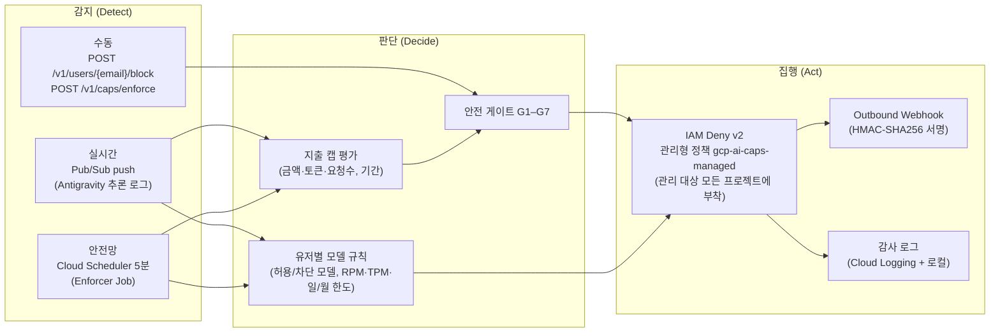
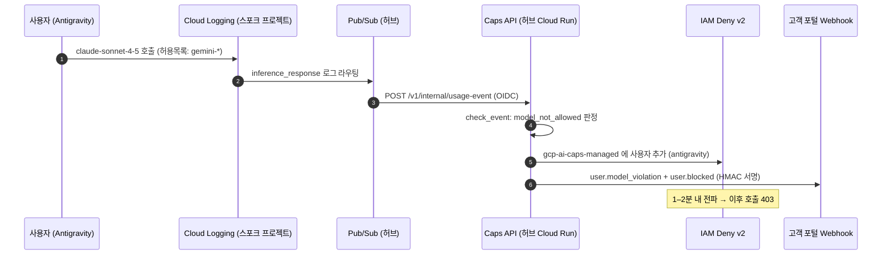

# 차단(Block) 엔진 상세 — 레퍼런스(`ai-control-plane`)에서 이식한 검증 로직

> 이 문서는 고객 보안·운영 검토용입니다. 이 API의 **모든 차단/해제**(지출 캡 초과, 수동 차단, 유저별 모델 규칙 위반)는 하나의 엔진을 거칩니다.
> 이 엔진은 레퍼런스 리포지토리 `ldu1225/ai-control-plane`의 `enforcers.py` · `usage_events.py` · `enforce_job.py` · `spend_caps.py`에서 **검증된 로직을 그대로 이식·재구성**한 것입니다.

---

## 1. 한 장 요약

| 단계 | 구현 파일 | 레퍼런스 원본 |
|---|---|---|
| IAM Deny v2 정책 읽기·계획·적용 (멀티 룰, etag 재시도, 운영 폴링) | [`enforcers.py`](../src/usage_caps_api/services/enforcers.py) | `ai-control-plane/src/controlplane/services/enforcers.py` |
| 캡 평가·게이트 G1–G7·수동 차단/해제·기간 리셋 | [`caps.py`](../src/usage_caps_api/services/caps.py) | `governance.py`, `users.py` |
| 실시간 Pub/Sub 감지 | [`usage_events.py`](../src/usage_caps_api/services/usage_events.py) | `usage_events.py` |
| 주기 안전망(Cloud Run Job) | [`enforce_job.py`](../src/usage_caps_api/enforce_job.py) | `enforce_job.py` |
| 프로젝트 하드캡 (Billing Budget spendCap) | [`spend_caps.py`](../src/usage_caps_api/services/spend_caps.py) | `spend_caps.py` |
| **신규** 유저별 모델 규칙 → 같은 차단 엔진 사용 | [`user_model_rules.py`](../src/usage_caps_api/services/user_model_rules.py) | (신규, 동일 엔진 재사용) |

---

## 2. IAM Deny v2 집행 방식

* **정책 1개, 부착점 N개**: 관리 대상 프로젝트(허브 + 모든 스포크) 각각에 `gcp-ai-caps-managed` Deny 정책을 부착합니다(`caps.deny_attachment=projects`, 기본). 폴더/조직 단위로 운영하면 `deny_attachment=scope`로 폴더·조직에 1회 부착합니다.
* **서비스별 룰 분리**: 서비스마다 별도 deny rule을 두어 “Antigravity만 차단” 같은 부분 차단이 가능합니다.

| 서비스(`services`) | 거부 권한(deniedPermissions) |
|---|---|
| `antigravity` | `businessaicode.googleapis.com/locations.generateContent` |
| `vertex_ai` | `aiplatform.googleapis.com/endpoints.predict` |
| `gemini_enterprise` | `discoveryengine.googleapis.com/assistants.assist` |

* **주체(principal)**: Google 계정은 `principal://goog/subject/{email}`, Workforce Identity는 `principal://iam.googleapis.com/locations/global/workforcePools/...` 형식으로 변환합니다. 그룹·도메인·상속 역할로 받은 권한도 Deny가 우선하므로 **우회가 불가능**합니다(G5).
* **동시성**: 정책 `etag` 기반 낙관적 잠금 + 충돌 시 재읽기·재시도. 알 수 없는(외부) 정책은 절대 덮어쓰지 않습니다.
* **반영 지연**: IAM Deny는 결과적 일관성(eventually consistent)으로 **보통 1–2분** 후 적용됩니다. 진행 중인 요청은 끝까지 처리됩니다. (OpenAI/Anthropic의 키 폐기 “즉시 반영”과의 가장 큰 차이)
* **용량**: 부착점당 거부 주체 2,500명 한도 — 2,000명부터 경고, 초과분은 보류(G6).

## 3. 안전 게이트 G1–G7 (자동 차단 오작동 방지)

| 게이트 | 내용 | 실패 시 |
|---|---|---|
| **G1** 정책 판독 | 모든 부착점의 관리형 Deny 정책을 읽을 수 있고 외부 정책 충돌이 없음 | **집행 중단** |
| **G2** 판정 가능 | 최소 1명 이상 판정 가능한 사용량 데이터 존재 | **집행 중단** |
| **G3** 텔레메트리 건전성 | 로그가 비어있거나 잘리지 않음 | 경고 — 사용량 기반 **복구만 보류**(기간 리셋 복구는 진행) |
| **G4** 변경 예산 | 1회 신규 차단 수 ≤ max(`change_budget_min`, 비율×모집단) | 초과분 다음 회차로 연기 (심각도 순) |
| **G5** 비사용자 권한 | 그룹·도메인 상속 권한도 Deny로 커버됨을 보증 | (항상 통과 — 설계로 보장) |
| **G6** Deny 용량 | 2,500 주체 한도 | 초과분 보류 |
| **G7** 급증 방지(Surge Guard) | 한 번에 `surge_guard_min`명 이상 & 모집단의 `surge_guard_ratio` 이상 자동 정지 시 | 자동 정지를 **검토 대기**로 전환 (가격표·텔레메트리 오류로 인한 대량 차단 방지) |

## 4. 감지 경로 3종

1. **실시간 (수 초)** — 각 관리 프로젝트의 Log Router 싱크가 Antigravity 추론 로그(`businessaicode.googleapis.com/inference_response`)를 **허브의 Pub/Sub 토픽**으로 보내고, 푸시 구독이 `POST /v1/internal/usage-event`(OIDC 인증)로 전달합니다. 중복 제거(insertId), 60초 스냅샷 캐시, 30초 트리거 스로틀을 둡니다.
2. **안전망 (5분)** — Cloud Scheduler → Cloud Run Enforcer Job(`python -m usage_caps_api.enforce_job`)이 전체 사용자 평가 + 차단/복구 + 거버넌스 사이클(모델 규칙, 쿼터 요청 상태, 헤드룸 알림, 모델 정책 재확장)을 수행합니다.
3. **수동** — 포털이 `POST /v1/users/{email}/block|unblock`, `POST /v1/caps/enforce {"dryRun": false}` 호출.

## 5. 기간 리셋 & 자동 복구

* 캡 기간: `daily|weekly|monthly|custom|all`, `calendar|rolling`, 리셋 요일/일/시각·타임존 지정 (`GET/PUT /v1/caps/policy`).
* 자동 정지된 사용자는 **다음 리셋 시각**에 자동 복구됩니다(`restore_at`).
* 만료 시각(`until`)이 있는 차단(수동 차단, 모델 규칙 차단)은 만료 후 다음 집행 사이클에서 Deny 정책에서 제거됩니다.

## 6. 유저별 모델 규칙 위반 → 차단 (요구사항: **차단 우선, 알림 필수**)

* 기본 동작 `on_violation=block_service`; 위반이 발생한 **서비스만** 차단(옵션 `block_services`로 확장).
* 차단 기간: 허용되지 않은 모델 사용 → 관리자 해제 전까지(또는 `block_minutes`); RPM/TPM 초과 → 기본 15분; 일 한도 → 다음 날 0시(워크스페이스 타임존); 월 한도 → 캡 기간 리셋.
* `notify` 모드, `enforcement_backend=notify_only`, 보호 주체(`models.protected_principals`), 캡 규칙 `type=allow` 사용자는 **알림만** 보냅니다.
* 관리자가 해제한 뒤 같은 날 **새로운** 위반 요청이 들어오면 다시 차단합니다(요청 수 기반 중복 제거).
* G4 변경 예산이 모델 규칙 자동 차단에도 적용되어 대량 오차단을 방지합니다.

## 7. 프로젝트 하드캡

Cloud Billing Budget API v1의 `spendCap`(ENFORCED/CONFIGURED)으로 **프로젝트 전체 AI 지출을 강제 중단**합니다(`PUT /v1/caps/projects/{id}`, `POST .../lift`). 해제 후 트래픽 재개까지 최대 약 1시간.
