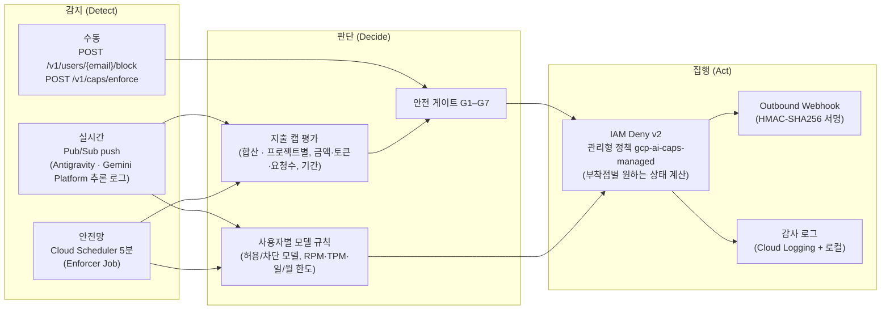
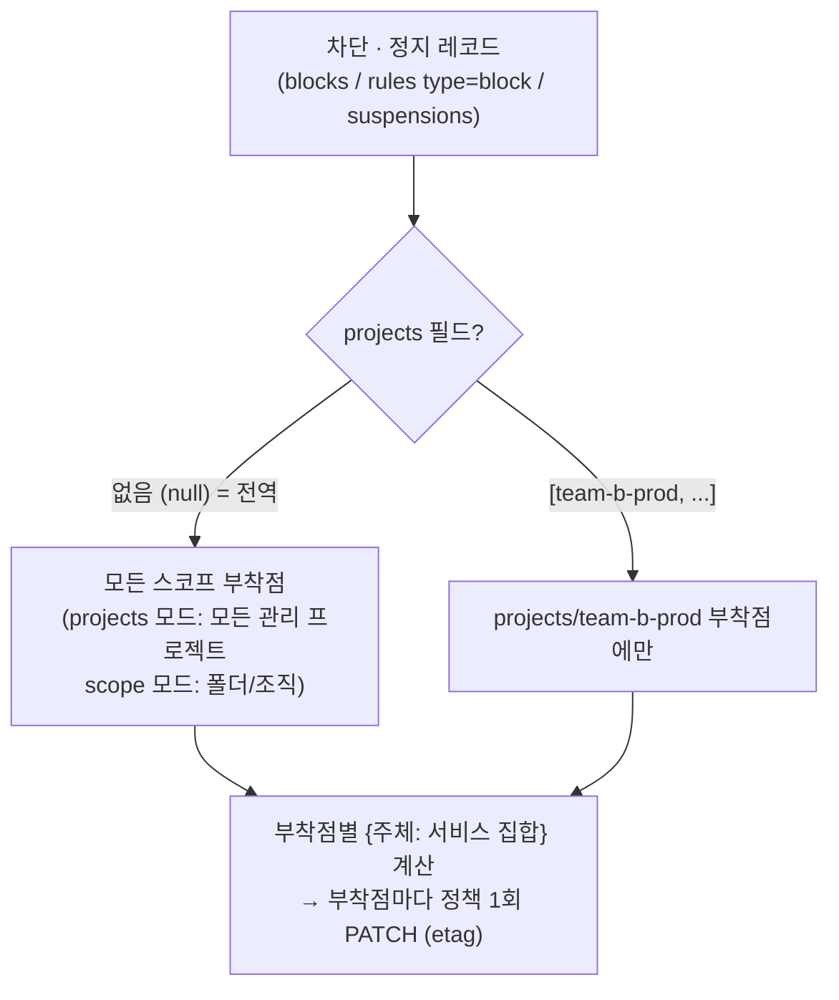
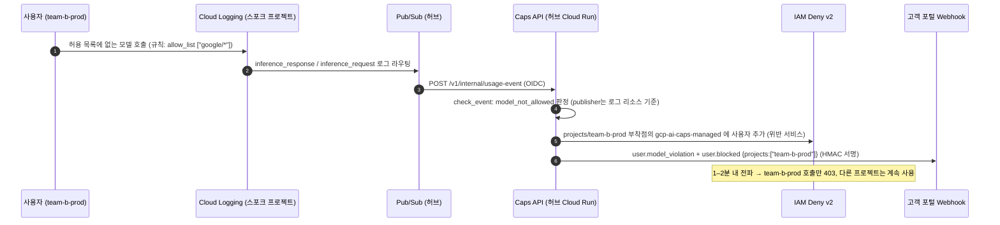
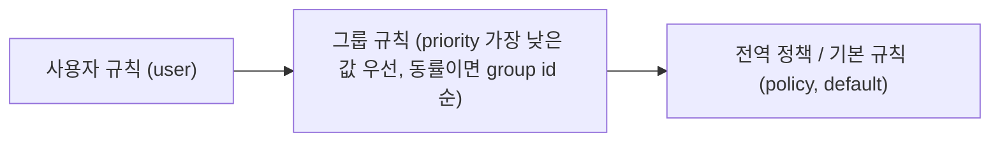

# 차단(Block) 엔진 상세 — 레퍼런스(`ai-control-plane`)에서 이식한 검증 로직

> 이 문서는 고객 보안·운영 검토용입니다. 이 API의 **모든 차단/해제**(지출 캡 초과, 수동 차단, 사용자별 모델 규칙 위반)는 하나의 엔진을 거칩니다.
> 이 엔진은 레퍼런스 리포지토리 `ldu1225/ai-control-plane`의 `enforcers.py` · `usage_events.py` · `enforce_job.py` · `spend_caps.py`에서 **검증된 로직을 그대로 이식·재구성**하고, 1.2.0에서 **프로젝트 단위(멀티 프로젝트) 집행**으로 확장했습니다.
> 대상 AI 서비스는 Antigravity, Gemini Platform, Gemini Enterprise입니다. 사용자뿐 아니라 **그룹**도 같은 엔진으로 집행됩니다([9장](#9-그룹-groups)).

> **English summary** — One managed IAM Deny v2 policy per attachment point (each managed project, or the folder/organization scope), one deny rule per AI surface. Desired state is computed **per attachment point**: global entries (no `projects`) go to every scope attachment point, project-scoped entries only to `projects/{id}`. A user who overspends in one project is suspended only there (`plan.suspend_projects`); model-rule violations block only in the violating project by default (`models.violation_block_scope`). Safety gates G1–G7 still guard every automatic change; propagation takes ~1–2 minutes.

---

## 1. 한 장 요약



| 단계 | 구현 파일 | 레퍼런스 원본 |
|---|---|---|
| IAM Deny v2 정책 읽기·계획·적용 (멀티 룰, **부착점별 desired state**, etag 재시도, 운영 폴링) | [`enforcers.py`](../src/usage_caps_api/services/enforcers.py) | `ai-control-plane/src/controlplane/services/enforcers.py` |
| 캡 평가(합산·프로젝트별)·게이트 G1–G7·수동 차단/해제·기간 리셋 | [`caps.py`](../src/usage_caps_api/services/caps.py) | `governance.py`, `users.py` |
| 실시간 Pub/Sub 감지 | [`usage_events.py`](../src/usage_caps_api/services/usage_events.py) | `usage_events.py` |
| 주기 안전망(Cloud Run Job) | [`enforce_job.py`](../src/usage_caps_api/enforce_job.py) | `enforce_job.py` |
| 프로젝트 하드캡 (Billing Budget spendCap) | [`spend_caps.py`](../src/usage_caps_api/services/spend_caps.py) | `spend_caps.py` |
| 사용자별 모델 규칙 → 같은 차단 엔진 사용 | [`user_model_rules.py`](../src/usage_caps_api/services/user_model_rules.py) | (신규, 동일 엔진 재사용) |

---

## 2. IAM Deny v2 집행 방식

* **부착점마다 관리형 정책 1개**: 관리 대상 프로젝트(허브 + 모든 스포크) 각각에 `gcp-ai-caps-managed` Deny 정책을 둡니다(`caps.deny_attachment=projects`, 기본). 폴더/조직 단위로 운영하면 `deny_attachment=scope`로 폴더·조직에 부착하고, **프로젝트 한정 항목이 생기면 해당 `projects/{id}` 부착점을 추가로 읽고 씁니다**.
* **서비스별 룰 분리**: 서비스마다 별도 deny rule을 두어 “Antigravity만 차단” 같은 부분 차단이 가능합니다.

| 서비스(`services`) | 거부 권한(deniedPermissions) |
|---|---|
| `antigravity` | `businessaicode.googleapis.com/locations.generateContent` |
| `gemini_platform` (구 별칭 `vertex_ai`도 허용) | `aiplatform.googleapis.com/endpoints.predict` |
| `gemini_enterprise` | `discoveryengine.googleapis.com/assistants.assist` |

* **주체(principal)**: Google 계정은 `principal://goog/subject/{email}`, Workforce Identity는 `principal://iam.googleapis.com/locations/global/workforcePools/...` 형식으로 변환합니다. 그룹·도메인·상속 역할로 받은 권한도 Deny가 우선하므로 **우회가 불가능**합니다(G5).
* **동시성**: 정책 `etag` 기반 낙관적 잠금 + 충돌 시 재읽기·재시도. 알 수 없는(외부) 정책은 절대 덮어쓰지 않습니다.
* **반영 지연**: IAM Deny는 결과적 일관성(eventually consistent)으로 **보통 1–2분** 후 적용됩니다. 진행 중인 요청은 끝까지 처리됩니다. (기존 AI 벤더 Admin API의 키 폐기 “즉시 반영”과의 가장 큰 차이)
* **용량**: 부착점당 거부 주체 2,500명 한도 — 2,000명부터 경고, 초과분은 보류(G6).

## 3. 멀티 프로젝트 집행 (1.2.0)

### 3.1 부착점별 원하는 상태(desired state)



| 상황 | 결과 Deny 항목 |
|---|---|
| 합산 캡(`cap_scope=total`) 초과, `auto` | 모든 프로젝트 부착점에 정지 (`over_scope="all"`) |
| `per_project` 캡 · `project_caps` · `project_defaults` 중 **일부 프로젝트만** 초과 | **초과한 프로젝트 부착점에만** 정지 (`over_scope=["team-b-prod"]`, `plan.suspend_projects`) |
| 수동 차단 `{"projects":["team-b-prod"]}` | `projects/team-b-prod`에만 |
| 수동 차단 (projects 없음) | 모든 스코프 부착점 |
| 모델 규칙 위반 (`models.violation_block_scope=project`, 기본) | 위반 요청이 실행된 프로젝트에만 |
| 모델 규칙 위반 (`violation_block_scope=all`) | 모든 스코프 부착점 |

* 이미 일부 프로젝트에서 정지된 사용자가 다른 프로젝트에서도 초과하면, 정지 레코드의 `projects`가 **합집합**으로 확장됩니다. 전역 정지가 이미 있으면 전역이 유지됩니다.
* 프로젝트별 임계치 웹훅: `cap.threshold_reached` / `cap.exceeded`에 `"scope":"project","project":"<id>"`(합산 캡은 `"scope":"total"`), `user.blocked`에 `"projects": [...] | "all"`.

### 3.2 사용자 캡 상태 필드

| 필드 | 의미 |
|---|---|
| `status` | `active` · `over_cap` · `suspended`(자동) · `blocked`(수동/규칙) |
| `status_scope` | `all`(전체 프로젝트에 해당) · `projects`(일부 프로젝트만) · `null` |
| `cap_scope` | 이 사용자에게 적용된 `total` / `per_project` |
| `over_scope` | `"all"` · `["프로젝트", ...]` · `null` |
| `blocked_services` | 전역으로 거부된 서비스 |
| `blocked_projects` | `{project_id: [서비스]}` — 프로젝트 한정 거부 |
| `projects[]` | 프로젝트별 `status`, `over_cap`, `utilization_pct`, `limit{…, source: user_project_cap \| project_default \| per_project_scope}`, `usage`, `remaining`, `blocked_services` |
| `multi_project` | 2개 이상 프로젝트에서 사용 |
| `rule_source` | 적용 중인 캡 규칙의 출처: `user`(사용자 규칙) · `policy`(전역 정책) · `group:<id>`(그룹 규칙) |
| `groups` | 이 사용자가 유효 멤버인 그룹 ID 목록(우선순위 순) |
| `group_pools` | 이 사용자가 속한 공유 풀(shared pool) 그룹 캡 |
| `block_source` | 차단의 출처: `manual`(수동) · `group:<id>`(그룹 차단 또는 그룹 차단 규칙) · `rule`(사용자 차단 규칙) · `auto_cap`(캡 초과 자동 정지) |

### 3.3 해제·복구 규칙

| 동작 | 처리 |
|---|---|
| **기간 리셋** | 자동 정지(`suspensions`)는 `until`(=다음 리셋 시각)이 지나면 다음 사이클에서 모든 부착점에서 제거. 수동 차단·차단 규칙은 유지 |
| **사용량 기반 복구** | 캡 상향 등으로 더 이상 초과가 아니고 G3(텔레메트리 건전) 통과 시 복구. G3 경고면 보류(`plan.withheld_restores`) |
| **만료(`until`)** | 수동 차단·모델 규칙 차단은 만료 후 다음 집행 사이클에서 제거 |
| `POST /unblock {"projects":["team-b-prod"]}` | 그 프로젝트의 Deny 항목만 제거. 전역 차단/정지는 “모든 관리 프로젝트 − 대상”으로 **좁혀서** 유지 |
| `POST /unblock {"services":["gemini_platform"]}` | 해당 서비스만 제거, 나머지 서비스 차단 유지 |
| `POST /unblock {}` | 수동 차단·차단 규칙·자동 정지 모두 제거, 모든 부착점에서 제거 |
| 캡 규칙 `type=allow` | 수동 차단이 없으면 모든 부착점에서 제거(알림만) |
| `notify_only` 백엔드 | 새 Deny 항목은 추가하지 않지만, 해제(break-glass)는 기존 항목을 제거 |

> [!NOTE]
> 복구는 자동 정지/만료 레코드만 지우며, 같은 부착점에 유효한 수동 차단·차단 규칙이 있으면 다시 계산 과정에서 그대로 남습니다(우발적 해제 방지).

## 4. 안전 게이트 G1–G7 (자동 차단 오작동 방지)

| 게이트 | 내용 | 실패 시 |
|---|---|---|
| **G1** 정책 판독 | 모든 부착점(프로젝트 한정 항목용 부착점 포함)의 관리형 Deny 정책을 읽을 수 있고 외부 정책 충돌이 없음 | **집행 중단** |
| **G2** 판정 가능 | 최소 1명 이상 판정 가능한 사용량 데이터 존재 | **집행 중단** |
| **G3** 텔레메트리 건전성 | 로그가 비어있거나 잘리지 않음 | 경고 — 사용량 기반 **복구만 보류**(기간 리셋 복구는 진행) |
| **G4** 변경 예산 | 1회 신규 차단 수 ≤ max(`change_budget_min`, 비율×모집단) | 초과분 다음 회차로 연기 (심각도 순) |
| **G5** 비사용자 권한 | 그룹·도메인 상속 권한도 Deny로 커버됨을 보증 | (항상 통과 — 설계로 보장) |
| **G6** Deny 용량 | 부착점당 2,500 주체 한도 | 초과분 보류 |
| **G7** 급증 방지(Surge Guard) | 한 번에 `surge_guard_min`명 이상 & 모집단의 `surge_guard_ratio` 이상 자동 정지 시 | 자동 정지를 **검토 대기**로 전환 (단가표·텔레메트리 오류로 인한 대량 차단 방지) |

## 5. 감지 경로 3종

1. **실시간 (수 초)** — 각 관리 프로젝트의 Log Router 싱크가 Antigravity 추론 로그(`businessaicode.googleapis.com/inference_response`)와 Gemini Platform 추론 요청 로그(`aiplatform.googleapis.com/inference_request`)를 **허브의 Pub/Sub 토픽**으로 보내고, 푸시 구독이 `POST /v1/internal/usage-event`(OIDC 인증)로 전달합니다. 이벤트마다 모델 규칙 → 합산 캡 → **요청이 실행된 프로젝트의 캡** 순으로 평가합니다. Gemini Platform 이벤트는 헤더 라벨이 있을 때 실시간으로 사용자에 귀속되고, 헤더가 없는 이벤트는 5분 안전망에서 감사 로그와 상관 분석됩니다. 중복 제거(insertId), 60초 스냅샷 캐시, 30초 트리거 스로틀을 둡니다.
2. **안전망 (5분)** — Cloud Scheduler → Cloud Run Enforcer Job(`python -m usage_caps_api.enforce_job`)이 전체 사용자 × 프로젝트 평가 + 차단/복구 + 거버넌스 사이클(모델 규칙, 쿼터 요청 상태, 헤드룸 알림, 모델 정책 재확장)을 수행합니다.
3. **수동** — 포털이 `POST /v1/users/{email}/block|unblock`(선택 `projects`), `POST /v1/caps/enforce {"dryRun": false}` 호출.

## 6. 기간 리셋 & 자동 복구

* 캡 기간: `daily|weekly|monthly|custom|all`, `calendar|rolling`, 리셋 요일/일/시각·타임존 지정 (`GET/PUT /v1/caps/policy`).
* 자동 정지된 사용자는 **다음 리셋 시각**에 자동 복구됩니다(`restore_at`). 프로젝트 한정 정지도 같은 시각에 복구됩니다.
* 만료 시각(`until`)이 있는 차단(수동 차단, 모델 규칙 차단)은 만료 후 다음 집행 사이클에서 Deny 정책에서 제거됩니다.

## 7. 사용자별 모델 규칙 위반 → 차단 (요구사항: **차단 우선, 알림 필수**)



* 기본 동작 `on_violation=block_service`; 위반이 발생한 **서비스만**, 기본적으로 **위반이 발생한 프로젝트에서만** 차단(`models.violation_block_scope=project`; `all`이면 모든 관리 프로젝트). `block_services`로 서비스 확장 가능.
* 차단 기간: 허용되지 않은 모델 사용 → 관리자 해제 전까지(또는 `block_minutes`); RPM/TPM 초과 → 기본 15분; 일 한도 → 다음 날 0시(워크스페이스 타임존); 월 한도 → 캡 기간 리셋.
* `notify` 모드, `enforcement_backend=notify_only`, 보호 주체(`models.protected_principals`), 캡 규칙 `type=allow` 사용자는 **알림만** 보냅니다.
* 관리자가 해제한 뒤 같은 날 **새로운** 위반 요청이 들어오면 다시 차단합니다(요청 수 기반 중복 제거).
* G4 변경 예산이 모델 규칙 자동 차단에도 적용되어 대량 오차단을 방지합니다.
* 모델 패턴은 로그에 기록된 모델 ID와 비교하며, publisher 한정 패턴(`<publisher>/*`)은 Model Garden·로그 리소스의 publisher를 사용합니다(이름으로 추측하지 않음).

## 8. 프로젝트 하드캡

Cloud Billing Budget API v1의 `spendCap`(ENFORCED/CONFIGURED)으로 **프로젝트 전체 AI 지출을 강제 중단**합니다(`PUT /v1/caps/projects/{id}`, `POST .../lift`). 해제 후 트래픽 재개까지 최대 약 1시간. (사용자 단위 캡과 별개이며, Billing Export를 사용하지 않습니다.)

## 9. 그룹 (Groups)

그룹은 사용자와 **동일한 기능**(지출 캡, 차단, 모델 규칙, 예외, 사용량)을 갖는 정책 주체입니다. 그룹의 유효 멤버는 명시적 `members` + (선택) Google Group에서 동기화된 멤버 − `excluded`(예외)입니다. 그룹도 위의 IAM Deny v2 엔진, 부착점별 desired state, 안전 게이트 G1–G7을 **그대로** 사용합니다.

### 9.1 규칙 해석 순서 (가장 구체적인 규칙 우선)



* 사용자 규칙이 있으면 그 규칙만 적용됩니다. 없으면 사용자가 속한 그룹 중 `priority`가 가장 낮은(동률이면 group id 사전순) 그룹의 규칙을 상속하고, 그것도 없으면 전역 정책을 따릅니다.
* 사용자 수준 `allow` 규칙은 그룹 차단보다도 우선합니다.
* 그룹 정책은 **사용자별 레코드에 기록되지 않습니다**. `expand_state`가 평가 시점마다 멤버별 유효 상태를 즉석에서 계산하므로, 멤버 제거·예외 추가·그룹 규칙 삭제는 **즉시 반영되고 완전히 되돌릴 수 있습니다**.

### 9.2 그룹 지출 캡: `per_member` vs `shared` (`PUT /v1/caps/groups/{id}`)

| `pool` | 동작 |
|---|---|
| `per_member` (기본) | 그룹 캡이 사용자 규칙이 없는 **각 멤버의 개인 캡**으로 상속됩니다(`rule_source: "group:<id>"`). |
| `shared` | 유효 멤버 전체의 **합산 사용량**을 하나의 그룹 캡과 비교합니다. 각 멤버 자신의 캡에 **추가로** 평가됩니다. |

* 공유 풀 사용량이 캡에 도달하면, 사용자 수준 `allow`가 없는 **모든 멤버**가 정지됩니다. `scope: total`(기본)이면 모든 관리 프로젝트에서, `scope: per_project` 또는 `project_caps`를 쓰면 **초과한 프로젝트에서만** 정지됩니다(`over_projects`).
* `type`은 `limit`(`cost_cap` / `token_cap` / `request_cap` / `project_caps`, `pool`, `scope`), `allow`, `block`을 지원합니다.
* 임계치 도달 시 `group.cap_threshold_reached` / `group.cap_exceeded` 웹훅이 그룹·기간·임계치별로 한 번 발송됩니다([webhooks.md](webhooks.md)).
* 기간 리셋 시 그룹 공유 풀로 인한 자동 정지도 다른 자동 정지와 같이 **자동 복구**됩니다.

### 9.3 그룹 차단 (`POST /v1/groups/{id}/block`)

```json
{"services": ["gemini_platform"], "projects": ["team-b-prod"], "reason": "보안 점검", "until": "2026-12-01T00:00:00Z"}
```

* `services` 생략 시 정책의 `default_block_services`, `projects` 생략 시 모든 관리 프로젝트에 적용됩니다. `until`은 RFC3339이며 만료 후 다음 사이클에서 제거됩니다.
* 사용자 수준 `allow` 규칙이 있는 멤버에게는 적용되지 않습니다.
* 자신의 수동 차단이 이미 있는 멤버는 **자신의 차단을 그대로 유지**합니다(그룹 차단이 덮어쓰지 않음).
* 응답의 `members_blocked` / `members_not_affected`로 실제 적용 대상을 확인할 수 있습니다.

### 9.4 멤버십 변경과 예외

* **예외(`excluded`)**: `POST /v1/groups/{id}/exclusions {"add": [...]}`로 추가된 사람은 그룹 유효 멤버에서 제외되어 그룹 정책이 전혀 적용되지 않습니다.
* 그룹에 집행 중인 정책(그룹 차단, `type=block|allow` 규칙, 공유 풀 캡)이 있으면, 멤버 추가·제거·예외·Google Group 동기화로 인한 멤버십 변경이 **즉시 IAM Deny에 반영**됩니다.
* 변경이 있으면 `group.membership_changed` 웹훅이 발송됩니다.

### 9.5 그룹 해제·삭제 시 복구 규칙

| 동작 | 처리 |
|---|---|
| `POST /v1/groups/{id}/unblock` | 그룹 차단(및 `type=block` 그룹 규칙)을 제거 |
| `DELETE /v1/caps/groups/{id}` | 그룹 캡 규칙 제거, 멤버는 자신의 규칙 또는 전역 정책으로 돌아감 |
| `DELETE /v1/groups/{id}` | 그룹과 모든 그룹 정책(캡 규칙, 그룹 차단, 모델 규칙) 제거 |

* 세 경우 모두 **오직 해당 그룹 때문에 존재하는 정지만** 제거합니다. 개인 캡 초과로 인한 정지, 개인 수동 차단은 그대로 유지됩니다.
* 해제 응답의 `members_still_blocked`에 여전히 차단 상태인 멤버가 나열됩니다(개인 차단은 `POST /v1/users/{email}/unblock`으로 별도 해제).

### 9.6 진단

* `GET /v1/caps/users/{email}`의 `rule_source`, `groups`, `group_pools`, `block_source`(3.2절)로 누가/무엇이 차단했는지 확인합니다.
* `GET /v1/users/{email}/groups`는 사용자의 그룹(유효/예외), `effective_cap_rule_source`, `effective_block_source`, `effective_model_rule_source`, `shared_pools`를 반환합니다.
