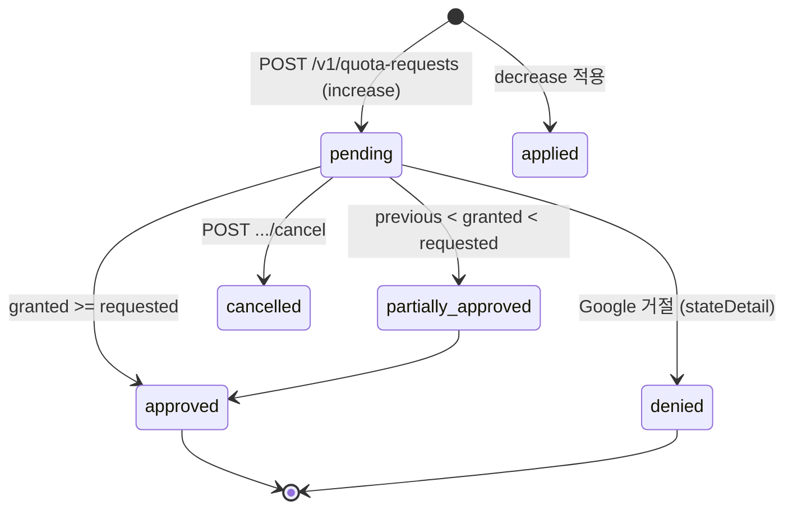

# 모델 거버넌스 & 쿼터 API 가이드

OpenAI / Anthropic Admin API에서 고객 포털이 쓰던 기능(**모델 조회 · 모델 제한 · 제한 해제 · Rate Limit 조회/조정 · 쿼터 상향 요청**)을 Google Cloud에서 **메인(허브) 프로젝트 한 곳에서 모든 관리 대상 프로젝트에** 똑같이 쓰도록 만든 API입니다.

> 모든 예시는 `BASE=https://<cloud-run-url>` 와 `KEY=gcpai_...` (적절한 scope) 를 가정합니다.

## 0. 기능 매핑 (OpenAI / Anthropic → 이 API → GCP 실제 집행 수단)

| 하고 싶은 일 | OpenAI | Anthropic | 이 API | GCP 집행 수단 | 적용 단위 | 반영 |
|---|---|---|---|---|---|---|
| 모델 목록/상세 | `GET /v1/models` | `GET /v1/models` | `GET /v1/models`, `/v1/models/{id}` | Model Garden publisher models + 가격표 | 전체 | 즉시 |
| 프로젝트 모델 허용/차단 | Project model permissions | Workspace(Console) | `PUT /v1/model-access/projects/{id}` | Org Policy `constraints/vertexai.allowedModels` | 프로젝트·폴더·조직 | 수 분(≤~15분) |
| 여러 프로젝트에 일괄 | – | – | `POST /v1/model-access/bulk-apply` (`projects/*`) | 위와 동일, 병렬 | 전체 관리 프로젝트 | 수 분 |
| 앱 단위 모델 ON/OFF | – | – | `PATCH /v1/gemini-enterprise/apps/{app}/models` | Discovery Engine `Engine.modelConfigs` | GE 앱 | 수 초~1분 |
| Antigravity 허용 모델 | – | – | `GET /v1/antigravity/models` (쓰기=409) | DevToolsConfig (Console 전용 쓰기) | 프로젝트·로케이션 | – |
| **유저별** 모델 허용/차단 | ✗ | ✗ | `PUT /v1/users/{email}/model-rules`, `/v1/model-rules/default` | 감지 → IAM Deny v2 서비스 차단 | 유저 | 감지 수 초 + 1–2분 |
| **유저별** RPM/TPM/일·월 한도 | ✗(키/프로젝트 단위) | ✗ | `PUT /v1/rate-limits/users/{email}` | 감지 → IAM Deny v2 | 유저×모델 | 실시간/5분 |
| Rate limit 조회 | `GET .../rate_limits` | Rate Limits API | `GET /v1/rate-limits`, `/v1/projects/{id}/rate-limits` | Cloud Quotas `QuotaInfo` + Monitoring | 프로젝트×리전×모델 | 즉시 |
| Rate limit 하향(캡) | `POST .../rate_limits/{id}` | Console | `PATCH /v1/projects/{id}/rate-limits/{rl}` | `QuotaPreference` (decrease) | 프로젝트×리전×모델 | 빠름 |
| 쿼터 상향 요청 | Usage tier / 폼 | 영업 문의 | `POST /v1/quota-requests` | `QuotaPreference` (increase, Google 심사) | 프로젝트×리전×모델 | 수 시간~수 일 |
| 진행 상태 추적 | – | – | `GET /v1/operations/{id}`, `GET /v1/quota-requests/{id}` + Webhook | – | – | – |

> [!IMPORTANT]
> Org Policy 쓰기에 필요한 `roles/orgpolicy.policyAdmin`은 **조직 수준에서만 부여 가능**한 역할입니다(프로젝트 단위 정책을 쓰더라도 동일). 설치 시 `--grant-org-roles`를 사용하거나 조직 관리자에게 출력된 명령을 전달하세요. 권한이 없으면 모델 정책 쓰기 API는 `403 forbidden`과 필요한 역할을 안내합니다. 사전점검의 `capabilities.org_policy_writable`로 미리 확인할 수 있습니다.

## 1. 모델 카탈로그

```bash
curl -s "$BASE/v1/models?publisher=anthropic&include=access&project=team-a-prod" -H "Authorization: Bearer $KEY"
curl -s "$BASE/v1/models/gemini-2.5-pro" -H "Authorization: Bearer $KEY"     # access_by_project 포함
curl -s "$BASE/v1/models/claude-sonnet-4-5/access" -H "Authorization: Bearer $KEY"  # 누가 쓸 수 있나
curl -s -X POST "$BASE/v1/models/sync" -H "Authorization: Bearer $KEY"      # Model Garden 즉시 재동기화
```

`Model` 객체: `id`, `owned_by`, `display_name`, `resource_name`(`publishers/google/models/...`), `policy_values`, `surfaces`, `lifecycle{stage, deprecation_date, shutdown_date, replacement}`, `pricing{input/output/cached per 1M}`, `access_by_project{vertex_ai, gemini_enterprise, antigravity}`.

## 2. 프로젝트/폴더/조직 모델 접근 정책 (Vertex AI)

```bash
# 1) 영향 미리보기 (최근 30일 이 정책이었다면 차단됐을 사용자/모델)
curl -s -X POST "$BASE/v1/model-access/projects/team-a-prod/preview" -H "Authorization: Bearer $KEY" \
  -H "Content-Type: application/json" -d '{"mode":"allow_list","models":["gemini-2.5-*","anthropic/claude-haiku-4-5"]}'

# 2) 적용 (패턴은 카탈로그로 확장되어 Org Policy 값으로 기록, Claude가 있으면 count-tokens 헬퍼 자동 추가)
curl -s -X PUT "$BASE/v1/model-access/projects/team-a-prod" -H "Authorization: Bearer $KEY" \
  -H "Content-Type: application/json" -H 'If-Match: "<etag>"' \
  -d '{"mode":"allow_list","models":["gemini-2.5-*","anthropic/claude-haiku-4-5"],"reason":"보안팀 승인 #123"}'

# 3) 단건 해제/제한
curl -s -X POST "$BASE/v1/model-access/projects/team-a-prod/models/claude-sonnet-4-5/allow" -H "Authorization: Bearer $KEY"
curl -s -X POST "$BASE/v1/model-access/projects/team-a-prod/models/claude-sonnet-4-5/restrict" -H "Authorization: Bearer $KEY"

# 4) 모든 관리 프로젝트에 일괄 적용 (dryRun 권장 후 실제 적용)
curl -s -X POST "$BASE/v1/model-access/bulk-apply" -H "Authorization: Bearer $KEY" -H "Content-Type: application/json" \
  -d '{"scopes":["projects/*"],"mode":"deny_list","models":["anthropic/claude-opus-*"],"dryRun":true}'

# 5) 상속으로 되돌리기
curl -s -X DELETE "$BASE/v1/model-access/projects/team-a-prod" -H "Authorization: Bearer $KEY"
```

모드: `allow_list` · `deny_list` · `unrestricted`(allowAll) · `deny_all`(denyAll, `force` 필요) · `inherit`(정책 삭제).

안전장치: `dryRun` · 영향 미리보기 · **잠금 방지**(빈 allow_list/deny_all은 `force:true` 필요) · `If-Match` etag 동시성 · 값 500개 한도 검사 · 상위(폴더/조직) 정책이 막고 있으면 409로 위치 안내 · 모든 변경은 `operation` 반환 + 감사 로그 + `model.access_changed` 웹훅.

**패턴 재확장(Reconcile)**: Org Policy는 와일드카드를 지원하지 않으므로 고객 의도(`gemini-2.5-*`)를 저장해 두고, 새 모델 버전이 카탈로그에 나타나면 **매시간 자동 재확장**합니다(`POST /v1/model-access/reconcile`, 응답의 `drift`).

## 3. 서비스별 모델 제어

```bash
# Gemini Enterprise 앱 (모든 관리 프로젝트) — 앱이 없는 프로젝트는 status=not_applicable
curl -s "$BASE/v1/gemini-enterprise/apps" -H "Authorization: Bearer $KEY"
curl -s -X PATCH "$BASE/v1/gemini-enterprise/apps/team-a-prod~global~corp-assistant/models" \
  -H "Authorization: Bearer $KEY" -H "Content-Type: application/json" -d '{"models":{"claude-sonnet-4-5":"off"}}'
curl -s -X POST "$BASE/v1/gemini-enterprise/apps/bulk-models" -H "Authorization: Bearer $KEY" \
  -H "Content-Type: application/json" -d '{"apps":["*"],"models":{"gemini-2.5-flash":"on"}}'

# Antigravity (읽기 전용) — 쓰기는 409 console_required + console_url
curl -s "$BASE/v1/antigravity/models" -H "Authorization: Bearer $KEY"
```

## 4. 유저별 모델 규칙 (차단 우선 · 알림 필수)

```bash
# 전 직원 기본: Gemini만 허용, Claude는 일 50만 토큰
curl -s -X PUT "$BASE/v1/model-rules/default" -H "Authorization: Bearer $KEY" -H "Content-Type: application/json" -d '{
  "mode": "allow_list", "models": ["gemini-*", "claude-*"],
  "limits": [{"model": "claude-*", "daily_tokens": 500000, "rpm": 20}],
  "on_violation": "block_service"
}'

# 특정 유저 예외: Claude Opus 허용 + 위반 시 알림만
curl -s -X PUT "$BASE/v1/users/alice%40company.com/model-rules" -H "Authorization: Bearer $KEY" \
  -H "Content-Type: application/json" -d '{"mode":"allow_list","models":["*"],"on_violation":"notify"}'

curl -s "$BASE/v1/users/alice%40company.com/model-rules" -H "Authorization: Bearer $KEY"   # 오늘 모델별 사용 + 판정
curl -s "$BASE/v1/model-violations?email=bob@company.com" -H "Authorization: Bearer $KEY"
curl -s -X POST "$BASE/v1/model-rules/evaluate" -H "Authorization: Bearer $KEY" -d '{"dryRun":true}' -H "Content-Type: application/json"
```

| 위반 유형 | 감지 | 기본 차단 기간 |
|---|---|---|
| `model_not_allowed` / `model_denied` | 실시간(Antigravity) + 5분(모든 서비스) | 관리자 해제 전까지 (`block_minutes`로 자동 해제 가능) |
| `limit_exceeded` rpm / tpm | 실시간(Antigravity) | 15분 (또는 `block_minutes`) |
| `limit_exceeded` daily_* | 5분 | 다음 날 0시 (워크스페이스 TZ) |
| `limit_exceeded` monthly_* | 5분 | 캡 기간 리셋 시각 |

> 데이터 소스 한계: Vertex AI는 Data Access 감사 로그(요청 수 기준, 토큰 없음), Gemini Enterprise는 사용자 활동 로그, Antigravity는 추론 로그(토큰 포함·실시간)를 사용합니다. RPM/TPM 실시간 제한은 Antigravity 이벤트 스트림에서 동작합니다.

## 5. Rate Limit & 쿼터

```bash
curl -s "$BASE/v1/rate-limits?model=gemini-2.5-pro&near_limit=true" -H "Authorization: Bearer $KEY"
# → limit, usage_peak(24h), utilization_pct, headroom_pct, increase_eligible, preference

# 하향(캡): 피크 사용량보다 낮으면 force 필요
curl -s -X PATCH "$BASE/v1/projects/team-a-prod/rate-limits/rl_xxxxxxxxxxxxxxxx" -H "Authorization: Bearer $KEY" \
  -H "Content-Type: application/json" -d '{"value": 500, "force": true}'

# 상향 요청: Google Cloud에 바로 제출 (단일 / 전체 프로젝트)
curl -s -X POST "$BASE/v1/quota-requests" -H "Authorization: Bearer $KEY" -H "Idempotency-Key: 7d1c..." \
  -H "Content-Type: application/json" -d '{
    "projects": ["*"], "quota_id": "GenerateContentRequestsPerMinutePerProjectPerBaseModel",
    "model": "gemini-2.5-pro", "location": "us-central1", "requested_value": 5000,
    "justification": "전사 코딩 어시스턴트 2,000명 확대", "contact_email": "cloud-admin@company.com"}'

curl -s "$BASE/v1/quota-requests?status=pending&refresh=true" -H "Authorization: Bearer $KEY"
curl -s -X POST "$BASE/v1/quota-requests/qr_xxxxxxxxxxxxxxxx/cancel" -H "Authorization: Bearer $KEY"
```

상태 전이:



상태 변경 시 `quota_request.updated` 웹훅, 헤드룸이 `quotas.headroom_warn_pct`(기본 80%) 이상이면 `rate_limit.threshold_reached` 웹훅(한도별 1일 1회).

## 6. Scope

| Scope | 허용 |
|---|---|
| `models:read` | 카탈로그, 정책·앱·규칙·위반 조회, preview |
| `models:write` | 정책/앱/규칙 변경, sync, reconcile, evaluate |
| `quotas:read` | rate limit, 쿼터 요청 조회, 유저 한도 조회 |
| `quotas:write` | 하향/상향 요청, 취소, 유저 한도 변경 |
| `admin` | 전체 |

## 7. 오류 코드

| HTTP | `error.code` | 의미 |
|---|---|---|
| 400 | `bad_request` | 입력 오류 |
| 403 | `forbidden` / `insufficient_scope` | 관리 대상 아님·GCP 권한 부족(필요 역할 안내)·scope 부족 |
| 404 | `not_found` | 모델/정책/요청 없음 |
| 409 | `conflict` | 패턴/상위 정책 때문에 단건 변경 불가 |
| 409 | `console_required` | Antigravity 쓰기 (Console 전용) |
| 409 | `quota_request_pending` | 같은 한도에 진행 중 요청 존재 |
| 412 | `precondition_failed` | `If-Match` etag 불일치·동시 변경 |
| 422 | `lockout_prevented` | 전면 차단 위험 — `force` 필요 |
| 422 | `unprocessable` / `quota_exceeds_maximum` | 500값 초과·피크 미만 하향·증설 불가 |
| 502 | `upstream_error` | GCP API 오류 |
