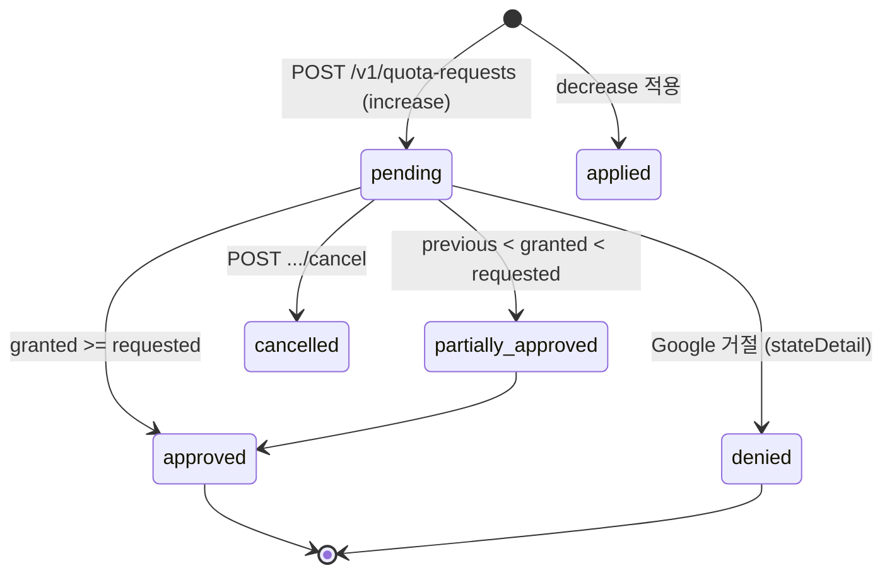

# 모델 거버넌스 & 쿼터 API 가이드

기존 AI 벤더 Admin API에서 고객 포털이 쓰던 기능(**모델 조회 · 모델 제한 · 제한 해제 · Rate Limit 조회/조정 · 쿼터 상향 요청**)을 Google Cloud에서 **메인(허브) 프로젝트 한 곳에서 모든 관리 대상 프로젝트에** 똑같이 쓰도록 만든 API입니다. 대상 서비스는 Antigravity, Gemini Platform, Gemini Enterprise입니다.

> 모든 예시는 `BASE=https://<cloud-run-url>` 와 `KEY=gcpai_...` (적절한 scope) 를 가정합니다.

> [!IMPORTANT]
> **이 API에는 내장 모델 목록이 없습니다.** 아래 예시의 `<model-id>`, `<family>-*`, `<publisher>/<model-id>`는 자리표시자입니다. 실제 값은 항상 `GET /v1/models`(실시간 Model Garden + 로그 관측 모델)가 돌려주는 `id`를 쓰거나, 모델명을 몰라도 되는 **publisher 와일드카드**(`google/*`, `<publisher>/*`)를 쓰세요.

## 0. 기능 매핑 (기존 AI 벤더 Admin API → 이 API → GCP 실제 집행 수단)

| 하고 싶은 일 | 기존 AI 벤더 Admin API | 이 API | GCP 집행 수단 | 적용 단위 | 반영 |
|---|---|---|---|---|---|
| 모델 목록/상세 | 지원 (`GET /v1/models`) | `GET /v1/models`, `/v1/models/{id}` | 실시간 Model Garden ∪ 로그 관측 모델 + 공식 SKU 단가 | 전체 | 즉시 |
| 신규 모델 감지 | 미지원 | `model.first_seen`, `model.catalog_changed` 웹훅 | 로그 · Model Garden 비교 | 전체 | 수 초~1시간 |
| 프로젝트 모델 허용/차단 | 프로젝트/워크스페이스 단위 모델 권한 | `PUT /v1/model-access/projects/{id}` | Org Policy `constraints/vertexai.allowedModels` | 프로젝트·폴더·조직 | 수 분(≤~15분) |
| 여러 프로젝트에 일괄 | 미지원 | `POST /v1/model-access/bulk-apply` (`projects/*`) | 위와 동일, 병렬 | 전체 관리 프로젝트 | 수 분 |
| 앱 단위 모델 ON/OFF | 미지원 | `PATCH /v1/gemini-enterprise/apps/{app}/models` | Discovery Engine `Engine.modelConfigs` | GE 앱 | 수 초~1분 |
| Antigravity 허용 모델 | 미지원 | `GET /v1/antigravity/models` (쓰기=409) | DevToolsConfig (Console 전용 쓰기) | 프로젝트·로케이션 | – |
| **사용자별** 모델 허용/차단 | 미지원 | `PUT /v1/users/{email}/model-rules`, `/v1/model-rules/default` | 감지 → IAM Deny v2 서비스 차단 (위반 프로젝트) | 사용자 × 프로젝트 | 감지 수 초 + 1–2분 |
| **그룹별** 모델 허용/차단 | 미지원 | `PUT /v1/groups/{id}/model-rules` | 감지 → IAM Deny v2 서비스 차단 (위반 프로젝트) | 그룹 멤버 × 프로젝트 | 감지 수 초 + 1–2분 |
| **사용자별** RPM/TPM/일·월 한도 | 미지원 (키/프로젝트 단위) | `PUT /v1/rate-limits/users/{email}` | 감지 → IAM Deny v2 | 사용자×모델 | 실시간/5분 |
| Rate limit 조회 | 지원 | `GET /v1/rate-limits`, `/v1/projects/{id}/rate-limits` | Cloud Quotas `QuotaInfo` + Monitoring | 프로젝트×리전×모델 | 즉시 |
| Rate limit 하향(캡) | 일부 지원 (API 또는 Console) | `PATCH /v1/projects/{id}/rate-limits/{rl}` | `QuotaPreference` (decrease) | 프로젝트×리전×모델 | 빠름 |
| 쿼터 상향 요청 | 사용 등급 / 폼 / 영업 문의 | `POST /v1/quota-requests` | `QuotaPreference` (increase, Google 심사) | 프로젝트×리전×모델 | 수 시간~수 일 |
| 진행 상태 추적 | 미지원 | `GET /v1/operations/{id}`, `GET /v1/quota-requests/{id}` + Webhook | – | – | – |

> [!IMPORTANT]
> Org Policy 쓰기에 필요한 `roles/orgpolicy.policyAdmin`은 **조직 수준에서만 부여 가능**한 역할입니다(프로젝트 단위 정책을 쓰더라도 동일). 설치 시 `--grant-org-roles`를 사용하거나 조직 관리자에게 출력된 명령을 전달하세요. 권한이 없으면 모델 정책 쓰기 API는 `403 forbidden`과 필요한 역할을 안내합니다. 사전점검의 `capabilities.org_policy_writable`로 미리 확인할 수 있습니다.

## 1. 동적 모델 카탈로그 (내장 목록 없음)

### 1.1 카탈로그의 구성

`GET /v1/models`는 다음 두 출처의 **합집합**입니다.

| 출처 | 내용 | `source` |
|---|---|---|
| **실시간 Model Garden** | v1beta1 `publishers/{publisher}/models`를 `models.publishers`(벤더 목록) + **로그에서 관측된 모든 publisher**에 대해 조회. TTL 1시간(`models.catalog_ttl_seconds`), `POST /v1/models/sync`로 즉시 갱신. Model Garden에서 사라진 모델은 삭제하지 않고 `lifecycle.delisted_at`을 기록 | `model_garden` |
| **로그 관측 모델** | 모든 서비스 로그에서 발견된 모델 ID — Antigravity `labels.model_id`, Gemini Platform 추론 요청 로그 `resource.labels.model_user_id`, Data Access 감사 로그 `resourceName`, Gemini Enterprise 활동 로그. `observed{first_seen, last_seen, surfaces, projects, users_seen}`과 함께 저장 | Model Garden에 없으면 `observed` |

* 설정 `models.publishers`(`MODEL_PUBLISHERS`, 기본값은 `google`과 Model Garden의 주요 파트너 publisher 목록)는 **조회할 벤더 목록일 뿐 모델 목록이 아닙니다**. 로그에 새 publisher가 나타나면 자동으로 조회 대상에 추가됩니다.
* **publisher는 모델 이름 패턴으로 추측하지 않습니다.** Model Garden 응답이나 로그 리소스(`publishers/{p}/models/{m}`)에 나온 값만 씁니다. 한 번도 본 적 없는 모델을 정책에 넣을 때는 `publisher/model-id`로 지정하세요(그렇지 않으면 `400 Cannot determine the publisher`).
* `lifecycle_overrides`(설정)로 지원 중단·종료일·대체 모델을 수동 보강할 수 있습니다.
* 단가 동기화 시 SKU 파서는 이 카탈로그와 로그의 모델 ID로 모델 계열을 학습합니다 → 신규 모델은 Google이 SKU를 게시하는 즉시 가격이 붙습니다([cost-methodology.md](cost-methodology.md)).

### 1.2 조회

```bash
curl -s "$BASE/v1/models?used=true" -H "Authorization: Bearer $KEY"                       # 실제로 사용된 모델만
curl -s "$BASE/v1/models?source=observed" -H "Authorization: Bearer $KEY"                 # Model Garden에 없지만 로그에 나온 모델
curl -s "$BASE/v1/models?publisher=partner-publisher&include=access&project=team-a-prod" -H "Authorization: Bearer $KEY"
curl -s "$BASE/v1/models?include=usage" -H "Authorization: Bearer $KEY"                   # 최근 30일 모델별 사용량 포함
curl -s "$BASE/v1/models/<model-id>" -H "Authorization: Bearer $KEY"                      # access_by_project 포함
curl -s "$BASE/v1/models/<model-id>/access" -H "Authorization: Bearer $KEY"               # 누가 쓸 수 있나 (프로젝트·사용자 규칙)
curl -s -X POST "$BASE/v1/models/sync" -H "Authorization: Bearer $KEY"                    # Model Garden 즉시 재동기화 (added/delisted 반환)
```

`Model` 객체: `id`, `owned_by`/`publisher`, `display_name`, `family`, `resource_name`(`publishers/<publisher>/models/<model-id>`), `policy_values`, `surfaces`, `available_surfaces`, `lifecycle{stage, version_id, first_listed, delisted_at, deprecation_date, shutdown_date, replacement}`, `observed{first_seen, last_seen, surfaces, projects, users_seen}`, `pricing{input/output/cached/cache_write per 1M, tiers, source, skus}`, `source`(`model_garden` | `observed`), `helper`, `access_by_project`.

목록 응답의 `catalog{fetched_at, errors, publishers, model_garden_models, observed_only_models}`로 카탈로그 상태를 확인합니다. Model Garden 조회가 실패해도(`errors`) 로그 관측 모델은 계속 표시됩니다.

### 1.3 모델별 사용량

```bash
curl -s "$BASE/v1/usage/models?start=2026-11-01&end=2026-11-30&group_by=project" -H "Authorization: Bearer $KEY"
```

행 필드: `model`, `publisher`, `surface`, `surfaces`, 토큰 카운터, `by_traffic`, `estimated_cost`, `cost_basis`, `active_users`, `projects`, `unattributed_requests`, `unattributed_tokens`, `first_seen_in_range`, `last_seen`, **`catalog_status`**(`model_garden` | `observed_only`), `lifecycle_stage`. `group_by`는 `user`·`project`·`surface`·`traffic`.

### 1.4 신규 모델 알림

| 웹훅 | 발생 시점 | 주요 필드 |
|---|---|---|
| `model.first_seen` | 어떤 서비스 로그에서든 처음 사용된 모델 | `model`, `publisher`, `surfaces`, `projects`, `users`, `first_seen`, `in_model_garden` |
| `model.catalog_changed` | Model Garden 동기화에서 신규/제외 발견 | `added[]`, `delisted[]`, `fetched_at` |

포털은 `model.first_seen`을 받아 **사용자 규칙·프로젝트 정책에 아직 반영되지 않은 신규 모델**을 바로 검토할 수 있습니다.

## 2. 프로젝트/폴더/조직 모델 접근 정책 (Gemini Platform)

```bash
# 1) 영향 미리보기 (최근 30일 이 정책이었다면 차단됐을 사용자/모델)
curl -s -X POST "$BASE/v1/model-access/projects/team-a-prod/preview" -H "Authorization: Bearer $KEY" \
  -H "Content-Type: application/json" -d '{"mode":"allow_list","models":["google/*","partner-publisher/<model-id>"]}'

# 2) 적용 (패턴은 실시간 카탈로그로 확장되어 Org Policy 값으로 기록, 파트너 모델이 있으면 count-tokens 헬퍼 자동 추가)
curl -s -X PUT "$BASE/v1/model-access/projects/team-a-prod" -H "Authorization: Bearer $KEY" \
  -H "Content-Type: application/json" -H 'If-Match: "<etag>"' \
  -d '{"mode":"allow_list","models":["google/*","partner-publisher/<model-id>"],"reason":"보안팀 승인 #123"}'

# 3) 단건 해제/제한 (모델 ID는 GET /v1/models 에서)
curl -s -X POST "$BASE/v1/model-access/projects/team-a-prod/models/<model-id>/allow" -H "Authorization: Bearer $KEY"
curl -s -X POST "$BASE/v1/model-access/projects/team-a-prod/models/<model-id>/restrict" -H "Authorization: Bearer $KEY"

# 4) 모든 관리 프로젝트에 일괄 적용 (dryRun 권장 후 실제 적용)
curl -s -X POST "$BASE/v1/model-access/bulk-apply" -H "Authorization: Bearer $KEY" -H "Content-Type: application/json" \
  -d '{"scopes":["projects/*"],"mode":"deny_list","models":["partner-publisher/<family>-*"],"dryRun":true}'

# 5) 상속으로 되돌리기
curl -s -X DELETE "$BASE/v1/model-access/projects/team-a-prod" -H "Authorization: Bearer $KEY"
```

모델 지정 형식: `<model-id>` · `<publisher>/<model-id>` · `<family>-*`(와일드카드) · `<publisher>/*` · `publishers/<publisher>/models/<model-id>[:predict|:deploy|:tune]`.

모드: `allow_list` · `deny_list` · `unrestricted`(allowAll) · `deny_all`(denyAll, `force` 필요) · `inherit`(정책 삭제).

안전장치: `dryRun` · 영향 미리보기 · **잠금 방지**(빈 allow_list/deny_all은 `force:true` 필요) · `If-Match` etag 동시성 · 값 500개 한도 검사 · 상위(폴더/조직) 정책이 막고 있으면 409로 위치 안내 · 모든 변경은 `operation` 반환 + 감사 로그 + `model.access_changed` 웹훅.

**패턴 재확장(Reconcile)**: Org Policy는 와일드카드를 지원하지 않으므로 고객 의도(예: `google/*`, `<family>-*`)를 저장해 두고, 새 모델이 실시간 카탈로그(Model Garden 또는 로그 관측)에 나타나면 **매시간 자동 재확장**합니다(`POST /v1/model-access/reconcile`, 응답의 `drift`). Model Garden에서 제외(`delisted_at`)된 모델과 publisher를 모르는 모델은 패턴 확장에서 빠집니다.

> **집행 범위와 전파 시간 (2026-11 실환경 관측)**
> 이 API는 Org Policy를 즉시 기록하지만, 실제 거부는 Google 쪽에서 엔드포인트별로 반영됩니다.
> - 리전 엔드포인트(`us-central1-aiplatform.googleapis.com`): 적용 약 6분 뒤 `400 FAILED_PRECONDITION`(`constraints/vertexai.allowedModels violated`)으로 거부됨.
> - **global 엔드포인트(`aiplatform.googleapis.com`, `locations/global`): 15분 동안 거부되지 않음.** 다른 리전(`asia-northeast3`)도 20분 동안 반영되지 않은 사례가 있음.
> - 정책 삭제(허용) 후에도 이미 거부가 반영된 리전에서는 45분 이상 거부가 이어진 사례가 있음.
>
> 따라서 특정 사용자나 프로젝트를 **즉시** 막아야 할 때는 IAM Deny 기반 차단(`POST /v1/users/{email}/block`, 지출 캡, 모델 규칙 위반 차단)을 함께 쓰세요. IAM Deny는 global·리전 엔드포인트 모두에서 1~2분 안에 `403 PERMISSION_DENIED`로 거부되는 것을 확인했습니다. 모델 접근 Org Policy는 프로젝트 전체의 장기 허용 목록을 관리하는 용도로 쓰는 것을 권장합니다.

## 3. 서비스별 모델 제어

```bash
# Gemini Enterprise 앱 (모든 관리 프로젝트) — 앱이 없는 프로젝트는 status=not_applicable
curl -s "$BASE/v1/gemini-enterprise/apps" -H "Authorization: Bearer $KEY"
curl -s -X PATCH "$BASE/v1/gemini-enterprise/apps/team-a-prod~global~corp-assistant/models" \
  -H "Authorization: Bearer $KEY" -H "Content-Type: application/json" -d '{"models":{"<model-id>":"off"}}'
curl -s -X POST "$BASE/v1/gemini-enterprise/apps/bulk-models" -H "Authorization: Bearer $KEY" \
  -H "Content-Type: application/json" -d '{"apps":["*"],"models":{"<model-id>":"on"}}'

# Antigravity (읽기 전용) — 쓰기는 409 console_required + console_url
curl -s "$BASE/v1/antigravity/models" -H "Authorization: Bearer $KEY"
```

> GE 앱에서 쓸 수 있는 모델 ID는 `GET /v1/gemini-enterprise/apps/{app_id}/models` 응답에 나온 값을 그대로 사용하세요.

## 4. 사용자별 모델 규칙 (차단 우선 · 알림 필수)

```bash
# 전 직원 기본: Google·파트너 publisher 모델만 허용, 파트너 모델은 일 50만 토큰 · 분당 20회
curl -s -X PUT "$BASE/v1/model-rules/default" -H "Authorization: Bearer $KEY" -H "Content-Type: application/json" -d '{
  "mode": "allow_list", "models": ["google/*", "partner-publisher/*"],
  "limits": [{"model": "partner-publisher/*", "daily_tokens": 500000, "rpm": 20}],
  "on_violation": "block_service"
}'

# 특정 사용자 예외: 모든 모델 허용 + 위반 시 알림만
curl -s -X PUT "$BASE/v1/users/alice%40company.com/model-rules" -H "Authorization: Bearer $KEY" \
  -H "Content-Type: application/json" -d '{"mode":"allow_list","models":["*"],"on_violation":"notify"}'

# 인턴: 특정 모델 계열 금지
curl -s -X PUT "$BASE/v1/users/intern%40company.com/model-rules" -H "Authorization: Bearer $KEY" \
  -H "Content-Type: application/json" -d '{"mode":"deny_list","models":["<family>-*"]}'

curl -s "$BASE/v1/users/alice%40company.com/model-rules" -H "Authorization: Bearer $KEY"   # 오늘 모델별 사용 + 판정
curl -s "$BASE/v1/model-violations?email=bob@company.com" -H "Authorization: Bearer $KEY"
curl -s -X POST "$BASE/v1/model-rules/evaluate" -H "Authorization: Bearer $KEY" -d '{"dryRun":true}' -H "Content-Type: application/json"
```

| 위반 유형 | 감지 | 기본 차단 기간 |
|---|---|---|
| `model_not_allowed` / `model_denied` | 실시간(Antigravity, 헤더 라벨이 있는 Gemini Platform) + 5분(모든 서비스) | 관리자 해제 전까지 (`block_minutes`로 자동 해제 가능) |
| `limit_exceeded` rpm / tpm | 실시간 | 15분 (또는 `block_minutes`) |
| `limit_exceeded` daily_* | 5분 | 다음 날 0시 (워크스페이스 TZ) |
| `limit_exceeded` monthly_* | 5분 | 캡 기간 리셋 시각 |

**멀티 프로젝트**: 위반 차단은 기본적으로 **위반 요청이 실행된 프로젝트에서만** 적용됩니다(`models.violation_block_scope: project`, 환경변수 `MODEL_VIOLATION_BLOCK_SCOPE`). `all`이면 모든 관리 프로젝트에서 차단합니다. 기본 동작은 여전히 **차단 + 항상 알림**(`user.model_violation` + `user.blocked{projects}`)입니다.

> 데이터 소스: Antigravity는 추론 로그(토큰 포함·실시간), Gemini Platform은 추론 요청 로그(토큰 포함, 프로젝트별 활성화 필요; 미활성 시 Data Access 감사 로그 요청 수만), Gemini Enterprise는 사용자 활동 로그(요청 수)를 사용합니다. 모델 패턴은 로그에 기록된 모델 ID와 비교합니다.

### 4.1 그룹 모델 규칙

사용자와 동일한 규칙을 그룹 단위로 지정할 수 있습니다. 본문 형식은 사용자 모델 규칙(`PUT /v1/users/{email}/model-rules`)과 **완전히 같습니다**(`mode`, `models`, `surfaces`, `limits`, `on_violation`, `block_services`, `block_minutes`, `until`, `mode: inherit` 등).

| 엔드포인트 | Scope | 설명 |
|---|---|---|
| `GET /v1/groups/{id}/model-rules` | `models:read` | 그룹 모델 규칙 조회(`rule`이 없으면 `null`) |
| `PUT /v1/groups/{id}/model-rules` | `models:write` | 그룹 모델 규칙 생성/교체 |
| `DELETE /v1/groups/{id}/model-rules` | `models:write` | 삭제 → 멤버는 기본 규칙(또는 자신의 규칙)으로 돌아감 |

```bash
# 외부 협력사 그룹: Google 모델만 허용, 일 20만 토큰
curl -s -X PUT "$BASE/v1/groups/contractors/model-rules" -H "Authorization: Bearer $KEY" \
  -H "Content-Type: application/json" -d '{
  "mode": "allow_list", "models": ["google/*"],
  "limits": [{"model": "*", "daily_tokens": 200000}],
  "on_violation": "block_service"
}'

# 사람별로 어떤 규칙이 적용되는지 확인
curl -s "$BASE/v1/users/dave%40company.com/groups" -H "Authorization: Bearer $KEY"
# → effective_model_rule_source: "group:contractors", effective_model_rule: {...}
```

**해석 순서**: 사용자 규칙 > 그룹 규칙(사용자가 속한 그룹 중 `priority`가 가장 낮은 그룹, 동률이면 group id 순) > 기본 규칙(`/v1/model-rules/default`).

* `mode: inherit`인 그룹 규칙은 기본 규칙의 허용/차단 목록을 유지하고 `limits`·`on_violation`·`block_services`·`block_minutes`만 덮어씁니다(출처 `group:<id>+default`). 사용자 규칙이 `inherit`이면 그룹/기본 규칙 위에 다시 덮어씁니다(`user+group:<id>+default`).
* 그룹의 예외(`excluded`)에 있는 사람에게는 그룹 모델 규칙이 적용되지 않습니다.
* `GET /v1/users/{email}/groups`의 `effective_model_rule_source`(`user` · `group:<id>` · `default` · `none` 등)와 위반 레코드·웹훅의 `rule_source`로 출처를 확인합니다.
* 그룹 규칙 위반도 동일한 엔진을 거치므로 기본 동작은 **차단 우선 + 항상 알림**(`user.model_violation` + `user.blocked{projects}`)이며, 차단 범위는 `models.violation_block_scope`를 따릅니다.

## 5. Rate Limit & 쿼터

```bash
curl -s "$BASE/v1/rate-limits?model=<model-id>&near_limit=true" -H "Authorization: Bearer $KEY"
# → limit, usage_peak(24h), utilization_pct, headroom_pct, increase_eligible, preference

# 하향(캡): 피크 사용량보다 낮으면 force 필요
curl -s -X PATCH "$BASE/v1/projects/team-a-prod/rate-limits/rl_xxxxxxxxxxxxxxxx" -H "Authorization: Bearer $KEY" \
  -H "Content-Type: application/json" -d '{"value": 500, "force": true}'

# 상향 요청: Google Cloud에 바로 제출 (단일 / 전체 프로젝트)
curl -s -X POST "$BASE/v1/quota-requests" -H "Authorization: Bearer $KEY" -H "Idempotency-Key: 7d1c..." \
  -H "Content-Type: application/json" -d '{
    "projects": ["*"], "quota_id": "GenerateContentRequestsPerMinutePerProjectPerBaseModel",
    "model": "<model-id>", "location": "us-central1", "requested_value": 5000,
    "justification": "전사 코딩 어시스턴트 2,000명 확대", "contact_email": "cloud-admin@company.com"}'

curl -s "$BASE/v1/quota-requests?status=pending&refresh=true" -H "Authorization: Bearer $KEY"
curl -s -X POST "$BASE/v1/quota-requests/qr_xxxxxxxxxxxxxxxx/cancel" -H "Authorization: Bearer $KEY"
```

> 쿼터의 `model` 값은 `GET /v1/rate-limits` 응답에 나온 `model`(Cloud Quotas 모델 차원 값)을 그대로 쓰세요.

상태 전이:



상태 변경 시 `quota_request.updated` 웹훅, 헤드룸이 `quotas.headroom_warn_pct`(기본 80%) 이상이면 `rate_limit.threshold_reached` 웹훅(한도별 1일 1회).

## 6. Scope

| Scope | 허용 |
|---|---|
| `models:read` | 카탈로그, 정책·앱·규칙·위반 조회, preview, `GET /v1/pricing`, `GET /v1/usage/models` |
| `models:write` | 정책/앱/규칙 변경, sync, reconcile, evaluate |
| `quotas:read` | rate limit, 쿼터 요청 조회, 사용자 한도 조회 |
| `quotas:write` | 하향/상향 요청, 취소, 사용자 한도 변경 |
| `admin` | 전체 |

## 7. 오류 코드

| HTTP | `error.code` | 의미 |
|---|---|---|
| 400 | `bad_request` | 입력 오류 (publisher를 알 수 없는 신규 모델 → `publisher/model-id`로 지정) |
| 403 | `forbidden` / `insufficient_scope` | 관리 대상 아님·GCP 권한 부족(필요 역할 안내)·scope 부족 |
| 404 | `not_found` | 모델(Model Garden·로그 어디에도 없음)/정책/요청 없음 |
| 409 | `conflict` | 패턴/상위 정책 때문에 단건 변경 불가 |
| 409 | `console_required` | Antigravity 쓰기 (Console 전용) |
| 409 | `quota_request_pending` | 같은 한도에 진행 중 요청 존재 |
| 412 | `precondition_failed` | `If-Match` etag 불일치·동시 변경 |
| 422 | `lockout_prevented` | 전면 차단 위험 — `force` 필요 |
| 422 | `unprocessable` / `quota_exceeds_maximum` | 500값 초과·피크 미만 하향·증설 불가 |
| 502 | `upstream_error` | GCP API 오류 |
