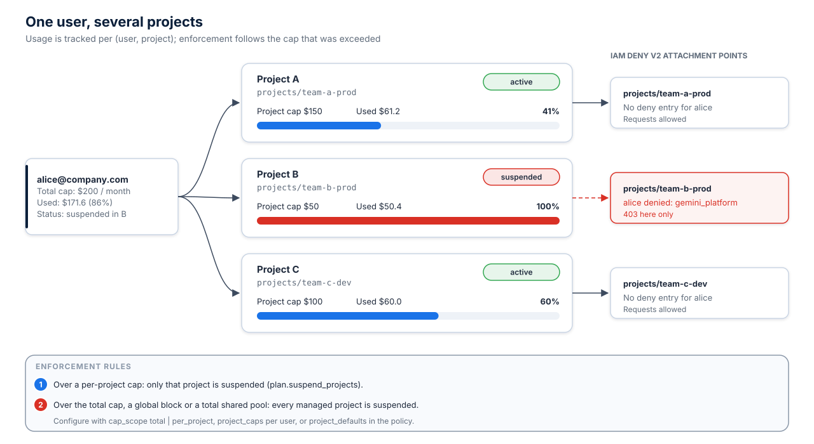
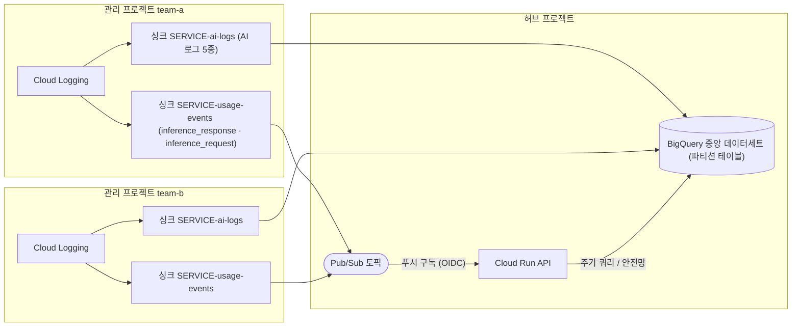
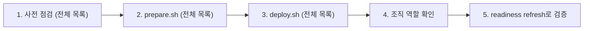
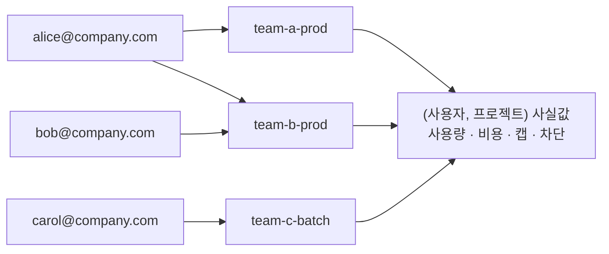

# 멀티 프로젝트(Hub-and-Spoke) 배포 가이드

> **English summary** — One **hub** project hosts the Cloud Run API, the Enforcer Job, the GCS state bucket, the
> Pub/Sub real-time topic and Cloud Scheduler, and governs any number of **managed (spoke)** projects. Every managed
> project gets a Log Router sink into one central BigQuery dataset (default) and a Pub/Sub sink into the single hub
> topic (Antigravity `inference_response` + Gemini Platform
> `inference_request`), Gemini Platform inference request logging, plus
> least-privilege grants for the runtime and enforcer service accounts. Users ↔ projects are **N:M**: usage is
> measured per (user, project) and caps can be total or per project, so an over-cap in one project suspends the user
> only there. IAM Deny Admin/Reviewer and Organization Policy Administrator are **organization-level-only** roles
> required for per-user IAM Deny enforcement and model-governance writes. No Cloud Billing export is needed. Scope can
> be an explicit list (`--managed-projects`), a folder/organization (`--scope-type`/`--scope-ids`, optionally with one
> `--aggregated-sink`). Install with the one-click `install.sh`, `prepare.sh` + `deploy.sh`, or Terraform (including
> the `terraform state mv` migration from v1.0 `count` resources to `for_each`). Teardown keeps data and deny policies.

---

## 목차

1. [아키텍처](#1-아키텍처)
2. [로그 흐름 (싱크)](#2-로그-흐름-싱크)
3. [서비스 계정별·프로젝트별 IAM 부여](#3-서비스-계정별프로젝트별-iam-부여)
4. [스코프 모드](#4-스코프-모드)
5. [중앙 데이터세트 vs 프로젝트별 데이터세트](#5-중앙-데이터세트-vs-프로젝트별-데이터세트)
6. [설치 경로 A — 원클릭 `install.sh`](#6-설치-경로-a--원클릭-installsh)
7. [설치 경로 B — `prepare.sh` + `deploy.sh`](#7-설치-경로-b--preparesh--deploysh)
8. [설치 경로 C — Terraform](#8-설치-경로-c--terraform)
9. [나중에 관리 프로젝트 추가하기](#9-나중에-관리-프로젝트-추가하기)
10. [제거 (Teardown)](#10-제거-teardown)
11. [사용자 ↔ 프로젝트 N:M · 프로젝트별 캡](#11-사용자--프로젝트-nm--프로젝트별-캡)

---

## 1. 아키텍처

<p align="center"></p>

허브의 런타임 SA(`ai-usage-caps-api`)는 OIDC 푸시(`/v1/internal/usage-event`)를 받아 로그 · 쿼터 · 모델 정책 · Discovery Engine을 읽고 쓰며, 집행 SA(`ai-usage-caps-enforcer`)는 Cloud Scheduler(OAuth `run.jobs.run`)가 실행하는 Enforcer Job에서 관리 프로젝트에 IAM Deny v2 정책을 적용합니다. 조직 수준 역할(`iam.denyAdmin` / `iam.denyReviewer` / `orgpolicy.policyAdmin`)은 관리 프로젝트로 상속됩니다.

허브가 갖는 것: Cloud Run API 서비스, Enforcer Job, GCS 상태 버킷(정책·해시된 API 키·웹훅·가격·readiness 캐시),
Secret Manager 부트스트랩 키, 중앙 BigQuery 데이터세트(기본), Pub/Sub 토픽+푸시 구독, Cloud Scheduler.
관리 프로젝트가 갖는 것: Log Router 싱크 2개(BigQuery, Pub/Sub)와 런타임/집행 SA 역할 바인딩뿐입니다.

> [!NOTE]
> 기본 이름(서비스 이름 `gcp-ai-usage-caps-api` 기준): 싱크 `…-ai-logs`(BigQuery), `…-usage-events`(Pub/Sub),
> 토픽 `…-usage-events`, 구독 `…-usage-events-push`, Job `…-enforcer`, 스케줄러 `…-enforce-schedule`,
> 버킷 `<HUB>-…-state`, 시크릿 `…-bootstrap-key`, Artifact Registry 저장소 `ai-usage-caps`.

## 2. 로그 흐름 (싱크)



| 싱크 | 필터 | 목적지 | writer identity 권한 |
|---|---|---|---|
| `<service>-ai-logs` | `log_id("businessaicode.googleapis.com/inference_response") OR log_id("aiplatform.googleapis.com/inference_request") OR (log_id("cloudaudit.googleapis.com/data_access") AND protoPayload.serviceName="aiplatform.googleapis.com") OR log_id("discoveryengine.googleapis.com/gemini_enterprise_user_activity") OR log_id("discoveryengine.googleapis.com/gen_ai_user_message")` | `bigquery.googleapis.com/projects/<감사 프로젝트>/datasets/<데이터세트>` (`--use-partitioned-tables`) | 해당 **데이터세트에만** WRITER(`roles/bigquery.dataEditor`) — 프로젝트 IAM은 건드리지 않음 |
| `<service>-usage-events` | `log_id("businessaicode.googleapis.com/inference_response") OR log_id("aiplatform.googleapis.com/inference_request")` | `pubsub.googleapis.com/projects/<HUB>/topics/<service>-usage-events` | 허브 토픽에 `roles/pubsub.publisher` |

> [!NOTE]
> `aiplatform.googleapis.com/inference_request`는 Gemini Platform 토큰 수의 유일한 로그 출처이며, 프로젝트마다 **추론 요청 메타데이터 로깅**을 켜야 생성됩니다(`prepare.sh` 5단계 / Terraform `enable_vertex_inference_logging`, 기본 켜짐). 1.1 이하에서 만든 싱크를 채택(`--reuse-sinks`)했다면 필터에 이 로그를 추가하세요. 결제 내보내기(Billing Export) 싱크·데이터세트는 필요 없습니다.

- 실시간 경로: Antigravity 추론 로그와 Gemini Platform 추론 요청 로그 → 각 프로젝트 Pub/Sub 싱크 → **하나의** 허브 토픽 → 푸시 구독(OIDC, 런타임 SA
  서명) → `POST /v1/internal/usage-event`. Pub/Sub 서비스 에이전트
  (`service-<허브 번호>@gcp-sa-pubsub.iam.gserviceaccount.com`)에 런타임 SA의 `roles/iam.serviceAccountTokenCreator`가
  부여됩니다.
- 안전망: Cloud Scheduler가 5분마다 Enforcer Job을 실행(`https://run.googleapis.com/v2/<job>:run`, 런타임 SA OAuth).
  `--no-realtime`이면 이 경로만 사용합니다.
- 집계 싱크(`--aggregated-sink`)는 BigQuery 싱크만 폴더/조직 수준 1개로 대체합니다. **Pub/Sub 실시간 싱크는 항상
  프로젝트별**입니다.

## 3. 서비스 계정별·프로젝트별 IAM 부여

`scripts/deploy.sh`와 `terraform/main.tf`가 부여하는 역할은 동일합니다(차이는 표 아래 참고).

### 3.1 런타임 SA — `ai-usage-caps-api@<HUB>.iam.gserviceaccount.com`

| 위치 | 역할 | 용도 |
|---|---|---|
| 허브 프로젝트 | `roles/browser`, `roles/bigquery.dataViewer`, `roles/bigquery.jobUser`, `roles/logging.viewer`, `roles/logging.privateLogViewer`, `roles/logging.logWriter`, `roles/serviceusage.serviceUsageConsumer`, `roles/monitoring.viewer`, `roles/cloudquotas.admin`, `roles/discoveryengine.editor` | 사용량 쿼리, 감사 로그 기록, 쿼터·GE 앱 관리 |
| 관리 프로젝트 (각각) | `roles/browser`, `roles/logging.viewer`, `roles/logging.privateLogViewer`, `roles/monitoring.viewer`, `roles/cloudquotas.admin`, `roles/discoveryengine.editor`, `roles/serviceusage.serviceUsageConsumer` (+ 프로젝트별 데이터세트 모드면 `roles/bigquery.dataViewer`) | 로그·쿼터·GE 앱 |
| 중앙 감사 프로젝트(허브가 아닐 때) | `roles/bigquery.dataViewer` | 중앙 데이터세트 읽기 |
| 허브 + 관리 프로젝트 (각각) | 커스텀 역할 `gcpAiCapsVertexLoggingReader` (1권한: `aiplatform.endpoints.fetchPublisherModelConfig`) | Gemini Platform 추론 요청 로그 상태 조회(`GET /v1/projects/{id}/vertex-logging`, 사전점검). API로 **활성화**하려면 `aiplatform.endpoints.setPublisherModelConfig`를 별도로 부여 |
| GCS 상태 버킷 | `roles/storage.objectAdmin` | 상태 문서 읽기/쓰기 |
| 부트스트랩 시크릿 | `roles/secretmanager.secretAccessor` (`deploy.sh`) | `BOOTSTRAP_ADMIN_KEY` |
| Cloud Run 서비스 | `roles/run.invoker` | 푸시 구독/스케줄러 OIDC 호출 |
| Enforcer Job | `roles/run.jobsExecutor`, `roles/run.viewer` | Job 실행 트리거 |
| **조직** | `roles/iam.denyReviewer`, `roles/orgpolicy.policyAdmin` | deny 정책 읽기, `constraints/vertexai.allowedModels` 쓰기(모델 거버넌스) |

### 3.2 집행 SA — `ai-usage-caps-enforcer@<HUB>.iam.gserviceaccount.com`

| 위치 | 역할 | 용도 |
|---|---|---|
| 허브 프로젝트 | `roles/bigquery.dataViewer`, `roles/bigquery.jobUser`, `roles/logging.viewer`, `roles/logging.privateLogViewer`, `roles/logging.logWriter`, `roles/serviceusage.serviceUsageConsumer` | 사용량 평가 |
| 관리 프로젝트 (각각) | `roles/logging.viewer`, `roles/logging.privateLogViewer` (+ 프로젝트별 데이터세트 모드면 `roles/bigquery.dataViewer`) | 로그 읽기 |
| 중앙 감사 프로젝트(허브가 아닐 때) | `roles/bigquery.dataViewer` | 중앙 데이터세트 읽기 |
| GCS 상태 버킷 | `roles/storage.objectAdmin` | 상태 문서 |
| **조직** | `roles/iam.denyAdmin` | 사용자별 IAM Deny v2 정책 생성/수정/삭제 (**이 SA만** 보유) |

### 3.3 조직 전용 역할

> [!IMPORTANT]
> `roles/iam.denyAdmin`, `roles/iam.denyReviewer`, `roles/orgpolicy.policyAdmin`은 **조직 수준에서만** 부여할 수
> 있습니다(readiness 코드의 `ORG_ONLY_ROLES`). 이 역할이 없으면:
> - `roles/iam.denyAdmin`(집행 SA) 없음 → 사용자별 IAM Deny 차단 불가 (`iam.enforcer.permissions` 실패, 비차단)
> - `roles/orgpolicy.policyAdmin`(런타임 SA) 없음 → 모델 거버넌스(`constraints/vertexai.allowedModels`) 쓰기 불가
> - `roles/iam.denyReviewer`(런타임 SA) 없음 → API에서 deny 상태 조회 불가
>
> 조직이 없는 프로젝트(`project.ancestry` = `warn`)에서는 `enforcement_backend=notify_only`를 사용하세요.

`--grant-org-roles`(Terraform: `grant_org_roles = true` + `organization_id`)를 주면 설치기가 직접 부여하고,
아니면 조직 관리자가 실행할 명령을 출력합니다.

```bash
gcloud organizations add-iam-policy-binding ORG_ID \
  --member=serviceAccount:ai-usage-caps-enforcer@HUB.iam.gserviceaccount.com --role=roles/iam.denyAdmin --condition=None
gcloud organizations add-iam-policy-binding ORG_ID \
  --member=serviceAccount:ai-usage-caps-api@HUB.iam.gserviceaccount.com --role=roles/iam.denyReviewer --condition=None
gcloud organizations add-iam-policy-binding ORG_ID \
  --member=serviceAccount:ai-usage-caps-api@HUB.iam.gserviceaccount.com --role=roles/orgpolicy.policyAdmin --condition=None
```

### 3.4 Google 관리 신원

| 신원 | 권한 | 부여 위치 |
|---|---|---|
| 각 BigQuery 싱크 writer identity | 데이터세트 WRITER (`roles/bigquery.dataEditor`) | 감사 데이터세트 |
| 각 Pub/Sub 싱크 writer identity | `roles/pubsub.publisher` | 허브 토픽 |
| `service-<허브 번호>@gcp-sa-pubsub.iam.gserviceaccount.com` | `roles/iam.serviceAccountTokenCreator` | 런타임 SA (OIDC 푸시 토큰 발급) |

> [!NOTE]
> 차이점: `deploy.sh`는 부트스트랩 시크릿을 만들고 런타임 SA에 `secretAccessor`를 부여합니다. Terraform은
> `bootstrap_admin_key_secret`(기존 시크릿 이름)을 참조만 하므로 시크릿과 `roles/secretmanager.secretAccessor`
> 바인딩은 별도로 준비해야 합니다. `--scope-type` + `--grant-org-roles`(Terraform: `grant_scope_roles = true`)면
> 관리 프로젝트 역할을 프로젝트별 대신 **폴더/조직에 한 번** 부여합니다.

## 4. 스코프 모드

| 모드 | 스크립트 플래그 | Terraform | 관리 프로젝트 결정 | 싱크 | 관리 프로젝트 역할 |
|---|---|---|---|---|---|
| 명시 목록 | `--managed-projects A,B` (`--link-projects`) | `managed_projects = [...]` | 목록 그대로 (`SCAN_PROJECTS`) | 프로젝트별 | 프로젝트별 |
| 폴더 | `--scope-type folder --scope-ids 123[,456]` | `scope_type = "folder"`, `scope_ids` | 설치 시: 사전 점검이 하위 프로젝트 탐색(`PREFLIGHT_MANAGED_PROJECTS`). 런타임: CRM v3로 주기 탐색(기본 최대 300, `SCOPE_MAX_PROJECTS`) | 프로젝트별 또는 `--aggregated-sink` | 프로젝트별, 또는 `--grant-org-roles`로 폴더에 1회 |
| 조직 | `--scope-type organization --scope-ids ORG` | `scope_type = "organization"` | 위와 동일 | 위와 동일 | 위와 동일 (조직에 1회) |
| 집계 싱크 | `--aggregated-sink` (스코프 모드 + 중앙 데이터세트 필요) | **미지원** (프로젝트 싱크만 생성) | — | 폴더/조직 싱크 1개(`includeChildren`) + 허브 자체 싱크 | — |

- `--deny-attachment scope`면 IAM Deny 정책을 프로젝트별 대신 스코프(폴더/조직)에 부착합니다(`iam.scope.permissions`
  점검 대상).
- 런타임 스코프 필터 `SCOPE_FILTER=gemini_enterprise`(GE 앱이 있는 프로젝트만) 옵션이 있습니다.

```bash
# 폴더 하위 전체 + 집계 싱크 + 폴더 수준 역할 + 조직 역할
scripts/install.sh --project hub-prj --scope-type folder --scope-ids 123456789012 \
  --aggregated-sink --grant-org-roles
```

> [!WARNING]
> 집계 싱크를 쓰더라도 **Pub/Sub 실시간 싱크와 프로젝트별 IAM**은 설치 시점에 탐색된 프로젝트에만 만들어집니다.
> 이후 폴더에 새 프로젝트가 생기면 BigQuery 수집은 자동이지만 실시간 경로는 `deploy.sh`를 다시 실행해야 합니다
> (그 전까지는 5분 스케줄러가 집행). 폴더/조직 수준 역할(`--grant-org-roles`)을 쓰면 IAM은 상속됩니다.

## 5. 중앙 데이터세트 vs 프로젝트별 데이터세트

| 항목 | 중앙 (기본, `--central-dataset`) | 프로젝트별 (`--per-project-datasets`) |
|---|---|---|
| 데이터세트 | 허브(또는 `--audit-project P`)에 **1개** | 모든 프로젝트에 1개씩 |
| 런타임 설정 | `AUDIT_PROJECT_ID=<감사 프로젝트>`, `AUDIT_DATASET_ID` | `AUDIT_DATASET_ID`만 |
| 관리 프로젝트 BigQuery API | 불필요 (optional) | 필요 (required) |
| 관리 프로젝트 `bigquery.dataViewer` | 불필요 | 런타임·집행 SA 모두 필요 |
| 교차 위치 조인 | 문제 없음 | 위치가 다르면 불가 (`bq.dataset.location_consistency`) |
| CMEK 정책 영향 | 감사 프로젝트만 | 모든 프로젝트 |
| 권장 | 프로젝트가 많을 때 | 데이터 경계가 프로젝트별이어야 할 때 |

`--reuse-dataset P:D`는 중앙 모드를 강제하고 기존 데이터세트를 채택합니다
([preflight-checklist.md §6](preflight-checklist.md#6-기존-bigquery-데이터세트싱크-채택-adoption)).
데이터세트 위치 기본값은 `--region`이며 `--dataset-location`으로 바꿀 수 있습니다.

## 6. 설치 경로 A — 원클릭 `install.sh`

`install.sh`는 로컬 체크아웃이 아니면 저장소를 `$HOME/gcp-ai-usage-caps-api`(`CAPS_API_INSTALL_DIR`)에
클론/갱신한 뒤, **사전 점검을 한 번** 실행하고 `prepare.sh` → `deploy.sh`를 순서대로 실행합니다(같은 인자 전달).

```bash
# 1) 단일 허브
bash <(curl -fsSL https://github.com/ldu1225/gcp-ai-usage-caps-api/raw/main/scripts/install.sh) \
  --project HUB_PROJECT

# 2) 허브 + 관리 프로젝트, 중앙 데이터세트, 실시간 Pub/Sub, 조직 역할, Gemini Platform Data Access 로그
bash <(curl -fsSL https://github.com/ldu1225/gcp-ai-usage-caps-api/raw/main/scripts/install.sh) \
  --project HUB_PROJECT --managed-projects PROJECT_B,PROJECT_C --grant-org-roles --enable-data-access-logs

# 3) 폴더 하위 전체
bash <(curl -fsSL .../scripts/install.sh) \
  --project HUB_PROJECT --scope-type folder --scope-ids 123456789 --aggregated-sink --grant-org-roles

# 4) 점검만 (아무것도 만들지 않음)
bash <(curl -fsSL .../scripts/install.sh) --preflight-only --project HUB_PROJECT --managed-projects PROJECT_B

# 5) 로그 수집 준비만 (데이터세트 + 싱크 + Data Access 로그)
bash <(curl -fsSL .../scripts/install.sh) --prepare-only --project HUB_PROJECT --managed-projects PROJECT_B

# 6) 제약이 많은 환경 예: VPC egress 강제 + 기존 데이터세트 채택 + 사전 빌드 이미지
scripts/install.sh --project HUB_PROJECT --managed-projects PROJECT_B \
  --vpc-network shared-net --vpc-subnet projects/host-prj/regions/asia-northeast3/subnetworks/run-subnet \
  --reuse-dataset logs-prj:ai_logs --reuse-sinks --image asia-northeast3-docker.pkg.dev/HUB/ai-usage-caps/api:1.1
```

### 공통 플래그 (`prepare.sh`, `deploy.sh`, `install.sh`, `teardown.sh` 공용)

| 플래그 | 설명 |
|---|---|
| `--project HUB` | 허브 프로젝트 (없으면 `gcloud config get-value project`) |
| `--managed-projects A,B` / `--link-projects` | 관리 프로젝트 |
| `--scope-type folder\|organization --scope-ids ID[,ID]` | 폴더/조직 스코프 (사전 점검이 탐색) |
| `--aggregated-sink` | 스코프 모드에서 폴더/조직 집계 싱크 1개 |
| `--region REGION` | 허브 리전 (기본 `asia-northeast3`) |
| `--service-name NAME` | Cloud Run 서비스 이름 (기본 `gcp-ai-usage-caps-api`) |
| `--dataset NAME` | 감사 데이터세트 ID (기본 `ge_analytics`) |
| `--dataset-location LOC` | BigQuery 위치 (기본 `--region`) |
| `--central-dataset` | (기본) 허브에 데이터세트 1개 |
| `--audit-project P` | 중앙 데이터세트 프로젝트 |
| `--per-project-datasets` | 레거시: 프로젝트마다 데이터세트 |
| `--reuse-dataset P:D` | 기존 데이터세트 채택 |
| `--reuse-sinks` | 사전 점검이 찾은 기존 싱크 채택 |
| `--enable-data-access-logs` | Gemini Platform `ADMIN_READ`/`DATA_READ`/`DATA_WRITE` 감사 로그 병합 (기존 설정 보존) |
| `--org-id ID` | 조직 ID (기본: 자동 탐지) |
| `--grant-org-roles` | 조직 역할(+스코프 모드의 폴더/조직 역할) 부여 |
| `--deny-attachment projects\|scope` | Deny 정책 부착 위치 |
| `--billing-account ID` / `--spend-caps` | 프로젝트 지출 캡 |
| `--mode manual\|auto` | 기본 캡 집행 모드 (`ENFORCEMENT_MODE`) |
| `--no-realtime` | Pub/Sub 파이프라인 없이 5분 스케줄러만 |
| `--vpc-network N --vpc-subnet S [--vpc-egress all-traffic\|private-ranges-only]` | Direct VPC egress |
| `--worker-pool projects/P/locations/R/workerPools/W` / `--image IMAGE` | Cloud Build 전용 풀 / 사전 빌드 이미지 |
| `--quota-contact-email EMAIL` | 쿼터 증설 요청 연락처 |
| `--model-violation-action ACT` | 기본 `block_service` |
| `--no-vertex-inference-logging` | (prepare/install) Gemini Platform 추론 요청 로그 활성화 생략 (`ENABLE_VERTEX_INFERENCE_LOGGING=false`). 생략하면 Gemini Platform 토큰·비용·캡을 측정할 수 없음 |
| `--enforcement-backend iam_deny\|notify_only` | 집행 백엔드 (`ENFORCEMENT_BACKEND`) |
| `--cap-scope total\|per_project` | 기본 캡 범위 (`CAP_SCOPE`) |
| `--metered-surfaces antigravity,gemini_platform,gemini_enterprise` | 캡 계산 대상 서비스 (`METERED_SURFACES`). 레거시 surface id `vertex_ai`도 `gemini_platform`의 별칭으로 허용 |
| `--vertex-user-header-label LABEL` | Gemini Platform 사용자 헤더 라벨 접미사 (`VERTEX_USER_HEADER_LABEL`, 기본 `user`) |
| `--model-violation-block-scope project\|all` | 모델 규칙 위반 차단 범위 (`MODEL_VIOLATION_BLOCK_SCOPE`, 기본 `project`) |
| `--skip-preflight` / `--skip-preflight-blockers` | 사전 점검 생략 / 차단 항목 무시 |
| `--keep-log-sinks` | (teardown) BigQuery 싱크 유지 |
| `--lang ko\|en` | 사전 점검 출력 언어 |
| `--dry-run` | 명령만 출력 |

추가 환경변수: `ENABLE_VERTEX_INFERENCE_LOGGING`(기본 `true`), `VERTEX_LOGGING_ENDPOINT`(기본 `https://aiplatform.googleapis.com/v1beta1`), `PRICING_SYNC_SCHEDULE`/`PRICING_SYNC_TIME_ZONE`(일일 단가 동기화 스케줄), `MODEL_PUBLISHERS`, `LONG_CONTEXT_THRESHOLD_TOKENS`, `PROVISIONED_THROUGHPUT_COST`. **Billing Export 관련 플래그·변수(`BILLING_PROJECT_ID`/`BILLING_DATASET_ID`/`BILLING_TABLE_ID`)는 없습니다.**

## 7. 설치 경로 B — `prepare.sh` + `deploy.sh`

| 스크립트 | 단계 |
|---|---|
| `prepare.sh` | 0) 사전 점검 → 1) API 활성화(일괄 → 실패 시 개별, required 실패는 중단) → 2) 감사 데이터세트(중앙/채택/프로젝트별) → 3) BigQuery 싱크(프로젝트별 또는 집계 + 허브 자체 싱크), writer에 데이터세트 WRITER → 4) (선택) Data Access 감사 로그 병합 → 5) **Gemini Platform 추론 요청 로그 활성화**(프로젝트별 `setPublisherModelConfig`, 이미 켜진 프로젝트·aiplatform 미사용 프로젝트는 건너뜀, 409 허용, Cloud Logging 비용 안내) |
| `deploy.sh` | 1/9 허브 API → 2/9 SA 생성 + 허브 역할 → 3/9 관리 프로젝트(또는 폴더/조직) 역할(+ `gcpAiCapsVertexLoggingReader`) → 4/9 조직 역할 → 5/9 GCS 상태 버킷(버전 관리, 균일 접근, 공개 차단) + 부트스트랩 키 → 6/9 컨테이너 이미지(Cloud Build / 전용 풀 / Docker / 사전 빌드) → 7/9 Cloud Run 서비스 + Enforcer Job → 8/9 Cloud Scheduler 5분 + 일일 `…-pricing-sync`(OIDC) → 9/9 실시간 토픽 + 프로젝트별 Pub/Sub 싱크(`inference_response` + `inference_request`) + 푸시 구독 |

```bash
scripts/prepare.sh --project hub-prj --managed-projects team-a,team-b --enable-data-access-logs
scripts/deploy.sh  --project hub-prj --managed-projects team-a,team-b --grant-org-roles --mode manual
```

- 두 스크립트 모두 멱등입니다(describe → create|update). 같은 인자로 다시 실행해도 안전합니다.
- 부트스트랩 관리자 키(`gcpai_<12 hex>_<secret>`)는 시크릿이 처음 만들어질 때 **한 번만** 출력됩니다.
- 배포 결과: `API URL https://<service>-<허브 번호>.<region>.run.app`, `/v1/openapi.yaml`, `GET /v1/admin/readiness`.

> [!IMPORTANT]
> `deploy.sh`는 Cloud Run 서비스·Enforcer Job의 환경변수 `SCAN_PROJECTS`를 **이번 실행의 `--managed-projects`
> 목록(+ 스코프 탐색 결과)으로 교체**합니다. 더 짧은 목록으로 재실행하면 빠진 프로젝트는 **조용히 관리 대상에서
> 제외**됩니다(사용량 집계·집행·모델/쿼터 API 대상에서 빠짐. 이미 만든 싱크와 IAM 바인딩은 남음). 재실행할 때는
> 항상 **전체 목록**을 전달하세요. 또한 `deploy.sh`는 `ENFORCEMENT_BACKEND=iam_deny`로 배포합니다. 조직이 없거나
> Deny Admin을 받을 수 없으면 배포 후 `PUT /v1/caps/policy {"enforcement_backend":"notify_only"}`로 전환하세요.

## 8. 설치 경로 C — Terraform

```bash
cd terraform
cp terraform.tfvars.example terraform.tfvars   # 값 수정
scripts/preflight.sh --project my-hub --managed-projects team-a,team-b   # 적용할 대응 확인 (기본: 중앙 데이터세트)
terraform init && terraform plan && terraform apply
```

이미지는 미리 빌드해서 `container_image`로 지정해야 합니다(Terraform은 빌드하지 않음).

### 8.1 주요 변수

| 변수 | 기본값 | 설명 |
|---|---|---|
| `project_id` | (필수) | 허브 프로젝트 |
| `region` | `asia-northeast3` | Cloud Run/Scheduler 리전 |
| `service_name` | `gcp-ai-usage-caps-api` | 서비스 이름 접두사 |
| `container_image` | (필수) | 컨테이너 이미지 URI |
| `managed_projects` | `[]` | 관리 프로젝트 (각각 싱크 2개 + 역할) |
| `linked_projects` | `[]` | `managed_projects`의 폐기 예정 별칭(병합) |
| `enable_managed_apis` | `true` | 관리 프로젝트 API 활성화 (logging, iam, cloudresourcemanager, serviceusage, orgpolicy, cloudquotas, monitoring + 프로젝트별 모드면 bigquery) |
| `grant_managed_roles` | `true` | 관리 프로젝트별 역할 부여 |
| `scope_type` / `scope_ids` | `projects` / `[]` | 런타임 스코프 |
| `grant_scope_roles` | `false` | 폴더/조직에 관리 역할 1회 부여 |
| `central_dataset` | `true` | 중앙 데이터세트 1개 |
| `audit_project_id` | `""` | 중앙 데이터세트 프로젝트 (기본: 허브) |
| `audit_dataset_id` | `ge_analytics` | 데이터세트 ID |
| `reuse_dataset` | `""` | `PROJECT:DATASET` 채택 (데이터 소스로 읽기만, 중앙 모드 강제) |
| `dataset_location` | `""` (= region) | 데이터세트·상태 버킷 위치 |
| `create_audit_sink` | `true` | 데이터세트·BigQuery 싱크 생성 |
| `enable_data_access_logs` | `false` | Gemini Platform 감사 로그 (`google_project_iam_audit_config`, aiplatform 서비스 설정만 권한적으로 관리) |
| `organization_id` / `grant_org_roles` | `""` / `false` | 조직 전용 역할 |
| `vpc_network` / `vpc_subnet` / `vpc_egress` | `""` / `""` / `all-traffic` | Direct VPC egress |
| `no_invoker_iam_check` | `false` | DRS 환경에서 `true` (allUsers 대신 invoker 검사 해제) |
| `allow_unauthenticated_edge` | `true` | `allUsers` run.invoker (`no_invoker_iam_check=true`면 생략) |
| `ingress` | `INGRESS_TRAFFIC_ALL` | Cloud Run v2 인그레스 |
| `binary_authorization_policy` | `""` | Binary Authorization 정책 |
| `realtime_enforcement` | `true` | 토픽·구독·Pub/Sub 싱크 |
| `enforcement_backend` / `enforcement_mode` | `iam_deny` / `manual` | 집행 |
| `deny_attachment` / `deny_policy_id` | `projects` / `gcp-ai-caps-managed` | Deny 정책 |
| `enforcement_schedule` / `pricing_sync_schedule` | `*/5 * * * *` / `0 3 * * *` | 스케줄러 (빈 문자열이면 생성 안 함) |
| `bootstrap_admin_key_secret` | `""` | 기존 시크릿 이름 |
| `public_base_url` | `""` (= run.app URL) | OIDC audience 기준 URL |
| `oidc_allowed_service_accounts` | `[]` | OIDC 허용 외부 SA |
| `enable_vertex_inference_logging` / `vertex_logging_endpoint` / `create_vertex_logging_reader_role` | `true` / v1beta1 / `true` | Gemini Platform 추론 요청 로그 활성화(네이티브 리소스가 없어 `terraform_data` local-exec로 `setPublisherModelConfig` 호출 — Terraform 실행 환경에 bash·curl과 `aiplatform.endpoints.setPublisherModelConfig` 필요, hashicorp/terraform-provider-google#30642) / 런타임 SA용 1권한 조회 역할 |
| `cap_scope` / `metered_surfaces` / `vertex_user_header_label` / `model_violation_block_scope` | `total` / 3개 / `user` / `project` | 멀티 프로젝트 캡·귀속 설정 (환경변수로 전달) |
| `quota_contact_email`, `model_violation_action`, `spend_caps_enabled`, `billing_account_id`(하드캡 전용), `cap_currency`, `workspace_timezone` | — | 기타 (Billing Export 관련 변수 없음) |

출력: `api_url`, `openapi_url`, `api_service_account`, `enforcer_service_account`, `enforcer_job_name`,
`state_bucket`, `org_iam_commands`(`grant_org_roles=false`일 때 조직 관리자용 명령), `managed_projects`,
`audit_dataset`, `ai_log_sink_writers`, `usage_event_sink_writers`.

> [!NOTE]
> Terraform은 폴더/조직 **집계 싱크**와 **싱크 채택(`--reuse-sinks`)** 을 지원하지 않습니다. 필요하면
> `scripts/prepare.sh`로 싱크를 만들고 `create_audit_sink = false`로 두세요.

### 8.2 v1.0 → 현재 버전 상태 이전 (`count` → `for_each`)

v1.0의 단일 프로젝트 리소스(`count`)가 프로젝트별 `for_each` 맵으로 바뀌었습니다. 이전하지 않으면 Terraform이 기존
데이터세트·싱크를 **삭제 후 재생성**하려고 합니다(싱크 writer identity가 바뀌고, 데이터세트는
`delete_contents_on_destroy=false`라 실패). `terraform plan` 전에 상태를 옮기세요(`HUB` = `project_id` 값).

```bash
HUB=my-hub-project-id

# BigQuery 데이터세트 / AI 로그 싱크 / 싱크 writer 바인딩 (central_dataset=true, audit_project_id="" 기준 키 = HUB)
terraform state mv 'google_bigquery_dataset.audit[0]'            "google_bigquery_dataset.audit[\"$HUB\"]"
terraform state mv 'google_logging_project_sink.ai_logs_bq[0]'   "google_logging_project_sink.ai_logs_bq[\"$HUB\"]"
terraform state mv 'google_bigquery_dataset_iam_member.sink_writer[0]' "google_bigquery_dataset_iam_member.sink_writer[\"$HUB\"]"

# 실시간 Pub/Sub 싱크와 publisher 바인딩 (realtime_enforcement=true)
terraform state mv 'google_logging_project_sink.usage_events[0]' "google_logging_project_sink.usage_events[\"$HUB\"]"
terraform state mv 'google_pubsub_topic_iam_member.usage_sink_pub[0]' "google_pubsub_topic_iam_member.usage_sink_pub[\"$HUB\"]"

# 조직 역할: 개별 리소스 → org_roles 맵 (grant_org_roles=true)
terraform state mv 'google_organization_iam_member.enforcer_deny_admin[0]' 'google_organization_iam_member.org_roles["enforcer|roles/iam.denyAdmin"]'
terraform state mv 'google_organization_iam_member.api_deny_reviewer[0]'   'google_organization_iam_member.org_roles["api|roles/iam.denyReviewer"]'

terraform plan   # 위 리소스는 변경 없음이어야 하며, 신규 org_roles["api|roles/orgpolicy.policyAdmin"]와 관리 프로젝트 리소스만 추가
```

> [!CAUTION]
> `audit_project_id`를 다른 프로젝트로 바꾸거나 `central_dataset = false`로 전환하면 키가 달라집니다
> (`google_bigquery_dataset.audit`의 키는 데이터세트 프로젝트, 싱크 키는 싱크 소스 프로젝트). 이전 전에
> `terraform state list`로 실제 주소를 확인하세요. 해당 리소스가 v1.0에서 생성되지 않았다면(예:
> `create_audit_sink=false`) 그 줄은 건너뜁니다.

## 9. 나중에 관리 프로젝트 추가하기



1. **사전 점검** — 새 프로젝트를 포함한 전체 목록으로(기본이 중앙 데이터세트):
   `scripts/preflight.sh --project HUB --managed-projects team-a,team-b,team-new`
   (새 프로젝트의 `api.*`, `orgpolicy.*`, `vpcsc.cross_project`, `logging.*` 확인)
2. **로그 수집 준비** — `scripts/prepare.sh --project HUB --managed-projects team-a,team-b,team-new
   [--enable-data-access-logs]` (API 활성화, 싱크, writer 권한, **Gemini Platform 추론 요청 로그 활성화**. 기존 프로젝트는 변경 없음)
3. **배포 갱신** — `scripts/deploy.sh --project HUB --managed-projects team-a,team-b,team-new [기존과 동일한 옵션]`
   (`SCAN_PROJECTS` 교체, 새 프로젝트 역할, Pub/Sub 싱크 + publisher 권한, Cloud Run 새 리비전).
   **기존 프로젝트를 빼먹으면 그 프로젝트는 관리 대상에서 제외됩니다** — 반드시 전체 목록을 전달하세요.
4. **조직 역할** — 같은 조직이면 상속되어 추가 작업 없음. **다른 조직**의 프로젝트라면 그 조직에서도 3.3의 조직
   역할이 필요합니다.
5. **VPC-SC** — 새 프로젝트가 다른 경계에 있으면 `vpcsc.cross_project`가 생성한 YAML을 적용합니다.
6. **검증** — `GET /v1/admin/readiness?refresh=true&project=team-new`, 서피스·권한 요약은
   `GET /v1/projects/team-new/capabilities`(`models:read`/`quotas:read`/`caps:read`), Gemini Platform 로그는
   `GET /v1/projects/team-new/vertex-logging`(`enabled: true`), 몇 분 뒤 `bq.freshness.*`·사용량 API의
   `telemetry.token_sources` 확인.
7. **캡** — 새 프로젝트에 프로젝트 기본 캡이 필요하면 `PUT /v1/caps/policy {"project_defaults": {...}}`에 추가([11장](#11-사용자--프로젝트-nm--프로젝트별-캡)).

Terraform: `managed_projects`에 추가 후 `terraform apply`.
폴더/조직 스코프: 런타임이 새 프로젝트를 자동 탐색하고 집계 싱크가 로그를 수집합니다. 다만 프로젝트별 역할
(폴더 수준 부여를 안 했을 때)과 Pub/Sub 실시간 싱크를 위해 `deploy.sh`를 다시 실행하세요.

## 10. 제거 (Teardown)

```bash
scripts/teardown.sh --project HUB --managed-projects team-a,team-b [--scope-type folder --scope-ids ID --aggregated-sink] \
  [--region R] [--service-name NAME] [--keep-log-sinks] [--dry-run]
```

| 삭제 | 유지 |
|---|---|
| Scheduler 작업(`…-enforce-schedule`, `…-pricing-sync`), 푸시 구독, 토픽, Cloud Run 서비스, Enforcer Job, 프로젝트별 Pub/Sub 싱크, (`--keep-log-sinks`가 없으면) 프로젝트별·집계 BigQuery 싱크 | BigQuery 데이터세트, GCS 상태 버킷, 부트스트랩 시크릿, Artifact Registry, 서비스 계정과 IAM 바인딩, **IAM Deny 정책**, **Gemini Platform 추론 요청 로그 설정**(켜진 상태 유지 — Cloud Logging 비용을 줄이려면 프로젝트별로 직접 끄세요) |

> [!CAUTION]
> Teardown은 IAM Deny 정책을 지우지 않습니다(차단된 사용자가 조용히 풀리지 않도록). 서비스를 내리기 **전에**
> `POST /v1/users/{email}/unblock`으로 해제하거나, 조직 정책 관리자가
> `gcloud iam policies delete gcp-ai-caps-managed --attachment-point=cloudresourcemanager.googleapis.com/projects/P --kind=denypolicies`
> 로 직접 삭제해야 합니다. SA를 삭제할 경우 남은 IAM 바인딩은 `gcloud projects remove-iam-policy-binding` /
> `gcloud organizations remove-iam-policy-binding`으로 정리하세요.

Terraform `destroy` 시: 데이터세트는 `delete_contents_on_destroy = false`, 버킷은 `force_destroy = false`이므로
내용이 있으면 삭제가 실패합니다(데이터 보호). 백업 후 수동으로 비우거나 `terraform state rm`으로 관리에서 제외하세요.

## 11. 사용자 ↔ 프로젝트 N:M · 프로젝트별 캡

한 사용자는 보통 1개 프로젝트에 배정되지만 여러 관리 프로젝트에서 일할 수 있습니다(N:M). 이 API는 모든 사용량을
**(사용자, 프로젝트)** 단위로 집계하므로 별도 매핑 테이블이 필요 없습니다 — 로그에 기록된 프로젝트가 곧 귀속 프로젝트입니다.



| 기능 | 설정 / API | 동작 |
|---|---|---|
| 합산 캡 | 정책 `cap_scope: total` (기본) | 사용자의 모든 프로젝트 사용량 합계에 캡 1개 → 초과 시 **모든 프로젝트**에서 정지 |
| 프로젝트별 동일 캡 | 정책 `cap_scope: per_project` 또는 사용자 규칙 `scope: per_project` | 같은 캡을 프로젝트마다 따로 평가 → 초과한 **그 프로젝트만** 정지 |
| 사용자 × 프로젝트 캡 | 사용자 규칙 `project_caps: {project: {cost_cap, token_cap, request_cap}}` | 합산 캡과 **함께** 평가 (`limit.source = user_project_cap`) |
| 프로젝트 기본 캡 | 정책 `project_defaults: {project: {...}}` | 그 프로젝트의 모든 사용자에게 적용 (`limit.source = project_default`) |
| 계측 서비스 | 정책 `metered_surfaces` (`METERED_SURFACES`) | 캡 계산에 포함할 서비스 |
| 프로젝트 한정 차단 | `POST /v1/users/{email}/block {"projects":[...]}` | 해당 프로젝트 부착점에만 IAM Deny |
| 프로젝트 한정 해제 | `POST /v1/users/{email}/unblock {"projects":[...]}` | 해당 프로젝트만 해제, 나머지 유지 |
| 사용자 프로젝트 조회 | `GET /v1/users/{email}/projects?include=iam` | 사용·배정된 모든 프로젝트의 사용량·비용·모델·캡 상태, 직접 `user:` IAM 바인딩 |
| 모델 규칙 위반 차단 범위 | `models.violation_block_scope` (`MODEL_VIOLATION_BLOCK_SCOPE`) `project` (기본) \| `all` | 위반 프로젝트만 / 모든 프로젝트 |

```bash
# 프로젝트별 캡 정책 + 배치 프로젝트 기본 캡
curl -s -X PUT "$BASE/v1/caps/policy" -H "Authorization: Bearer $KEY" -H "Content-Type: application/json" \
  -d '{"cost_cap":100,"period":"monthly","enforcement_mode":"auto","cap_scope":"per_project",
       "project_defaults":{"team-c-batch":{"token_cap":50000000}}}'

# alice: 합산 $200 + team-b-prod $50
curl -s -X PUT "$BASE/v1/caps/users/alice%40company.com" -H "Authorization: Bearer $KEY" -H "Content-Type: application/json" \
  -d '{"type":"limit","cost_cap":200,"scope":"total","project_caps":{"team-b-prod":{"cost_cap":50}}}'

# 확인
curl -s "$BASE/v1/caps/users/alice%40company.com" -H "Authorization: Bearer $KEY" \
  | jq '{status, status_scope, over_scope, blocked_projects, projects: [.projects[] | {project, status, limit, remaining}]}'
curl -s "$BASE/v1/users/alice%40company.com/projects?include=iam" -H "Authorization: Bearer $KEY"
```

> [!NOTE]
> `deny_attachment=projects`(기본)에서는 모든 관리 프로젝트가 이미 부착점이므로 프로젝트 한정 차단에 추가 설정이 없습니다.
> `deny_attachment=scope`(폴더/조직 부착)에서는 프로젝트 한정 항목이 생길 때 해당 `projects/{id}` 부착점에도 관리형
> 정책을 만들므로, 집행 SA의 `roles/iam.denyAdmin`(조직 수준)이 그대로 사용됩니다. 상세 규칙은
> [enforcement-logic.md](enforcement-logic.md#3-멀티-프로젝트-집행-120).

관련 문서: [preflight-checklist.md](preflight-checklist.md) · [operations-runbook.md](operations-runbook.md) ·
[security.md](security.md) · [enforcement-logic.md](enforcement-logic.md) · [cost-methodology.md](cost-methodology.md)
