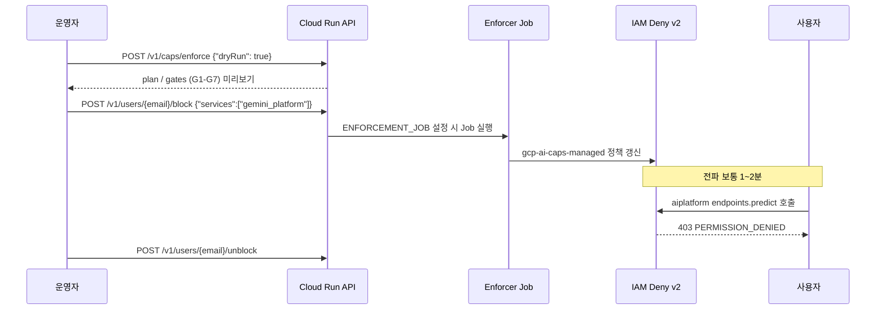

# 운영 런북 (Day-2 Operations)

> **English summary** — Day-2 procedures for the hub deployment: health checks (`GET /v1/health`, readiness report,
> Enforcer Job executions, daily price sync), verifying enforcement (IAM Deny v2 typically propagates in ~1–2 minutes),
> emergency unblock / break-glass (order matters: unblock while `enforcement_backend=iam_deny`, or delete the managed
> deny policy after switching to `notify_only`), protected principals and `allow` overrides, a symptom → cause → fix
> troubleshooting table (missing usage data, Vertex AI `requests_only`, high `unattributed`, unpriced models, VPC-SC
> denials, permission denied on Org Policy / Cloud Quotas / deny policies, IAM v2 read quota, Pub/Sub push failures,
> Scheduler, stuck quota requests, model policy drift, Gemini Enterprise `not_applicable`), webhook signature
> verification with a Python sample, API key rotation, GCS state bucket backup/restore, upgrade/rollback, and §10 on
> cost & attribution operations (official SKU price sync — no Cloud Billing export —, enabling Vertex AI inference
> request logging, reading `telemetry.attribution`, handling unattributed usage, new-model tracking).

---

## 목차

1. [일상 점검 (Health)](#1-일상-점검-health)
2. [Readiness 보고서 읽는 법](#2-readiness-보고서-읽는-법)
3. [집행(차단) 동작 검증](#3-집행차단-동작-검증)
4. [긴급 해제 / Break-glass](#4-긴급-해제--break-glass)
5. [문제 해결 표](#5-문제-해결-표)
6. [웹훅 서명 검증](#6-웹훅-서명-검증)
7. [API 키 교체](#7-api-키-교체)
8. [GCS 상태 버킷 백업·복구](#8-gcs-상태-버킷-백업복구)
9. [업그레이드·롤백](#9-업그레이드롤백)
10. [비용·단가·사용자 귀속 운영](#10-비용단가사용자-귀속-운영)

공통 변수(예시):

```bash
HUB=hub-prj; REGION=asia-northeast3; SVC=gcp-ai-usage-caps-api
API=$(gcloud run services describe $SVC --region $REGION --project $HUB --format='value(status.url)')
ADMIN_KEY=gcpai_xxxxxxxxxxxx_yyyyyyyy...   # admin 스코프 키
```

---

## 1. 일상 점검 (Health)

| 점검 | 명령 | 정상 기준 |
|---|---|---|
| API 생존 | `curl -s $API/v1/health` | `{"status":"ok", "version": ...}` (인증 불필요) |
| 상세 상태 | `curl -s -H "Authorization: Bearer $ADMIN_KEY" $API/v1/health` | `workspace_configured: true`, `storage.durable: true`(GCS), `enforcement.mode/backend`, `enforcement.last_run` 최근 시각 |
| 환경 준비도 | `curl -s -H "Authorization: Bearer $ADMIN_KEY" "$API/v1/admin/readiness" \| jq '.overall,.summary'` | `ready` 또는 예상된 `ready_with_warnings` |
| Enforcer Job 실행 이력 | `gcloud run jobs executions list --job $SVC-enforcer --region $REGION --project $HUB --limit 5` | 5분 간격 성공 실행 |
| 스케줄러 | `gcloud scheduler jobs describe $SVC-enforce-schedule --location $REGION --project $HUB --format='value(state,lastAttemptTime,status)'` | `ENABLED`, 최근 시도 성공 |
| **단가 동기화** | `curl -s -H "Authorization: Bearer $ADMIN_KEY" "$API/v1/pricing" \| jq '.pricing_source'` / `gcloud scheduler jobs describe $SVC-pricing-sync --location $REGION --project $HUB` | `catalog_synced_at`이 24시간 이내, `official_sku_models > 0`, `billing_export: "not_used"` |
| **Vertex AI 토큰 출처** | `curl -s -H "Authorization: Bearer $ADMIN_KEY" "$API/v1/usage/users?limit=1" \| jq '.telemetry'` | `token_sources.gemini_platform = "logs"`, `attribution.unattributed`가 전체 대비 작음 |
| 실시간 구독 적체 | Cloud Monitoring `pubsub.googleapis.com/subscription/num_undelivered_messages` (구독 `$SVC-usage-events-push`) | 0 근처 |
| 감사 로그 | `curl -s -H "Authorization: Bearer $ADMIN_KEY" "$API/v1/audit-logs"` | 예상하지 못한 `api_key.created`, `user.blocked` 등 없음 |

Enforcer Job은 실행마다 PII가 제거된 JSON 요약 한 줄을 stdout으로 남깁니다(이메일은 `<email>`로 치환).
종료 코드: `0` 성공(적용·변경 없음·드라이런·안전 게이트로 정상 중단), `1` 실패(IAM 변경 실패/업스트림 오류),
`2` 구성 오류(워크스페이스 미설정, 잘못된 인자, Cloud Run Job에서 GCS 저장소 없음).

```bash
gcloud logging read "resource.type=cloud_run_job AND resource.labels.job_name=$SVC-enforcer" \
  --project $HUB --limit 20 --format='value(timestamp,textPayload,jsonPayload)'
```

## 2. Readiness 보고서 읽는 법

1. `overall`과 `summary.blocking` / `summary.blocking_unfixable`을 먼저 봅니다.
2. `fail` → `warn` 순으로 `projects[].checks[]`와 `cross_project[]`를 확인합니다. 각 체크의 `impact`가 영향받는
   기능(`usage`, `caps_enforcement`, `model_governance`, `quota_management`, `realtime`, …)입니다.
3. `skip`은 오류가 아니라 **판단 불가**입니다. `detail`의 사유(권한, API 비활성, VPC-SC)를 해결하면 다시 평가됩니다.
4. `capabilities[project]`로 서피스별 사용 가능 여부(`gemini_platform`, `gemini_enterprise`, `antigravity`)와
   `org_policy_writable`, `quotas_api`, `deny_writable`을 확인합니다.
5. `remediation_script`를 내려받아 검토 후 실행합니다.

```bash
curl -s -H "Authorization: Bearer $ADMIN_KEY" "$API/v1/admin/readiness?refresh=true" \
  | jq -r '[.projects[] as $p | $p.checks[] | select(.status=="fail" or .status=="warn")
           | "\(.status)\t\($p.project_id)\t\(.id)\t\(.title_en)"] | .[]'
```

체크 ID별 의미와 조치는 [preflight-checklist.md](preflight-checklist.md)를 참고하세요. 캐시 TTL은
`readiness.cache_ttl_seconds`(기본 900초)입니다.

## 3. 집행(차단) 동작 검증



1. **드라이런**: `POST /v1/caps/enforce {"dryRun": true}`(기본값도 `true`) — 계획(`plan`)과 안전 게이트(`gates`
   G1–G7)를 확인합니다. 게이트 상세는 [enforcement-logic.md](enforcement-logic.md).
2. **테스트 사용자 차단**: `POST /v1/users/test.user@example.com/block` `{"services":["gemini_platform"],"reason":"drill"}`.
   응답의 `enforcement.applied`(또는 `mode: enforcer_job`)를 확인합니다.
3. **Deny 정책 확인** (deny 읽기 권한 필요):

   ```bash
   gcloud iam policies get gcp-ai-caps-managed \
     --attachment-point=cloudresourcemanager.googleapis.com/projects/team-a \
     --kind=denypolicies --format=json | jq '.rules[].denyRule'
   ```

   서비스별 거부 권한: Antigravity `businessaicode.googleapis.com/locations.generateContent`, Vertex AI
   `aiplatform.googleapis.com/endpoints.predict`, Gemini Enterprise `discoveryengine.googleapis.com/assistants.assist`.
4. **전파 대기**: IAM Deny는 보통 **1–2분** 안에 적용됩니다(환경에 따라 더 걸릴 수 있음). 즉시 확인되지 않아도
   2–3분 뒤 다시 시도하세요.
5. **해제**: `POST /v1/users/test.user@example.com/unblock` → 정책에서 주체가 빠졌는지 다시 확인.

> [!NOTE]
> 정책 ID는 `caps.deny_policy_id`(`DENY_POLICY_ID`, 기본 `gcp-ai-caps-managed`)이고, 부착 지점은
> `deny_attachment=projects`면 관리 프로젝트마다, `scope`면 폴더/조직입니다. 부착 지점당 거부 주체 한도는 2,500명
> (2,000명부터 `enforcement.deny_policies` 경고)입니다.

## 4. 긴급 해제 / Break-glass

> [!IMPORTANT]
> `enforcement_backend=notify_only`로 바꾸면 **새로운 차단(주체 추가)은 모두 중단**됩니다. 단,
> `POST /v1/users/{email}/unblock`으로 사용자의 **모든 서비스**를 해제하면 notify_only에서도 그 사용자의 기존 IAM deny
> 항목이 제거됩니다(`caps._reconcile_direct_change`의 break-glass 경로, 응답
> `enforcement.note: "Existing IAM deny entry removed (break-glass unblock in notify_only mode)."`). 다른 사용자의
> deny 항목은 그대로 유지됩니다.

> [!WARNING]
> notify_only의 해제 경로는 Enforcer Job을 거치지 않고 **API(런타임 SA)가 직접** deny 정책을 수정합니다. 표준 배포에서
> 런타임 SA는 `roles/iam.denyReviewer`만 가지므로 쓰기가 거부될 수 있습니다. 응답의 `enforcement.applied`가 `false`이거나
> `error`가 있으면 아래 4.2의 `gcloud` 삭제로 처리하세요. 서비스 **일부만** 해제(`{"services":[...]}` 후 남은 서비스가
> 있음)하는 경우에는 notify_only에서 IAM이 바뀌지 않습니다.

### 4.1 상황별 절차

| 상황 | 절차 |
|---|---|
| 자동 차단이 오작동하는 것 같다 (추가 차단만 막고 싶음) | `PUT /v1/caps/policy {"enforcement_mode":"manual"}` — 자동 정지 중단, 수동 block/unblock은 계속 IAM에 반영 |
| 신규 차단을 전부 멈추고 소수만 풀어야 함 | `PUT /v1/caps/policy {"enforcement_backend":"notify_only"}` → `POST /v1/users/{email}/unblock`(서비스 지정 없이) 반복 → 응답 `enforcement.applied` 확인 |
| 소수 사용자를 즉시 풀어야 함 (집행 유지) | backend `iam_deny` 그대로 `POST /v1/users/{email}/unblock`. 서비스 일부만: `{"services":["gemini_platform"]}` |
| 특정 사용자를 앞으로도 절대 차단하면 안 됨 | `PUT /v1/caps/users/{email} {"type":"allow"}` (캡 자동 정지·임계값 웹훅 제외) + 모델 규칙 보호: `MODEL_PROTECTED_PRINCIPALS` / `models.protected_principals` |
| 전원을 즉시 풀고 집행을 멈춰야 함 (break-glass) | 아래 4.2 |

### 4.2 전체 Break-glass

```bash
# 1) 신규 차단 중단 (재생성 방지)
curl -s -X PUT -H "Authorization: Bearer $ADMIN_KEY" -H "Content-Type: application/json" \
  -d '{"enforcement_backend":"notify_only","enforcement_mode":"manual"}' "$API/v1/caps/policy"

# 2-a) 대상이 적으면: 사용자별 전체 해제 (notify_only에서도 해당 사용자의 deny 항목 제거)
curl -s -X POST -H "Authorization: Bearer $ADMIN_KEY" "$API/v1/users/alice@example.com/unblock" | jq .enforcement

# 2-b) 전원/즉시: 관리 deny 정책을 부착 지점마다 직접 삭제 (roles/iam.denyAdmin 보유자, 예: 조직 보안 관리자)
for P in team-a team-b; do
  gcloud iam policies delete gcp-ai-caps-managed \
    --attachment-point=cloudresourcemanager.googleapis.com/projects/$P --kind=denypolicies --quiet
done
# deny_attachment=scope라면: --attachment-point=cloudresourcemanager.googleapis.com/folders/FOLDER_ID (또는 organizations/ORG_ID)

# 3) 1~2분 후 사용자 접근 확인
```

복구(정상화) 순서:

1. 상태의 차단 기록 정리: `GET /v1/caps/users`에서 `blocked`/`suspended` 사용자를 확인하고, 계속 차단할 사람만 남깁니다
   (notify_only 상태의 unblock도 상태 문서를 갱신합니다).
2. `PUT /v1/caps/policy {"enforcement_backend":"iam_deny"}` — 다음 집행 주기에 남은 차단 대상으로 정책이 재생성됩니다.
3. `POST /v1/caps/enforce {"dryRun": true}`로 계획을 확인한 뒤 `enforcement_mode`를 원래 값으로 되돌립니다.

> [!TIP]
> 보호 주체(`models.protected_principals`)는 **모델 규칙 위반**에 대해 차단 대신 알림만 보냅니다. 지출 캡 자동 정지에서
> 제외하려면 캡 규칙 `type: "allow"`를 사용하세요. 둘 다 [enforcement-logic.md](enforcement-logic.md) §6에 정리되어 있습니다.

## 5. 문제 해결 표

| 증상 | 가능한 원인 | 확인 | 조치 |
|---|---|---|---|
| 사용량이 0 / 특정 서피스 데이터 없음 | 싱크 없음·비활성·writer 권한 없음, `_Default` 제외 필터, Vertex AI Data Access 로그 꺼짐, Antigravity Metadata logging 꺼짐, 서비스가 데이터세트를 잘못 가리킴 | readiness `logging.sink.bigquery`, `logging.sink.writer_access`, `logging.sink.disabled`, `logging.default_sink`, `logging.audit_config.aiplatform`, `surface.antigravity.metadata_logging`, `bq.freshness.*`; Cloud Run 환경변수 `AUDIT_PROJECT_ID`/`AUDIT_DATASET_ID` | `prepare.sh` 재실행(싱크·권한), `--enable-data-access-logs`, 콘솔에서 Metadata logging 켜기, 환경변수 수정. 새 싱크는 **생성 이후** 로그만 라우팅합니다 |
| Vertex AI 요청 수는 있는데 토큰·비용이 0 (`token_sources.gemini_platform = "requests_only"`, 경고 `inference_logs_missing`) | 추론 요청 메타데이터 로그 꺼짐, 또는 싱크 필터에 `aiplatform.googleapis.com/inference_request` 없음(1.1 이하에서 채택한 싱크) | readiness `logging.vertex_inference_logging`, `logging.sink.bigquery`의 `data.missing`, `GET /v1/projects/{id}/vertex-logging` | `POST /v1/projects/{id}/vertex-logging/enable` 또는 `prepare.sh` 재실행. 레거시 싱크는 readiness가 제시하는 `gcloud logging sinks update ... --log-filter=...`로 필터 보강. 켠 **이후** 요청부터 토큰이 집계됩니다 |
| `telemetry.attribution.unattributed`가 큼 / `summary.unattributed_*` 증가 | 포털이 Vertex AI 호출에 헤더 라벨을 안 붙임, 헤더 값이 알 수 없는 uid, Data Access 감사 로그 꺼짐, 배치·서비스 계정 워크로드 | `telemetry.unattributed_projects`, `GET /v1/usage/models?group_by=project`의 `unattributed_*`, 차지백 `unattributed[].reasons` (`service_account` / `no_user_identity`) | §10.3 참고: 헤더 추가(이메일 권장), `--enable-data-access-logs`, 서비스 계정 워크로드는 프로젝트 비용으로 처리 |
| `estimated_cost`가 `null` / `cost_partial: true` / `cost_basis: "unpriced"` | 단가 동기화 안 됨, 해당 모델 SKU가 아직 Catalog에 없음, 모델 ID와 SKU 이름 불일치 | `GET /v1/pricing` (`catalog_synced_at`, `model_key` 목록), `GET /v1/pricing?model=<model-id>` | `POST /v1/internal/pricing/sync`(관리자 키) 실행, Scheduler `$SVC-pricing-sync` 확인. 불일치는 `pricing.model_aliases`, 계약 단가는 `pricing.model_overrides`. **추측 단가로 채우지 않습니다** |
| `GET /v1/models`가 비어 있거나 Model Garden 모델이 없음 | Model Garden 조회 실패(권한·VPC-SC·네트워크), 아직 로그 관측 없음 — **내장 목록 없음**(정상 설계) | 응답 `catalog.errors`, `catalog.model_garden_models`, readiness `surface.gemini_platform.models` | 원인 해결 후 `POST /v1/models/sync`. 로그에서 모델이 사용되면 `source: observed`로 자동 등록 |
| `vpcsc.denials` / API 호출이 `SECURITY_POLICY_VIOLATED`, "VPC Service Controls" 오류 | 허브와 관리 프로젝트가 다른 경계, 경계 밖 호출자(포털·설치 PC) | readiness `vpcsc.perimeter`, `vpcsc.cross_project`, `vpcsc.denials`의 `data.denials` | `vpcsc.cross_project`가 생성한 ingress/egress YAML을 기존 규칙과 병합 적용, 포털에는 액세스 수준/ingress 규칙 ([preflight-checklist.md §7](preflight-checklist.md#7-vpc-서비스-제어vpc-sc-경계-간-ingressegress-가이드)) |
| 모델 접근 정책 변경 시 `403`/`forbidden`, `org_policy_writable=false` | 런타임 SA에 조직 수준 `roles/orgpolicy.policyAdmin` 없음, `orgpolicy.googleapis.com` 비활성, `ALLOW_ORG_POLICY_WRITES=false`, 조직 없는 프로젝트 | `iam.runtime.permissions`의 `data.missing`, `api.orgpolicy.enabled`, `capabilities.org_policy_writable` | 조직 관리자가 `roles/orgpolicy.policyAdmin` 부여 (조직 전용 역할) |
| 쿼터 조회/요청 `403` ("lacks cloudquotas.quotas.update") | `roles/cloudquotas.admin` 없음, API 비활성 | `quotas.api` | `gcloud projects add-iam-policy-binding P --member=serviceAccount:ai-usage-caps-api@HUB.iam.gserviceaccount.com --role=roles/cloudquotas.admin`, API 활성화 |
| 차단이 적용되지 않음 / `deny_policy_unreadable`, G1 게이트 실패 | 집행 SA에 조직 `roles/iam.denyAdmin` 없음, 런타임 SA에 `roles/iam.denyReviewer` 없음 | `iam.enforcer.permissions`, `enforcement.deny_policies`, `GET /v1/health`의 `enforcement.last_run` | 조직 역할 부여([multi-project-deployment.md §3.3](multi-project-deployment.md#33-조직-전용-역할)). 조직이 없으면 `notify_only` |
| `RESOURCE_EXHAUSTED` / 429 on `iam.googleapis.com/v2` | IAM v2 deny 읽기 한도(quota 프로젝트당 **분당 5회**) 초과 — 관리 프로젝트가 많거나 readiness를 자주 강제 실행 | Enforcer 로그, `enforcement.deny_policies` `skip`("preserve the IAM v2 read quota") | `?refresh=true` 남용 자제, `deny_attachment=scope`로 부착 지점 축소, 별도 `QUOTA_PROJECT_ID`, IAM 쿼터 증설 요청. Enforcer는 쿼터 오류 시 20초·40초 대기 후 재시도 |
| Pub/Sub 푸시가 계속 실패 (`401`/`403`) | `PUBLIC_BASE_URL`과 OIDC audience 불일치, 푸시 SA가 허용 목록에 없음, Pub/Sub 서비스 에이전트에 TokenCreator 없음, 인그레스 제한 | `enforcement.pubsub.subscription`(엔드포인트가 `/v1/internal/usage-event`인지), Cloud Run 요청 로그 | audience는 `<PUBLIC_BASE_URL>/v1/internal/usage-event`(또는 base URL) 이어야 함. 푸시 SA = 런타임 SA(자동 허용, `RUNTIME_SERVICE_ACCOUNT` 설정 확인). 다른 SA를 쓰면 `OIDC_ALLOWED_SERVICE_ACCOUNTS`와 `auth.oidc_internal_service_accounts` **둘 다**에 추가(그렇지 않으면 `403 forbidden` — `internal:pubsub` 없음). `service-<허브 번호>@gcp-sa-pubsub.iam.gserviceaccount.com`에 런타임 SA `roles/iam.serviceAccountTokenCreator` |
| 푸시는 `200`인데 반영 안 됨 | 응답 `action`이 `ignored`(`invalid_payload`, `not_matching_inference_entry`, `status_unavailable`), `over_cap_manual_mode`, `over_cap_notify_only`, `allowed` | Cloud Run 로그의 응답 본문 | 의도된 동작인지 확인. 메시지 데이터는 60KB 이하 base64 JSON이어야 함. 수동 모드면 자동 정지 안 함 |
| 스케줄러가 실행되지 않음 | 작업 없음(API 비활성으로 생성 실패), `PAUSED`, 런타임 SA에 Job `roles/run.jobsExecutor` 없음, 리전에 Scheduler 미지원 | `enforcement.scheduler`, `gcloud scheduler jobs describe`, `enforcement.cloudrun.job` | `gcloud scheduler jobs resume $SVC-enforce-schedule --location $REGION`, 수동 테스트 `gcloud scheduler jobs run ...`, `deploy.sh` 재실행. 임시로 `gcloud run jobs execute $SVC-enforcer --region $REGION --wait` |
| 쿼터 증설 요청이 `pending`에서 멈춤 | Google 검토 대기(수 시간~수 일), 연락처 없음, 증설 불가 쿼터 | `GET /v1/quota-requests/{id}`(실시간 갱신), `status_detail`, rate-limit 행의 `increase_eligible`/`ineligibility_reason`, `quotas.contact_email` | 기다리거나 `QUOTA_CONTACT_EMAIL` 설정 후 재요청. 집행 주기마다 대기 요청 50건까지 자동 갱신. 취소: `POST /v1/quota-requests/{id}/cancel` |
| 모델 정책 드리프트 (콘솔에서 누군가 `vertexai.allowedModels` 수정) | 의도(intent)와 실제 조직 정책 불일치, 새 모델 버전 등장 | `GET /v1/model-access/{scope_type}/{scope_id}`, `orgpolicy.vertexai.allowedModels`의 `data` | `POST /v1/model-access/reconcile {"dryRun": true}` → 확인 후 `{"dryRun": false}`. 거버넌스 주기가 매시간 자동 재조정. 조직 정책 반영은 보통 수 분(최대 ~15분) |
| Gemini Enterprise 기능이 `not_applicable` | 그 프로젝트에 GE 앱이 없거나 `discoveryengine` API 비활성 (정상) | `surface.gemini_enterprise`, `capabilities.gemini_enterprise.reason` (`no_apps` / `api_disabled` / `unreadable`) | 앱이 필요하면 콘솔에서 생성. `unreadable`이면 런타임 SA `roles/discoveryengine.viewer` 이상 |
| Antigravity 모델 설정 쓰기 `409 console_required` | Google이 `UpdateDevToolsConfig`를 콘솔로 제한 | 응답의 `console_url` | 콘솔에서 변경 |
| 웹훅 수신 측 서명 검증 실패 | 원문 바이트가 아닌 재직렬화 JSON으로 검증, 타임스탬프 미포함, 다른 웹훅의 시크릿 사용, 시크릿 분실 | 아래 §6 | §6 코드 사용. 시크릿은 생성 시 한 번만 반환되므로 분실 시 새 웹훅 생성 후 기존 삭제 |
| 웹훅이 도착하지 않음 | 공개 HTTPS가 아님(사설/루프백/메타데이터 주소 거부), 5초 타임아웃, 비 2xx 응답, VPC egress에 Cloud NAT 없음 | API 로그 `webhook delivery failed id=... event=... error=...`, readiness `network.nat` | 2xx를 5초 안에 응답하고 처리는 비동기로. **재시도 없음(단발 전송)** 이므로 수신 측 가용성 확보 |
| `429 rate_limited` | 호출자별 토큰 버킷 초과 (`general` 300/분, `write` 60/분, `enforce` 20/분, `usage_event` 6000/분) | 응답 `Retry-After` 헤더 | 백오프 후 재시도, 호출자별 키 분리 |

## 6. 웹훅 서명 검증

발신 측 구현([`services/webhooks.py`](../src/usage_caps_api/services/webhooks.py)):

| 헤더 | 값 |
|---|---|
| `X-Webhook-Id` | 웹훅 구독 ID (`wh_<12 hex>`) — 이벤트 ID가 아님 |
| `X-Webhook-Event` | 이벤트 이름 (예: `user.blocked`) |
| `X-Webhook-Timestamp` | Unix 초 (문자열) |
| `X-Signature-256` | `"sha256=" + hex(HMAC_SHA256(secret, f"{timestamp}.{body}"))` |
| `Content-Type` / `User-Agent` | `application/json; charset=utf-8` / `GcpAiUsageCapsApi-Webhook/1.0` |

```python
import hashlib
import hmac
import json
import time

TOLERANCE_SECONDS = 300  # 재전송(replay) 방지 허용 오차 — 운영 정책에 맞게 조정


def verify_webhook(secret: str, headers: dict, raw_body: bytes) -> dict:
    """Returns the parsed envelope when the signature is valid, else raises ValueError.

    raw_body must be the exact bytes received (do NOT re-serialize the JSON before verifying).
    """
    ts = headers.get("X-Webhook-Timestamp", "")
    received = headers.get("X-Signature-256", "")
    if not ts.isdigit() or abs(time.time() - int(ts)) > TOLERANCE_SECONDS:
        raise ValueError("stale or missing timestamp")
    message = ts.encode("ascii") + b"." + raw_body
    expected = "sha256=" + hmac.new(secret.encode("utf-8"), message, hashlib.sha256).hexdigest()
    if not hmac.compare_digest(expected, received):
        raise ValueError("bad signature")
    envelope = json.loads(raw_body.decode("utf-8"))
    if envelope.get("event") != headers.get("X-Webhook-Event"):
        raise ValueError("event header mismatch")
    return envelope  # {"id": "evt_...", "event": ..., "timestamp": ISO-8601, "data": {...}}
```

- 서명 대상은 **수신한 원문 바이트**입니다. 프레임워크가 JSON을 파싱/재직렬화한 값으로 검증하면 실패합니다
  (발신 측은 `separators=(",", ":")`, `ensure_ascii=False`로 직렬화).
- 중복 처리에는 본문의 `id`(`evt_…`)를 사용하세요. 이벤트 페이로드 상세는 [webhooks.md](webhooks.md).

## 7. API 키 교체

키 형식: `gcpai_<key_id 12 hex>_<secret>`. 저장소에는 키별 랜덤 salt + SHA-256 해시만 보관되며 평문은 생성 응답에서
**한 번만** 반환됩니다. 사용 가능한 스코프: `usage:read`, `caps:read`, `caps:write`, `users:write`, `models:read`,
`models:write`, `quotas:read`, `quotas:write`, `admin`(모든 스코프 포함). 최대 500개.

### 7.1 REST (`admin` 스코프)

```bash
# 1) 새 키 발급 (만료일 권장)
curl -s -X POST -H "Authorization: Bearer $ADMIN_KEY" -H "Content-Type: application/json" \
  -d '{"name":"portal-2026q4","scopes":["usage:read","caps:read","caps:write","users:write"],"expires_at":"2027-03-31T00:00:00Z"}' \
  "$API/v1/admin/api-keys"          # 201, 응답의 "key"를 즉시 보관

# 2) 클라이언트 교체 후, 기존 키의 last_used_at이 멈췄는지 확인 (갱신은 최대 5분 단위)
curl -s -H "Authorization: Bearer $ADMIN_KEY" "$API/v1/admin/api-keys" | jq '.data[] | {id,name,status,last_used_at}'

# 3) 기존 키 폐기
curl -s -X DELETE -H "Authorization: Bearer $ADMIN_KEY" "$API/v1/admin/api-keys/<old_key_id>"
```

발급·폐기는 감사 로그(`api_key.created`, `api_key.revoked`)에 기록됩니다.

### 7.2 CLI (`python -m usage_caps_api.cli`)

CLI는 API 서버와 같은 설정(`config.yaml` + 환경변수)으로 저장소에 직접 접근합니다. GCS 상태 버킷을 쓰려면
`SETTINGS_BUCKET`(및 필요 시 `SETTINGS_GCS_PREFIX`, `PROJECT_ID`)과 버킷 쓰기 권한이 있는 자격 증명이 필요합니다.

```bash
export PYTHONPATH=src PROJECT_ID=$HUB SETTINGS_BUCKET=$HUB-$SVC-state
python3 -m usage_caps_api.cli keys create --name "enterprise-portal" \
  --scopes usage:read,caps:read,caps:write,users:write --expires-at 2027-03-31T00:00:00Z
python3 -m usage_caps_api.cli keys list
python3 -m usage_caps_api.cli keys revoke <key_id>
```

### 7.3 부트스트랩 관리자 키

`deploy.sh`가 Secret Manager `<service>-bootstrap-key`에 저장하고 Cloud Run에 `BOOTSTRAP_ADMIN_KEY`(`:latest`)로
주입합니다. 서버는 기동 시 메모리에서만 해시합니다.

```bash
# 교체: 새 버전 추가 후 새 리비전 배포 (기존 인스턴스는 이전 값을 유지하므로 재배포 필요)
printf '%s' "gcpai_$(python3 -c 'import secrets;print(secrets.token_hex(6)+"_"+secrets.token_urlsafe(32))')" \
  | gcloud secrets versions add $SVC-bootstrap-key --data-file=- --project $HUB
gcloud run services update $SVC --region $REGION --project $HUB \
  --update-secrets=BOOTSTRAP_ADMIN_KEY=$SVC-bootstrap-key:latest
```

> [!TIP]
> 운영 안정화 후에는 전용 `admin` 키를 발급하고, 부트스트랩 키는 비상용으로만 보관(또는
> `--remove-secrets=BOOTSTRAP_ADMIN_KEY`로 제거)하는 것을 권장합니다.

## 8. GCS 상태 버킷 백업·복구

버킷 `<HUB>-<service>-state`는 **객체 버전 관리**가 켜져 있습니다(Terraform은 보관 버전 50개 초과 시 삭제하는
수명 주기 규칙 포함). 문서는 `gs://<bucket>/<prefix>/<name>.json`(기본 prefix `gcp-ai-usage-caps-api`)에 저장됩니다.

| 문서 | 내용 |
|---|---|
| `policy.json` | 전역 지출 캡 정책 |
| `user_caps.json` | 사용자별 캡 규칙, 차단/해제, 정지 기록, 마지막 실행 |
| `project_caps.json` | 프로젝트 지출 캡 |
| `api_keys.json` | API 키 salt + 해시 |
| `webhooks.json` | 웹훅 구독(시크릿 포함), 알림 dedupe 원장 |
| `pricing.json` | 공식 Cloud Billing Catalog SKU 단가표(차원·티어·SKU 이름)·환율, `synced_at` |
| `audit_local.json` | 최근 감사 이벤트 2,000건 |
| `model_policies.json`, `model_catalog.json`, `user_model_rules.json` | 모델 거버넌스 의도·카탈로그(Model Garden `models` + 로그 관측 `observed`)·사용자 모델 규칙 |
| `user_directory.json` | 헤더 라벨 `uid` → 사용자 매핑 |
| `quota_requests.json`, `operations.json`, `governance_cycle.json`, `readiness.json` | 쿼터 요청, 비동기 작업, 거버넌스 주기 상태, readiness 캐시 |

```bash
BUCKET=gs://$HUB-$SVC-state
# 정기 백업 (별도 버킷, 가능하면 다른 프로젝트/리전)
gcloud storage cp -r "$BUCKET/gcp-ai-usage-caps-api" "gs://my-backup-bucket/caps-state/$(date -u +%Y%m%dT%H%M%SZ)/"

# 특정 문서의 이전 버전 조회·복구
gcloud storage ls -a "$BUCKET/gcp-ai-usage-caps-api/user_caps.json"
gcloud storage cp "$BUCKET/gcp-ai-usage-caps-api/user_caps.json#<GENERATION>" "$BUCKET/gcp-ai-usage-caps-api/user_caps.json"
```

> [!WARNING]
> `webhooks.json`에는 서명용 웹훅 시크릿이 평문으로, `api_keys.json`에는 키 해시가 들어 있습니다. 백업 버킷도 같은
> 수준(균일 접근, 공개 차단, 최소 권한)으로 보호하세요. 복구 후에는 `POST /v1/caps/enforce {"dryRun": true}`로
> 계획이 기대와 같은지 확인하세요(복구된 차단 기록이 다음 집행 주기에 IAM에 반영됩니다).

## 9. 업그레이드·롤백

### 9.1 스크립트 설치

```bash
# 0) 백업 (§8) + 현재 리비전 기록
gcloud run services describe $SVC --region $REGION --project $HUB --format='value(status.latestReadyRevisionName)'

# 1) 최신 코드로 동일 옵션 재실행 (install.sh는 $HOME/gcp-ai-usage-caps-api를 origin/main으로 갱신)
bash <(curl -fsSL https://github.com/ldu1225/gcp-ai-usage-caps-api/raw/main/scripts/install.sh) \
  --project $HUB --managed-projects team-a,team-b [기존과 동일한 모든 옵션]
#    또는 로컬 체크아웃: git pull && scripts/deploy.sh --project $HUB --managed-projects ... [동일 옵션]

# 2) 검증
curl -s $API/v1/health | jq .version
curl -s -H "Authorization: Bearer $ADMIN_KEY" "$API/v1/admin/readiness?refresh=true" | jq .overall
gcloud run jobs execute $SVC-enforcer --region $REGION --project $HUB --wait
```

- 재실행 시 사전 점검이 먼저 돌고, 새 버전이 요구하는 API·권한을 자동으로 보완합니다.
- **관리 프로젝트 전체 목록과 기존 옵션**(`--mode`, `--vpc-*`, `--reuse-dataset` 등)을 반드시 동일하게 전달하세요.

### 9.2 Terraform

1. 새 이미지 빌드·푸시 → `container_image`를 새 태그(가능하면 고정 태그/다이제스트)로 변경.
2. v1.0에서 올라오는 경우 [multi-project-deployment.md §8.2](multi-project-deployment.md#82-v10--현재-버전-상태-이전-count--for_each)의
   `terraform state mv` 수행.
3. `terraform plan`으로 삭제/재생성 리소스가 없는지 확인 → `terraform apply`.

### 9.3 롤백

```bash
# API 서비스: 이전 리비전으로 트래픽 전환
gcloud run services update-traffic $SVC --region $REGION --project $HUB --to-revisions=<PREVIOUS_REVISION>=100
# Enforcer Job: 이전 이미지 다이제스트로 되돌리기
gcloud run jobs update $SVC-enforcer --region $REGION --project $HUB --image=<PREVIOUS_IMAGE_DIGEST>
```

상태 문서 형식이 바뀐 경우를 대비해 §8 백업에서 필요한 문서만 복구합니다.

### 9.4 1.1 → 1.2 업그레이드 체크리스트

1. 환경변수 `BILLING_PROJECT_ID`/`BILLING_DATASET_ID`/`BILLING_TABLE_ID` 삭제(무시됨). Terraform `billing_project_id`/`billing_dataset_id`/`billing_table_id` 변수 삭제.
2. `prepare.sh` 재실행 → Vertex AI 추론 요청 로그 활성화 + 싱크 필터에 `inference_request` 추가(채택 싱크는 readiness 안내 명령으로 수정).
3. `deploy.sh` 재실행 → `$SVC-pricing-sync` 스케줄러, `gcpAiCapsVertexLoggingReader` 역할.
4. `POST /v1/internal/pricing/sync` 1회 실행 후 `GET /v1/pricing` 확인.
5. 포털: Vertex AI 호출에 사용자 헤더 라벨 추가, 하드코딩된 모델 ID 제거, `Model.source`(`model_garden`|`observed`) 처리 확인.

## 10. 비용·단가·사용자 귀속 운영

> [!IMPORTANT]
> 비용은 **로그 토큰 수 × 공식 Cloud Billing Catalog SKU 단가**입니다. Cloud Billing Export는 사용하지 않으며 설정할 것도 없습니다. 산정 방식 전체는 [cost-methodology.md](cost-methodology.md).

### 10.1 단가 동기화 (매일)

| 항목 | 내용 |
|---|---|
| 스케줄 | Cloud Scheduler `$SVC-pricing-sync` → `POST /v1/internal/pricing/sync` (OIDC, 기본 매일 03:00 워크스페이스 TZ, `PRICING_SYNC_SCHEDULE`/`pricing_sync_schedule`) |
| 결과 | GCS `pricing.json`: 모델 키별 `input/output/cached/cache_write`, `tiers`(long_context·flex·priority·batch), `skus`(SKU 리소스 이름), 환율 `fx` |
| 확인 | `GET /v1/pricing` → `pricing_source.catalog_synced_at`, `official_sku_models`; 특정 모델 `?model=<model-id>` |
| 수동 실행 | `curl -s -X POST -H "Authorization: Bearer $ADMIN_KEY" "$API/v1/internal/pricing/sync"` → `services_scanned`, `models_synced`, `models_with_tiers`, `families_learned`, `currencies_synced` |
| 실패 시 | 이전 동기화 값을 계속 사용(6시간 캐시). VPC egress 환경에서 비 USD 통화의 공개 환율 조회가 실패하면 Cloud NAT 확인(`network.nat`) |

```bash
gcloud scheduler jobs run $SVC-pricing-sync --location $REGION --project $HUB       # 즉시 실행
curl -s -H "Authorization: Bearer $ADMIN_KEY" "$API/v1/pricing" | jq '.pricing_source, (.data | length)'
```

계약 단가가 있으면 `config.local.yaml`의 `pricing.model_overrides`(1M 토큰당, 캡 통화)로 넣고 재배포합니다. 응답의 `cost_basis`가 `override`로 바뀝니다.

### 10.2 Vertex AI 추론 요청 로그 켜기·확인

```bash
# 상태 (모든 관리 프로젝트)
for P in team-a team-b; do
  curl -s -H "Authorization: Bearer $ADMIN_KEY" "$API/v1/projects/$P/vertex-logging" | jq -c '{project, enabled, state, error}'
done
# 일괄 활성화: 먼저 dryRun(기본 true) → 실제 적용
curl -s -X POST -H "Authorization: Bearer $ADMIN_KEY" -H "Content-Type: application/json" \
  -d '{"projects":["*"]}' "$API/v1/vertex-logging/enable" | jq '.data[] | {project, action}'
curl -s -X POST -H "Authorization: Bearer $ADMIN_KEY" -H "Content-Type: application/json" \
  -d '{"projects":["*"],"dryRun":false}' "$API/v1/vertex-logging/enable"
```

* API로 활성화하려면 런타임 SA에 각 프로젝트의 `aiplatform.endpoints.setPublisherModelConfig`가 필요합니다(기본 부여 안 됨, 기본은 조회용 `gcpAiCapsVertexLoggingReader`만). 권한이 없으면 `action: failed, error: denied` → `prepare.sh` 재실행 또는 readiness가 제시하는 curl을 관리자 권한으로 실행하세요.
* 한 번에 최대 `quotas.max_projects_per_call`(기본 50)개, 초과분은 `skipped_over_limit`.
* 활성화 후 몇 분 뒤부터 로그가 생성되며, 과거 요청은 소급되지 않습니다.

### 10.3 `telemetry.attribution` 읽기 · 귀속 불가 사용량 처리

| 키 | 의미 | 기대 |
|---|---|---|
| `log_identity` | 로그 자체에 사람이 기록된 요청 (Antigravity, 감사 로그, GE) | 대부분 |
| `header_label` | 포털 헤더 `x-goog-agent-platform-observability-label-user`로 정확 귀속된 Vertex AI 요청 | Vertex AI의 대부분 |
| `audit_correlated` | 헤더가 없어 같은 분(±1)의 Data Access 감사 호출자에게 비례 배분 | 적을수록 좋음 |
| `unattributed` | 귀속 불가 → 프로젝트 `unattributed`로 보존 | 0에 가깝게 |

처리 절차:

1. **어디서 생기나**: `telemetry.unattributed_projects`, `GET /v1/usage/models?group_by=project`의 `unattributed_requests/tokens`, `GET /v1/billing/users?month=YYYY-MM`의 `unattributed[]`(`reasons`: `service_account` — 서비스 계정 호출, `no_user_identity` — 주체 정보 없음).
2. **포털 호출이면**: Vertex AI 호출 코드에 헤더를 추가합니다(README §4 예시). 값은 이메일을 권장합니다(uid는 이 API가 이미 아는 사용자만 해석). 헤더 이름 접미사를 바꿨다면 `VERTEX_USER_HEADER_LABEL`과 일치시켜야 합니다.
3. **감사 로그 상관을 쓰려면**: `logging.audit_config.aiplatform`이 `pass`인지 확인(`prepare.sh --enable-data-access-logs`). 같은 프로젝트·모델·분에 사람 호출자가 있어야 배분됩니다.
4. **배치·파이프라인(서비스 계정)**: 사람에게 귀속할 수 없는 정상 사용입니다. 차지백에서는 프로젝트 비용으로 처리하고, 사용자 캡에는 포함되지 않음을 이해관계자에게 알립니다.
5. **보고**: 프로젝트 합계 = 사용자 합계 + `unattributed`. 고객 보고서에는 두 값을 분리해 표기하세요.

### 10.4 신규 모델 추적

* `model.first_seen` 웹훅을 포털에 등록해 새 모델 사용을 당일 검토합니다(사용자 규칙·프로젝트 정책 반영 여부).
* `GET /v1/models?source=observed` — Model Garden에 없지만 사용된 모델(프리뷰·파트너·튜닝 모델 등). publisher가 비어 있으면 정책 지정 시 `publisher/model-id`를 사용하세요.
* `GET /v1/usage/models` 행의 `cost_basis: unpriced`이면 SKU가 아직 게시되지 않은 모델입니다 — 다음 단가 동기화에서 자동 반영되며, 급하면 `pricing.model_overrides`.
* `model.catalog_changed`의 `delisted`는 Model Garden에서 사라진 모델입니다(카탈로그에는 `lifecycle.delisted_at`과 함께 유지, 패턴 확장에서는 제외).

관련 문서: [preflight-checklist.md](preflight-checklist.md) · [multi-project-deployment.md](multi-project-deployment.md) ·
[security.md](security.md) · [webhooks.md](webhooks.md) · [enforcement-logic.md](enforcement-logic.md) · [cost-methodology.md](cost-methodology.md)
