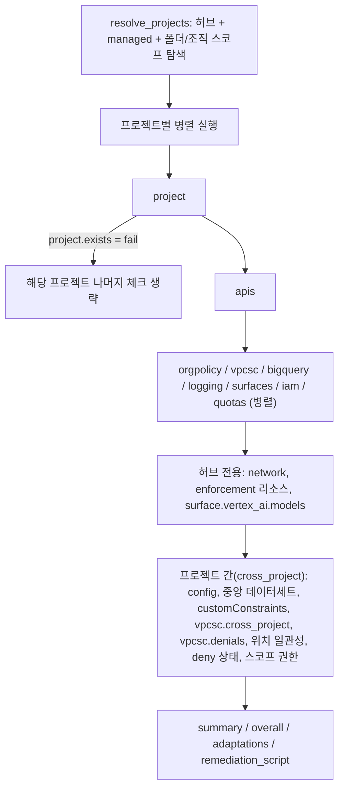
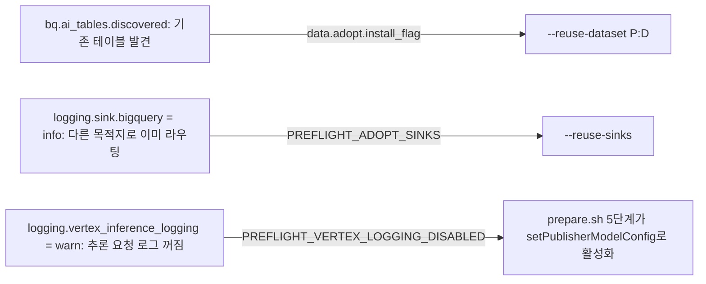
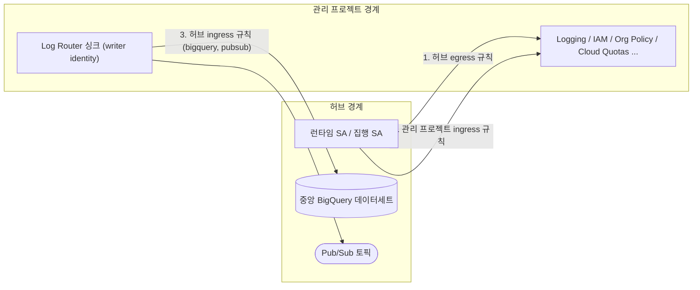

# 환경 사전 점검(Preflight) 체크리스트

> **English summary** — The readiness engine (`src/usage_caps_api/services/readiness*.py`) is a strictly read-only
> preflight that inspects the hub project and every managed project across 12 categories (`project`, `apis`,
> `orgpolicy`, `vpcsc`, `network`, `bigquery`, `logging`, `surfaces`, `iam`, `enforcement`, `quotas`, `config`) and
> returns one report (`overall: ready | ready_with_warnings | blocked`) with per-check status
> (`pass/warn/fail/skip/info`), remediation commands, a generated `remediation_script`, and *adaptations* the installer
> applies automatically (DRS → `--no-invoker-iam-check`, VPC egress, Binary Authorization, Docker build fallback, …).
> Run it with `scripts/preflight.sh` / `python3 -m usage_caps_api.preflight` before installing (exit codes 0/1/2/3), or
> after deployment via `GET /v1/admin/readiness` and `POST /v1/admin/readiness/run`. This document lists **every check
> ID** the code can emit, what it reads, its outcomes, whether it blocks, and how to fix it.

---

## 목차

1. [개요와 판정 규칙](#1-개요와-판정-규칙)
2. [실행 방법](#2-실행-방법)
3. [체크 항목 전체 목록 (카테고리별)](#3-체크-항목-전체-목록-카테고리별)
4. [조치 스크립트 (`remediation_script`)](#4-조치-스크립트-remediation_script)
5. [설치 자동 대응 (adaptations)](#5-설치-자동-대응-adaptations)
6. [기존 BigQuery 데이터세트/싱크 채택 (adoption)](#6-기존-bigquery-데이터세트싱크-채택-adoption)
7. [VPC 서비스 제어(VPC-SC) 경계 간 ingress/egress 가이드](#7-vpc-서비스-제어vpc-sc-경계-간-ingressegress-가이드)
8. [Gemini Enterprise가 없는 환경 (`not_applicable`)](#8-gemini-enterprise가-없는-환경-not_applicable)
9. [Antigravity 설정은 콘솔 전용](#9-antigravity-설정은-콘솔-전용)
10. [참고: 소스 위치](#10-참고-소스-위치)

---

## 1. 개요와 판정 규칙

사전 점검 엔진은 **읽기 전용**입니다(쓰기 API를 호출하지 않음). 허브 프로젝트 1개와 관리(spoke) 프로젝트 N개를
병렬로 읽고, 리소스를 읽을 수 없으면 예외 대신 `skip` + 사유를 기록합니다. 한 카테고리가 예기치 않게 실패해도
`internal.<함수명>` `skip` 체크 하나로 대체되고 나머지는 계속 진행됩니다.



### 1.1 상태(status) 의미

| 상태 | 의미 |
|---|---|
| `pass` | 조건 충족 |
| `warn` | 동작은 하지만 기능 저하·수동 확인 필요 |
| `fail` | 조건 미충족. 기본적으로 **차단(blocking)** — 단, 코드에서 `blocking=false`로 명시한 체크는 비차단 |
| `skip` | 권한·API 미활성·VPC-SC 등으로 **판단 불가** (오류 아님, 사유가 `detail`에 기록) |
| `info` | 참고 정보 (해당 기능이 이 프로젝트에서 사용되지 않음 등) |

### 1.2 종합 판정 (`overall`)

`summarize()` / `overall_of()` 기준:

| `overall` | 조건 |
|---|---|
| `blocked` | `blocking=true`인 `fail`이 1개 이상 |
| `ready_with_warnings` | 차단 실패는 없지만 `warn` 또는 (비차단) `fail`이 존재 |
| `ready` | 그 외 |

`summary`에는 `pass, warn, fail, skip, info, total, blocking, blocking_unfixable`이 포함됩니다.
`blocking_unfixable`은 차단 실패 중 `auto_fixable=false`(설치 스크립트가 자동으로 고칠 수 없는) 항목 수입니다.

> [!NOTE]
> `auto_fixable=true`는 `prepare.sh`/`deploy.sh`가 자동으로 처리하는 항목(API 활성화, 싱크 생성, 권한 부여 등)을
> 뜻합니다. `--install-mode`로 실행하면 이런 항목은 종료 코드 계산에서 차단으로 세지 않습니다.

### 1.3 신원 평가 모드 (`hub.identity_mode`)

| 모드 | 언제 | 권한 평가 방식 |
|---|---|---|
| `caller` | Cloud Run 서비스/Job 내부(`K_SERVICE` 또는 `CLOUD_RUN_JOB` 환경변수 존재) | 호출자 = 런타임 SA. `projects.testIamPermissions`로 정확히 평가 |
| `bindings` | CLI(설치 전 워크스테이션/Cloud Shell) | 호출자 = 설치자. 런타임/집행 SA 권한은 프로젝트+상위(폴더/조직) allow 정책 바인딩을 역할→권한 표로 추정. 설치자 본인 권한은 `iam.deployer.permissions`로 별도 평가 |

---

## 2. 실행 방법

### 2.1 CLI — `scripts/preflight.sh` / `python3 -m usage_caps_api.preflight`

`scripts/preflight.sh`는 `PYTHONPATH=src`를 설정하고 `python3 -m usage_caps_api.preflight "$@"`를 실행하는 얇은
래퍼입니다(파이썬이 없으면 종료 코드 3). 아무 리소스도 만들지 않습니다.

```bash
# 허브 + 관리 프로젝트 2개 (기본: 허브의 중앙 데이터세트 — 설치 기본값과 동일)
scripts/preflight.sh --project hub-prj --managed-projects team-a,team-b

# 폴더 하위 전체 프로젝트, JSON 보고서 파일로 저장
scripts/preflight.sh --project hub-prj --scope-type folder --scope-ids 123456789012 \
  --format json --output readiness.json

# 영어 Markdown 보고서 (고객 공유용)
scripts/preflight.sh --project hub-prj --managed-projects team-a \
  --format markdown --lang en --output readiness.md

# 레거시 프로젝트별 데이터세트 구성으로 점검
scripts/preflight.sh --project hub-prj --managed-projects team-a --per-project-datasets

# 일부 카테고리만
scripts/preflight.sh --project hub-prj --categories orgpolicy,vpcsc,iam
```

> [!NOTE]
> CLI의 데이터세트 기본값은 설치 스크립트(`prepare.sh`/`deploy.sh`)와 같은 **중앙(central) 데이터세트(허브)** 입니다.
> 다른 프로젝트의 중앙 데이터세트는 `--audit-project P`, 레거시 프로젝트별 데이터세트는 `--per-project-datasets`로
> 점검합니다(`--audit-project`를 함께 주면 `--audit-project`가 우선).

#### 전체 플래그

| 플래그 | 설명 |
|---|---|
| `--project HUB` (필수) | 허브(메인) 프로젝트 ID |
| `--managed-projects A,B` (`--link-projects`) | 관리(spoke) 프로젝트 목록 |
| `--scope-type projects\|folder\|organization` | 스코프 유형 |
| `--scope-ids 123,456` | 숫자 폴더/조직 ID 목록 |
| `--region R` | 허브 리전 (기본 `asia-northeast3`) |
| `--dataset D` | 감사 BigQuery 데이터세트 ID (기본 `ge_analytics`) |
| `--audit-project P` | 중앙 데이터세트 프로젝트 (기본: 허브) |
| `--central-dataset` | 허브를 중앙 데이터세트 프로젝트로 사용 (기본값, 명시용) |
| `--per-project-datasets` | 레거시: 프로젝트마다 감사 데이터세트 |
| `--vpc-network N` / `--vpc-subnet S` | Direct VPC egress 네트워크/서브넷 |
| `--vpc-egress all-traffic\|private-ranges-only` | VPC egress 방식 |
| `--runtime-sa EMAIL` / `--enforcer-sa EMAIL` | 런타임(API)/집행(Enforcer Job) SA. 미지정 시 `ai-usage-caps-api@HUB.iam.gserviceaccount.com`, `ai-usage-caps-enforcer@HUB.iam.gserviceaccount.com` |
| `--service-name NAME` | Cloud Run 서비스 이름 (기본 `gcp-ai-usage-caps-api`) |
| `--org-id ID` | 조직 ID 힌트 (계층 조회 실패 시 사용) |
| `--quota-project P` | API 읽기 과금(quota) 프로젝트 (기본: 허브) |
| `--deny-attachment projects\|scope` | IAM Deny 정책 부착 위치 |
| `--enforcement-backend iam_deny\|notify_only` | 집행 백엔드 |
| `--discovery-locations L1,L2` | 추가 Discovery Engine 로케이션 |
| `--config FILE` | 기본값 위에 병합할 YAML 설정 파일 |
| `--categories a,b` | 카테고리 부분 집합 (위 12개 중) |
| `--format text\|json\|markdown\|env` | 출력 형식 (기본 `text`) |
| `--lang ko\|en` | 텍스트/Markdown 언어 (기본 `ko`) |
| `--strict` / `--no-strict` | 경고 시 종료 코드 1 여부 (기본값은 `readiness.strict`, 기본 `true`) |
| `--install-mode` | 자동 조치 가능한(`auto_fixable`) 실패는 차단으로 세지 않음 |
| `--client auto\|adc\|token` | 자격 증명 방식: `adc`(google-auth ADC), `token`(정적 토큰), `auto`(ADC 시도 후 토큰) |
| `--output FILE` | 보고서를 파일로 저장 |
| `--env-file FILE` | `PREFLIGHT_*` 셸 변수도 파일로 저장 (권한 0600) |
| `--no-script` | 텍스트 출력에서 조치 스크립트 생략 |
| `--verbose` | `pass` 항목의 상세도 출력 |

**자격 증명**: google-auth/requests가 설치되어 있고 ADC가 동작하면 ADC, 아니면 `StaticTokenGcp`
(`src/usage_caps_api/tokengcp.py`)가 `GCP_ACCESS_TOKEN` → `CLOUDSDK_AUTH_ACCESS_TOKEN` →
`gcloud auth print-access-token` 순으로 토큰을 얻습니다(약 45분마다 또는 401 시 재발급, 토큰은 로그에 남기지 않음).

#### 출력 형식

| 형식 | 내용 |
|---|---|
| `text` | 프로젝트별 `[OK] [WARN] [FAIL] [SKIP] [INFO]` 목록, 종합 결과, 설치 자동 대응, 조치 스크립트 |
| `json` | 전체 `readiness_report` 객체 (+ `client: adc\|token`) |
| `markdown` | 프로젝트별 표 + 프로젝트 간 점검 표 + 조치 스크립트 |
| `env` | 설치 스크립트가 읽는 `PREFLIGHT_*=값` 라인 (아래 표) |

`env` 형식이 출력하는 변수:

| 변수 | 출처 |
|---|---|
| `PREFLIGHT_OVERALL`, `PREFLIGHT_BLOCKING`, `PREFLIGHT_BLOCKING_UNFIXABLE`, `PREFLIGHT_WARNINGS` | `overall`, `summary` |
| `PREFLIGHT_DRS`, `PREFLIGHT_NO_INVOKER_IAM_CHECK`, `PREFLIGHT_INVOKER_IAM_REQUIRED`, `PREFLIGHT_ALLOW_UNAUTHENTICATED` | adaptations (`drs`, `no_invoker_iam_check`, `invoker_iam_required`, `allow_unauthenticated`) |
| `PREFLIGHT_INGRESS`, `PREFLIGHT_VPC_EGRESS_REQUIRED`, `PREFLIGHT_BINAUTHZ`, `PREFLIGHT_DOCKER_BUILD`, `PREFLIGHT_VPCSC_RESTRICTED` | adaptations |
| `PREFLIGHT_ORG_ID`, `PREFLIGHT_PROJECT_NUMBER` | `hub` |
| `PREFLIGHT_MANAGED_PROJECTS` | 보고서의 managed 프로젝트(스코프 탐색 결과 포함) |
| `PREFLIGHT_ADOPT_DATASET` | `bq.ai_tables.discovered`의 채택 후보 `PROJECT:DATASET` |
| `PREFLIGHT_ADOPT_SINKS` | `logging.sink.bigquery`의 프로젝트 수준 채택 후보 `project:sink` 목록 |
| `PREFLIGHT_VERTEX_LOGGING_DISABLED` | `logging.vertex_inference_logging`이 `warn`(추론 요청 로그 꺼짐)인 프로젝트 목록 — `prepare.sh` 5단계가 활성화 |
| `PREFLIGHT_VERTEX_LOGGING_ENABLED`, `PREFLIGHT_VERTEX_LOGGING_UNKNOWN`, `PREFLIGHT_VERTEX_LOGGING_NA` | 이미 활성 / 읽기 불가(`skip`, prepare.sh가 시도 후 오류 허용) / aiplatform 미활성(해당 없음) 프로젝트 목록 |

> [!NOTE]
> 1.2.0부터 `PREFLIGHT_BILLING_PROJECT_ID` / `PREFLIGHT_BILLING_DATASET_ID` / `PREFLIGHT_BILLING_TABLE_ID`와 `bq.billing_export` 점검은 **제거**되었습니다. 비용은 로그 토큰 수 × 공식 Cloud Billing Catalog SKU 단가로 계산하며 Cloud Billing Export가 필요 없습니다([cost-methodology.md](cost-methodology.md)).

#### 종료 코드

| 코드 | 의미 |
|---|---|
| `0` | 준비 완료 (또는 `--no-strict`에서 경고/비차단 실패만 있음) |
| `1` | 경고 또는 비차단 실패만 있음 (`strict` 모드) |
| `2` | 차단됨 — `blocking` 실패 존재 (`--install-mode`에서는 `blocking_unfixable` 기준) |
| `3` | 점검 불가 — 잘못된 인자(`--project`, `--categories`), 자격 증명 없음, 실행 중 예외 |

### 2.2 설치 스크립트와의 연동

`prepare.sh` / `deploy.sh` / `install.sh`는 리소스를 만들기 전에 `run_preflight`(`scripts/lib/common.sh`)로 다음을
실행합니다.

```bash
python3 -m usage_caps_api.preflight <preflight_args> --install-mode --no-strict --env-file <tmp>
```

- 종료 코드 `0`/`1` → 계속, `2` → **아무것도 만들지 않고 중단**(단 `--skip-preflight-blockers`면 경고 후 계속),
  그 외(`3` 등) → 경고 후 런타임 폴백으로 계속.
- 결과 `PREFLIGHT_*` 값은 이후 단계와 다음 스크립트에 `CAPS_API_PREFLIGHT_ENV`로 재사용됩니다(`install.sh`는
  사전 점검을 **한 번만** 실행).
- `--skip-preflight`(또는 `CAPS_API_SKIP_PREFLIGHT` 환경변수)로 생략 가능, `--dry-run`이면 명령만 출력합니다.
- 점검만 하려면: `scripts/install.sh --preflight-only --project HUB --managed-projects A`.

### 2.3 배포 후 API

| 엔드포인트 | 스코프 | 레이트 버킷 | 동작 |
|---|---|---|---|
| `GET /v1/admin/readiness` | `admin` | `general` (300/분) | `readiness.cache_ttl_seconds`(기본 900초)보다 새로운 캐시가 있으면 캐시 반환, 없으면 새로 실행·캐시 저장. `?refresh=true`로 강제 실행, `?project=P`로 한 프로젝트로 필터 |
| `POST /v1/admin/readiness/run` | `admin` | `enforce` (20/분) | 본문 `{"projects": [...], "categories": [...]}`(둘 다 선택, 문자열 리스트, 최대 500). 둘 다 비었을 때(전체 실행)만 캐시 갱신. 허브는 항상 포함 |
| `GET /v1/projects/{project_id}/capabilities` | `models:read`, `quotas:read`, `caps:read` 중 하나 | `general` (300/분) | 한 프로젝트의 서피스 사용 가능 여부(`readiness.capabilities()`). 캐시된 보고서에 있으면 `source: "cache"`, 없으면 가벼운 카테고리(`apis, orgpolicy, surfaces, iam, quotas`)만 점검해 `source: "probe"`(TTL 동안 메모). 관리 대상이 아닌 프로젝트는 `403` |

> [!NOTE]
> 캐시가 아닌(새로 실행한) 보고서의 `overall`이 `blocked` 또는 `ready_with_warnings`이면 `readiness.degraded` 웹훅이
> 상태별 하루 1회 발송됩니다([webhooks.md](webhooks.md#69-readinessdegraded)).

```bash
# 캐시된 보고서 (없으면 실행)
curl -s -H "Authorization: Bearer $ADMIN_KEY" "$API/v1/admin/readiness" | jq '.overall, .summary'

# 특정 프로젝트만 새로 점검
curl -s -H "Authorization: Bearer $ADMIN_KEY" "$API/v1/admin/readiness?refresh=true&project=team-a"

# 일부 카테고리만 실행 (캐시는 갱신되지 않음)
curl -s -X POST -H "Authorization: Bearer $ADMIN_KEY" -H "Content-Type: application/json" \
  -d '{"projects":["team-a"],"categories":["vpcsc","iam"]}' "$API/v1/admin/readiness/run"
```

응답에는 보고서 전체와 함께 `cached`(bool), `cache_age_seconds`가 포함됩니다. 지정한 프로젝트가 워크스페이스
스코프에 없거나 카테고리 이름이 틀리면 `400 bad_request`입니다. 한 번에 최대 200개 프로젝트를 점검합니다
(`config.project_limit` 경고).

> [!TIP]
> Cloud Run 안에서는 `identity_mode=caller`이므로 런타임 SA의 실제 권한이 `testIamPermissions`로 정확히
> 평가됩니다. 설치 직후 한 번 `?refresh=true`로 실행해 CLI(bindings 추정) 결과와 비교하세요.

### 2.4 보고서 구조

```text
{object: "readiness_report", generated_at, categories, overall, summary,
 hub: {project_id, project_number, region, service_name, runtime_service_account, enforcer_service_account,
       organization_id, audit_dataset, audit_project, dataset_mode: central|per_project, vpc_network, vpc_subnet,
       identity_mode: caller|bindings, managed_project_count},
 projects: [{project_id, project_number, role: hub|managed, parent: {type, id}, organization_id, checks: [Check]}],
 cross_project: [Check (+ project)], capabilities: {project_id: {...}}, adaptations: {...}, scope: {...},
 remediation_script, duration_ms, cached, cache_age_seconds}

Check = {id, category, status, title_ko, title_en, detail, impact: [...],
         remediation: {commands: [...], docs_url?}, auto_fixable, blocking (fail일 때만), data?}
```

`capabilities[project]`는 `vertex_ai`, `gemini_enterprise`, `antigravity`(각각 `available: true|false|null`,
`reason`, `apps`, `locations`), `org_policy_writable`, `quotas_api`, `deny_writable`, `allowed_models_policy`를
담습니다. 같은 내용을 프로젝트 단위로 `GET /v1/projects/{project_id}/capabilities`에서 조회할 수 있습니다
(`object: "capabilities"`, `generated_at`, `source: cache|probe` 추가).

```bash
curl -s -H "Authorization: Bearer $KEY" "$API/v1/projects/team-a/capabilities" \
  | jq '{ge: .gemini_enterprise.available, agy: .antigravity.available, org_policy_writable, deny_writable, source}'
```

---

## 3. 체크 항목 전체 목록 (카테고리별)

범례: **범위** = H(허브), M(관리 프로젝트), X(프로젝트 간 `cross_project`). **차단** = `fail`일 때 차단 여부.
**자동** = `auto_fixable`(설치 스크립트가 자동 조치).

### 3.1 `project` — 존재·계층·결제

사용 API: Cloud Resource Manager v3 `projects.get`, v1 `projects.getAncestry`, Cloud Billing v1
`projects.getBillingInfo`.

| ID | 범위 | 점검 내용 | 결과 | 차단 | 영향 | 조치 | 자동 |
|---|---|---|---|---|---|---|---|
| `project.exists` | H, M | 프로젝트 존재·읽기 가능·`ACTIVE` 상태 | `pass` / `fail`(없음·권한 거부·비활성) / `skip`(그 외 오류) | 예 | all — `fail`이면 그 프로젝트의 나머지 점검 생략 | 프로젝트 ID 확인, `resourcemanager.projects.get` 권한. `DELETE_REQUESTED`면 `gcloud projects undelete P` | 아니오 |
| `project.ancestry` | H, M | 조직/폴더 계층 | `pass` / `warn`(조직 없음) / `skip` | — | 조직이 없으면 IAM Deny Admin/Reviewer·Org Policy Administrator 부여 불가 → 사용자별 IAM Deny 집행·조직정책 기반 모델 거버넌스 불가 | 조직 없는 프로젝트는 `enforcement_backend=notify_only` 사용 | 아니오 |
| `project.billing` | H, M | 결제 계정 연결 | `pass` / `fail`(허브 미연결) / `warn`(관리 프로젝트 미연결, 또는 billingInfo 비공개 — MSP/리셀러) / `skip` | 예(허브) | 허브: Cloud Run·Artifact Registry·Secret Manager·BigQuery 사용 불가 | `gcloud billing projects link P --billing-account=ACCOUNT_ID` | 아니오 |

### 3.2 `apis` — API 활성화

사용 API: Service Usage v1 `services:batchGet`(30개 단위). ID 형식은 `api.<서비스 앞부분>.enabled`
(예: `api.run.enabled`). 읽기 실패 시 단일 `api.state`(`skip`, `roles/serviceusage.serviceUsageViewer` 필요)를 냅니다.

결과 규칙:

- 활성화 → `pass`
- `required` 미활성 → `fail`(차단, **자동**) — 단 관리 프로젝트에서 중앙 데이터세트 모드일 때 핵심 API
  (`logging, iam, cloudresourcemanager, serviceusage, orgpolicy, cloudquotas`)가 아닌 required는 `warn`
- `optional` 미활성 → `warn`(**자동**)
- `surface` 미활성 → `info` (`data.surface_unused=true`, 해당 서피스 기능은 `not_applicable`)

**허브 프로젝트 기대 API**

| ID | 서비스 | 수준 | 영향 기능 | 용도 |
|---|---|---|---|---|
| `api.run.enabled` | run.googleapis.com | required | deployment | Cloud Run API 서비스 + Enforcer Job |
| `api.artifactregistry.enabled` | artifactregistry.googleapis.com | required | deployment | 컨테이너 이미지 저장소 |
| `api.cloudbuild.enabled` | cloudbuild.googleapis.com | optional | deployment | 이미지 빌드 (없으면 로컬 Docker 빌드) |
| `api.storage.enabled` | storage.googleapis.com | required | state, deployment | GCS 상태 버킷 |
| `api.secretmanager.enabled` | secretmanager.googleapis.com | required | deployment | 부트스트랩 관리자 키 |
| `api.pubsub.enabled` | pubsub.googleapis.com | optional | realtime | 실시간 사용 이벤트 푸시 (없으면 5분 스케줄러) |
| `api.cloudscheduler.enabled` | cloudscheduler.googleapis.com | optional | safety_net, pricing_sync | 5분 안전망·일일 가격 동기화 |
| `api.iam.enabled` | iam.googleapis.com | required | caps_enforcement, deployment | SA, IAM Deny v2 |
| `api.iamcredentials.enabled` | iamcredentials.googleapis.com | required | realtime, deployment | 푸시/스케줄러 OIDC 토큰 |
| `api.cloudresourcemanager.enabled` | cloudresourcemanager.googleapis.com | required | scope, iam | 프로젝트/폴더/조직 탐색, IAM |
| `api.serviceusage.enabled` | serviceusage.googleapis.com | required | readiness | API 상태, quota 프로젝트 |
| `api.logging.enabled` | logging.googleapis.com | required | usage, audit | 추론 로그·감사 로그 |
| `api.bigquery.enabled` | bigquery.googleapis.com | required | usage, chargeback | Log Router 데이터세트(사용량 로그 쿼리) |
| `api.cloudbilling.enabled` | cloudbilling.googleapis.com | optional | pricing, spend_caps | **공개 Cloud Billing Catalog SKU 단가**(비용 산정)·결제 계정 연결 확인 — 결제 내보내기와 무관 |
| `api.billingbudgets.enabled` | billingbudgets.googleapis.com | optional | spend_caps | 프로젝트 하드 지출 캡 |
| `api.orgpolicy.enabled` | orgpolicy.googleapis.com | required | model_governance, readiness | `constraints/vertexai.allowedModels`, 조직정책 점검 |
| `api.cloudquotas.enabled` | cloudquotas.googleapis.com | required | quota_management | QuotaInfo/QuotaPreference |
| `api.monitoring.enabled` | monitoring.googleapis.com | required | quota_management | 쿼터 사용량 시계열 |
| `api.accesscontextmanager.enabled` | accesscontextmanager.googleapis.com | optional | readiness | VPC-SC 경계 조회 |
| `api.aiplatform.enabled` | aiplatform.googleapis.com | required | vertex_ai, model_governance | 모델 카탈로그, Data Access 감사 로그 |
| `api.discoveryengine.enabled` | discoveryengine.googleapis.com | surface | gemini_enterprise | Gemini Enterprise 앱 |
| `api.businessaicode.enabled` | businessaicode.googleapis.com | surface | antigravity | Antigravity (AI 개발자 도구) |

**관리 프로젝트 기대 API**

| ID | 서비스 | 수준 | 영향 기능 |
|---|---|---|---|
| `api.logging.enabled` | logging.googleapis.com | required | usage |
| `api.iam.enabled` | iam.googleapis.com | required | caps_enforcement |
| `api.cloudresourcemanager.enabled` | cloudresourcemanager.googleapis.com | required | iam, scope |
| `api.serviceusage.enabled` | serviceusage.googleapis.com | required | readiness |
| `api.orgpolicy.enabled` | orgpolicy.googleapis.com | required | model_governance |
| `api.cloudquotas.enabled` | cloudquotas.googleapis.com | required | quota_management |
| `api.monitoring.enabled` | monitoring.googleapis.com | optional | quota_management |
| `api.bigquery.enabled` | bigquery.googleapis.com | 중앙 모드: optional / 프로젝트별 모드: required | usage |
| `api.aiplatform.enabled` | aiplatform.googleapis.com | surface | vertex_ai |
| `api.discoveryengine.enabled` | discoveryengine.googleapis.com | surface | gemini_enterprise |
| `api.businessaicode.enabled` | businessaicode.googleapis.com | surface | antigravity |

조치: `gcloud services enable <service> --project=P` (`prepare.sh`/`deploy.sh`가 자동 활성화).

### 3.3 `orgpolicy` — 조직 정책

사용 API: Org Policy v2 `policies:getEffectivePolicy`(프로젝트 단위), `projects/P/policies/vertexai.allowedModels`
(프로젝트 로컬 정책), `organizations/O/customConstraints`(목록). 존재하지 않는 제약(`not_found`/`invalid`)은
"미설정"으로 간주합니다. 모든 제약을 읽지 못하면 단일 `orgpolicy.read`(`skip`, `roles/orgpolicy.policyViewer`
필요)만 냅니다.

| ID | 범위 | 점검 내용 | 결과 | 차단 | 영향 / 자동 대응 | 조치 |
|---|---|---|---|---|---|---|
| `orgpolicy.read` | H, M | 유효 조직정책 읽기 가능 여부 | `skip` | — | readiness, model_governance | `roles/orgpolicy.policyViewer`, `orgpolicy.googleapis.com` 활성화 |
| `orgpolicy.gcp.resourceLocations` | H, M | 허브 리전(Cloud Run/GCS/Secret Manager/AR)과 감사 데이터세트 위치가 허용되는지 | `pass` / `info`(제한은 있으나 이 프로젝트엔 리전 리소스 없음) / `warn`(판단 불가 값 그룹) / `fail` / `skip` | 예 | deployment, usage. 허용 리전 예시(`asia-northeast3`, `asia-northeast1`, `asia-southeast1`, `us-central1`, `us-east1`, `europe-west1`, `europe-west4` 중 허용되는 것) 제안 | `--region <허용 리전>` / `--dataset-location <허용 위치>`로 재실행 |
| `orgpolicy.gcp.resourceLocations` (X) | X | 허브 밖 **중앙 감사 프로젝트**의 데이터세트 위치 | `pass` / `fail` / `skip` | 예 | usage | 위와 동일 |
| `orgpolicy.iam.allowedPolicyMemberDomains` | H, M | 도메인 제한 공유(DRS): 레거시 `iam.allowedPolicyMemberDomains` 또는 관리형 `iam.managed.allowedPolicyMembers` | 허브: `pass` / `warn` · 관리: `pass` / `info` · `skip` | — | 허브: `allUsers` run.invoker 불가 → **`--no-invoker-iam-check`로 자동 배포** (`drs`, `no_invoker_iam_check=true`, `allow_unauthenticated=false`) | 교차 프로젝트 싱크 writer 부여가 거부되면 허브 데이터세트/토픽에 대한 예외 요청 |
| `orgpolicy.run.managed.requireInvokerIam` | H | Cloud Run 호출자 IAM 강제 | `pass` / `warn` / `skip` | — | `invoker_iam_required=true`, `no_invoker_iam_check=false`. DRS 없으면 `allUsers` run.invoker 부여(`allow_unauthenticated=true`), DRS도 있으면 Google 서명 ID 토큰 + `roles/run.invoker` 보유 호출자만 접근 가능(external_access) | API 키 전용 포털은 외부 HTTPS LB + IAP 또는 Google ID 토큰 사용 |
| `orgpolicy.run.allowedIngress` | H | Cloud Run 인그레스 허용값 | `pass`(all 허용) / `warn`(내부 값 사용) / `fail`(사용 가능한 값 없음) / `skip` | 예 | `ingress=internal-and-cloud-load-balancing` 또는 `internal`로 자동 배포. 외부 포털은 외부 ALB 또는 VPC 내부에서 호출 | `fail`: 허브 프로젝트 예외 요청 |
| `orgpolicy.run.allowedVPCEgress` | H | 모든 egress를 VPC로 강제(`private-ranges-only` 외 값만 허용) | `pass` / `warn`(VPC 지정됨 → `--vpc-egress=all-traffic`) / `fail`(VPC 미지정) / `skip` | 예 | `vpc_egress_required=true`. 서브넷 Private Google Access, 외부 웹훅용 Cloud NAT 필요 | `--vpc-network N --vpc-subnet S` |
| `orgpolicy.run.allowedBinaryAuthorizationPolicies` | H | Binary Authorization 정책 강제 | `pass` / `warn` / `skip` | — | `binary_authorization=<정책>` → `--binary-authorization=<정책>`로 자동 배포 | 이미지가 정책에 통과하지 않으면 증명(attestation)/예외 요청 |
| `orgpolicy.cloudbuild.allowedWorkerPools` | H | 기본 Cloud Build 풀 허용 여부 | `pass` / `warn` / `skip` | — | `docker_build=true` → 로컬 Docker 빌드 | `--worker-pool projects/P/locations/R/workerPools/POOL` 또는 `--image IMAGE` |
| `orgpolicy.storage.publicAccessPrevention` | H | 강제 시에만 출력 | `info` | — | 제품이 준수(비공개·균일 버킷) | 없음 |
| `orgpolicy.storage.uniformBucketLevelAccess` | H | 강제 시에만 출력 | `info` | — | 준수 | 없음 |
| `orgpolicy.iam.disableServiceAccountKeyCreation` | H | 강제 시에만 출력 | `info` | — | 준수(SA 키 미사용) | 없음 |
| `orgpolicy.iam.automaticIamGrantsForDefaultServiceAccounts` | H | 강제 시에만 출력 | `info` | — | 준수(전용 SA + 명시적 최소 권한) | 없음 |
| `orgpolicy.gcp.restrictNonCmekServices` | H, M | CMEK 강제 대상 서비스 중 제품이 만드는 서비스(허브: storage, bigquery, secretmanager, artifactregistry, run, logging, cloudbuild, pubsub / 프로젝트별 모드 관리 프로젝트: bigquery) | `pass` / `info`(대상 아님) / `fail` / `skip` | 예 | `cmek_required=[...]`. **설치기는 CMEK를 프로비저닝하지 않음** | 프로젝트 예외 요청, 또는 CMEK 리소스를 미리 만들고 채택(`--reuse-dataset`) |
| `orgpolicy.gcp.restrictServiceUsage` | H, M | 제품이 쓰는 API가 거부되는지 | `pass` / `warn`(optional/surface API만 거부) / `fail`(required 거부) / `skip` | 예 | deployment | 조직 관리자에게 허용 요청 |
| `orgpolicy.serviceuser.services` | H, M | 레거시 서비스 제한 (위와 동일 규칙) | 위와 동일 | 예 | deployment | 위와 동일 |
| `orgpolicy.vertexai.allowedModels` | H, M | 모델 거버넌스 제약의 현재 유효값·상속 | `info` / `skip` | — | `data`: `effective`, `project_policy`, `inherit_from_parent`, `set_at_ancestor`. 상위 정책이 있으면 `inheritFromParent=true`일 때 병합(상위 deny 우선), false면 대체 | [model-governance.md](model-governance.md) 참고 |
| `orgpolicy.customConstraints` | X | 조직 커스텀 제약 중 제품이 만드는 리소스 유형(run, iam, bigquery, logging, pubsub, storage, cloudscheduler, secretmanager, artifactregistry, orgpolicy, cloudquotas, discoveryengine)을 겨냥한 것 | `pass` / `warn` / `skip`(조직 없음·권한 없음) | — | deployment | 해당 제약 조건 검토 |

### 3.4 `vpcsc` — VPC 서비스 제어

사용 API: Access Context Manager v1 `accessPolicies.list`(parent=조직), `servicePerimeters.list`. 필요한 권한:
조직의 `roles/accesscontextmanager.policyReader`. `restrictedServices: ["*"]`는 제품이 쓰는 모든 서비스로 해석합니다.

| ID | 범위 | 점검 내용 | 결과 | 차단 | 영향 | 조치 |
|---|---|---|---|---|---|---|
| `vpcsc.perimeter` | H, M | 프로젝트가 강제(enforced) 경계 안에 있는지, 제품이 쓰는 서비스가 제한되는지 | `pass`(경계 밖 / 조직 없음) / `info`(경계 안, 겹치는 제한 없음) / `warn`(제품 서비스 제한) / `skip` | — | usage, deployment. 허브에서 겹치면 `vpcsc_restricted` adaptation | 경계 밖 호출자(포털, 설치 워크스테이션)용 ingress 규칙/액세스 수준 |
| `vpcsc.accessible_services` | H | 경계의 *VPC 접근 가능 서비스* 제한에서 허브 사용 서비스 누락 여부 | `pass` / `warn`(VPC egress 사용 시) / `info` | — | usage — all-traffic egress 시 Cloud Run 호출 실패 | 허용 서비스 목록에 추가 |
| `vpcsc.dry_run` | H, M | 드라이런(spec) 경계 포함 여부 | `info` | — | 현재는 로깅만, 강제 전환 시 차단 | 강제 전에 규칙 준비 |
| `vpcsc.cross_project` | X (관리 프로젝트별) | 허브↔관리 프로젝트 경로: 서로 다른 경계 + 제품 서비스 제한 | `pass`(같은 경계 / 제한 없음 / 브리지) / `warn`(기존 규칙이 SA 또는 ANY_IDENTITY 언급 — 범위 확인 필요) / `fail`(규칙 없음) / `skip`(경계 읽기 불가) | 예 | usage, caps_enforcement, model_governance, quota_management | 자동 생성 ingress/egress YAML 적용 ([7장](#7-vpc-서비스-제어vpc-sc-경계-간-ingressegress-가이드)) |
| `vpcsc.denials` | X | 점검 실행 중 **실제로 관측된** VPC-SC 거부(최대 20건 표시) | CLI(`identity_mode=bindings`): `warn` / Cloud Run 내부(`caller`): `fail` | Cloud Run 내부에서만 예 | usage, deployment | 점검 실행 신원(및 제품 런타임)에 ingress 규칙/액세스 수준 |

> [!WARNING]
> `vpcsc.denials`는 **점검을 실행한 신원**이 거부된 경우에도 발생합니다. 그래서 CLI(설치 전 워크스테이션/Cloud
> Shell)에서는 비차단 `warn`으로만 보고하고, 제품 런타임 자체가 거부를 겪는 **Cloud Run 내부 실행**에서만 차단
> `fail`이 됩니다. CLI에서 경고가 나오면 경계 안에서 다시 실행하거나 설치자 계정에 ingress 규칙을 추가하고, 배포 후
> `GET /v1/admin/readiness?refresh=true`로 런타임 기준 결과를 확인하세요.

### 3.5 `network` — 허브 VPC egress

사용 API: Compute v1 `subnetworks.get`, `routers.list`(리전), Cloud DNS v1 `managedZones.list`. `hub.vpc_subnet`은
짧은 이름 또는 `projects/HOST/regions/R/subnetworks/S` 전체 경로(Shared VPC 호스트 프로젝트) 모두 허용합니다.

| ID | 범위 | 점검 내용 | 결과 | 차단 | 영향 | 조치 |
|---|---|---|---|---|---|---|
| `network.vpc.subnet` | H | VPC 미설정 시: 조직정책이 VPC egress를 요구하는지. 설정 시: 서브넷 리전 = Cloud Run 리전, 네트워크 일치, Private Google Access | `info`(VPC 없음) / `fail`(egress 필수인데 VPC 없음, 또는 all-traffic인데 문제 있음) / `warn`(문제 있으나 all-traffic 아님) / `pass` / `skip` | 예 | deployment, usage | `gcloud compute networks subnets update S --region=R --project=HOST --enable-private-ip-google-access` |
| `network.nat` | H (VPC 설정 시) | 해당 네트워크·리전의 Cloud Router에 Cloud NAT 존재 | `pass` / `warn` / `skip` | — | webhooks, pricing (외부 웹훅·환율 조회 실패; Google API는 PGA로 동작) | `gcloud compute routers create caps-nat-router ...` + `gcloud compute routers nats create caps-nat ...` (조치 스크립트에 포함) |
| `network.private_dns` | H (VPC 설정 + 허브가 경계 안일 때) | `googleapis.com.` 비공개 영역이 VPC에 연결됐는지 | `pass` / `warn` / `skip` | — | usage | `*.googleapis.com` → `restricted.googleapis.com`(199.36.153.4/30) 비공개 DNS 영역 |

### 3.6 `bigquery` — 데이터세트·기존 테이블

사용 API: BigQuery v2 `datasets.get/list`, `tables.list/get`. 프로젝트당 최대 50개 데이터세트 스캔. (결제 내보내기 테이블은 점검·사용하지 않습니다.)

| ID | 범위 | 점검 내용 | 결과 | 차단 | 영향 | 조치 | 자동 |
|---|---|---|---|---|---|---|---|
| `bq.dataset.exists` | 데이터세트 호스트 프로젝트(중앙: 감사 프로젝트, 프로젝트별: 모든 프로젝트) | 설정된 감사 데이터세트 존재·위치·CMEK | `pass` / `warn`(없음) / `skip` | — | usage | `bq --project_id=P mk --dataset --location=R P:D` 또는 `--reuse-dataset P:D` | 예 |
| `bq.ai_tables.discovered` | H, M | 기존 AI 로그 테이블(`businessaicode_googleapis_com_inference_response*`, `aiplatform_googleapis_com_inference_request*`, `cloudaudit_googleapis_com_data_access*`, `discoveryengine_googleapis_com_gen_ai_user_message*`, `discoveryengine_googleapis_com_gemini_enterprise_user_activity*`) | `pass`(설정 데이터세트에 존재) / `warn`(다른 데이터세트에 존재, 이 프로젝트가 데이터세트 호스트) / `info` / `skip` | — | usage. 채택 후보를 `data.adopt`(`install_flag`, `config`, `env`)로 제공 | `--reuse-dataset P:D` | 아니오 |
| `bq.freshness.antigravity` | 데이터세트 호스트 | 최신 테이블이 7일 이내 갱신됐는지 | `pass` / `warn` / `info`(테이블 없음) / `skip` | — | antigravity | 싱크 활성·writer 권한·서피스 사용 여부 확인 | 아니오 |
| `bq.freshness.vertex_ai` | 데이터세트 호스트 | 위와 동일 (`cloudaudit_googleapis_com_data_access`, 추론 요청 로그 테이블) | 위와 동일 | — | vertex_ai | Data Access 감사 로그 + 추론 요청 로그 활성화 | 아니오 |
| `bq.freshness.gemini_enterprise` | 데이터세트 호스트 | 위와 동일 (discoveryengine 테이블) | 위와 동일 | — | gemini_enterprise | — | 아니오 |
| `bq.dataset.location_consistency` | X | 감사 데이터세트들의 위치 일치 | `pass` / `warn`(데이터세트 위치 상이) | — | usage (교차 위치 조인 불가) | 중앙 데이터세트(`--central-dataset`) 또는 단일 위치 | 아니오 |

### 3.7 `logging` — Log Router 싱크·감사 로그

사용 API: Cloud Logging v2 `sinks.list`(프로젝트 + `includeChildren`인 상위 폴더/조직 싱크), `exclusions.list`,
CRM `getIamPolicy`(프로젝트/폴더/조직의 `auditConfigs`), BigQuery `datasets.get`(접근 목록), Pub/Sub
`topics.getIamPolicy`, Vertex AI v1beta1 `projects/P:fetchPublisherModelConfig`.

필요 로그(`NEEDED_LOGS`): `businessaicode.googleapis.com/inference_response`,
**`aiplatform.googleapis.com/inference_request`**(Vertex AI 토큰 출처), `cloudaudit.googleapis.com/data_access`,
`discoveryengine.googleapis.com/gen_ai_user_message`, `discoveryengine.googleapis.com/gemini_enterprise_user_activity`.
기존 싱크를 채택할 때는 싱크 필터에 `log_id("aiplatform.googleapis.com/inference_request")`가 포함되어 있는지 반드시
확인하세요(없으면 `logging.sink.bigquery`의 `data.missing`에 표시).

| ID | 범위 | 점검 내용 | 결과 | 차단 | 영향 | 조치 | 자동 |
|---|---|---|---|---|---|---|---|
| `logging.sinks` | H, M | 싱크 목록 읽기 | `skip` | — | — | `logging.sinks.list` 권한 | — |
| `logging.sink.bigquery` | H, M | 필요 로그(`inference_request` 포함)가 기대 목적지(`bigquery.googleapis.com/projects/<데이터세트 프로젝트>/datasets/<D>`)로 라우팅되는지 (제외 필터 반영) | `pass` / `info`(다른 목적지로 이미 라우팅 → 채택 권장) / `warn`(누락) | — | usage + 누락 서피스 | `prepare.sh`가 `<service>-ai-logs` 싱크 생성. 채택은 `--reuse-sinks` | 예 |
| `logging.sink.pubsub` | H, M | 추론 로그(Antigravity `inference_response`, Vertex AI `inference_request`) Pub/Sub 싱크 존재 | `pass` / `info` | — | realtime (없으면 5분 스케줄러 폴백) | `deploy.sh`가 `<service>-usage-events` 싱크 → 허브 토픽 생성 | 예 |
| `logging.sink.disabled` | H, M | AI 로그를 라우팅할 싱크가 비활성화됨 | `warn` | — | usage | `gcloud logging sinks update S --no-disabled --project=P` | 아니오 |
| `logging.sink.writer_access` | H, M | 싱크 writer identity가 목적지에 쓰기 권한 보유(BQ: 데이터세트 WRITER/OWNER/dataEditor/dataOwner/admin 또는 프로젝트 역할, Pub/Sub: publisher/editor/admin), 최대 10개 | `pass` / `warn` / `skip`(전부 읽기 불가) | — | usage, realtime (로그가 조용히 유실) | `bq add-iam-policy-binding --member=W --role=roles/bigquery.dataEditor P:D` / `gcloud pubsub topics add-iam-policy-binding ...` | 예 |
| `logging.default_sink` | H, M | `_Default` 싱크 존재·활성, 제외 필터·프로젝트 제외가 AI 로그를 버리지 않는지 | `pass` / `warn`(`usage_source`=auto/logging) / `info`(bigquery) | — | usage (Cloud Logging 읽기 누락, BigQuery 싱크는 무관) | 제외 필터 수정 | 아니오 |
| `logging.audit_config.aiplatform` | H, M | Vertex AI `DATA_READ`+`DATA_WRITE` 감사 로그(프로젝트 → 폴더/조직 상속까지 확인) | `pass` / `warn` / `info`(aiplatform 미활성) / `skip` | — | vertex_ai, usage (헤더 라벨 없는 호출의 사용자 귀속·추론 로그 미활성 시 요청 수 집계 불가) | `scripts/prepare.sh --project HUB [--managed-projects P] --enable-data-access-logs` (기존 auditConfigs 보존 병합) | 예 |
| `logging.vertex_inference_logging` | H, M | Vertex AI **추론 요청 메타데이터 로그**(`inferenceEventLoggingConfig.state`, v1beta1 `fetchPublisherModelConfig`) 활성 여부. 설정이 한 번도 없으면(NOT_FOUND) 꺼짐으로 판정 | `pass`(ENABLED) / `warn`(꺼짐 → `PREFLIGHT_VERTEX_LOGGING_DISABLED`) / `info`(aiplatform 미활성 → 해당 없음) / `skip`(읽기 불가 — 런타임 SA에 1권한 커스텀 역할 `gcpAiCapsVertexLoggingReader` = `aiplatform.endpoints.fetchPublisherModelConfig` 부여 명령 제시) | — (경고만, 실패 아님) | vertex_ai, usage — 꺼져 있으면 Vertex AI 토큰·비용·캡을 측정할 수 없음(요청 수만, `token_sources.vertex_ai=requests_only`). Antigravity·Gemini Enterprise는 영향 없음 | `prepare.sh`가 기본으로 활성화(`ENABLE_VERTEX_INFERENCE_LOGGING=true`, 끄려면 `--no-vertex-inference-logging`). 수동: `setPublisherModelConfig` curl(제시됨) 또는 `POST /v1/projects/P/vertex-logging/enable`(런타임 SA에 `aiplatform.endpoints.setPublisherModelConfig` 필요). Cloud Logging 수집·보관 요금 발생 | 예 |

### 3.8 `surfaces` — AI 서피스 존재 여부

사용 API: Discovery Engine v1 `collections/default_collection/engines`(로케이션 `global`, `us`, `eu` +
`workspace.discovery_engine_locations`), v1alpha `devToolsConfig`, Cloud Logging `entries.list`(최근 7일),
Vertex AI v1beta1 `publishers/google/models`(글로벌, 실패 시 허브 리전 엔드포인트).

| ID | 범위 | 점검 내용 | 결과 | 차단 | 영향 |
|---|---|---|---|---|---|
| `surface.vertex_ai` | H, M | aiplatform API 활성화 | `pass` / `info`(미활성 → not_applicable) / `skip`(API 상태 미상) | — | vertex_ai |
| `surface.gemini_enterprise` | H, M | Gemini Enterprise 앱(engine; `appType`이 있으면 `APP_TYPE_INTRANET`만) | `pass` / `info`(API 미활성 또는 앱 없음 → not_applicable) / `skip`(모든 로케이션 읽기 불가 → `roles/discoveryengine.viewer`) | — | gemini_enterprise |
| `surface.antigravity` | H, M | `devToolsEnabled` 또는 최근 7일 추론 로그 | `pass` / `info`(미사용) / `skip`(읽기 불가) | — | antigravity |
| `surface.antigravity.metadata_logging` | H, M (Antigravity 사용 중일 때) | 최근 7일 `businessaicode.googleapis.com/inference_response` 로그 없음 | `warn` | — | antigravity, usage — Gemini Enterprise > Settings > AI developer tools > Compliance > **Metadata logging**(기본 꺼짐)을 켜야 함 |
| `surface.vertex_ai.models` | H (실행당 1회) | Model Garden 게시자 모델 카탈로그 접근 | `pass` / `warn`(리전 엔드포인트만 동작 / 모두 불가 → **내장 목록 없음**: 카탈로그는 로그에서 관측된 모델만으로 구성되고 패턴 확장 범위가 줄어듦) | — | model_governance |

### 3.9 `iam` — 권한

사용 API: CRM v1 `projects.testIamPermissions`, `projects/folders/organizations.getIamPolicy`(v3 policy).
누락 권한은 최소 권한 사전 정의 역할과 복사 가능한 `gcloud` 명령으로 변환되며, 조직 전용 역할
(`roles/orgpolicy.policyAdmin`, `roles/iam.denyAdmin`, `roles/iam.denyReviewer`)은 조직 수준 명령으로 생성됩니다.

| ID | 범위 | 점검 내용 | 결과 | 차단 | 자동 |
|---|---|---|---|---|---|
| `iam.runtime.permissions` | H, M | 런타임 SA 권한 (아래 표). `enforcement_backend≠iam_deny`면 `iam.denypolicies.*` 제외 | `pass` / `fail`(required 누락) / `warn`(optional만 누락) / `info`(SA가 아직 바인딩 없음 — "deploy.sh가 부여 예정") / `skip` | 예(required 누락 시) | 예 |
| `iam.enforcer.permissions` | H, M (`iam_deny` + `deny_attachment=projects`일 때만) | 집행 SA 권한 (bindings 모드) | `pass` / `fail`(**비차단**) / `warn` / `info`(바인딩 없음) / `skip` | **아니오** — Deny Admin 누락은 사용자별 집행만 비활성 | 예 |
| `iam.deployer.permissions` | H, M (CLI 전용) | 설치 실행 계정의 권한 (아래 표) | `pass` / `warn`(Project IAM Admin 보유 → 자기 부여 가능) / `fail` / `skip` | 예 | 아니오 |
| `iam.scope.permissions` | X (폴더/조직별, `deny_attachment=scope`일 때) | 집행 SA가 폴더/조직에서 `iam.denypolicies.get/create/update/delete` 보유 | `pass` / `fail`(**비차단**) / `skip` | 아니오 | 예 |

**런타임 SA 요구 권한** (`RUNTIME_PERMISSIONS`; where=all/hub/dataset)

| 권한 | 최소 역할 | 수준 | 기능 | 적용 |
|---|---|---|---|---|
| `resourcemanager.projects.get` | `roles/browser` | required | scope | 전체 |
| `resourcemanager.projects.getIamPolicy` | `roles/browser` | optional | readiness | 전체 |
| `serviceusage.services.get` | `roles/serviceusage.serviceUsageConsumer` | optional | readiness | 전체 |
| `logging.logEntries.list` | `roles/logging.viewer` | required | usage | 전체 |
| `logging.privateLogEntries.list` | `roles/logging.privateLogViewer` | required | usage | 전체 |
| `bigquery.jobs.create` | `roles/bigquery.jobUser` | required | usage | 허브 |
| `bigquery.tables.getData` | `roles/bigquery.dataViewer` | required | usage | 데이터세트 프로젝트 |
| `iam.denypolicies.get` | `roles/iam.denyReviewer` (조직 전용) | optional | caps_enforcement | 전체 |
| `orgpolicy.policy.get` | `roles/orgpolicy.policyViewer` | optional | model_governance | 전체 |
| `orgpolicy.policies.create/update/delete` | `roles/orgpolicy.policyAdmin` (조직 전용) | optional | model_governance | 전체 |
| `cloudquotas.quotas.get` | `roles/cloudquotas.viewer` | optional | quota_management | 전체 |
| `cloudquotas.quotas.update` | `roles/cloudquotas.admin` | optional | quota_management | 전체 |
| `monitoring.timeSeries.list` | `roles/monitoring.viewer` | optional | quota_management | 전체 |
| `discoveryengine.engines.get` | `roles/discoveryengine.viewer` | optional | gemini_enterprise | 전체 |
| `discoveryengine.engines.update` | `roles/discoveryengine.editor` | optional | gemini_enterprise | 전체 |

**집행 SA 요구 권한** (`ENFORCER_PERMISSIONS`, 모두 required): `iam.denypolicies.get/create/update/delete`
(`roles/iam.denyAdmin`, 조직 전용), `logging.logEntries.list`(`roles/logging.viewer`),
`logging.privateLogEntries.list`(`roles/logging.privateLogViewer`).

**설치자 요구 권한** — 허브: `serviceusage.services.enable`, `resourcemanager.projects.getIamPolicy/setIamPolicy`,
`iam.serviceAccounts.create/setIamPolicy/actAs`, `storage.buckets.create`, `secretmanager.secrets.create`,
`run.services.create/setIamPolicy`, `artifactregistry.repositories.create`, `cloudbuild.builds.create`,
`bigquery.datasets.create`, `logging.sinks.create`, `pubsub.topics.create`, `cloudscheduler.jobs.create`.
관리 프로젝트: `serviceusage.services.enable`, `resourcemanager.projects.getIamPolicy/setIamPolicy`,
`logging.sinks.create/get`. 권장: `roles/owner` 또는 `roles/editor` + `roles/resourcemanager.projectIamAdmin`.

> [!NOTE]
> bindings 모드는 **조건 없는(unconditional)** 바인딩과 코드에 내장된 역할→권한 표(`ROLE_PERMISSIONS`)만 봅니다.
> 커스텀 역할이나 IAM 조건부 바인딩으로 권한을 준 경우 `fail`/`warn`로 과소 평가될 수 있으므로, 배포 후 Cloud Run
> 안에서(`caller` 모드) 다시 확인하세요.

### 3.10 `enforcement` — 집행 리소스 상태

사용 API: IAM v2 `policies/<attachment>/denypolicies`(목록/단건), Pub/Sub v1 `topics.get`/`subscriptions.get`,
Cloud Scheduler v1 `jobs.get`, Cloud Run v2 `services.get`/`jobs.get`.

| ID | 범위 | 점검 내용 | 결과 | 차단 |
|---|---|---|---|---|
| `enforcement.deny_policies` | X (부착 지점별) | 부착 지점의 deny 정책 수, 관리 정책(`caps.deny_policy_id`, 기본 `gcp-ai-caps-managed`) 존재, 같은 접두사(`gcp-ai-caps-`)의 다른 정책, 정책 수 ≥ 450(한도 500), 거부 주체 수 ≥ 2000(한도 2500) | `pass` / `warn` / `info`(`notify_only`) / `skip`(IAM v2 읽기 예산 소진 또는 권한 없음) | — |
| `enforcement.pubsub.topic` | H | 실시간 토픽(`hub.usage_events_topic`, 기본 `<service>-usage-events`) | `pass` / `info`(미배포) / `skip` | — |
| `enforcement.pubsub.subscription` | H | 푸시 구독 `<service>-usage-events-push`가 `/v1/internal/usage-event`로 푸시하는지 | `pass` / `warn`(엔드포인트 불일치) / `info` / `skip` | — |
| `enforcement.scheduler` | H | `<service>-enforce-schedule` 작업 상태 `ENABLED` | `pass` / `warn`(일시중지 등) / `info`(미배포 → 실시간/수동 집행만) / `skip` | — |
| `enforcement.cloudrun.service` | H | Cloud Run 서비스 URI·인그레스·`invokerIamDisabled` | `pass` / `info` / `skip` | — |
| `enforcement.cloudrun.job` | H | `<service>-enforcer` Job | `pass` / `info` / `skip` | — |

> [!IMPORTANT]
> IAM v2(deny 정책) 읽기는 **quota 프로젝트당 분당 5회**로 매우 낮습니다. 사전 점검은 실행당 최대 4회
> (`IAM_V2_READ_BUDGET`)만 사용하고 나머지 부착 지점은 `skip`("Enforcer Job이 보고")으로 남겨 API·Enforcer
> Job의 예산을 보존합니다. 관리 프로젝트가 많으면 일부 `enforcement.deny_policies`가 `skip`인 것이 정상입니다.

### 3.11 `quotas` — Cloud Quotas

사용 API: Cloud Quotas v1 `projects/P/locations/global/services/<quotas.service>/quotaInfos`(기본 서비스
`aiplatform.googleapis.com`).

| ID | 범위 | 점검 내용 | 결과 | 차단 | 조치 | 자동 |
|---|---|---|---|---|---|---|
| `quotas.api` | H, M | QuotaInfo 읽기 가능 | `pass` / `warn`(API 비활성 또는 권한 거부) / `skip` | — | `gcloud services enable cloudquotas.googleapis.com --project=P` / 런타임 SA에 `roles/cloudquotas.admin` | API 비활성 시 예 |
| `quotas.contact_email` | H | `quotas.contact_email`(`QUOTA_CONTACT_EMAIL`) 설정 | `pass` / `warn` | — | `--quota-contact-email EMAIL` (Google 검토가 필요한 증설 요청 제출에 필요) | 아니오 |

### 3.12 `config` — 구성 (프로젝트 간)

| ID | 점검 내용 | 결과 | 차단 |
|---|---|---|---|
| `config.workspace` | `workspace.project_id`(`PROJECT_ID`)가 실제 프로젝트(플레이스홀더 아님)인지 | `pass` / `fail` | 예 |
| `config.scope` | 폴더/조직 스코프 탐색 결과 (잘림·오류) | `pass` / `warn` | — |
| `config.dataset_mode` | 중앙 vs 프로젝트별 데이터세트 토폴로지 | `info` | — |
| `config.service_accounts` | SA를 명시하지 않아 설치 기본 SA 사용 | `info` | — |
| `config.project_limit` | 점검 대상이 200개 이상 → 앞 200개만 점검 | `warn` | — |

### 3.13 내부 오류

| ID | 의미 |
|---|---|
| `internal.<카테고리 함수명>` | 카테고리 함수가 예기치 않게 실패 (`skip`, 다른 점검에는 영향 없음) |
| `internal.project` | 프로젝트 전체 점검이 완료되지 못함 (`skip`) |

---

## 4. 조치 스크립트 (`remediation_script`)

보고서의 `remediation_script`는 `fail`/`warn` 체크의 `remediation.commands`를 상태(fail → warn) → ID → 프로젝트
순으로 정렬하고 **중복 제거**한 bash 스크립트입니다.

```bash
#!/usr/bin/env bash
# Remediation commands generated by the GCP AI Usage Caps API readiness preflight (2026-...).
# Review before running. Lines starting with '#' are manual steps (perimeter/org admin).
set -euo pipefail

# [FAIL] api.cloudquotas.enabled (team-a) - cloudquotas.googleapis.com enabled
gcloud services enable cloudquotas.googleapis.com --project=team-a
...
```

- `#`로 시작하는 줄은 경계/조직 관리자가 수행할 **수동 단계**입니다(예: `--set-ingress-policies`는 기존 규칙을
  **대체**하므로 주석으로만 제공).
- 조치할 것이 없으면 `# Nothing to fix.`
- `?project=P` 필터 시 해당 프로젝트 기준으로 다시 생성됩니다.

```bash
curl -s -H "Authorization: Bearer $ADMIN_KEY" "$API/v1/admin/readiness?refresh=true" \
  | jq -r .remediation_script > fix.sh
less fix.sh   # 반드시 검토 후 실행
```

> [!CAUTION]
> 스크립트에는 IAM 바인딩·API 활성화·싱크 생성 명령이 포함됩니다. 실행 전 대상 프로젝트와 주체를 반드시 검토하세요.
> `ACCOUNT_ID`, `ORGANIZATION_ID`, `YOUR_ACCOUNT`, `MANAGED_NUMBER` 같은 플레이스홀더는 직접 바꿔야 합니다.

---

## 5. 설치 자동 대응 (adaptations)

조직 정책 점검이 감지한 제약은 `report.adaptations`에 기록되고, `PREFLIGHT_*` 변수로 `deploy.sh`에 전달되어
배포 플래그가 자동으로 바뀝니다.

| 감지 (체크 ID) | adaptation 키 | `PREFLIGHT_*` | `deploy.sh` 동작 | Terraform 대응 변수 |
|---|---|---|---|---|
| DRS (`orgpolicy.iam.allowedPolicyMemberDomains`, 허브) | `drs`, `no_invoker_iam_check=true`, `allow_unauthenticated=false` | `PREFLIGHT_DRS=1`, `PREFLIGHT_NO_INVOKER_IAM_CHECK=1` | `--no-invoker-iam-check` (allUsers 바인딩 대신) | `no_invoker_iam_check = true` |
| 호출자 IAM 강제 (`orgpolicy.run.managed.requireInvokerIam`) | `invoker_iam_required=true`, `no_invoker_iam_check=false`, `allow_unauthenticated` | `PREFLIGHT_INVOKER_IAM_REQUIRED=1`, `PREFLIGHT_ALLOW_UNAUTHENTICATED` | DRS 없으면 `--allow-unauthenticated`, DRS도 있으면 `--no-allow-unauthenticated` (Google ID 토큰 필요) | `allow_unauthenticated_edge`, `no_invoker_iam_check = false` |
| 인그레스 제한 (`orgpolicy.run.allowedIngress`) | `ingress` | `PREFLIGHT_INGRESS` | `--ingress=<값>` | `ingress` (`INGRESS_TRAFFIC_INTERNAL_LOAD_BALANCER` 등 v2 열거형) |
| VPC egress 강제 (`orgpolicy.run.allowedVPCEgress`) | `vpc_egress_required` | `PREFLIGHT_VPC_EGRESS_REQUIRED=1` | `--network/--subnet --vpc-egress=all-traffic` 필수 (없으면 중단) | `vpc_network`, `vpc_subnet`, `vpc_egress` |
| Binary Authorization (`orgpolicy.run.allowedBinaryAuthorizationPolicies`) | `binary_authorization` | `PREFLIGHT_BINAUTHZ` | 서비스·Job 모두 `--binary-authorization=<정책>` | `binary_authorization_policy` |
| Cloud Build 기본 풀 금지 (`orgpolicy.cloudbuild.allowedWorkerPools`) | `docker_build` | `PREFLIGHT_DOCKER_BUILD=1` | 로컬 `docker build/push` (Docker 없으면 `--worker-pool`/`--image` 요구) | `container_image`로 미리 빌드한 이미지 지정 |
| CMEK 강제 (`orgpolicy.gcp.restrictNonCmekServices`) | `cmek_required` | (없음) | **자동 대응 없음** — `fail`로 차단 | CMEK 리소스 사전 생성 후 `reuse_dataset` |
| VPC-SC 제한 (`vpcsc.perimeter`, 허브) | `vpcsc_restricted` | `PREFLIGHT_VPCSC_RESTRICTED` | 정보 전달용 | — |

> [!NOTE]
> `deploy.sh`의 `--ingress` 값은 gcloud 형식(`internal`, `internal-and-cloud-load-balancing`)이고, Terraform
> `ingress` 변수는 Cloud Run v2 열거형(`INGRESS_TRAFFIC_ALL`, `INGRESS_TRAFFIC_INTERNAL_ONLY`,
> `INGRESS_TRAFFIC_INTERNAL_LOAD_BALANCER`)입니다.

---

## 6. 기존 BigQuery 데이터세트/싱크 채택 (adoption)

고객 환경에 이미 AI 로그가 라우팅되어 있다면, 중복 생성 대신 **채택**을 권장합니다.



### 6.1 데이터세트 채택 — `--reuse-dataset PROJECT:DATASET`

- 사전 점검이 `businessaicode_googleapis_com_inference_response*` 등 AI 로그 테이블이 있는 데이터세트를 찾으면
  `bq.ai_tables.discovered`의 `data.adopt`에 `install_flag`(`--reuse-dataset P:D`), `config`
  (`workspace.audit_dataset`, `workspace.audit_project`), `env`(`AUDIT_DATASET_ID`, `AUDIT_PROJECT_ID`)를 제공합니다.
- `--reuse-dataset P:D`는 **중앙 모드**를 강제하고 `AUDIT_PROJECT=P`, `DATASET=D`로 설정합니다. `prepare.sh`는
  데이터세트를 만들지 않고 읽기 가능 여부만 확인합니다(읽을 수 없으면 중단).
- 싱크는 여전히 각 프로젝트에 만들어지고(채택한 데이터세트로), writer identity에는 그 데이터세트에 대해서만
  WRITER(데이터 편집자)가 부여됩니다.
- Terraform: `reuse_dataset = "PROJECT:DATASET"` → `data "google_bigquery_dataset"`로 읽기만 하고 관리하지 않음.

### 6.2 싱크 채택 — `--reuse-sinks`

- `logging.sink.bigquery`가 기존 싱크(프로젝트 수준)를 발견하면 `PREFLIGHT_ADOPT_SINKS=project:sink,...`로
  전달됩니다. `--reuse-sinks`가 있으면 `ensure_bq_sink`는 해당 프로젝트에 `<service>-ai-logs` 싱크를 만들지 않습니다.
- **집계(폴더/조직) 싱크는 채택 목록에 포함되지 않습니다**(프로젝트 수준만). 집계 싱크가 이미 있으면 그 목적지를
  `--reuse-dataset`으로 채택하고 `--aggregated-sink`를 쓰지 않는 구성을 검토하세요.
- 채택 시 런타임이 읽을 데이터세트는 기존 싱크의 목적지여야 합니다. `logging.sink.bigquery`의 `data.adopt[].config`
  (`workspace.audit_project`, `workspace.audit_dataset`)를 `--reuse-dataset`으로 함께 지정하세요.

```bash
scripts/install.sh --project hub-prj --managed-projects team-a,team-b \
  --reuse-dataset shared-logs:ai_logs --reuse-sinks
```

> [!WARNING]
> 채택한 싱크의 필터가 다섯 가지 필요 로그(특히 1.2.0에서 추가된 `aiplatform.googleapis.com/inference_request`)를 모두
> 포함하는지 확인하세요(`logging.sink.bigquery`의 `data.missing`).
> 누락된 로그가 있으면 상태는 `warn`이며, `--reuse-sinks`를 써도 그 서피스의 사용량은 수집되지 않습니다.

---

## 7. VPC 서비스 제어(VPC-SC) 경계 간 ingress/egress 가이드

허브와 관리 프로젝트가 **서로 다른 경계**(또는 한쪽만 경계 안)에 있고, 그 경계가 제품이 쓰는 서비스
(`logging, bigquery, iam, orgpolicy, cloudquotas, discoveryengine, aiplatform, pubsub, cloudresourcemanager,
monitoring, serviceusage, businessaicode`)를 제한하면 `vpcsc.cross_project`가 `fail`이 됩니다.
같은 경계 / 공유 브리지 / 제한 서비스 없음이면 `pass`입니다.



점검이 `remediation.commands`와 `data.yaml`로 그대로 붙여 넣을 수 있는 YAML을 생성합니다.

| YAML 키 (`data.yaml`) | 적용 경계 | 내용 |
|---|---|---|
| `managed_ingress` | 관리 프로젝트 경계 | `ingressFrom.identities`: 런타임·집행 SA, `sources`: 허브 프로젝트(허브가 경계 안일 때) 또는 `accessLevel: "*"`, `ingressTo`: 제한된 제품 서비스 × `method: "*"`, `resources: projects/<관리 번호>` |
| `hub_egress` | 허브 경계 | `egressFrom.identities`: 런타임·집행 SA, `egressTo`: 제한된 제품 서비스, `resources: projects/<관리 번호>` |
| `hub_ingress_sink_writer` | 허브 경계 | `ingressFrom.identities`: `serviceAccount:service-<관리 번호>@gcp-sa-logging.iam.gserviceaccount.com`, 허브에서 제한된 `bigquery`/`pubsub`, `resources: projects/<허브 번호>` |

생성 예 (관리 프로젝트 ingress):

```yaml
- ingressFrom:
    identities:
    - serviceAccount:ai-usage-caps-api@hub-prj.iam.gserviceaccount.com
    - serviceAccount:ai-usage-caps-enforcer@hub-prj.iam.gserviceaccount.com
    sources:
    - resource: projects/111111111111
  ingressTo:
    operations:
    - serviceName: logging.googleapis.com
      methodSelectors:
      - method: "*"
    resources:
    - projects/222222222222
```

적용 절차:

1. 보고서의 YAML을 파일로 저장합니다(조치 스크립트의 `cat > vpcsc-ingress-<project>.yaml <<'YAML'` 블록).
2. **기존 규칙과 병합**합니다. `gcloud access-context-manager perimeters update PERIMETER --policy=POLICY
   --set-ingress-policies=FILE`(또는 `--set-egress-policies`)는 기존 규칙을 **대체**합니다.
3. 경계 관리자가 적용 → `POST /v1/admin/readiness/run {"categories":["vpcsc"]}`로 재확인합니다.

> [!TIP]
> 기존 규칙이 제품 SA 또는 `ANY_IDENTITY`/`ANY_SERVICE_ACCOUNT`를 이미 언급하면 `warn`(범위 확인 필요)입니다.
> 서비스/메서드 범위가 위 목록을 포함하는지, Log Router writer identity가 허브 ingress에 포함됐는지 확인하세요.
> 허브가 경계 안이고 Direct VPC egress를 쓰면 `network.private_dns`(restricted.googleapis.com)도 함께 확인하세요.

---

## 8. Gemini Enterprise가 없는 환경 (`not_applicable`)

Gemini Enterprise 앱이 없는 것은 **오류가 아닙니다**.

- `discoveryengine.googleapis.com`이 비활성: `api.discoveryengine.enabled` = `info`(`surface_unused`),
  `surface.gemini_enterprise` = `info`, `capabilities.gemini_enterprise = {available: false, reason: "api_disabled"}`.
- API는 켜져 있으나 앱이 없음: `surface.gemini_enterprise` = `info`, `reason: "no_apps"`.
- 이 경우 GE 좌석/기능/모델 거버넌스 응답은 `not_applicable`로 표시되고(예: 모델 접근 결정
  `{"decision": "not_applicable", "reason": "no Gemini Enterprise app in project"}`), 전체 판정에는 영향이 없습니다.
- `bq.freshness.gemini_enterprise`도 테이블이 없으면 `info`입니다.
- 앱을 쓰려면 콘솔에서 앱을 만든 뒤 `?refresh=true`로 다시 점검하세요. 앱 조회에는 런타임 SA의
  `roles/discoveryengine.viewer`(배포 시 `roles/discoveryengine.editor` 부여)가 필요합니다.

Vertex AI(`aiplatform` 비활성)와 Antigravity(미사용)도 같은 원칙으로 `info`/`not_applicable` 처리됩니다.

## 9. Antigravity 설정은 콘솔 전용

- Antigravity(AI 개발자 도구) 설정(`devToolsConfig`)은 Discovery Engine **v1alpha**로 읽기만 가능합니다.
  Google Cloud가 `UpdateDevToolsConfig`를 Cloud Console로 제한하므로, `PUT /v1/antigravity/models` 같은 쓰기는
  `409 console_required`와 `console_url`을 반환합니다.
- 사용자별 Antigravity 사용량·캡에는 **Metadata logging**이 필요합니다(콘솔: Gemini Enterprise > Settings >
  AI developer tools > Compliance > Metadata logging, 기본 꺼짐). 꺼져 있으면 `surface.antigravity.metadata_logging`
  `warn`이 나옵니다.

## 10. 참고: 소스 위치

| 영역 | 파일 |
|---|---|
| 엔진·캐시·HTTP 핸들러 | [`readiness.py`](../src/usage_caps_api/services/readiness.py) |
| 공통(Check, Run, 위치 판정, IAM v2 예산) | [`readiness_core.py`](../src/usage_caps_api/services/readiness_core.py) |
| project / apis | [`readiness_project.py`](../src/usage_caps_api/services/readiness_project.py) |
| orgpolicy | [`readiness_orgpolicy.py`](../src/usage_caps_api/services/readiness_orgpolicy.py) |
| vpcsc / network | [`readiness_network.py`](../src/usage_caps_api/services/readiness_network.py) |
| bigquery / logging | [`readiness_data.py`](../src/usage_caps_api/services/readiness_data.py) |
| iam / enforcement / quotas | [`readiness_iam.py`](../src/usage_caps_api/services/readiness_iam.py) |
| surfaces | [`readiness_surfaces.py`](../src/usage_caps_api/services/readiness_surfaces.py) |
| CLI | [`preflight.py`](../src/usage_caps_api/preflight.py), [`tokengcp.py`](../src/usage_caps_api/tokengcp.py), [`scripts/preflight.sh`](../scripts/preflight.sh) |
| 설치 연동 | [`scripts/lib/common.sh`](../scripts/lib/common.sh) (`run_preflight`, `preflight_args`) |

관련 문서: [multi-project-deployment.md](multi-project-deployment.md) · [operations-runbook.md](operations-runbook.md) ·
[security.md](security.md)
