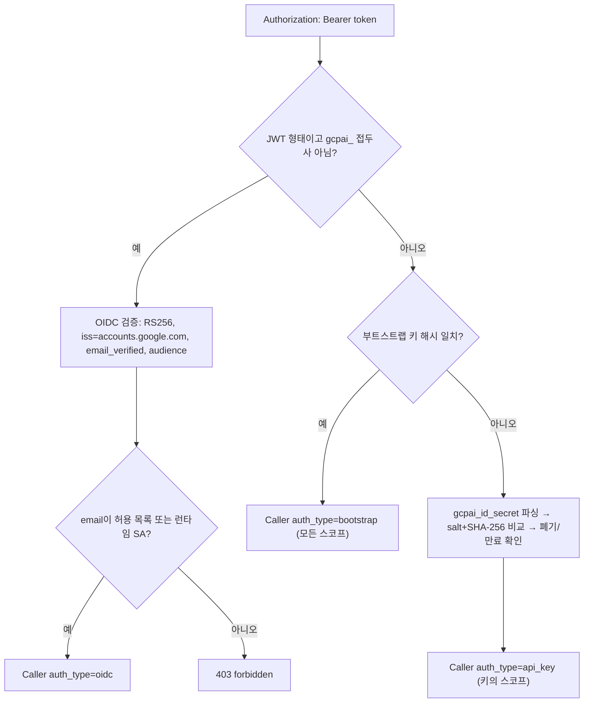

# 보안 가이드 (Security)

> **English summary** — The API is headless (machine-to-machine). Callers authenticate with scoped API keys
> (`gcpai_<id>_<secret>`, stored only as a per-key salted SHA-256 hash, compared in constant time) or Google-signed
> RS256 OIDC ID tokens (Cloud Scheduler, Pub/Sub push, allowlisted service accounts). A bootstrap admin key lives in
> Secret Manager and is hashed in memory at startup. Two dedicated service accounts split duties: the runtime SA reads
> and governs; only the Enforcer Job SA holds organization-level `roles/iam.denyAdmin`. The product stores policy and
> metadata only (principals, token counts, models, costs) — never prompts or responses — but the Log Router copies whole
> log entries into the audit dataset, so that dataset must be access-controlled. This document covers scopes, roles,
> data handling, audit logging, the webhook SSRF guard, rate limiting, network exposure options and a threat model.

---

## 목차

1. [인증 모델](#1-인증-모델)
2. [권한(스코프) 모델](#2-권한스코프-모델)
3. [최소 권한 역할](#3-최소-권한-역할)
4. [처리하는 데이터](#4-처리하는-데이터)
5. [감사 로깅](#5-감사-로깅)
6. [웹훅 SSRF 방어와 서명](#6-웹훅-ssrf-방어와-서명)
7. [레이트 리밋과 요청 제한](#7-레이트-리밋과-요청-제한)
8. [네트워크 노출 옵션](#8-네트워크-노출-옵션)
9. [위협 모델](#9-위협-모델)
10. [보안 점검 체크리스트](#10-보안-점검-체크리스트)

---

## 1. 인증 모델

모든 요청은 `Authorization: Bearer <token>` 헤더를 사용합니다(`GET /v1/health`만 인증 선택). 토큰에 점이 2개 있고
`gcpai_`로 시작하지 않으면 OIDC JWT로, 그 외는 API 키(또는 부트스트랩 키)로 처리합니다
([`auth.py`](../src/usage_caps_api/auth.py)).

### 1.1 API 키

| 항목 | 구현 |
|---|---|
| 형식 | `gcpai_<key_id>_<secret>` — `key_id`는 12자리 hex(`secrets.token_hex(6)`), `secret`은 `secrets.token_urlsafe(32)` |
| 저장 | GCS 상태 버킷 `api_keys.json`에 키별 랜덤 salt(`token_hex(16)`) + `SHA-256("<salt>:<secret>")`만 저장. 평문은 **생성 응답에서 한 번만** 반환 |
| 비교 | `hmac.compare_digest` (상수 시간) |
| 수명 | 선택적 `expires_at`(RFC 3339), 폐기(`revoked_at`/`revoked_by`), `last_used_at`(최대 5분 간격 갱신) |
| 한도 | 최대 500개 |
| 관리 | `GET/POST /v1/admin/api-keys`, `DELETE /v1/admin/api-keys/{key_id}`(`admin`), CLI `python -m usage_caps_api.cli keys create/list/revoke` |
| 표시 | 목록에는 `prefix`(`gcpai_<id>_<앞 4자>...`)만 노출 |

> [!NOTE]
> salted SHA-256은 키 자체가 256비트 수준의 무작위 값이므로 사전/무차별 대입에 대해 충분합니다(사람이 고른 비밀번호용
> 느린 해시가 필요한 경우가 아님). 그래도 `api_keys.json`이 노출되지 않도록 버킷 접근을 최소화하세요.

### 1.2 Google OIDC (서비스 간 호출)

| 검증 항목 | 내용 |
|---|---|
| 알고리즘 | 헤더 `alg`가 `RS256`이 아니면 거부, 토큰 길이 ≤ 8192 |
| 서명 | `google.oauth2.id_token.verify_token`, Google 인증서(`https://www.googleapis.com/oauth2/v1/certs`, 1시간 캐시), 시계 오차 10초 |
| 발급자 | `accounts.google.com` 또는 `https://accounts.google.com` |
| 이메일 | `email_verified == true` 필수 |
| audience | `PUBLIC_BASE_URL + 요청 경로`, `PUBLIC_BASE_URL`, `PUBLIC_BASE_URL + "/"` 중 하나 — `PUBLIC_BASE_URL` 미설정 시 OIDC 전면 거부 |
| 허용 주체 | `OIDC_ALLOWED_SERVICE_ACCOUNTS`(`auth.oidc_allowed_service_accounts`) + 자기 런타임 SA(환경변수 `RUNTIME_SERVICE_ACCOUNT`, 없으면 Cloud Run 메타데이터 서버의 기본 SA) |
| 부여 스코프 | 모든 허용 주체: `auth.oidc_default_scopes`(기본 `usage:read`, `caps:read`, `caps:write`). 런타임 SA: 추가로 `caps:write`, `caps:read`, `usage:read`, `internal:pubsub` 보장 |
| `internal:pubsub` 부여 대상 | (1) 런타임 SA, (2) 설정 `auth.oidc_internal_service_accounts`에 나열된 SA, (3) 런타임 SA를 알 수 없는 레거시 배포에서만 모든 허용 주체 |

사용처: Pub/Sub 푸시(`/v1/internal/usage-event`, 런타임 SA 서명), Cloud Scheduler 가격 동기화
(`/v1/internal/pricing/sync`, Terraform — 런타임 SA 서명), 허용된 외부 GCP 워크로드(일반 API만).

> [!NOTE]
> 외부 SA를 `OIDC_ALLOWED_SERVICE_ACCOUNTS`에 넣어도 `/v1/internal/*`은 호출할 수 없습니다. 별도 푸시/스케줄러 SA가
> 내부 엔드포인트를 호출해야 한다면 `config.yaml`의 `auth.oidc_internal_service_accounts`에 명시하세요(전용 환경변수는
> 없음). `deploy.sh`/Terraform은 `RUNTIME_SERVICE_ACCOUNT`를 항상 설정하므로 레거시 동작(3)은 적용되지 않습니다.

### 1.3 부트스트랩 관리자 키

- `deploy.sh`가 `gcpai_…` 형식 키를 생성해 Secret Manager `<service>-bootstrap-key`에 저장하고, Cloud Run에
  `BOOTSTRAP_ADMIN_KEY`(`:latest`)로 주입합니다. 런타임 SA에만 `roles/secretmanager.secretAccessor`.
- 서버는 기동 시 무작위 salt로 **메모리에서만** 해시하고 평문을 보관하지 않습니다. 모든 스코프(`admin` 포함)를 갖습니다.
- 운영 안정화 후 전용 `admin` 키를 발급하고 부트스트랩 키는 비상용으로만 사용하거나 제거하세요
  ([operations-runbook.md §7.3](operations-runbook.md#73-부트스트랩-관리자-키)).

### 1.4 로컬 개발 우회

`ALLOW_LOCAL_INSECURE=true`일 때만 루프백 주소에서, 프록시 헤더(`X-Forwarded-For`, `Forwarded`, `X-Real-IP`)가 없는
요청을 인증 없이 허용합니다. Cloud Run(`K_SERVICE` 존재)에서는 **설정 로드 단계에서 거부**되어 기동하지 않습니다.

## 2. 권한(스코프) 모델

| 스코프 | 대표 엔드포인트 |
|---|---|
| `usage:read` | `GET /v1/usage/users`, `/v1/usage/users/{email}`, `/v1/usage/groups…`(그룹 사용량), `/v1/users/{email}/projects`, `/v1/billing/users`, `/v1/usage/models`(또는 `models:read`), `/v1/pricing`(또는 `models:read`), `/v1/projects/{id}/vertex-logging`(또는 `admin`) |
| `caps:read` | `GET /v1/caps/policy`, `/v1/caps/users`, `/v1/caps/projects`, `/v1/caps/groups…`, `GET /v1/groups…`(또는 `users:write`), `GET /v1/users/{email}/groups`(또는 `usage:read`), `/v1/audit-logs`(또는 `admin`), `/v1/operations` |
| `caps:write` | `PUT /v1/caps/policy`, `PUT/DELETE /v1/caps/users/{email}`, `PUT/DELETE /v1/caps/groups/{id}`(그룹 지출 캡), `POST /v1/caps/enforce`, `PUT /v1/caps/projects/{id}`, `POST /v1/caps/projects/{id}/lift` |
| `users:write` | `POST /v1/users/{email}/block`, `/unblock` (선택 `projects`). 그룹 관리: `POST/PATCH/DELETE /v1/groups…`, `POST /v1/groups/{id}/members`, `/exclusions`, `/block`, `/unblock`, `/sync`. 그룹 조회 `GET /v1/groups…`(또는 `caps:read`) |
| `models:read` | `GET /v1/models…`, `/v1/model-access…`, `/v1/gemini-enterprise/apps…`, `/v1/antigravity/models`, `/v1/model-rules…`, `/v1/model-violations`, `GET /v1/groups/{id}/model-rules`, 정책 미리보기 |
| `models:write` | `POST /v1/models/sync`, `PUT/DELETE /v1/model-access/{scope_type}/{scope_id}`, `bulk-apply`, `reconcile`, GE 앱 모델 변경, 모델 규칙 쓰기·평가, `PUT/DELETE /v1/groups/{id}/model-rules` |
| `quotas:read` | `GET /v1/rate-limits…`, `/v1/projects/{id}/rate-limits…`, `/v1/quota-requests…` |
| `quotas:write` | `PATCH /v1/projects/{id}/rate-limits/{limit_id}`, `POST /v1/quota-requests`, `/cancel`, 사용자 레이트 리밋 쓰기 |
| `admin` | 위 모든 스코프 포함 + `/v1/admin/api-keys`, `/v1/admin/webhooks`, `/v1/admin/readiness`, `POST /v1/projects/{id}/vertex-logging/enable`, `POST /v1/vertex-logging/enable` |
| `internal:pubsub` (OIDC 전용, 키에 부여 불가) | `POST /v1/internal/usage-event`, `/v1/internal/pricing/sync` (또는 `admin`) — 런타임 SA와 `auth.oidc_internal_service_accounts`만 보유 |

키 발급 시 업무별로 최소 스코프만 부여하세요. 예: 사용량 대시보드 `usage:read`, 사내 포털 `usage:read,caps:read,
caps:write,users:write`, 모델 관리 도구 `models:read,models:write`.

## 3. 최소 권한 역할

두 개의 전용 서비스 계정으로 권한을 분리합니다(상세 표:
[multi-project-deployment.md §3](multi-project-deployment.md#3-서비스-계정별프로젝트별-iam-부여)).

| 주체 | 핵심 권한 | 의도적으로 **없는** 권한 |
|---|---|---|
| 런타임 SA `ai-usage-caps-api` | 로그·BigQuery 읽기(`logging.viewer`, `privateLogViewer`, `bigquery.dataViewer`, `jobUser`), 감사 로그 쓰기(`logging.logWriter`), 쿼터(`cloudquotas.admin`), GE 앱(`discoveryengine.editor`), 조직 `iam.denyReviewer`(읽기만), 조직 `orgpolicy.policyAdmin`(모델 거버넌스), 1권한 커스텀 역할 `gcpAiCapsVertexLoggingReader`(`aiplatform.endpoints.fetchPublisherModelConfig`) | IAM Deny 정책 쓰기(`iam.denyAdmin`), 프로젝트 IAM 변경, SA 키, **결제 계정·Billing Export 데이터 읽기**(단가는 공개 Cloud Billing Catalog API), Gemini Platform 로그 설정 쓰기(`setPublisherModelConfig` — 필요 시 별도 부여), Google Admin의 그룹 쓰기 권한 |
| 집행 SA `ai-usage-caps-enforcer` | 조직 `iam.denyAdmin`, 로그·BigQuery 읽기 | 조직 정책 쓰기, 쿼터, Discovery Engine |
| 싱크 writer identity | 감사 **데이터세트에만** WRITER, 허브 토픽에만 publisher | 프로젝트 수준 BigQuery 권한 |
| Pub/Sub 서비스 에이전트 | 런타임 SA에 대한 `iam.serviceAccountTokenCreator`(푸시 OIDC) | — |

- SA 키를 만들지 않습니다(`iam.disableServiceAccountKeyCreation` 강제 환경과 호환).
- 상태 버킷: 균일 버킷 수준 접근, 공개 액세스 차단, 버전 관리. 두 SA에만 `roles/storage.objectAdmin`(버킷 범위).
- IAM Deny 정책은 제품이 관리하는 정책 ID(`gcp-ai-caps-` 접두사, 기본 `gcp-ai-caps-managed`)만 다루며, 다른 정책이나
  알 수 없는 규칙이 있으면 "foreign"으로 보고 건드리지 않습니다. 거부 권한은 서비스별 3개
  (`businessaicode.googleapis.com/locations.generateContent`, `aiplatform.googleapis.com/endpoints.predict`,
  `discoveryengine.googleapis.com/assistants.assist`)로 한정됩니다.

### 3.1 Google Group 동기화 (Cloud Identity API)

그룹에 `google_group`(그룹 이메일)을 지정하면 멤버를 Google Group에서 가져옵니다(수동 `POST /v1/groups/{id}/sync`, 거버넌스 주기에서 시간 단위 자동 동기화).

| 항목 | 내용 |
|---|---|
| 필요 API | 허브 프로젝트에서 **Cloud Identity API**(`cloudidentity.googleapis.com`) 사용 설정 |
| 필요 권한 | 런타임 SA에 Google Admin 콘솔의 **Groups Reader** 관리자 역할 부여 (Admin 콘솔 > 계정 > 관리자 역할 > Groups Reader > 관리자 할당 > 서비스 계정) |
| 접근 범위 | **읽기 전용**. `groups:lookup`, `memberships:searchTransitiveMemberships`(중첩 그룹 포함), 실패 시 직접 멤버십 목록으로 대체. 그룹을 만들거나 수정하지 않음 |
| 가져오는 데이터 | 멤버의 이메일(`preferredMemberKey`)만. 이름·프로필 등 다른 디렉터리 속성은 읽지 않음 |
| 필터 | 서비스 계정(`*.gserviceaccount.com`)과 그룹 자신은 제외, 그룹당 최대 5,000명 |
| 저장 | `groups.json`의 `synced_members`, `synced_at`, `sync_error` |

> [!NOTE]
> Google Group 동기화를 쓰지 않으면(명시적 `members`만 사용) Cloud Identity API와 Groups Reader 역할은 필요 없습니다. 권한이 없으면 동기화는 실패하고 `sync_error`에 오류가 기록되며, 기존 동기화 멤버는 그대로 유지됩니다.

## 4. 처리하는 데이터

### 4.1 제품이 읽고 저장하는 것

| 데이터 | 출처 | 저장 위치 |
|---|---|---|
| 사용자 주체(이메일/워크포스 주체), 모델 ID, 서피스, 요청 수, 토큰 수(`promptTokenCount`, `candidatesTokenCount`, 캐시 토큰 등), 트래픽 유형, 타임스탬프, 추정 비용 | Cloud Logging / BigQuery 로그의 **메타데이터 필드** (Gemini Platform은 추론 요청 메타데이터 로그 `usageMetadata`·`trafficType`·커스텀 헤더 라벨) | 응답 시 계산. 정지·위반 기록(사용량 수치 포함)은 `user_caps.json`, `user_model_rules.json` |
| `uid` → 사용자 매핑 (헤더 라벨에 이메일 대신 `uid`를 보낼 때 해석용) | 사용량·캡 규칙에서 관측된 사용자 | `user_directory.json` |
| 공식 SKU 단가·환율 | 공개 Cloud Billing Catalog API | `pricing.json` |
| 캡 정책, 차단/해제, 모델 정책 의도, 쿼터 요청, 작업 | API 호출 | GCS 상태 버킷 |
| API 키 해시, 웹훅 구독(URL, **서명 시크릿**) | 관리 API | `api_keys.json`, `webhooks.json` |
| 감사 이벤트(행위자, 대상, 세부) | 모든 변경 작업 | Cloud Logging + `audit_local.json`(최근 2,000건) |

> [!IMPORTANT]
> 제품 코드는 **프롬프트·응답 본문을 읽거나 저장하지 않습니다**. 사용량 파서는 `usageMetadata`의 토큰 수와 모델·주체
> 같은 메타데이터만 추출합니다(`services/usage.py`, `services/usage_events.py`). 실시간 푸시 메시지도 처리 후 저장하지
> 않으며 메모리 트래커에만 잠시 유지됩니다. Gemini Platform 추론 요청 **메타데이터** 로그는 요청/응답 본문을 기록하지 않습니다.
> 결제 계정 데이터(Billing Export)는 읽지 않습니다.

> [!NOTE]
> 포털이 보내는 헤더 `x-goog-agent-platform-observability-label-user`의 값은 고객 프로젝트의 Cloud Logging에 기록됩니다.
> 이메일 노출을 줄이려면 이 API가 반환하는 가명 `uid`(16자리 해시)를 값으로 보내세요(이 API가 이미 아는 사용자만 해석됨).

### 4.2 고객 환경에 남는 것 (제품 외부)

- Log Router 싱크(`<service>-ai-logs`)는 필터에 맞는 **로그 항목 전체**를 감사 BigQuery 데이터세트로 복사합니다.
  어떤 필드가 포함되는지는 Google 로그 스키마에 따릅니다(예: `discoveryengine.googleapis.com/gen_ai_user_message`,
  `cloudaudit.googleapis.com/data_access`, `aiplatform.googleapis.com/inference_request`). 이 데이터세트는 민감 데이터로
  취급하고 접근을 제한하세요(런타임/집행 SA는 `bigquery.dataViewer`만 보유).
- Pub/Sub 토픽에는 Antigravity `inference_response`와 Gemini Platform `inference_request` 로그 항목이 흐릅니다. Terraform 구독은 메시지 보존 600초입니다.
- Gemini Platform 추론 요청 메타데이터 로깅은 teardown 후에도 켜진 상태로 남습니다(Cloud Logging 요금 지속 — 필요 시 프로젝트별로 끄기).
- Enforcer Job 표준 출력 요약은 이메일을 `<email>`로 치환합니다.

## 5. 감사 로깅

- 모든 변경 작업이 `write_audit()`로 기록됩니다: Cloud Logging 로그 `projects/<HUB>/logs/<caps.audit_log_name>`
  (기본 `gcp-ai-usage-caps-audit`, 심각도 `NOTICE`, `jsonPayload`) + 상태 버킷 링 버퍼.
- 필드: `id`(`aud_…`), `timestamp`, `action`, `actor`(키 ID `key:<id>` / OIDC 이메일 / `bootstrap-admin` / `system`),
  `auth_type`, `target`, `details`.
- 대표 액션: `api_key.created`, `api_key.revoked`, `webhook.created`, `webhook.deleted`, `user.blocked`,
  `user.unblocked`, `caps.enforce`, `caps.project.lifted`, `model_policy.updated`, `ge_models.updated`,
  `ge_models.bulk_updated`, `user_model_rule.violation`, `quota_request.created`, `quota_request.status_changed`,
  `quota_request.cancelled`, `group.created`, `group.deleted`, `group.members.updated`, `group.exclusions.updated`,
  `group.synced`, `group.sync_failed`, `group.blocked`, `group.unblocked`, `caps.group.updated`, `caps.group.deleted`,
  `group_model_rule.updated`, `group_model_rule.deleted`.
- 조회: `GET /v1/audit-logs`(`caps:read` 또는 `admin`). 장기 보관은 Cloud Logging 버킷 보존 기간/싱크로 설정하세요.
- 추가로 Google Cloud 자체 감사 로그(Admin Activity)에 IAM Deny·조직 정책·쿼터 변경이 런타임/집행 SA 이름으로 남습니다.

## 6. 웹훅 SSRF 방어와 서명

| 단계 | 검사 (`config.valid_https_url`) |
|---|---|
| 등록 시 (`POST /v1/admin/webhooks`) | `https` 스킴만, 길이 ≤ 2048, 제어 문자 금지, 호스트 `localhost`/`metadata.google.internal`/`*.local`/`*.internal` 금지, IP 리터럴이면 사설·루프백·링크로컬·예약·멀티캐스트 금지, 점 없는 호스트명 금지 |
| 전송 시 | 위 검사 + **DNS 해석 결과 모든 주소가 공인 IP**인지(`check_dns=True`) |
| 전송 | 단발 POST, 타임아웃 5초, 재시도 없음 |

서명: `X-Signature-256: sha256=HMAC_SHA256(secret, "{X-Webhook-Timestamp}.{body}")`. 시크릿(`whsec_…`)은 생성 시 한 번만
반환되고 GET에는 노출되지 않습니다. 검증 코드는 [operations-runbook.md §6](operations-runbook.md#6-웹훅-서명-검증),
이벤트 형식은 [webhooks.md](webhooks.md).

> [!CAUTION]
> 남은 위험: (1) 표준 `urllib` 오프너는 HTTP 리디렉션을 따르므로, 공인 주소가 내부 주소로 리디렉션하면 최초 검사를
> 우회할 수 있습니다. (2) DNS 검사와 실제 연결 사이의 DNS 리바인딩. 완화책으로 Cloud Run egress를 VPC + Cloud NAT로
> 보내고 방화벽으로 사설 대역·메타데이터 서버(169.254.169.254) 송신을 차단하는 구성을 권장합니다. 웹훅 시크릿은 서명을
> 위해 상태 버킷에 평문으로 저장되므로 버킷 접근을 최소화하세요.

## 7. 레이트 리밋과 요청 제한

- 호출자별(`key:<id>`, `oidc:<email>`) 토큰 버킷: `general` 300/분, `write` 60/분, `enforce` 20/분,
  `usage_event` 6000/분. 초과 시 `429 rate_limited` + `Retry-After`.
- 버킷은 **인스턴스 메모리**에 있으므로 실효 한도는 인스턴스 수(기본 최대 5)에 비례합니다. 엄격한 전역 제한이 필요하면
  앞단(API Gateway/Cloud Armor)에서 추가하세요.
- 요청 본문 최대 256 KiB, Pub/Sub 푸시 데이터 최대 60 KiB.
- 응답 보안 헤더: `X-Content-Type-Options: nosniff`, HTTPS에서 `Strict-Transport-Security`, `X-Request-Id`.

## 8. 네트워크 노출 옵션

| 옵션 | 설정 | 효과 | 사용 시점 |
|---|---|---|---|
| 공개 엣지 + 앱 인증 (기본) | `--allow-unauthenticated` / TF `allow_unauthenticated_edge=true` | Cloud Run은 누구나 도달, API가 모든 요청을 키/OIDC로 인증 | 일반 |
| Invoker IAM 검사 해제 | `--no-invoker-iam-check` / TF `no_invoker_iam_check=true` | `allUsers` 바인딩 없이 도달 가능, 앱 인증 유지 | 도메인 제한 공유(DRS)로 `allUsers` 불가 시 (사전 점검이 자동 선택) |
| Invoker IAM 필수 | `--no-allow-unauthenticated` (`run.managed.requireInvokerIam` + DRS) | Google ID 토큰 + `roles/run.invoker` 보유자만 도달 | 조직 정책 강제 시. API 키 전용 포털은 외부 HTTPS LB + IAP 또는 ID 토큰 필요 |
| 인그레스 제한 | `--ingress=internal-and-cloud-load-balancing` / `internal` (TF `ingress`) | 외부 직접 접근 차단, LB 또는 VPC 내부만 | `run.allowedIngress` 또는 사내망 전용 |
| Direct VPC egress | `--vpc-network/--vpc-subnet --vpc-egress` | 송신을 VPC로, PGA·Cloud NAT 필요 | `run.allowedVPCEgress`, 송신 통제 |
| VPC 서비스 제어 | 경계 + ingress/egress 규칙 | Google API 데이터 유출 방지 | 규제 환경 ([preflight-checklist.md §7](preflight-checklist.md#7-vpc-서비스-제어vpc-sc-경계-간-ingressegress-가이드)) |
| Binary Authorization | `--binary-authorization=<정책>` | 승인된 이미지만 실행 | 조직 정책 강제 시 |

## 9. 위협 모델

| 위협 | 시나리오 | 통제 | 잔여 위험 / 권장 |
|---|---|---|---|
| API 키 유출 | 포털 설정·로그에서 키 노출 | 스코프 최소화, 만료일, 폐기, `last_used_at`, 감사 로그, 해시 저장 | 키별 용도 분리, 정기 교체, 유출 시 즉시 `DELETE /v1/admin/api-keys/{id}` |
| 상태 버킷 접근 | 버킷 읽기 권한자가 키 해시·웹훅 시크릿 획득 | 해시만 저장, 버킷 범위 IAM, 균일 접근·공개 차단 | 웹훅 시크릿은 평문 → 버킷 IAM을 두 SA로 제한, 데이터 액세스 감사 로그 활성화 |
| OIDC 위조/오용 | 다른 audience용 토큰 재사용, 허용되지 않은 SA, 외부 SA의 내부 엔드포인트 호출(가짜 사용 이벤트 주입) | RS256·발급자·`email_verified`·audience·허용 목록 검증. `internal:pubsub`은 런타임 SA와 `auth.oidc_internal_service_accounts`에만 부여 | 허용 SA도 `oidc_default_scopes`(기본 `caps:write` 포함)를 받음 → 신뢰 워크로드만 등록하고, 필요 시 `auth.oidc_default_scopes`를 축소. `RUNTIME_SERVICE_ACCOUNT` 미설정(레거시) 배포는 모든 허용 SA에 `internal:pubsub`이 부여되므로 반드시 설정 |
| 대량 오차단 (가용성) | 텔레메트리·가격 급변으로 다수 사용자 자동 정지 | 안전 게이트 G1–G7(서지 가드, 변경 예산), 기본 `manual` 모드, 드라이런 | Break-glass 절차 숙지 ([operations-runbook.md §4](operations-runbook.md#4-긴급-해제--break-glass)) |
| 권한 남용 (집행 SA) | 집행 SA 탈취 시 조직 전체 deny 정책 변경 | `iam.denyAdmin`은 집행 SA만, SA 키 없음, Job 실행은 런타임 SA·스케줄러만 | 조직 정책/감사 로그로 SA 사용 모니터링 |
| 그룹을 통한 대량 차단 | `users:write` 키로 대규모 그룹 차단, 또는 Google Group 멤버 변경으로 그룹 정책 대상이 갑자기 확대 | 그룹 차단·멤버십 변경 감사 로그, `group.blocked`·`group.membership_changed` 웹훅, 사용자 수준 `allow`가 그룹 차단보다 우선, 그룹 해제는 그룹 때문에 생긴 차단만 제거 | `users:write` 키 최소화, Google Group 관리 권한자 관리, 웹훅으로 멤버십 변경 모니터링 |
| 조직 정책 오변경 | 모델 거버넌스 API로 잘못된 `vertexai.allowedModels` 적용 | 미리보기(`/preview`), `dryRun`, 감사 로그, 의도(intent) 저장·재조정 | `models:write` 키 최소화, `ALLOW_ORG_POLICY_WRITES=false`로 쓰기 차단 가능 |
| SSRF (웹훅) | 내부 주소로 웹훅 등록 | HTTPS·호스트·IP·DNS 검사 | 리디렉션·DNS 리바인딩 → VPC egress + 방화벽 |
| 로그 데이터 노출 | 감사 데이터세트에 로그 전체 복사 | 데이터세트 수준 writer 권한, SA는 읽기만 | 데이터세트 IAM 최소화, 보존 기간·CMEK 고려 |
| 서비스 거부 | 과도한 요청 | 호출자별 레이트 리밋, 본문 크기 제한, 최대 인스턴스 5 | 인스턴스별 버킷 → 앞단 WAF/Cloud Armor |
| 재전송 (웹훅) | 캡처한 웹훅 재전송 | 타임스탬프 포함 서명, 이벤트 ID | 수신 측 허용 오차·`evt_` ID 중복 제거 구현 |
| 공급망 | 변조된 이미지 배포 | Artifact Registry, 선택적 Binary Authorization, 고정 이미지(`--image`) | 다이제스트 고정 배포 권장 |

## 10. 보안 점검 체크리스트

- [ ] 부트스트랩 키를 비상용으로 격리하고 업무용 키는 최소 스코프 + 만료일로 발급
- [ ] `OIDC_ALLOWED_SERVICE_ACCOUNTS`에는 신뢰 워크로드만 등록, `PUBLIC_BASE_URL`·`RUNTIME_SERVICE_ACCOUNT` 설정 확인,
      `auth.oidc_internal_service_accounts`는 내부 엔드포인트가 꼭 필요한 SA만
- [ ] 상태 버킷·감사 데이터세트 IAM이 런타임/집행 SA(+운영 관리자)로 제한되어 있음
- [ ] 조직 역할 `iam.denyAdmin`은 집행 SA에만, `iam.denyReviewer`·`orgpolicy.policyAdmin`은 런타임 SA에만 부여
- [ ] 외부 포털 노출 방식(공개 엣지 / LB / IAP)을 결정하고 readiness `orgpolicy.run.*` 결과와 일치
- [ ] 웹훅 수신 측이 서명·타임스탬프·`evt_` ID 중복 제거를 검증
- [ ] `GET /v1/audit-logs` 또는 Cloud Logging 알림으로 `api_key.created`, `user.blocked`, `model_policy.updated` 모니터링
- [ ] 상태 버킷 정기 백업 ([operations-runbook.md §8](operations-runbook.md#8-gcs-상태-버킷-백업복구))

관련 문서: [multi-project-deployment.md](multi-project-deployment.md) · [operations-runbook.md](operations-runbook.md) ·
[webhooks.md](webhooks.md) · [preflight-checklist.md](preflight-checklist.md)
