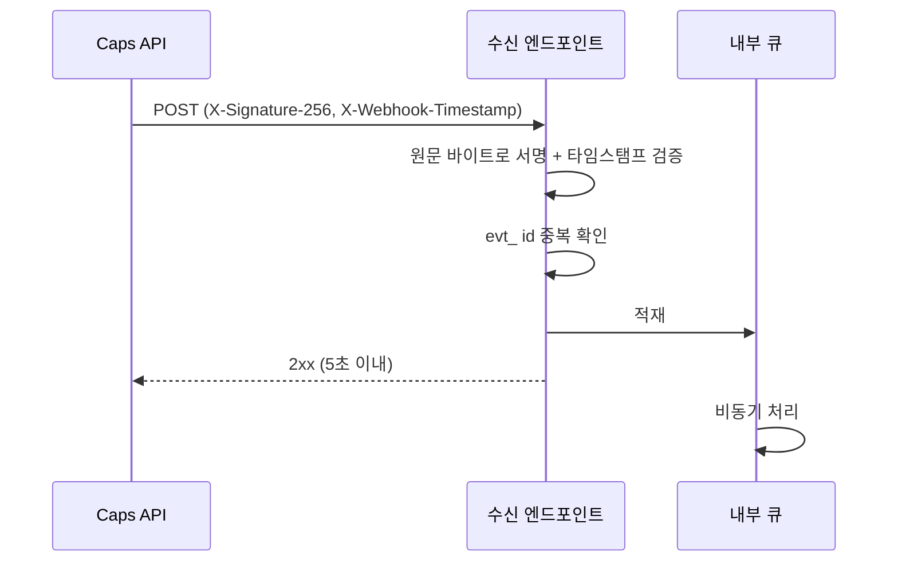

# 웹훅 이벤트 레퍼런스 (Webhooks)

> **English summary** — The API pushes signed JSON events to subscribed HTTPS endpoints. Every delivery is a single
> `POST` (5-second timeout, no retries) with the envelope `{id: "evt_…", event, timestamp, data}` and the headers
> `X-Webhook-Id`, `X-Webhook-Event`, `X-Webhook-Timestamp` and
> `X-Signature-256: sha256=HMAC_SHA256(secret, "{timestamp}.{body}")`. This page lists every event in
> `SUPPORTED_EVENTS` (`services/webhooks.py`), when it fires, and an example `data` payload taken from the emitting code
> (`caps.py`, `usage_events.py`, `spend_caps.py`, `model_access.py`, `surface_models.py`, `user_model_rules.py`,
> `quotas.py`, `governance_cycle.py`, `app.py`). All 13 events are emitted. Threshold, rate-limit, project-cap,
> model-lifecycle and readiness events are de-duplicated server-side; receivers should still de-duplicate on the
> envelope `id`.

---

## 목차

1. [구독 관리](#1-구독-관리)
2. [전송 형식 (Envelope·헤더)](#2-전송-형식-envelope헤더)
3. [서명 검증](#3-서명-검증)
4. [중복 제거(dedupe) 의미론](#4-중복-제거dedupe-의미론)
5. [이벤트 목록](#5-이벤트-목록)
6. [이벤트별 페이로드](#6-이벤트별-페이로드)
7. [수신 측 구현 권장사항](#7-수신-측-구현-권장사항)

---

## 1. 구독 관리

| 엔드포인트 | 스코프 | 설명 |
|---|---|---|
| `GET /v1/admin/webhooks` | `admin` | 구독 목록 (`id`, `name`, `url`, `events`, `enabled`, `created_at`, `created_by` — 시크릿 미포함) |
| `POST /v1/admin/webhooks` | `admin` | 생성. 본문 `{url, name?, events?, enabled?}`. `events` 생략 시 **모든 이벤트** 구독. 응답(201)에 `secret`(`whsec_…`)이 **한 번만** 포함 |
| `DELETE /v1/admin/webhooks/{webhook_id}` | `admin` | 삭제 (`wh_<12 hex>`) |

```bash
curl -s -X POST -H "Authorization: Bearer $ADMIN_KEY" -H "Content-Type: application/json" \
  -d '{"name":"portal","url":"https://portal.example.com/hooks/ai-caps","events":["cap.threshold_reached","cap.exceeded","user.blocked","user.unblocked"]}' \
  "$API/v1/admin/webhooks"
# → {"id":"wh_1a2b3c4d5e6f","name":"portal","url":"...","events":[...],"enabled":true,"created_at":"...","created_by":"key:...","secret":"whsec_..."}
```

- URL은 공개 HTTPS만 허용됩니다(사설·루프백·링크로컬 IP, `localhost`, `metadata.google.internal`, `*.local`,
  `*.internal` 거부, 전송 시 DNS 결과도 공인 IP인지 재검사). 상세: [security.md §6](security.md#6-웹훅-ssrf-방어와-서명).
- 최대 50개 구독. 지원하지 않는 이벤트 이름은 `400`. 생성/삭제는 감사 로그(`webhook.created`, `webhook.deleted`)에 기록.
- 시크릿 교체 API는 없습니다. 새 구독을 만들고 수신 측을 전환한 뒤 기존 구독을 삭제하세요.

## 2. 전송 형식 (Envelope·헤더)

```http
POST /hooks/ai-caps HTTP/1.1
Content-Type: application/json; charset=utf-8
User-Agent: GcpAiUsageCapsApi-Webhook/1.0
X-Webhook-Id: wh_1a2b3c4d5e6f
X-Webhook-Event: user.blocked
X-Webhook-Timestamp: 1795700458
X-Signature-256: sha256=5f0c...e91a

{"id":"evt_9f8e7d6c5b4a3921","event":"user.blocked","timestamp":"2026-11-26T11:40:58Z","data":{...}}
```

| 필드 | 설명 |
|---|---|
| `id` | 이벤트 ID `evt_<16 hex>`. 한 번의 디스패치에서 모든 구독에 **같은 ID·같은 본문**이 전달됨 |
| `event` | 이벤트 이름 (헤더 `X-Webhook-Event`와 동일) |
| `timestamp` | 생성 시각 (UTC, `YYYY-MM-DDTHH:MM:SSZ`) |
| `data` | 이벤트별 페이로드 (아래 §6) |

| 헤더 | 설명 |
|---|---|
| `X-Webhook-Id` | **구독** ID (`wh_…`) — 이벤트 ID가 아님 |
| `X-Webhook-Event` | 이벤트 이름 |
| `X-Webhook-Timestamp` | Unix 초. 서명 입력에 포함 |
| `X-Signature-256` | `sha256=` + `HMAC_SHA256(구독 시크릿, "{X-Webhook-Timestamp}.{원문 본문}")`의 hex |

본문은 `json.dumps(envelope, ensure_ascii=False, separators=(",", ":"))`로 직렬화된 UTF-8 바이트입니다.
전송은 구독마다 **한 번**(타임아웃 5초)이며, 2xx가 아니거나 오류가 나면 재시도하지 않고 서버 로그에
`webhook delivery failed id=<wh> event=<event> error=<type>`만 남깁니다. 비활성(`enabled=false`) 구독은 건너뜁니다.

## 3. 서명 검증

```python
import hashlib, hmac, json, time

def verify(secret: str, headers: dict, raw_body: bytes, tolerance: int = 300) -> dict:
    ts = headers["X-Webhook-Timestamp"]
    if abs(time.time() - int(ts)) > tolerance:
        raise ValueError("stale timestamp")
    expected = "sha256=" + hmac.new(secret.encode("utf-8"), ts.encode("ascii") + b"." + raw_body,
                                    hashlib.sha256).hexdigest()
    if not hmac.compare_digest(expected, headers["X-Signature-256"]):
        raise ValueError("bad signature")
    return json.loads(raw_body)
```

전체 예제와 흔한 실패 원인은 [operations-runbook.md §6](operations-runbook.md#6-웹훅-서명-검증)을 참고하세요.
반드시 **수신한 원문 바이트**로 검증해야 합니다.

## 4. 중복 제거(dedupe) 의미론

| 이벤트 | 서버 측 중복 제거 | 키 |
|---|---|---|
| `cap.threshold_reached`, `cap.exceeded` | 예 — `notify_threshold_once` | `(사용자 이메일 소문자, 기간 시작, 임계값 %)` — 같은 기간·같은 임계값은 한 번만. 실시간 경로와 5분 주기 경로가 같은 원장을 공유 |
| `rate_limit.threshold_reached` | 예 — `notify_once` | `rate_limit.threshold_reached\|<limit_id>\|<UTC 날짜>` — 한도별 하루 1회 |
| `project_cap.enforced` | 예 — `notify_once` | `project_cap.enforced\|<project_id>\|<UTC 날짜>` — 캡이 `ENFORCED`인 동안 프로젝트별 하루 1회 |
| `model.lifecycle_notice` | 예 — `notify_once` | `model.lifecycle_notice\|<model_id>\|<deprecation_date 또는 shutdown_date>\|<날짜 값>` — 모델·필드·날짜별 1회 (날짜가 바뀌면 다시 발송) |
| `readiness.degraded` | 예 — `notify_once` | `readiness.degraded\|<overall>\|<UTC 날짜>` — 상태(`blocked`/`ready_with_warnings`)별 하루 1회 (프로젝트 구분 없음) |
| 그 외 모든 이벤트 | 아니오 | 상태 변경이 일어날 때마다 1회 디스패치 |

- 원장은 상태 버킷 `webhooks.json`의 `notified` 맵이며, 5,000개를 넘으면 오래된 1,000개를 정리합니다. 정리된 키는
  다시 발송될 수 있습니다.
- 원장은 **디스패치 전에** 기록됩니다. 따라서 전송이 실패해도 같은 키로 다시 보내지 않습니다(at-most-once).
- 같은 이벤트가 여러 구독에 전달될 때 `id`는 동일합니다. 수신 측은 `id` 기준으로 중복 제거하세요.
- 임계값 목록은 캡 정책 `webhook_thresholds`(기본 `[80, 100]`)이며, 100 이상은 `cap.exceeded`, 미만은
  `cap.threshold_reached`로 보냅니다. 임계값 웹훅은 `manual` 모드에서도 발송되지만, 캡 규칙이 `type: "allow"`인
  사용자는 제외됩니다.

## 5. 이벤트 목록

| 이벤트 | 발생 시점 | 발신 코드 | 상태 |
|---|---|---|---|
| `cap.threshold_reached` | 사용자 사용률이 임계값(< 100%) 이상 | `caps.enforce_cycle`, `usage_events.handle_usage_event` → `webhooks.notify_threshold_once` | 발송 |
| `cap.exceeded` | 사용률이 100% 이상인 임계값 도달 | 위와 동일 | 발송 |
| `user.blocked` | 수동 차단, 자동 캡 정지, 모델 규칙 위반 차단 | `caps.block_user`, `caps.enforce_cycle`, `user_model_rules.apply_violations` | 발송 |
| `user.unblocked` | 수동 해제, 기간 리셋 자동 복구 | `caps.unblock_user`, `caps.enforce_cycle` | 발송 |
| `project_cap.enforced` | 프로젝트 지출 캡(Billing Budget `spendCap.outputState`)이 `ENFORCED`인 동안, 거버넌스 주기마다 확인 — 프로젝트별 하루 1회. `SPEND_CAPS_ENABLED=true`일 때만 | `governance_cycle.notify_enforced_project_caps` | 발송 |
| `project_cap.lifted` | `POST /v1/caps/projects/{project_id}/lift` 성공 | `spend_caps.lift_project_cap` | 발송 |
| `model.access_changed` | Vertex AI 모델 접근 정책 적용, Gemini Enterprise 앱 모델 변경(단건/일괄) | `model_access`(정책 적용), `surface_models.patch_app_models`, `surface_models.bulk_patch_app_models` | 발송 |
| `model.lifecycle_notice` | 카탈로그 모델의 `deprecation_date` 또는 `shutdown_date`가 90일 이내(이미 지난 날짜 포함) — 거버넌스 주기마다 확인, 모델·필드·날짜별 1회 | `governance_cycle.notify_model_lifecycle` | 발송 |
| `user.model_violation` | 사용자별 모델 규칙 위반 탐지(허용되지 않은 모델, 한도 초과) — `models.violation_notify`가 `true`일 때 | `user_model_rules.apply_violations` | 발송 |
| `rate_limit.threshold_reached` | 프로젝트 쿼터 사용률 ≥ `quotas.headroom_warn_pct`(기본 80%) — 거버넌스 주기(시간 단위) | `quotas` 임계값 점검 → `webhooks.notify_once` | 발송 |
| `quota_request.created` | 쿼터 변경 요청 제출 (드라이런 제외) | `quotas._submit` | 발송 |
| `quota_request.updated` | 요청 상태 변경(새로고침 시) 또는 취소 | `quotas.refresh_request`, `quotas.cancel_request` | 발송 |
| `readiness.degraded` | `GET /v1/admin/readiness`(캐시 미사용 실행) 또는 `POST /v1/admin/readiness/run` 결과의 `overall`이 `blocked`/`ready_with_warnings` — 상태별 하루 1회 | `app._notify_readiness` | 발송 |

> [!NOTE]
> `events`를 생략하고 구독하면 위 13개 이벤트를 모두 받습니다. `readiness.degraded`는 API로 readiness를 실행할 때만
> 평가되며(캐시 응답은 제외), 사전 점검 CLI(`scripts/preflight.sh`)나 스케줄러는 이 이벤트를 발생시키지 않습니다.

## 6. 이벤트별 페이로드

아래 예시는 `data` 필드만 보여 줍니다. 값은 예시이며, 필드 구성은 발신 코드에서 그대로 가져왔습니다.

### 6.1 `cap.threshold_reached` / `cap.exceeded`

```json
{
  "email": "alice@example.com",
  "period_start": "2026-11-01T00:00:00Z",
  "threshold_pct": 80,
  "utilization_pct": 83.4,
  "usage": {
    "requests": 412, "input_tokens": 1830000, "output_tokens": 220000, "cached_tokens": 50000,
    "total_tokens": 2050000, "estimated_cost": 41.7, "cost_partial": false, "currency": "USD",
    "last_active": "2026-11-26T11:38:02Z"
  },
  "limit": {"cost_cap": 50.0, "token_cap": null, "request_cap": null, "currency": "USD"}
}
```

- `period_start`는 캡 기간 시작(기간이 없으면 `"all"`). `utilization_pct`는 소수 둘째 자리 반올림.
- 실시간 경로(`usage_events`)에서 발송되면 `usage`는 `{"requests", "total_tokens", "estimated_cost"}`만 포함합니다.
- `limit`의 비어 있는 캡은 `null`.

### 6.2 `user.blocked`

발생 경로에 따라 필드가 다릅니다(`trigger`로 구분).

```json
{"email": "alice@example.com", "services": ["vertex_ai"], "reason": "policy breach drill",
 "until": "2026-11-27T00:00:00Z", "trigger": "manual", "actor": "key:1a2b3c4d5e6f"}
```

```json
{"email": "bob@example.com", "services": ["antigravity", "vertex_ai", "gemini_enterprise"],
 "trigger": "auto_cap", "until": "2026-12-01T00:00:00Z", "reasons": ["cost"]}
```

```json
{"email": "carol@example.com", "services": ["antigravity"], "until": "2026-11-27T00:00:00Z",
 "trigger": "model_policy", "reasons": ["model_not_allowed"]}
```

| `trigger` | 발생 | 추가 필드 |
|---|---|---|
| `manual` | `POST /v1/users/{email}/block` | `reason`, `until`(RFC 3339 또는 `null`), `actor` |
| `auto_cap` | 자동 모드 캡 초과 정지(집행 주기에서 IAM 적용 성공 시) | `until`(다음 기간 리셋), `reasons`(`over_cap_reasons`) |
| `model_policy` | 모델 규칙 위반 차단 | `until`, `reasons`(위반 유형 목록: `model_not_allowed`, `model_denied`, `limit_exceeded`) |

### 6.3 `user.unblocked`

```json
{"email": "alice@example.com", "unblocked_services": ["vertex_ai"], "remaining_services": [],
 "reason": "drill complete", "trigger": "manual", "actor": "key:1a2b3c4d5e6f"}
```

```json
{"email": "bob@example.com", "trigger": "auto_reset"}
```

- `manual`: `services`를 지정하지 않으면 `unblocked_services`는 모든 서비스(`antigravity`, `vertex_ai`,
  `gemini_enterprise`). `remaining_services`가 비어 있지 않으면 일부 서비스는 계속 차단 중입니다.
- `auto_reset`: 기간 리셋으로 자동 복구(집행 주기에서 IAM 적용 성공 시).

### 6.4 `project_cap.lifted`

```json
{"project_id": "team-a", "budget": "billingAccounts/012345-6789AB-CDEF01/budgets/abcd1234", "actor": "key:1a2b3c4d5e6f"}
```

지출 캡 해제 요청 후 Google Cloud가 트래픽을 재개하기까지 최대 약 1시간이 걸릴 수 있습니다.

### 6.5 `model.access_changed`

Vertex AI 조직 정책(`constraints/vertexai.allowedModels`) 적용:

```json
{"surface": "vertex_ai", "scope": "projects/team-a", "mode": "allow_list",
 "models": ["gemini-2.5-*"], "expanded_models": ["publishers/google/models/gemini-2.5-pro", "publishers/google/models/gemini-2.5-flash"],
 "operation_id": "op_0123456789abcdef", "actor": "key:1a2b3c4d5e6f"}
```

- `mode`: `allow_list`, `deny_list`, `unrestricted`, `deny_all`, `inherit` 중 하나.
- `operation_id`로 `GET /v1/operations/{operation_id}`에서 반영 확인(조직 정책 반영은 보통 수 분, 최대 ~15분).

Gemini Enterprise 앱 모델 변경(단건 `PATCH /v1/gemini-enterprise/apps/{app_id}/models`):

```json
{"surface": "gemini_enterprise", "target": "team-a/global/my-engine", "changes": {"gemini-2.5-pro": "on", "gemini-2.0-flash": "off"},
 "actor": "key:1a2b3c4d5e6f"}
```

일괄(`POST /v1/gemini-enterprise/apps/bulk-models`):

```json
{"surface": "gemini_enterprise", "target": "bulk", "changes": {"gemini-2.5-pro": "on"}, "apps": 7, "actor": "key:1a2b3c4d5e6f"}
```

`changes` 값은 `on` / `off` / `default`. 실제 변경이 있을 때만(드라이런·무변경 제외) 발송됩니다.

### 6.6 `user.model_violation`

```json
{
  "object": "model_violation",
  "id": "mv_0123456789abcdef",
  "email": "carol@example.com",
  "type": "limit_exceeded",
  "model": null,
  "surface": "antigravity",
  "metric": "daily_tokens",
  "limit": 500000,
  "observed": 612345,
  "rule_source": "user+default",
  "action": "block_service",
  "action_note": null,
  "trigger": "scheduler",
  "detected_at": "2026-11-26T11:40:58Z",
  "window_id": "2026-11-26",
  "block_services": ["antigravity"],
  "block_until": "2026-11-27T00:00:00Z",
  "enforcement_applied": true
}
```

| 필드 | 값 |
|---|---|
| `type` | `model_not_allowed`, `model_denied`, `limit_exceeded` |
| `metric` | `limit_exceeded`일 때 `rpm`, `tpm`, `daily_requests`, `daily_tokens`, `monthly_requests`, `monthly_tokens`, `monthly_cost` |
| `rule_source` | `user`, `user+default`, `default` |
| `action` | `block_service`, `notify`, `deferred`(변경 예산 G4 도달) — `already_blocked`인 위반은 발송하지 않음 |
| `action_note` | `notify`로 바뀐 사유(`enforcement_backend=notify_only`, `protected principal / allow override`) 등 |
| `trigger` | `scheduler`(거버넌스 주기), `api`(`POST /v1/model-rules/evaluate`), `usage_event`(실시간) |
| `block_services`, `block_until` | `action=block_service`일 때만 |
| `enforcement_applied` | `block_service`일 때 IAM 적용 성공 여부, 그 외 `false` |

### 6.7 `rate_limit.threshold_reached`

`data`는 rate-limit 행 전체입니다(`GET /v1/projects/{id}/rate-limits`의 항목과 동일).

```json
{
  "object": "rate_limit",
  "id": "rl_…",
  "project_id": "team-a",
  "service": "aiplatform.googleapis.com",
  "quota_id": "GenerateContentRequestsPerMinutePerProjectPerBaseModel",
  "metric": "aiplatform.googleapis.com/generate_content_requests_per_minute_per_project_per_base_model",
  "metric_kind": "per_minute",
  "display_name": "Generate content requests per minute per project per base model",
  "unit": "1/min/{project}/{base_model}",
  "refresh_interval": "minute",
  "model": "gemini-2.5-pro",
  "location": "global",
  "dimensions": {"base_model": "gemini-2.5-pro"},
  "is_default": false,
  "limit": 600,
  "usage_peak": 540,
  "usage_window_hours": 24,
  "utilization_pct": 90.0,
  "headroom_pct": 10.0,
  "increase_eligible": true,
  "ineligibility_reason": null,
  "is_fixed": false,
  "preference": null
}
```

`id`, `quota_id`, `metric`, `unit` 등 구체적인 값은 Cloud Quotas `QuotaInfo`에서 옵니다(위 값은 예시).
`preference`가 있으면 `{name, preferred_value, granted_value, reconciling, state_detail, update_time}`.

### 6.8 `quota_request.created` / `quota_request.updated`

`data`는 쿼터 요청 레코드에서 `idempotency_key`만 뺀 값입니다.

```json
{
  "object": "quota_request",
  "id": "qr_0123456789abcdef",
  "project_id": "team-a",
  "service": "aiplatform.googleapis.com",
  "quota_id": "GenerateContentRequestsPerMinutePerProjectPerBaseModel",
  "limit_id": "rl_…",
  "dimensions": {"base_model": "gemini-2.5-pro"},
  "model": "gemini-2.5-pro",
  "location": "global",
  "metric_kind": "per_minute",
  "kind": "increase",
  "previous_value": 600,
  "requested_value": 1200,
  "justification": "Q4 launch",
  "contact_email": "cloud-admin@example.com",
  "preference_name": "projects/team-a/locations/global/quotaPreferences/…",
  "created_at": "2026-11-26T11:40:58Z",
  "updated_at": "2026-11-26T11:40:58Z",
  "created_by": "key:1a2b3c4d5e6f",
  "history": [{"at": "2026-11-26T11:40:58Z", "status": "pending", "granted_value": null}],
  "status": "pending",
  "granted_value": null,
  "status_detail": null,
  "operation_id": "op_0123456789abcdef"
}
```

| 필드 | 값 |
|---|---|
| `kind` | `increase` / `decrease` |
| `status` | `pending`, `approved`, `partially_approved`, `denied`, `applied`, `cancelled`, `failed` (종료 상태: `approved`, `denied`, `applied`, `cancelled`, `failed`) |
| `history` | 상태 변화 이력 (`updated`마다 항목 추가) |

`quota_request.updated`는 (1) `GET /v1/quota-requests/{id}`, `GET /v1/quota-requests?refresh=true`, 거버넌스 주기의
대기 요청 갱신에서 상태나 승인 값이 바뀌었을 때, (2) `POST /v1/quota-requests/{id}/cancel` 성공 시 발송됩니다.

### 6.9 `readiness.degraded`

```json
{
  "overall": "blocked",
  "summary": {"pass": 182, "warn": 9, "fail": 2, "skip": 4, "info": 31, "total": 228, "blocking": 1, "blocking_unfixable": 1},
  "generated_at": "2026-11-26T11:40:58Z"
}
```

- `overall`: `blocked` 또는 `ready_with_warnings` (`ready`이면 발송하지 않음).
- `?project=P`로 필터한 요청이나 일부 카테고리만 실행한 `POST /v1/admin/readiness/run`도 그 결과 기준으로 평가됩니다.
- 상세는 보고서 자체(`GET /v1/admin/readiness`)와 [preflight-checklist.md](preflight-checklist.md)를 참고하세요.

### 6.10 `project_cap.enforced`

```json
{"project_id": "team-a", "budget": "billingAccounts/012345-6789AB-CDEF01/budgets/abcd1234", "amount": 500.0, "currency": "USD"}
```

- Billing Budgets API의 `spendCap.outputState == "ENFORCED"`인 제품 소유 예산(프로젝트 하나로 필터된 예산)에 대해 발송.
- `amount`/`currency`는 예산 금액. 캡 해제는 `POST /v1/caps/projects/{project_id}/lift`(→ `project_cap.lifted`).

### 6.11 `model.lifecycle_notice`

```json
{"model": "gemini-2.0-flash-001", "publisher": "google", "event": "shutdown_date", "date": "2027-02-01",
 "days_remaining": 67, "replacement": "gemini-2.5-flash"}
```

| 필드 | 값 |
|---|---|
| `event` | `deprecation_date` 또는 `shutdown_date` |
| `date` | 카탈로그에 기록된 날짜 문자열 (Model Garden 탐지 또는 `models.lifecycle_overrides`) |
| `days_remaining` | 오늘(UTC) 기준 남은 일수. 이미 지난 날짜면 음수 |
| `replacement` | 대체 모델(없으면 `null`) |

같은 모델이라도 `deprecation_date`와 `shutdown_date`는 각각 한 번씩 발송되고, 날짜가 바뀌면 다시 발송됩니다.

## 7. 수신 측 구현 권장사항



1. **5초 안에 2xx** 응답하고 처리는 비동기로 넘기세요(재시도가 없음).
2. 서명은 원문 바이트로, 타임스탬프 허용 오차(예: 5분)를 두고 검증하세요.
3. `id`(`evt_…`)로 중복 제거하세요. 같은 이벤트를 여러 구독으로 받으면 같은 `id`입니다.
4. 이벤트를 놓쳤을 때를 대비해 주기적으로 상태 API(`GET /v1/caps/users`, `GET /v1/quota-requests`,
   `GET /v1/model-violations`, `GET /v1/audit-logs`)로 보정하세요.
5. 허브가 VPC egress(all-traffic)를 쓰면 외부 웹훅 전송에 Cloud NAT가 필요합니다(readiness `network.nat`).

관련 문서: [security.md](security.md) · [operations-runbook.md](operations-runbook.md) ·
[enforcement-logic.md](enforcement-logic.md) · [model-governance.md](model-governance.md)
